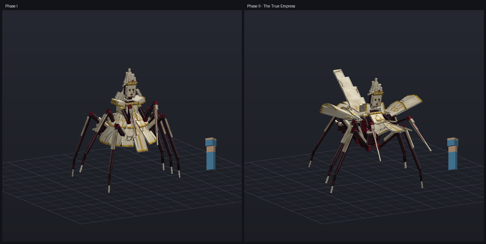
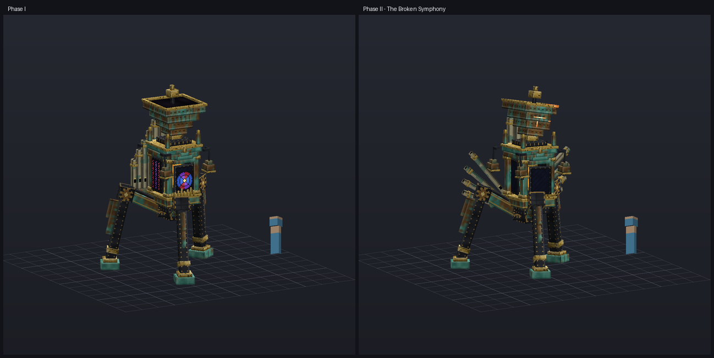
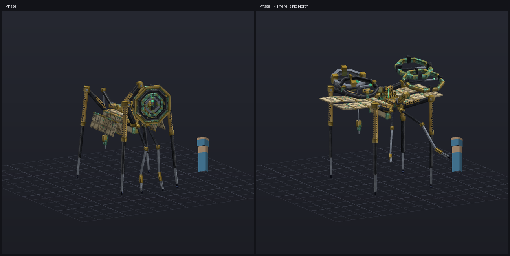
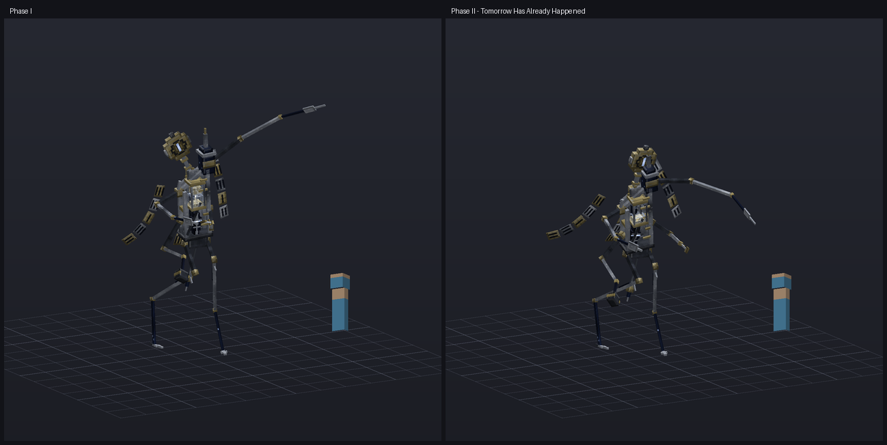

# The Abandoned Miracles

*Four perfect miracles. Four catastrophic successes.*

An original dark-fantasy boss add-on for **Minecraft: Bedrock Edition**. An ancient civilization pursued four kinds of
perfection — the immortal body, the harmony of all voices, the map of existence, the knowledge of the future — and
each experiment succeeded in the most literal and catastrophic way. The civilization is gone. The results are still here.

| | | |
|---|---|---|
| 001 | **Vesperra, The Ivory Succession** | An empress who was asked never to end, trapped in layer upon layer of her own former bodies. Break her porcelain armour piece by piece. |
| 002 | **Cantor XIII, The Walking Requiem** | A cathedral-sized instrument that learned to sing and now erases every voice but its own. A fight of rhythm and expanding waves. |
| 003 | **Nomos, The Unmapped Sovereign** | A living map that decided reality was the error. It redraws the battlefield around you. |
| 004 | **Orison, The Witness of Tomorrow** | A machine built to foresee death, which now punishes what you have not yet done — and what you did four seconds ago. |

Each boss has its own model, rig, textures, animation set, two combat phases, seven attacks, arena, sounds, particles,
introduction, death sequence and trophy.

| Vesperra | Cantor XIII |
|---|---|
|  |  |
| **Nomos** | **Orison** |
|  |  |

> Images in this repository are rendered from the shipped models and animations by the project's own preview
> renderer. They are **not** screenshots of the game. See [TEST_REPORT.md](TEST_REPORT.md) for exactly what has and has
> not been verified — in particular, the add-on has **not yet been run inside Minecraft**.

---

## Download and install

| File | What it is |
|---|---|
| [`dist/The_Abandoned_Miracles.mcaddon`](dist/The_Abandoned_Miracles.mcaddon) | the add-on (behaviour pack + resource pack) |
| [`dist/The_Abandoned_Miracles_Test_World.mcworld`](dist/The_Abandoned_Miracles_Test_World.mcworld) | optional flat world with the add-on applied and all four arenas |
| `dist/The_Abandoned_Miracles_BP.mcpack`, `…_RP.mcpack` | the two packs separately |

**Requirements**

* Minecraft: Bedrock Edition **1.26.10 or newer** (iOS, Android, Windows; other Bedrock platforms should work too).
  Built and checked against 1.26.60. Older versions cannot load it: the script needs an API that 1.26.10 introduced.
* No experimental toggles. No Beta APIs. The add-on uses the stable Script API only
  (it asks for `@minecraft/server` 2.6.0 and `@minecraft/server-ui` 2.0.0, the lowest versions that have everything
  it uses; newer games provide them) — there is nothing else to install.

**Steps**

1. Open `The_Abandoned_Miracles.mcaddon` on a device with Minecraft installed. The game imports both packs.
2. Create or edit a world and activate the behaviour pack **The Abandoned Miracles** (the resource pack follows).
3. To use the `/abm:` commands, turn on cheats; the Seals and the Codex work without them.

The add-on is safe to add to an existing world: it adds entities and items, never generates anything, never spawns a
boss on its own, and never changes a block during a fight.

Or simply open `The_Abandoned_Miracles_Test_World.mcworld`. It is a Survival world (you keep your inventory when you
die). During its first few seconds it raises a central plaza and the four arenas, then hands you the Codex, the four
Seals and the reference kit — enchanted diamond armour and sword, a shield and food. Follow a causeway, walk to the
middle of an arena and use its Seal on the floor.

---

## Fighting a Miracle

### Summoning

Use a **Seal** on the floor where the fight should happen.

| Seal | Wakes | Needs (level, open ground) |
|---|---|---|
| Seal of the Ivory Succession | Vesperra | a circle 35 blocks across, 9 high |
| Seal of the Last Note | Cantor XIII | a circle 39 blocks across, 11 high |
| Seal of the Unmapped Sovereign | Nomos | a square 41 blocks across, 9 high |
| Seal of the Unlived Hour | Orison | a circle 37 blocks across, 10 high |

* The spot is checked first. If the ground is too uneven, too cramped, too low or not fully loaded, nothing happens, the
  Seal is kept, and you are told what is missing. Nothing is ever dug out or flattened for you.
* Seals are in the Creative inventory and craftable in survival (3 × 3 crafting table, see below).
* Other ways: `/abm:wake <vesperra|cantor|nomos|orison>` (operators, skips the ground check),
  `/scriptevent abm:summon <boss>` from a command block or NPC, or plain `/summon abm:vesperra`
  (`abm:cantor_xiii`, `abm:nomos`, `abm:orison`).
* Want the full setting? Operators can raise a boss's **demonstration arena** from the Codex or with
  `/abm:arena <boss>`. This *replaces blocks* around you and asks for confirmation first.

**Recipes** (corners / edges / centre)

| Result | Corners | Edges | Centre |
|---|---|---|---|
| Seal of the Ivory Succession | block of quartz | bone block | fermented spider eye |
| Seal of the Last Note | block of copper | gold ingot | bell |
| Seal of the Unmapped Sovereign | paper | compass | empty map |
| Seal of the Unlived Hour | glass | clock | soul sand |
| Codex of the Abandoned Miracles | – | bone | book |

### Reading the fight

* Every attack is drawn on the floor before it lands. **Solid, pulsing marks that fill up are danger. Pale, hollow
  lozenges mean "stand here".** The two differ in shape and motion, not only in colour.
* The name of the attack being prepared is shown on the action bar, next to the phase and health; the boss bar at the
  top is the game's own.
* Everything can be read with the sound off, and nothing needs frame-perfect timing: each attack can be avoided at
  walking speed.
* At a health threshold each boss transforms. It cannot be skipped and the boss cannot be hurt while it happens.
  Phase II uses the same seven attacks, recombined.
* Leave the arena and the Miracle waits; stay away for twenty seconds and it folds back into its Seal, which is left at
  the centre for you.
* Hitting a boss from outside its arena does nothing.

### Equipment and difficulty

Balanced around one player in enchanted diamond; expect several minutes per fight. Armour, Protection and Resistance
all reduce boss damage, by a gentler curve than vanilla so that the attacks matter in good gear without being
instantly lethal in bad gear (details in [DESIGN_SPEC.md](DESIGN_SPEC.md) §3.5).

Up to four players are scaled for: each extra player adds 45 % health. Difficulty (Story / Normal / Hard), reduced
decorative particles, the action-bar line and a fallback movement mode are in the **Codex** (operators) — craft it from
a book and four bones, or take it from the Creative inventory.

### Rewards

Each Miracle leaves a unique trophy — one per player who fought, up to four — plus materials and experience:
the **Ivory Diadem of Succession**, the **Fragment of the Thirteenth Bell**, the **Needle of the Unmapped Sovereign**
and the **Hourglass of the Unlived Future**.

### If something goes wrong

The first time the add-on's script hits an internal problem it says so once in chat, in grey:
`[The Abandoned Miracles] internal problem in …`. That line (a screenshot is enough) is exactly what is needed to fix it.
An encounter that keeps failing folds itself away and returns its Seal rather than leaving a broken boss behind.
If a boss slides or will not turn, the add-on switches that boss to stepwise movement by itself.

### Commands (operators, cheats on)

```
/abm:wake <boss>               summon at your feet
/abm:arena <boss>              raise that boss's demonstration arena around you (replaces blocks)
/abm:dismiss                   end the nearest encounter
/abm:debug on|off              verbose logging
/abm:debug phase2|kill         force the transformation / the death sequence
/abm:debug attack <1-7>        make the boss use that attack next
/abm:debug info                state, health, scale, attack usage
/scriptevent abm:kit           hand yourself the reference kit (also a button in the Codex)
```

---

## Documentation

* [DESIGN_SPEC.md](DESIGN_SPEC.md) — encounter rules, technical approach, tuning; boss chapters in [`docs/bosses/`](docs/bosses).
* [TEST_REPORT.md](TEST_REPORT.md) — validation results, simulation results, known issues, verification status.
* [PROGRESS.md](PROGRESS.md) — what is finished, incomplete, blocked and tested.
* [`docs/previews/`](docs/previews) — model turnarounds, pose sheets, animation previews, arena layouts.

## Building from source

Requires Node.js 20+, Python 3.10+ with Pillow and NumPy, and `ffmpeg` with libvorbis.

```
npm install                 # TypeScript, esbuild, Script API typings, vanilla data
npm run build               # packs/, dist/*.mcaddon, dist/*.mcworld, assets/blockbench/*.bbmodel
npm run typecheck
python3 tools/validate.py --mct   # static validation + Mojang's Creator Tools validator
npm run sim                 # headless encounter simulation
npm run previews            # docs/previews/
npm run report              # regenerate TEST_REPORT.md from the last results
```

Everything in the packs is generated: models, textures, animations, particles, sounds and arenas come from the Python
sources in `tools/`, gameplay from the TypeScript in `src/`.

```
src/            gameplay scripts (TypeScript): core framework + one module per boss
shared/         beat timings shared by scripts and animations
tools/kit/      asset toolkit (geometry, painting, renderer, Molang, animation, particles, audio, NBT)
tools/bosses/   one asset module per boss
tools/sim/      headless simulation and its scenarios
packs/          the generated behaviour and resource packs (committed for inspection)
assets/blockbench/   editable .bbmodel for every model
dist/           importable .mcaddon / .mcpack / .mcworld
docs/           boss chapters and previews
```

## Credits and licence

All models, textures, animations, particles, sounds, structures and code in this add-on were made for this project;
no third-party assets are included. Every sound is synthesised. Not an official Minecraft product; not approved by or
associated with Mojang or Microsoft.
