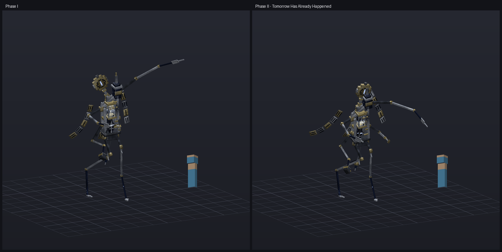

# Boss 004 — Orison, The Witness of Tomorrow

*The Clock That Mourns the Future.* Entity `abm:orison` · seal `abm:seal_orison` · trophy `abm:unlived_hourglass`
(*Hourglass of the Unlived Future*) · arena *The Court of Unlived Hours* (`abm:court_of_unlived_hours`).

Sources: model `tools/bosses/orison/model.py`, animation `anims.py`, particles and sound `fx.py`, arena `arena.py`,
combat `src/bosses/orison/` (`index.ts`, `history.ts`, `patterns.ts`, `tuning.ts`), beat timings
`shared/orison.timings.json`, boss-specific tests `tools/sim/specific/orison.mjs`.

## Design

A tall, leaning judge built out of a clock. The torso is an elongated case that tilts off its own axis; in its chest
hangs an hourglass behind glass, and behind the hourglass a small coffin is suspended inside the case. Four arms end
in a minute hand, an hour hand, a winding key and a gavel. The legs are far too thin and far too long for the body.
Where a head should be, a pendulum stands upside down: a rod rising from the shoulders with a geared bob and a single
pale eye that swings above the body instead of below it. A plumb weight hangs under the case, three metal ribbons
trail from the back, and the back plate is a clock face.

| | |
|---|---|
| Height | about 8 blocks to the top of the bob at rest; collision box 1.8 × 6.4 |
| Geometry | 51 bones, 132 cubes, per-face UV, one 256×128 texture; three render layers: opaque, emissive (`*_glow`: sand, coffin seam, pendulum eye), alpha-blended (`*_glass`: hourglass bulbs) |
| Rig | root → body → torso → escapement, hourglass (glass / broken glass / two sand volumes / glow), coffin, pendulum, 4 × 3-segment arms, 3 ribbons of 4–5 segments; plumb; 2 legs × (hip, 4 segments) |
| Helpers | `abm:orison_shadow` (own geometry: a flat cut-out rising from a pool with a pale ring and two jointed arms, 8 bones) · `abm:orison_hourglass` (6 bones) |
| Phase II look | the intact chest glass is hidden and a broken one shown (`abm:glass` property); the upper bulb is empty, its glow is out and the spilled sand lies low in the case; the body hunches, the coffin hangs askew, the hands spread low and wide and the ribbons flutter |

### Locomotion

Two legs, distance-driven: the walk phase comes from `q.modified_distance_moved` and the turn phase from
`q.body_y_rotation`, so feet stay planted at any speed and while turning on the spot. The stride is a stalking,
high-kneed step with the torso, pendulum, plumb, coffin and ribbons following with phase lags. In Phase I the
controller adds the clockwork rhythm itself: it walks for 12 ticks and holds for 8, like a second hand. In Phase II
the shadow walks first and the body follows the shadow's path 10 ticks later (see below).

## Signature system — the position history

Everything "temporal" in this fight is built from one small data structure, `PositionHistory` (`history.ts`):

| | |
|---|---|
| What is stored | X and Z of each participant, nothing else (no names, inventories, look direction, health) |
| Sampling | one sample every 4 ticks (`INTERVAL`) |
| Capacity | 64 samples per player (`CAPACITY`, a ring buffer: 12.8 s), at most 8 players (`MAX_PLAYERS`) — a hard ceiling of 512 samples |
| Used window | Footstep Echo reads the newest 25 samples (5 s) in Phase I and 50 (10 s) in Phase II; Tomorrow's Witness reads 5; Deferred Wound reads 10 |
| Forgetting | a player who leaves the world is dropped immediately (`playerLeave`), one who has not been a participant for 60 ticks is pruned, and the whole history is cleared when the encounter ends, resets or is abandoned |
| Persistence | not saved; after a world reload it starts empty |

No entity is rewound, no world state is restored and time is never manipulated: echoes are strikes placed on stored
coordinates, predictions are a linear extrapolation that is computed once and then left alone, and the ultimate is a
list of three patterns chosen once and replayed.

## AI

State machine `INTRO → PHASE_1 → PHASE_TRANSITION → PHASE_2 → DEATH` (framework), with the usual sub-states
(idle, reposition, telegraph, attack, recovery, stagger, reset). Target selection is the framework's focus target
(one participant at a time, re-evaluated with hysteresis).

- **Range.** Orison is a mid-range boss. It keeps about 8 blocks (Phase II 6.5) and only walks when the target is
  farther than 9.5 (Phase II 7.5). It never chases into melee; the Secondhand Exchange is its gap closer.
- **Selection.** Weighted random among attacks that are off cooldown; the weights are tactical (listed per attack):
  a target that has been running is answered with echoes and predictions, a distant one with the exchange or
  hourglasses, a close one with the pendulum. The ultimate is preferred as soon as it is available below 92 % health.
- **Fairness rule.** An hourglass pulse is never announced while Pendulum Verdict or The Hour That Never Occurred is
  running, and neither of those may start while a pulse is announced. This was added after a simulated seed found a
  pulse and a verdict landing 9 ticks apart with no walkable answer.
- **Stagger.** Breaking an hourglass staggers Orison for 36 ticks (the length of its stagger animation), except
  during the ultimate.

## The seven attacks

Times are in ticks at 20/s, from the start of the attack. "Warn" is the time between the floor telegraph appearing
and the hit. All damage is design damage before difficulty and the player-mitigation model. Telegraphs are drawn on
the floor with Orison's own particles (hollow lozenges that fill as the strike approaches, plus a countdown in Roman
numerals where noted), so no attack depends on colour alone. Every attack is cancelled cleanly (all pending strikes
removed, temporary shadow markers despawned) by a stagger, the phase change, a reset or death, except where noted.

### 01 — Footstep Echo
| | |
|---|---|
| Eligibility / weight | always; 3.0 when the target has covered more than 6 blocks inside the history window, else 1.3 |
| Target | focus target |
| Cooldown | 170 (Phase II 140) |
| Telegraph | at tick 14 Orison reads the trail: up to 5 footprints are marked, newest first — the target's position at that moment, then stored positions at least 2 blocks apart going back up to 5 s |
| Active | the footprints detonate oldest first at ticks 46, 52, 58, 64, 70 (warn 32–56), so the echoes walk the trail towards its owner; the last one is where the target stood at tick 14 |
| Hazard | circles of radius 1.6 around each footprint; 12 damage, small pop-up |
| Recovery | 28 |
| Counterplay | do not retrace your steps and do not stop: keep moving somewhere new; a player who stood still has only one footprint to avoid |
| Phase II | window 10 s, up to 8 footprints, radius 1.8, mark at 12, detonations at 42–77 every 5 ticks; the shadow gestures first |
| Interruptible | yes; a stagger removes every pending echo |

### 02 — Pendulum Verdict
| | |
|---|---|
| Eligibility / weight | 3.0 when the target is within 12 blocks, else 0.6; 0 while an hourglass pulse is announced |
| Target | focus target; Orison faces it at the start and does not turn afterwards |
| Cooldown | 150 (Phase II 120) |
| Telegraph | the whole arc is drawn from tick 2 (warn 34): a 140° ring section in front of it, 2.2–11 blocks; the head swings back to the side the sweep will start from (left or right, chosen at random and shown by the animation) |
| Active | ticks 36–50: the pendulum head sweeps through the arc as an 18°-wide blade; each player can be hit once per swing |
| Damage | 16, knockback; shield-blockable |
| Recovery | 30 |
| Counterplay | step inside 2.2 blocks (under the swing), outside 11, or anywhere behind it |
| Phase II | arc 200°, announced at tick 1 (warn 29), first sweep at 30–44, then a return swing in the opposite direction at 66–80 through the outer band, 5.5–14 blocks (announced at tick 32, warn 34): the inner pocket that was safe from nothing becomes the safe place for the return |
| Interruptible | yes |

### 03 — Deferred Wound
| | |
|---|---|
| Eligibility / weight | always; 2.0, plus 0.6 per additional player (at most +1.5) |
| Target | every participant in turn (mark *k* goes to participant *k* mod *n*) |
| Cooldown | 200 (Phase II 170) |
| Telegraph | 4 marks set at ticks 12, 20, 28, 36 on where a participant stands at that moment; each shows its circle and counts III, II, I |
| Active | each mark detonates 40 ticks after it was set (52, 60, 68, 76) |
| Hazard | circle of radius 2.2; 13 damage, small pop-up |
| Recovery | 24 |
| Counterplay | walk on after each mark and remember where the earlier ones are; never circle back through a live mark |
| Phase II | 6 marks (10–45, every 7), fuse 36; every second mark is set where that participant stood about 2 s earlier; every mark opens a second time 28 ticks after its first detonation, telegraphed again |
| Interruptible | yes; all live marks are removed |

### 04 — Hourglass Drain
| | |
|---|---|
| Eligibility / weight | 0 while any hourglass stands; otherwise 2.4 when the target is farther than 9 blocks, else 1.7 |
| Target | participants in turn |
| Cooldown | 420 (Phase II 360) |
| Telegraph | cast animation, 22 ticks |
| Effect | 2 hourglasses (`abm:orison_hourglass`, 16 health) are set down 2.2–3 blocks from players, never on top of one, at least 2.5 blocks from Orison and 3 from each other; they last 240 ticks |
| Reach | each has a marked circle of radius 4.0, armed 30 ticks after it appears. Players inside an armed circle receive Slowness II in 30-tick doses re-applied every 10 ticks, so it ends within 1.5 s of stepping out — it is never stored or stacked |
| Pulse | every 70 ticks an hourglass announces a pulse over its circle (warn 40): 8 damage. No pulse is announced if the hourglass would expire first |
| Recovery | 26 |
| Counterplay | leave the circles, or break an hourglass (16 health, two or three sword hits): that cancels its pulses and staggers Orison for 36 ticks |
| Phase II | 3 hourglasses, cast at 18, lifetime 300 |
| Interruptible | yes before the cast. Hourglasses already placed are independent of the attack and remain until broken, expired, the phase change, a reset or death (the framework removes all helpers at each of those) |

### 05 — Tomorrow's Witness
| | |
|---|---|
| Eligibility / weight | always; 3.0 when the target is moving (estimated speed above 0.08 blocks/tick), else 1.4 |
| Target | focus target |
| Cooldown | 190 (Phase II 150) |
| Telegraph | at tick 14 the prediction is **locked**: target position + (displacement over the last 20 ticks ÷ 20) × 30, clamped to the arena. A shadow appears on that spot and points, a line joins it to Orison, the circle is drawn |
| Active | tick 44 (warn 30): the shadow strikes its circle, radius 3.0; 15 damage, knockback |
| Recovery | 30 |
| Counterplay | change direction after the lock. The prediction is computed once and never updated; a player who simply keeps walking arrives exactly on it. A player standing still is predicted to stay and must step out |
| Phase II | lock at 12, strike at 40, radius 2.6, and a second locked circle for the obvious answer: 60 % of the predicted distance in the opposite direction (for a stationary target, 3.4 blocks towards the arena centre). Doubling back walks into it; a sidestep beats both. The real shadow goes to stand on the first spot |
| Interruptible | yes; the temporary shadow is removed |

### 06 — Secondhand Exchange
| | |
|---|---|
| Eligibility / weight | always; 3.2 when the target is farther than 10 blocks, 1.6 beyond 6, else 0.9 |
| Target | focus target |
| Cooldown | 260 (Phase II 220) |
| Destination | chosen at tick 8 and fixed: 3.5 blocks from the target, tried behind it first, then its flanks, then random arena points. A candidate must be inside the leash, at least 6 blocks from Orison, on a solid floor with free space at foot and head height in loaded blocks. If nothing qualifies Orison does not move and the arrival burst happens where it stands |
| Telegraph | from tick 8 (warn 50): a shadow stands on the arrival point; the arrival circle (radius 4.5) and the departure circle (radius 3.0) are both drawn, joined by a line |
| Active | tick 44: Orison collapses to a line and is teleported to the marked point (validated again at that moment); the shadow takes the place it left. Tick 58: both circles burst — arrival 15 damage with knockback, departure 8 |
| Recovery | 32 |
| Counterplay | both ends are known 2.5 s ahead: leave the arrival circle, do not hide in the place it is leaving; Orison is open while it recovers at the new spot |
| Phase II | marks at 6, swap 36, burst 50, then a second exchange: mark 54, swap 84, burst 98 (warn 44 each) |
| Interruptible | yes; if cancelled before the swap there is no teleport |

### 07 — The Hour That Never Occurred (ultimate)
| | |
|---|---|
| Eligibility / weight | below 92 % health and no hourglass pulse announced; weight 5 |
| Cooldown | 780 (Phase II 720) |
| Patterns | three patterns over the whole arena, chosen once at the start and stored: **rings** (alternate 4-block bands), **wedges** (alternate sectors, 8 of 45° matching the floor inlay) or **checker** (bands × wedges). Phase I: A, B, then A with the safe and dangerous cells exchanged. Each covers about half the floor |
| Preview | I at tick 20, II at 50, III at 80 — each shown alone for 26 ticks with its numeral, no damage |
| Execution | tick 134, 174, 214: the same three shapes in the same order (the code reads the same stored array for both). Each is flashed again 10 ticks before it lands, and its numeral rises 30 ticks before |
| Damage | 18 per pattern, small pop-up |
| Recovery | 34 |
| Counterplay | watch the preview, remember the order, stand in a safe cell of I that is next to a safe cell of II; the third is the first inverted, so the cell that saved you first will hurt you last |
| Phase II | checker, then rings or wedges, then the checker inverted; 12 wedges of 30° (these do not line up with the floor's 45° spokes); previews of 20 ticks at 18, 42, 66; executions at 112, 146, 180 with **no** reminder flash, only the numeral |
| Interruptible | no (staggers are refused). Phase change, reset and death still cancel it |

## Phase II — Tomorrow Has Already Happened (35 %)

Health stops at the threshold; Orison is invulnerable for the 136-tick transition. The chest glass cracks (26) and
shatters (60: sand, shards, a harmless push for anyone within 5 blocks), and at tick 100 the shadow steps out of it.
All hourglasses and pending hazards are removed when the transition begins.

- **The shadow** is a real, persistent helper entity (exactly one; replaced if lost). While Orison is idle the shadow
  steers towards the target and Orison follows the positions the shadow passed through 10 ticks earlier. At the start
  of every attack the shadow makes the attack's gesture before the body does. It performs Tomorrow's Witness and marks
  the Secondhand Exchange in person; while it is on such an errand the body walks on its own.
- Faster and closer: speed 0.15 (from 0.11), turn 7°/tick (from 5), preferred range 6.5.
- Every attack has the variation listed in its table: longer history, more echoes, the return swing, re-opening
  wounds, a third hourglass, the double-back prediction, the second exchange, the unprompted hour.
- The idle gap between attacks is 20 % shorter (framework).

## Intro and death

Intro (116 ticks, invulnerable): the stopped mechanism wakes (30) and the pendulum takes its first swing (70).

Death (184 ticks): the shadow is removed first, at the moment the sequence begins, leaving only wisps where it stood.
The pendulum stops (34). The body repeats its last verdict swing (74) and nothing answers it — one echo particle that
fails to form. The ribbons fall (112), the hourglass empties (142), the body folds down. The trophy and experience
are then awarded by the framework.

## Tuning

`CONFIG.bosses.orison`: health 600, Phase II at 35 %, arena radius 18, clearance 10, leash inset 4, `damageTaken`
0.128. `src/bosses/orison/tuning.ts` holds every per-attack number quoted above and `shared/orison.timings.json`
every beat.

Simulated solo fight (dodging, always-attacking bot with a 13-damage weapon): 233–239 s over five seeds
(about 3 min 55 s), all seven attacks used in every run.

## Not verified

Everything on this page was verified by static validation and headless simulation only. Rendering, the three
material layers, animation blending, particle appearance, audio mix and the feel of the fight have not been seen in
the game. Specific things the simulation cannot tell us:

- The simulated player does not model Slowness, so the pressure of standing in an hourglass's reach is untested;
  only its duration and bounds are.
- Whether three previews are readable and memorable at real camera angles, particularly the Phase II checker on a
  floor whose spokes do not match the 12-wedge grid.
- The shadow is moved with impulses and teleports; its smoothness and the look of the 10-tick lead depend on client
  interpolation.
- The exchange hides the body by scaling the model's root bone for a few ticks; the hit box does not shrink.
