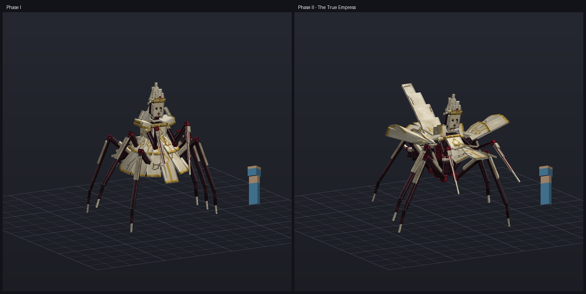

# Boss 001 — Vesperra, The Ivory Succession

*The Empress of Eternal Molting.* Entity `abm:vesperra` · seal `abm:seal_vesperra` · trophy `abm:ivory_diadem`
· arena *The Hall of Endless Succession* (`abm:hall_of_endless_succession`).

Sources: model `tools/bosses/vesperra/model.py`, animation `anims.py`, particles and sound `fx.py`, arena `arena.py`,
combat `src/bosses/vesperra/` (`index.ts`, `armor.ts`, `tuning.ts`), beat timings `shared/vesperra.timings.json`.

## Design

A crowned porcelain mask on a slender neck, a bell-shaped dress of overlapping ivory plates, six long chitin legs that
emerge from under the hem and arch above it, two folded bone-needle limbs and a plated abdomen trailing like a train.
Under the dress sits the organism it was built around: dark chitin, burgundy tissue, pale pupal segments and a dim
glowing core. The dress is four hinged sections (front apron, back mantle, left shell, right shell); Phase II opens
them like petals and the mantle and train rise behind her as a fan.

| | |
|---|---|
| Height | 115 units = 7.2 blocks (crown tip); leg span about 6.3 blocks |
| Geometry | 58 bones, 182 cubes, per-face UV, one 256×256 texture; emissive layer for eyes and core |
| Rig | body → thorax → neck/head/crown/mask, 2 × 3-segment needle limbs, 4 shell sections (+ shed-able overskirt tiers and collar), 4 abdomen segments + stinger, 6 × (hip, femur, tibia, tarsus) |
| Helpers | `abm:vesperra_heir` (15 bones), `abm:cocoon_anchor` (3 bones) |

### Locomotion

Procedural and exact. Each leg has its own phase in a metachronal wave (contact order L3, R1, L2, R3, L1, R2 — six
distinct footfalls per cycle). The walk phase is driven by distance actually travelled (`q.modified_distance_moved`),
the turn phase by body yaw actually turned (`q.body_y_rotation`), so a planted foot stays planted at any speed and
while turning on the spot. Stance is a linear sweep, swing a fast lifted return (duty 0.70). The dress sections,
collar and train follow the body with phase lags. Phase II switches to a quicker alternating-tripod gait
(duty 0.55, longer stride) with a lowered, forward-leaning carriage and fluttering open shells.

## Signature system — armour regions

Bedrock gives an entity a single damageable volume: neither `minecraft:collision_box` nor `minecraft:custom_hit_test`
tells a script which part was hit. Vesperra's regions are therefore scripted (`armor.ts`):

* On `world.beforeEvents.entityHurt`, the hit is classified geometrically against three oriented boxes computed from
  her current position and facing — **left shell**, **right shell**, **crown / face shield** — plus two occluders
  (skirt and abdomen; upper chest).
  * Melee: the attacker's eye ray is intersected with all boxes; the first one entered is the region hit.
  * Projectiles: the projectile's impact position is tested against the boxes.
* The boxes are functions of her transform, not attached entities, so they cannot lag, desync, unload or be orphaned.
  (Helper-entity hitboxes were rejected for exactly those reasons.)
* Each region has its own plate health (70 / 70 / 55, in raw weapon damage) and three visible states — intact, cracked
  (≤ 50 %), destroyed — synced to the client as `abm:armor_l`, `abm:armor_r`, `abm:armor_c` and shown by part
  visibility (crack overlays, then the plate group disappears and the wound or the true face is exposed).

| Hit lands on | Phase I | Phase II |
|---|---|---|
| intact plate | plate takes the hit; 35 % reaches her | plate takes the hit; 55 % reaches her |
| destroyed region (weak point) | ×1.4 | ×1.5 |
| destroyed region guarded by an Heir | ×0.8 | ×0.8 |
| elsewhere on the carapace | ×0.75 | ×1.0 |

Breaking a plate staggers her for 34 ticks (unless she is performing her ultimate). Armour state persists across the
phase change and across world reloads; nothing ever restores a destroyed plate.

## AI

* Positioning: approaches her focus target and holds at 5.2 blocks (Phase II: 3.6), turning to face; walk speed
  1.7 blocks/s (Phase II 3.0), turn rate 90°/s (Phase II 150°/s). She is leashed 4 blocks inside the arena edge.
* Attack choice: weighted by the table below, then adjusted by the shared scheduler (cooldown from the end of each
  attack, ×0.12 for an immediate repeat, ×0.55 for anything in the last four, up to ×2.5 for attacks not seen for a
  while). The ultimate is unavailable for the first 21 seconds of the fight.
* Idle gap between attacks: 26 ticks (21 in Phase II), scaled by difficulty.

## The seven attacks

Times are in ticks at 20/s, from the start of the attack. "Warn" is the time between the floor telegraph appearing
and the hit. All damage is design damage before difficulty and the player-mitigation model. Every attack is cancelled
cleanly (all pending strikes removed) by a stagger, the phase change, a reset or her death, except where noted.

### 01 — Ivory Scythe
| | |
|---|---|
| Eligibility / weight | always; 3.2 when the target is within 9 blocks, 1.2 within 13, else 0.3 |
| Target | focus target (she turns to face it at the start) |
| Cooldown | 150 (Phase II 120) |
| Beat 1 | frontal sector, 160° wide, 1.2–7.2 blocks; warn 24, hit at 26; 14 damage, knockback, shield-blockable |
| Beat 2 (chosen at tick 30 from where the target went, shown before it lands; hit at 56) | **turn**: she wheels round (the body really rotates, legs step) and sweeps the same sector toward the target's new bearing — chosen when the target is behind her or within 5 blocks. **cast**: a crescent of shards leaves the needles and travels from 6 to 13 blocks across the front 200° in five blades with four 15° gaps — chosen when the target backed off beyond 6.5 blocks; 12 damage |
| Recovery | 28 |
| Counterplay | leave the marked sector between the beats; versus the cast, sidestep into a gap instead of running |
| Phase II | beats at 24 / 52, then a third: a two-needle thrust down a 12-block lane fixed on the target at tick 54, hit at 70, 15 damage |
| Interruptible | yes |

### 02 — Needle Procession
| | |
|---|---|
| Weight | 3.0 at 5–17 blocks, else 0.9 |
| Cooldown | 190 (160) |
| Pattern | she plants one needle (tick 14); three parallel 15-block lanes, 2.5 wide, side by side in front of her, fire at 36, 49 and 62 in a random order. Lanes are marked one after another in firing order (4 ticks apart) and the free needle points down each lane before it fires |
| Damage | 13 per lane |
| Recovery | 28 |
| Counterplay | step into a lane that fires later, then back into one that has already fired |
| Phase II | the three lanes fan out from her at 0° and ±28° (30, 40, 50); then two 14-block lanes cross on the spot the target is standing at tick 50, firing at 68 |

### 03 — Royal Molting
| | |
|---|---|
| Weight | 1.6 + 1.1 per player within 7 blocks |
| Cooldown | 210 (170) |
| Pattern | eight shell plates are ejected at tick 30 along evenly spaced bearings and fly 13 blocks at 13 blocks/s (collision radius 1.05). Every flight path is drawn on the floor from tick 2; the gaps between paths are safe |
| Damage | 11, knockback, blockable |
| Recovery | 26 |
| Counterplay | stand between two paths; further out the gaps are wider |
| Phase II | a second ring at tick 46 flies through the gaps of the first |
| Side effect | advances her visible molt stage (overskirt tiers shed, then the collar). It never restores destroyed armour |

### 04 — Cocoon Edict
| | |
|---|---|
| Weight | 0 while anchors exist; 2.6 when the target is beyond 8 blocks, else 1.1 |
| Target | focus target; with several players, 50 % another participant |
| Cooldown | 300 (250) |
| Pattern | at tick 12 three cocoon anchors (8 health each) rise in a triangle of radius 4.6 around the target's position, joined by silk threads; at tick 60 the triangle constricts |
| Damage / status | 12 and Slowness II for 3 s to players still inside. No root, no stun |
| Counterplay | walk out of the triangle, or destroy any one anchor — the web then fails completely |
| Phase II | four anchors, radius 5.2, constriction at tick 50 |
| Cleanup | anchors are removed after the constriction, on cancellation and at encounter end; each also has a native 20 s despawn timer |

### 05 — False Submission
| | |
|---|---|
| Weight | 1.9 within 10 blocks, else 0.5 |
| Cooldown | 330 (280) |
| Pattern | she collapses as if staggered. At tick 32 the cue: crown and core glint, the needles — cocked back along her flanks, never limp as in a real stagger — level forward, and the thrust lane (11.5 × 3.2 blocks) appears. At tick 48 she lunges 8.5 blocks along it in 8 ticks |
| Damage | 17, strong knockback, blockable |
| Recovery | 48 ticks with the needles buried: all damage to her ×1.25 |
| Counterplay | read the needle pose; when the lane appears step out sideways, then punish |
| Phase II | thrust at 38, then she tears free, re-aims at the target (tick 54) and thrusts again at 68 |

### 06 — The Heirs
| | |
|---|---|
| Eligibility | fewer than two Heirs alive |
| Weight | 2.4 if any armour is broken or in Phase II, else 0.7 |
| Cooldown | 520 (420) |
| Effect | at tick 26 (20) shell fragments detach until two Heirs exist. Hard cap: two |
| Heir | 14 health, 25 s lifetime, own rig and gait. Stands between the nearest attacker and an exposed flank (active weak points first; otherwise one escorts each flank). While an Heir is within 3 blocks of a broken shell's post, that weak point's multiplier drops from ×1.4/1.5 to ×0.8. When a player comes within 1.8 blocks it rears (18-tick warning with a marked circle) and snaps: 5 damage and knockback away from the Empress; 3 s between bites |
| Counterplay | kill them (two or three hits) or draw them off before attacking the weak point |

### 07 — Coronation of Fracture (ultimate)
| | |
|---|---|
| Eligibility | health below 90 %; cooldown 760 (700); not interruptible |
| Pattern | she raises her crown; seven fracture paths (full chords of the arena, 2.6 wide) are marked at ticks 26, 37, … 92 and each erupts 34 ticks after it is marked. Every path is laid through where a participant is standing when it is marked (participants in turn) and each is rotated 51° from the previous one. One needle stabs down on every mark, alternating — seven countable beats |
| Damage | 16 per path |
| Recovery | 32 |
| Counterplay | keep moving out of the newest path without stepping into an older one that has not erupted yet |
| Phase II | every mark is a crossing pair (the path and its perpendicular); marks every 13 ticks, 36 ticks of warning |

## Phase II — The True Empress (45 %)

Health stops exactly at the threshold; the transition cannot be skipped and she takes no damage during it
(130 ticks): recoil and clutch (crack at 24), convulsion, the four seams burst (56) throwing nearby players back a
step without damage, the sections unfold (to 96), a cry, and she settles into the open stance. Afterwards: faster
movement and closer hold distance, the Phase II variants above, shorter cooldowns and a 20 % shorter gap between
attacks.

## Death

On the lethal hit the entity is kept alive at its last health point and made untouchable while the sequence plays
(176 ticks): the crown fractures first and falls with the mask; the petals strain shut in one last molt; it fails and
they sag; left, right, front and back sections drop away in stages; the legs curl and the body settles. The remnant
stays for 30 s and despawns through a native timer. Rewards: one **Ivory Diadem of Succession** per contributing
player (up to four), the bonus loot table and 500 experience each.

## Tuning

`CONFIG.bosses.vesperra`: health 480, Phase II at 45 %, arena radius 17, clearance 9, `damageTaken` 0.10.
`src/bosses/vesperra/tuning.ts` holds every per-attack number quoted above.

Simulated solo fight (dodging, always-attacking bot with a 13-damage weapon): about 3 min 40 s.

## Not verified

Everything on this page was verified by static validation and headless simulation only. Rendering, animation
blending, particle appearance, audio mix and the feel of the fight have not been seen in the game.
