# THE ANATOMY OF A WORLD — Minecraft Bedrock Add-on

Experimental colossal bosses whose **bodies are the battlefield**. Each specimen lives in its own
pocket dimension, is built from real blocks you climb and fight on, and is animated by multipart
entities, a deformable terrain system and a scripted encounter director.

**Install:** [`dist/The_Anatomy_of_a_World.mcaddon`](dist/The_Anatomy_of_a_World.mcaddon)
(separate `_BP.mcpack` / `_RP.mcpack` are in the same folder).

| | |
|---|---|
| Game version | Bedrock **26.60** (engine `1.26.60`) or newer |
| Script API | `@minecraft/server` **2.11.0**, `@minecraft/server-ui` **2.3.0** (latest stable) |
| Experiments | **none required** — stable APIs only; the arena dimension is a JSON dimension (format 1.26.50) |
| Status | **Specimen 001 — The Migrating Mountain: complete (version 1.1.0, three phases).** Specimens 002–004 are waiting for their concept sheets. |

> **สรุปภาษาไทย:** แอดออนบอสยักษ์ที่ "ร่างกายของบอสคือสนามรบ" บอสตัวแรก **The Migrating Mountain (เทือกเขาอพยพ)** สร้างเสร็จแล้ว
> (เวอร์ชัน 1.1.0) มี **3 เฟส** และ 7 ความสามารถตามแผ่นคอนเซปต์ เรียกบอสได้ด้วย *Restless Lodestone*
> (คราฟต์จากทัฟฟ์ เศษอเมทิสต์ เข็มทิศ และหินกรวดมีมอส) หรือจาก *Anatomical Atlas* ที่ได้ตอนเข้าโลกครั้งแรก
> * **เฟส 1** ทำลาย**ผลึกสีม่วง 3 จุด**: บนยอดเขา · ในถ้ำอวัยวะ (อุโมงค์ด้านหน้า) · ห้อยอยู่ใต้ตัวภูเขา (ลงบันไดวนจากถ้ำ)
> * **เฟส 2** ภูเขาคลี่ออก ตีหัวใจตอนม่านตาเปิด
> * **เฟส 3A การอพยพครั้งสุดท้าย** ภูเขาพับกลับแล้วเดินหนี ตัด**รากยึดเกาะ 4 ราก** แต่ละรากที่ขาดทำให้หัวใจเปิด
> * **เฟส 3B หัวใจหลุดจากร่าง** ลานแตกเป็นเกาะลอยฟ้า 9 เกาะ หัวใจลอยอยู่ ยิงตอนลอย ตีตอนมันกระแทกลงมา
>
> ชนะแล้วทุกคนได้ของเข้ากระเป๋า (เพชร มรกต เศษเนเธอไรต์ ทอง แอปเปิลทอง ขวด XP หนังสือเอนชานต์ ฯลฯ) และของเฉพาะบอส
> **ค้อนชั้นหิน (Strata Breaker)** กับ **รองเท้ารากยึด (Anchorage Greaves)** กดปุ่ม **Language** ใน Atlas เพื่อให้หน้า Atlas
> และคำแนะนำระหว่างสู้เป็นภาษาไทย ชื่อภาษาไทยของไอเท็มและเอนทิตีอยู่ใน `docs/th_TH.reference.lang` (Bedrock ไม่โหลดไฟล์ภาษาไทยจากแพ็ก)

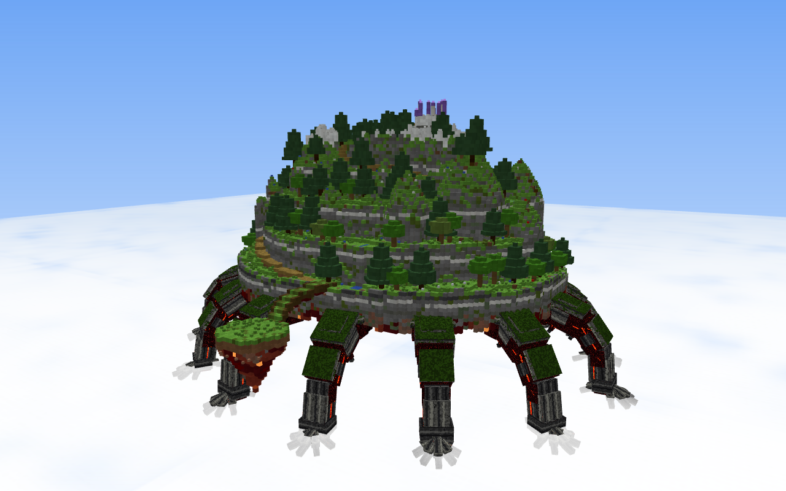

---

## Playing

1. Import the `.mcaddon`, then enable **THE ANATOMY OF A WORLD** behaviour pack on a world (the resource pack follows).
2. On first join you receive the **Anatomical Atlas** (lost it? `/anatomy:atlas`, or craft *book + amethyst shard*).
   The Atlas is the in-game codex: anatomy, abilities, phase flow and your records for every specimen.
3. Craft a **Restless Lodestone** and use it (or press *Begin the encounter* in the Atlas). You and every player within
   32 blocks are drawn into the Migration Path dimension.

```
Restless Lodestone        T = tuff   A = amethyst shard
   T A T                  C = compass
   A C A                  M = mossy cobblestone
   T M T
```

The Atlas' **Language** button switches the Atlas pages and the in-fight guidance (HUD, titles, briefings) between
English and ภาษาไทย.
During a fight the Atlas offers **Leave the encounter** / **Join the encounter**. Players who die are pulled back in a
moment after respawning. If nobody is left fighting for 30 s the mountain wanders on and the arena is cleaned up.
Your world is never modified — the whole fight happens in its own dimension and is erased afterwards; anything left on
the ground is carried home with you.

### Testing / spawning (cheats on, operator)

| Command | Effect |
|---|---|
| `/anatomy:boss start` | start Specimen 001 for you and nearby players (no lodestone needed) |
| `/anatomy:boss skip` | jump to the next phase: destroy the remaining Resonance Nodes (1 → 2), drop the heart to 35% and refold (2 → 3A), sever every Anchorage Root (3A → 3B) |
| `/anatomy:ability <id>` | force an ability: `continental_fold`, `lithic_peristalsis`, `geological_shedding`, `resonance_network`, `inverted_strata`, `mantle_contraction`, `great_unfolding` |
| `/anatomy:boss kill` · `stop` · `status` · `join` · `leave` | finish the fight · abort and clean up · print state (incl. which parts are loaded/spawned, the remaining nodes' coordinates and chunk coverage) · join · leave |
| `/scriptevent anatomy:start` (also `stop`, `skip`, `kill`, `status`, `ability <id>`) | same actions without custom commands |

The Atlas also has a **Test tools** page for operators and creative players.

---

## Specimen 001 — THE MIGRATING MOUNTAIN

*The Mountain That Never Belonged to the Earth* — a geological organism ~78 blocks tall and 116 long, its back a forest
of stratified cliffs, snow crags and waterfalls, walking on fourteen Anchorage Roots across a sea of clouds.

| Concept anatomy | In the add-on |
|---|---|
| Mountain Shell / Living Strata | ~200 000 real blocks: terraced grey strata cliffs, forest ledges, snow spires, two waterfalls (one falls into the cloud sea) |
| Dorsal Biome | 110 trees, flowers, moss; a pilgrim path spirals from the arrival shelf to the summit crag |
| Mineral Circulation | glowing shroomlight / magma veins through the musculature; animated vein strips on every entity |
| Organ Cavern | a ribbed cavern of red musculature with stalactites and glow-berry vines, reached by the front tunnel |
| Lithic Heart | animated entity: amethyst core, 8-plate iris, gyroscope rings and a 12-spoke wheel; carries the boss bar; tears free and hovers in Phase 3B |
| Mantle / Lithic Musculature | the underside arches and the underbelly gallery (spiral shaft down from the cavern) |
| Anchorage Roots | 14 animated root-leg entities with a peristaltic walking gait, a march, stomps, flinches, splay and collapse; in Phase 3A four more roots burst up to grip the disk, each with a glowing sinew knot |

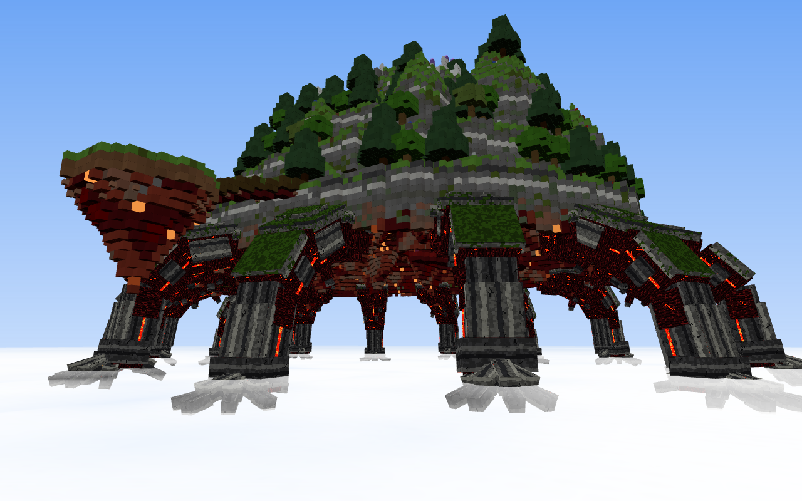
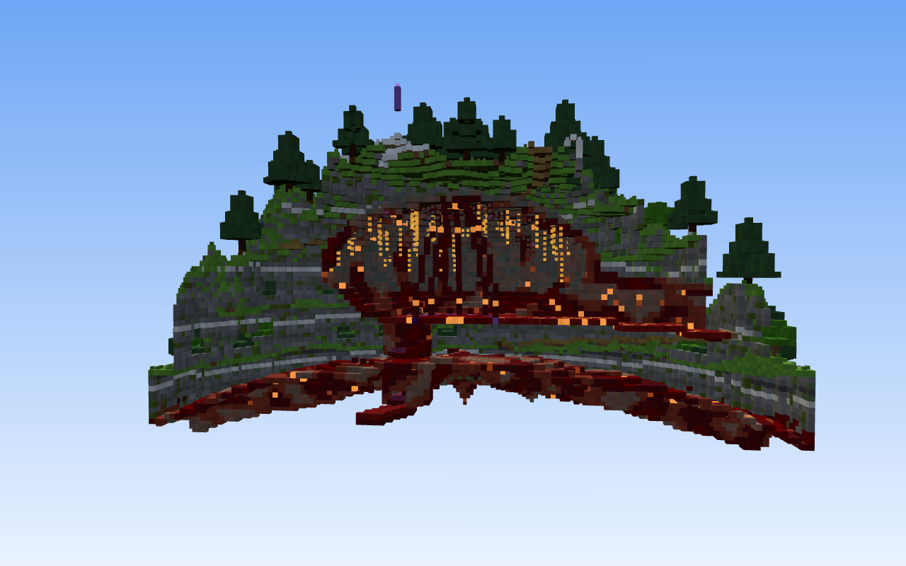

### Phase 1 — The Sleeping Continent
Climb and explore the body to find and destroy the three **Resonance Nodes** (the purple crystals) — on the summit
crag, inside the Organ Cavern, and hanging beneath the body over the underbelly gallery. A chat briefing lists where they
are (with coordinates); a tall purple light pillar stands over each one (pointing down for the hanging node), a purple ★
marks each on the locator bar, purple beams link them to the shielded heart, golden motes mark the path, and the action
bar shows the nearest one with distance and direction. Each destroyed node strips 13% of the mountain's health and makes
it more aggressive.

| Phase | Boss bar | How it goes down |
|---|---|---|
| 1 The Sleeping Continent | 100% → 60% | the three Resonance Nodes |
| 2 The Unfolded World | 60% → 35% | strike the heart while its iris is open |
| 3A The Last Migration | 35% → 20% | sever the four Anchorage Roots; each severed root opens the heart for 8 s |
| 3B The Heart Unbound | 20% → 0% | shoot it while it hovers (half damage), strike it when it slams down |

Within a phase the bar cannot drop below that phase's floor, however hard you hit.

### Phase 2 — The Unfolded World
**07 The Great Unfolding**: the shell peels open sector by sector; each sector becomes a giant petal that swings
outward into a crown around the exposed heart, and the arena becomes a disk of radial ribs over a mantle floor (steam
vents throw fallen players back up). The heart is sealed until it vents after **Resonance Network** or squeezes
everyone in with **Mantle Contraction** — then its iris opens for ~8 s. At low health the world refolds: the petals
slam shut and the ribs re-bloom rotated.

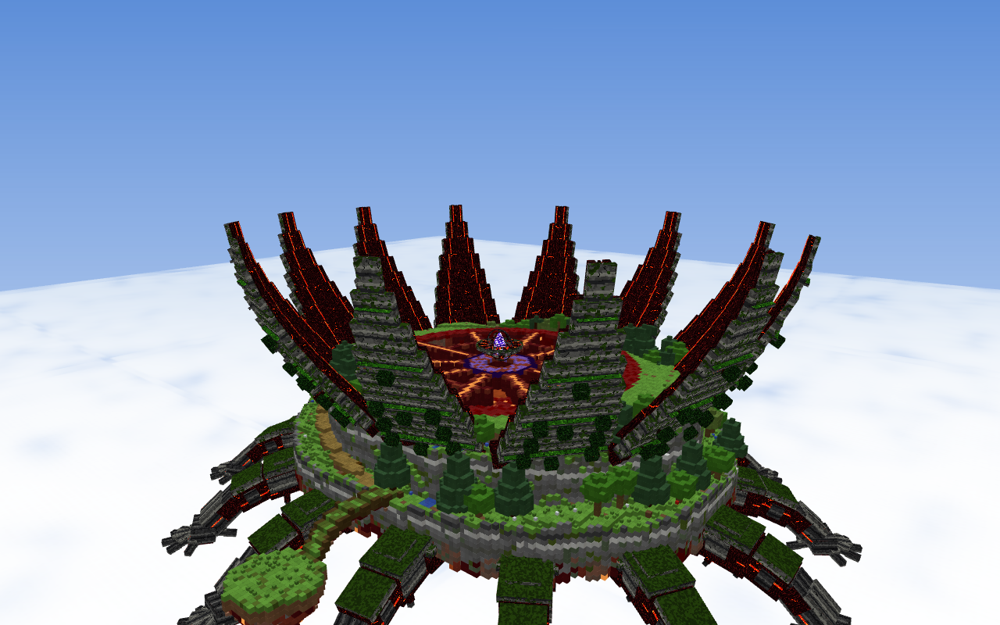
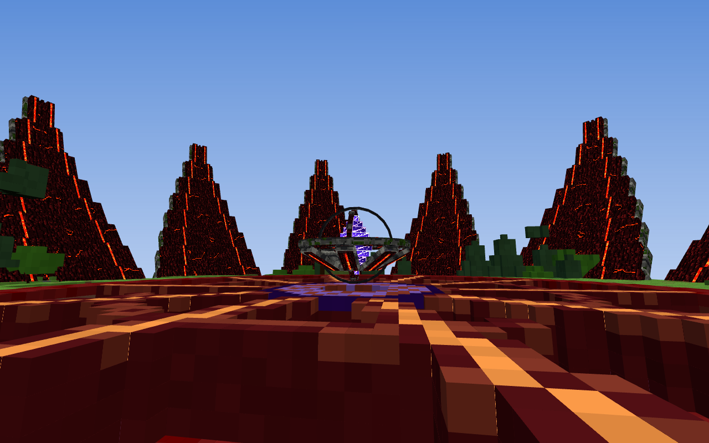

### Phase 3A — The Last Migration
Its heart failing, the mountain refolds: the twelve petals swing back up into a crown of walls around the disk, the
legs change from bracing to marching, and the body walks away across the cloud sea (heavy footfalls every few seconds,
a rolling ridge every third one, clouds streaming past). **Four Anchorage Roots** burst up beside the ring to hold the
disk together — each marked with a ★ on the locator bar. Break a root's glowing **sinew knot**: the root tears away into
the clouds, the mountain staggers and the heart opens for 8 s. Waves, ridges and rubble never grow over a root's knot.
Take longer than 4 minutes and it marches faster and attacks more often.

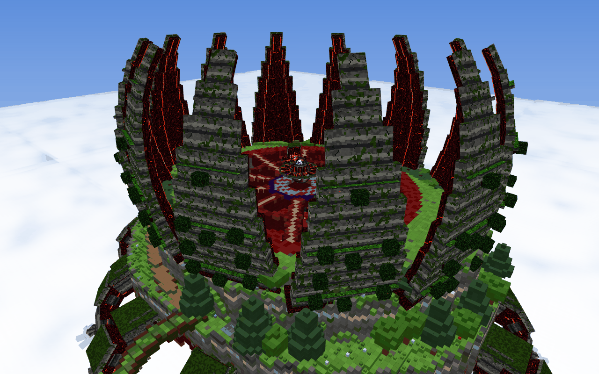
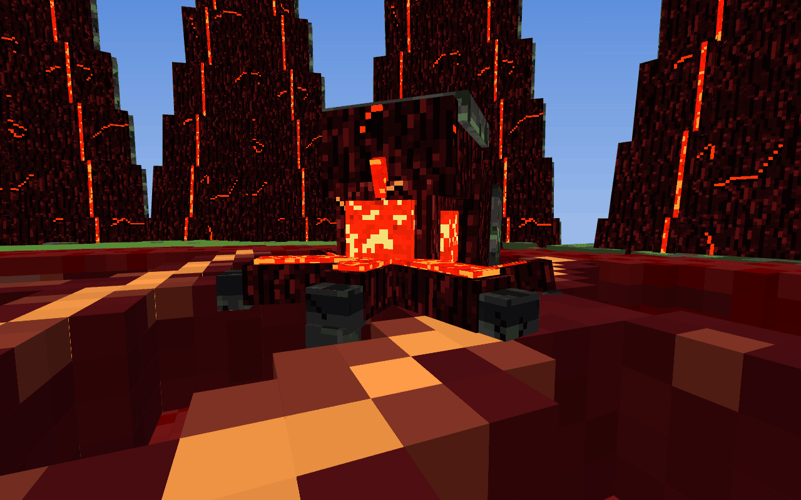

### Phase 3B — The Heart Unbound
The last root snaps and the mountain falls: the legs collapse, the petals drop away and the disk breaks into **nine
floating islands** (one in the centre, eight around it, a jump apart). The Lithic Heart tears itself free and hovers
11 blocks over the centre island, its gyroscope rings spinning wide. Bows and crossbows hurt it while it hovers (half
damage); about every 22 s it **slams down onto the centre island for 6 s** — strike it then for full damage. A fall
into the clouds throws you back onto the centre island. When it breaks, the islands sink into the cloud sea and the
spoils are handed out.

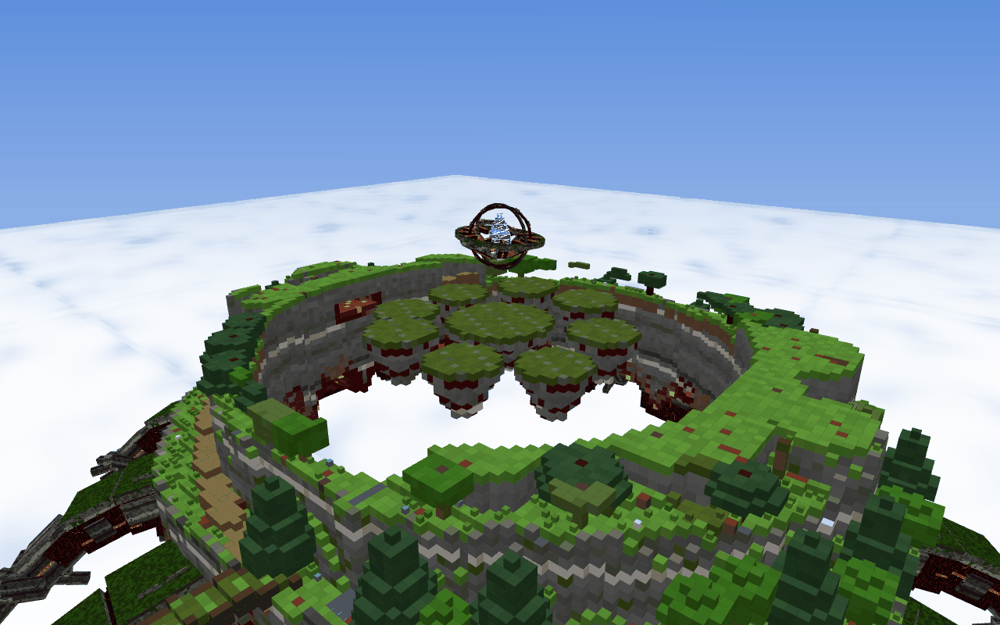
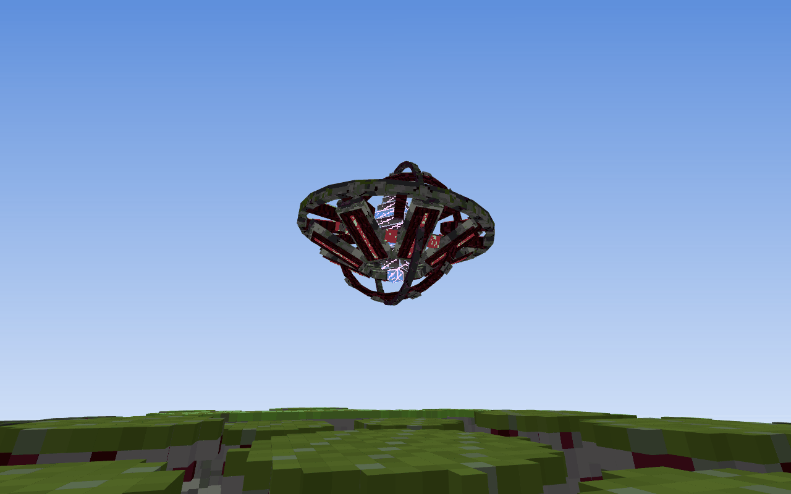

### Abilities (7)

| # | Ability | Phase 1 | Phase 2 | Phase 3A (the march) | Phase 3B (the islands) | Counter |
|---|---|---|---|---|---|---|
| 01 | **Continental Fold** | a glowing fault buckles into a 9–11 block ridge, re-routing paths for 9 s | a petal folds over its sector and leaves rubble ridges | a footfall drives a fault across the disk and a ridge heaves up along it | an island cracks along a fault and half of it drops away for a while | leave the fault / sector / half |
| 02 | **Lithic Peristalsis** | roots stomp; 3–4 waves of rock roll across the back | waves run inward along the ribs | the march sends waves across the whole disk | shockwave rings roll out from the centre island | jump each crest |
| 03 | **Geological Shedding** | rock skin peels (exposed musculature scars) and slabs are flung at marked rings | slabs thrown from the petals | slabs break from the walls of the shell | rubble falls from the sky | leave the rings |
| 04 | **Resonance Network** | rings expand from a node, each with two green gaps | rings from the heart; then the heart opens | rings from the roots still holding | **Mineral Beams**: a warning line, then a molten beam sweeps across the islands | stand in the gaps / jump to another island |
| 05 | **Inverted Strata** | a 5×11 walkway levels into a slab and flips into a wall or rolls overhead into a ceiling | a rib segment flips, cutting a route | a rib segment flips | an island with a glowing rim flips over | step off the outlined strip / island |
| 06 | **Mantle Contraction** | the Organ Cavern fills with flesh except glowing pockets | the disk contracts to the heart's ring; the heart opens | the disk contracts to the heart's ring | the heart drags everyone towards the centre | reach a pocket / the ring; walk away from the edge |
| 07 | **The Great Unfolding** | phase transition (cinematic) | the refold / re-bloom at low health | the refold into the march (cinematic) | the fall (cinematic) | — |

### Rewards

| | |
|---|---|
| **Every player**, straight into the inventory (a full inventory drops the rest at your feet) | 3 Lithic Heart Shards, 8–12 diamonds, 16–24 emeralds, 2–3 netherite scrap, 16 gold ingots, 4 golden apples, 32 bottles o' enchanting, 2 enchanted books (Mending, Unbreaking III, Protection IV, Sharpness V, Efficiency V, Fortune III, Feather Falling IV or Power V) |
| **Shared pile** at the heart | 64 amethyst shards, 6 + 2 per player diamonds, 12 + 4 per player emeralds, 1 netherite ingot (+1 per 2 players), 1 500 XP |
| **Strata Breaker** | a heavy hammer (durability 2 500, enchantable like a sword, repaired with Lithic Heart Shards). *Use:* **Fold Slam** — a ridge of rock bursts 7 blocks forward; mobs on it take 8 damage and are thrown up. 8 s cooldown, 2 durability per slam, never breaks blocks and never hurts players |
| **Anchorage Greaves** | boots (3 armour, durability 550, enchantable, repaired with shards): no fall damage; sneak to root yourself (Resistance I) |

Both pieces of gear are certain on a player's first victory, then 40% each. A Lithic Heart Shard gives *Mountain's
Resolve* (Health Boost II + Resistance I for 5 min). Victories and best time are recorded in the Atlas.

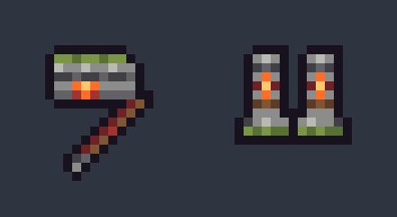

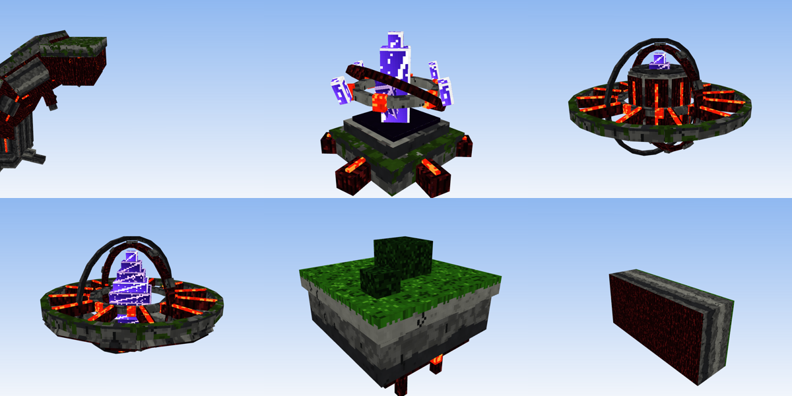

---

## How it works

* **Its own world.** `BP/dimensions/migration_path.json` defines a void dimension with a cloud layer at Y 100; the
  encounter loads it with the `TickingAreaManager`, builds the arena, and erases it afterwards. Players get a custom
  fog (`anatomy:migration_mist`), music, and a remembered return point.
* **A body you stand on.** The mountain is generated procedurally (`src/gen/mountain.ts`) at build time, then shipped as
  a compact LZ77 + base64 run-length column stream (`mm_data.js`, ~330 KB) and placed in-game through in-memory
  structure tiles (≤ 48×90×48) with the native layer-by-layer animation (falls back to budgeted writes).
* **Living strata.** `terrain.ts` keeps the dorsal surface as a height field. Abilities add deformation fields (folds,
  travelling waves, scars, levelled strips); each tick only changed columns are re-rendered through a 1 500-blocks-per-tick
  writer. Players are carried up by rising rock, trees uproot and regrow, and settled columns are restored exactly from the
  pristine data.
* **Multipart entities.** 14 legs, 3 nodes, the heart, 12 petals, 4 Anchorage Roots, flipping strata plates and slab
  projectiles are separate animated entities driven by client-synced properties and animation controllers.
* **Phase 3.** Abilities cancelled by a phase change leave nothing behind (the disk is restored before the roots seize
  it), the block writer refuses solid blocks over a living root's knot (an entity is lit by the block at its anchor), and
  the fall rebuilds the disk as nine islands through the same deferred, chunk-aware writer.
* **Encounter director.** `director.ts` reads each player's zone (dorsal, cavern, underbelly, disk, mantle), cooldowns,
  enrage and how long the heart has stayed shut, and picks one main ability at a time plus a Geological Shedding barrage.
* **Chunk loading.** `spawnEntity` and block edits only work in loaded, ticking chunks, and script ticking areas share a
  per-pack chunk budget the engine does not document. The arena (100 chunks) is kept ticking region by region in priority
  order — the nodes and the heart, the arrival shelf, the Organ Cavern, the Phase 2 disk, the rest — as far as the budget
  allows (`src/core/chunks.ts`). Boss parts go through a registry (`src/core/parts.ts`): each one spawns as soon as its
  chunk is loaded, is re-acquired by entity id when its chunk unloads and reloads (with its state re-applied), is
  re-created if it vanishes, and stale parts of earlier fights are removed when they load. Block edits in unloaded chunks
  are deferred per chunk, in order, and replayed when the chunk loads; short-lived ticking areas sweep the rest, and
  structure tiles are only placed over loaded chunks. The Content Log reports `[anatomy] arena: N/100 chunks kept
  ticking` when the budget is smaller than the arena.
* **Self-check.** If the engine refuses to create a boss part although its chunk is loaded, the `/summon` command is
  tried, a part created in the wrong place is moved back, and 10 s into Phase 1 the players get a chat report with the
  engine's own error text (English or Thai). The Atlas has **Check the fight** for the same report at any time, and on
  joining a world the add-on says if the game did not load one of its entity types. Behaviour entity files use format
  1.21.90 on purpose: from 1.26.40 on, an entity whose data the engine considers invalid fails to load as a whole.
* **Robustness.** The fight is saved every 5 s and rebuilt deterministically at its phase after a reload; arena blocks
  can't be broken (player-placed blocks excepted), explosions don't damage the arena, natural mob spawns are removed,
  falls into the cloud sea are caught.

```
anatomy-of-a-world/
├─ src/                    TypeScript (strict) → BP/scripts
│  ├─ core/                shared boss framework: registry, manager, arena, blocks, tasks, fx, atlas UI
│  ├─ gen/                 pure generators/codecs (run in-game and in Node)
│  └─ bosses/migrating_mountain/   encounter, abilities, unfolding, director, terrain, runtime
├─ tools/
│  ├─ build.py             full build → build/packs + dist/*.mcaddon
│  ├─ packdefs.py          BP/RP JSON (entities, client entities, controllers, items, dimension, sounds, fog)
│  ├─ models/              procedural model kit + Boss 001 models and baked animations
│  ├─ fx/particles.py      20 particle effects + atlas
│  ├─ audio/synth.py       27 synthesised sound effects + 4 music tracks (OGG)
│  ├─ export_mountain.mjs  pre-generates the mountain data module
│  ├─ validate.py          cross-file validation
│  ├─ sim/                 strict Script API mock + end-to-end encounter simulation
│  └─ preview/             three.js renderer for voxels + Bedrock geometry (docs images)
└─ dist/                   The_Anatomy_of_a_World.mcaddon (+ .mcpack)
```

Build: `npm install && npm test` (TypeScript check → build → validation → simulation). Needs Python 3 with
Pillow, numpy and scipy, and ffmpeg with libvorbis. Phase 3 preview images: `SIM_SNAPSHOT=1 npm run sim`, then
`node tools/preview/shots_p3.mjs`.

---

## Verification

| Check | Result |
|---|---|
| TypeScript `strict` against the official `@minecraft/server` 2.11.0 / `server-ui` 2.3.0 typings | 0 errors |
| Minecraft Creator Tools 0.21 validation (both packs) | 0 errors, 0 warnings |
| `tools/validate.py` — geometry ↔ animations ↔ controllers ↔ client entities ↔ scripts, block ids + states vs vanilla 1.26.60, sounds, particles, fog, items, lang | 3 167 checks, 0 errors |
| `tools/sim/run.mjs` — the compiled scripts run against a strict API mock with a voxel world: summoning, intro, all 7 abilities in every phase (1, 2, 3A, 3B), node destruction, the Great Unfolding, heart windows, re-bloom, the refold into the march, severing the four Anchorage Roots, the fall into nine islands, the hovering/slamming heart, health floors, victory, personal and shared rewards, first-victory gear, Fold Slam (damage, cooldown, durability, no player or block damage), Anchorage Greaves (fall damage, rooting), cleanup, resume after reload (phases 1, 2, 3A, 3B), respawn pull-back, defeat, commands, the Atlas UI in English and Thai, injected engine faults (spawnEntity refusing a part, an entity type that never loaded, parts created in the wrong place), every boss part anchored in open air | 191 checks, 0 failures, 0 API issues (repeated runs with random seeds) |
| Chunk loading in the same simulation — chunks load only inside ticking areas and around players; spawns, block edits and lookups fail in unloaded chunks, entities unload/reload with new handles, structure placements queue. A whole fight with a pack budget of 1–40 chunks and a simulation distance of 2–10: parts wait and appear, nodes stay destroyable after reloading, markers/HUD point to unloaded nodes, the whole shell is cut, the roots spawn as their chunks load, the nine islands are built, the arena is fully cleared | passes for every budget/distance combination tried |
| Visual review | models, the assembled creature, cavern cutaway, the Phase 2 crown and the Phase 3 scenes (rendered from snapshots of the simulated arena with the real geometry/textures; images above) |

**Not verifiable in this environment:** I could not run the Minecraft client or a dedicated server here, so these still
need a first in-game look: frame-rate and tick cost of large block edits on your hardware, the exact look of particles
and emissive textures, and animation feel (bone rotation signs follow Bedrock/Blockbench conventions and every
flip/fold end state was made direction-independent). The Content Log (Settings → Creator) is the first place to look if
anything misbehaves.

## Roadmap
Specimens **002 The Inverted Ocean**, **003 The Thousand-Mouthed Labyrinth** and **004 The Hungry Absence** plug into the
same framework (registry, void dimension, director, terrain/structure systems) and will be built from their concept sheets.
