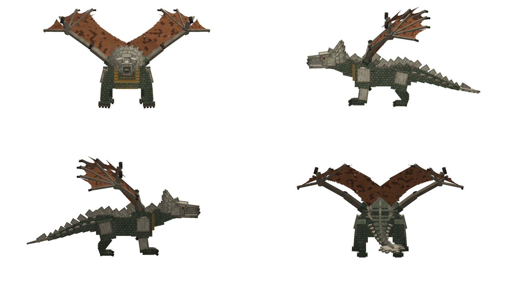

# Dragon Dominion — Boss 1: Gharvok, the Cliffbreaker

A Minecraft Bedrock add-on (behavior pack, resource pack and Script API) adding **Gharvok**, an original armored
"living battering ram" dragon boss. It has a custom 51-bone rig, 27 animations, six attacks, three phases and a
crownshield-fracture mechanic.

**Install file:** [`dist/DragonDominion_Gharvok_v1.mcaddon`](dist/DragonDominion_Gharvok_v1.mcaddon) (757 KB)

| | |
|---|---|
| Pack version | 1.0.0 |
| Game version | Bedrock **1.26.60+** (iPhone / iPad / Android / Windows / consoles) |
| Script API | `@minecraft/server` **2.11.0**, the current stable release on npm (2.12 is still rc/beta) |
| Experimental toggles | **None needed.** No beta modules or experimental components are used. |
| Entity | `dragon_dominion:gharvok` |
| Items | `dragon_dominion:cliff_sigil` (summons it), `dragon_dominion:fractured_crownplate` (its drop) |

> **Not tested in the real game yet.** This environment has no Minecraft client. The Creator Tools MCP can start a
> Bedrock Dedicated Server, but only after *you* accept the Minecraft EULA (`npx @minecraft/creator-tools eula`), and I
> did not accept it for you. Everything below was checked with static validation, a scripted mock of the Script API,
> and a software renderer that reads the pack's real geometry, texture and keyframe files. **No image here is a
> screenshot from Minecraft.**



*This is a software render of the actual `.geo.json`, texture and roar display pose, in the same layout as the reference
sheet: front, both profiles and rear. Other renders:
[wings folded](docs/preview/gharvok_four_view_folded.png), [BROKEN crown state](docs/preview/gharvok_four_view_broken_crown.png),
[28 key poses](docs/preview/animation_sheet.png). The original reference is kept for comparison at
[`docs/reference_four_view.png`](docs/reference_four_view.png).*

---

## 1. Install and test on iPhone

1. Save `DragonDominion_Gharvok_v1.mcaddon` to the **Files** app. You can AirDrop it, or download it from GitHub using **View raw**.
2. Tap the file. If it doesn't open, tap **Share**, then **Minecraft**. Minecraft opens and imports both packs. Wait for
   "Successfully imported" to appear twice.
3. Create a **new world** for testing:
   * Turn on **Activate Cheats** (needed for `/summon` and `/give`).
   * Under **Behavior Packs**, activate **Dragon Dominion**. The resource pack is added with it automatically.
4. Enter the world, then run `/give @s dragon_dominion:cliff_sigil 3`, or take the Cliff Sigil from the creative inventory under Items.
5. Switch to **Survival** (`/gamemode survival`). Gharvok ignores Creative and Spectator players, like vanilla mobs do.
6. Stand on open, flat ground, face an empty area and **use (tap and hold) the Cliff Sigil**. After a 3-second
   ritual (dust pillar and a red ring), Gharvok appears about 12 blocks in front of you.
   Developer shortcut: `/summon dragon_dominion:gharvok ~ ~ ~12`

If something looks wrong, open **Settings → Creator → Content Log GUI**, reproduce the problem, and send a screenshot of
the red errors.

### Test checklist

| # | Do this | You should see |
|---|---|---|
| 1 | Summon it and stay more than 24 blocks away | Slow breathing. Every 9–16 s it either scans with its head or does a territorial roar with its wings raised. It strolls short distances. |
| 2 | Walk to within 24 blocks (Survival) | A title card "Gharvok / The Cliffbreaker", an alert roar and camera shake, then the **boss bar** appears |
| 3 | Stand in front of it, close | **Twin Claw**: two separate swipes (left, then right), each hitting once for 6–8 |
| 4 | Stand 8–26 blocks in front | **Crushing Charge**: head lowered, paw scrape, roar, red dots marking its path, then a straight charge. It does not steer after committing. 10 damage and strong knockback. |
| 5 | Make it charge into a stone wall (step aside at the last moment) | It stops at the wall with debris and camera shake, then stays **staggered** for about 4 s with stars over its head. The crownshield takes damage. |
| 6 | Stand beside it or behind it | **Rudder Sweep**: hips twist, the tail coils and sweeps from its left flank, across its back, to its right flank. 8 damage. Players in front are safe. |
| 7 | Damage it below 70 % | Title "Phase II — Cliff Hunter" and a roar. **Wing Pressure** and **Cliff Dive** are now possible. |
| 8 | Wing Pressure | It rears up, spreads its wings and releases a gust: 2–4 damage with heavy knockback in front, and a push for anyone close. |
| 9 | Cliff Dive (stand 9–30 blocks away) | It takes off and climbs about 9 blocks. A **red ring marks the landing zone** for about 1 s, then it dives. 12 damage inside the ring, 6 near its edge. Running out of the ring avoids all damage. |
| 10 | Damage it below 35 % | "Phase III — Desperate Predator": it attacks more often, rests head-low between big attacks, and adds **Skullbreaker** |
| 11 | Skullbreaker (stand in front) | It braces, raises its head high (red warning rings) and slams its skull down. 12–14 damage at the impact point, then a ground shockwave out to about 10 blocks. **Jump** over the wave to avoid it. A long recovery follows. |
| 12 | Hit its **head** while it is staggered, exhausted or recovering from a Skullbreaker | Crown fracture: "crownshield CRACKS" (cracks appear in the texture), then "BREAKS" (plates are missing and red damage shows) |
| 13 | Kill it | A 3.6 s death animation (stumble, collapse onto its side, wings sprawl). Then a dust cloud and a drop of **Fractured Crownplate** ×1, or ×2 if its crown was BROKEN, plus XP. |
| 14 | Run more than 44 blocks from where the fight began, or switch to Creative for 8 s | It walks home, heals fully and goes back to idle (a reset) |

Useful commands: `/kill @e[type=dragon_dominion:gharvok]` removes it (no reward). `/effect @s resistance 9999 4 true`
lets you watch the attacks without dying.

---

## 2. Feature completion report

### Implemented and covered by automated checks

* **Custom entity, not a reskin.** It has its own geometry, a 51-bone hierarchy with 253 cubes, three 1024×256 textures, a client entity,
  a render controller and an editable Blockbench project ([`source_models/gharvok.bbmodel`](source_models/gharvok.bbmodel)).
* **Anatomy:** four articulated legs (upper/lower/foot, plus claws), exactly two membranous wings
  (arm → forearm → hand → 4 fingers, with separate membrane panels that fold), a wedge skull with a 3-segment neck,
  a separate jaw with teeth, amber eyes under brow ridges, a fan-shaped **crownshield** with 11 outer and 7 inner plates swept back,
  dorsal osteoderms, and a 7-segment tail ending in a broad flat blade.
* **Size in game (scale 0.8):** length about **11.8 blocks**, height about **4.4 blocks** without wings, wingspan about **15.2 blocks**.
  Collision box 3.2 × 3.6, hit box 7 × 4.4.
* **Animations (27):** `idle_breathing, idle_head_scan, walk, run, turn, jump, takeoff, wing_flap, glide, landing, roar,
  claw_combo, charge_windup, charge, charge_impact, tail_sweep, wing_pressure, cliff_dive, skullbreaker, hit_reaction,
  stagger, skull_fracture, exhausted, death`. There are also 3 layers: `wing_fold`, `injured_overlay` and `wing_display`.
  Every required animation moves at least 6 bone groups. The head, jaw, neck, spine, legs, wings and tail all take part.
  * Three controllers handle it. **Locomotion** switches between idle, walk, run, turn, flap and glide. **Action** plays one animation per
    `dragon_dominion:anim` code, so actions cannot overlap. **Flinch** plays the hit reaction.
  * Wing folding is blended by Molang (`v.fold`), so wings open and close smoothly over about 0.3 s.
  * Walk and run speed follow the actual ground speed.
* **AI states:** IDLE, ALERT, PURSUE, REPOSITION, ATTACK_WINDUP, ATTACK_ACTIVE, RECOVERY, STAGGERED, AIRBORNE, (landing),
  RESET and DEAD. Vanilla AI handles strolling while idle. During a fight the script controls movement with ground-snapped steps and
  wall and ledge probes, so it never clips through blocks or walks off cliffs.
* **All six attacks** have telegraphs, timed hit frames taken from the animation timing table, a per-swing hit-once
  registry, an 8-tick fairness guard per player, cooldowns and a recovery state.
* **Three phases** at 70 % and 35 %. Each fires once, with a title and a roar. Attack gating and pressure are set per phase.
* **Skull fracture** works in gameplay:
  * Points come from wall impacts (+45) and from head hits. Head hits earn ×1.0 per damage point in vulnerable windows and ×0.35 otherwise.
  * CRACKED at 60 points: a cracked texture, a longer wall stun, and +25 % damage taken while staggered.
  * BROKEN at 140 points: plates removed through `part_visibility`, a broken texture, head hits deal ×1.5, the charge is weaker (×0.8), and it is always exhausted after major attacks.
  * Also gives a bonus reward.
* **HP and multiplayer:** 500 HP, plus 120 per extra participant (up to 4 players, so 860 maximum). The participant count is fixed when the fight starts
  and stored in component groups, so the **boss bar** (`minecraft:boss`) shows the correct maximum.
* **Summoning:** the Cliff Sigil has a custom icon, a 3 s ritual, a spawn-spot check (7×7 footprint with 6 blocks of headroom on solid ground) and a
  duplicate guard. It is consumed in Survival. `/summon` also works. Natural spawning is disabled (there are no spawn rules).
* **Reward:** Fractured Crownplate (custom icon, epic rarity), given only for a legitimate defeat: a player landed the killing blow, or players dealt at least 50 % of its HP.
* **World safety:** no script call places, breaks or changes blocks, and there are no explosions or fire. The validator enforces this.
* **Robustness:**
  * One shared tick loop for all bosses. It stops when no boss is active.
  * Bosses are found through spawn and load events, not per-tick world scans.
  * Fight state (phase, crown, HP tier, home) is kept in dynamic properties and restored after a chunk unload or reload.
  * Disconnected targets are dropped.
  * Safety nets: a forced landing if it is airborne too long, unburying, and a leap or reset when stuck.

### Partially implemented, or an approximation (disclosed)

* **Head-hit detection is an approximation.** Bedrock gives scripts no per-bone hit data. A hit counts as a head hit
  when the attacker, or the projectile, is in front of Gharvok (within ±60°) and close to the computed head point. A lower head point is used while its
  head is down. See `isHeadHit()` in `dragons/gharvok/gharvok.js`.
* **Flight is used only for the Cliff Dive.** Rather than free-roaming autonomous flight, it does a controlled takeoff, climb, hover-and-mark, dive
  and landing on a scripted path, which is the robust option the brief allowed. There is also a sideways/backward **reposition leap**.
* **Model fidelity.** It is a voxel (cube-based) approximation of the reference, made to match its silhouette. The membranes are flat
  panels with cut-out, scalloped trailing edges. The wedge skull and crownshield are made from rotated plates. It cannot match the painted
  surface detail of the concept art. Also, its wings are folded by default in normal play; they are raised like the reference sheet only during
  the roar and display.
* **Sounds** are existing vanilla sound events (ravager, ender dragon, iron golem, explosion). No custom audio was
  created.
* **The Cliff Sigil** uses `world.afterEvents.itemUse`. I expect this to fire for a custom item with `minecraft:use_modifiers`,
  but it has not been confirmed in game.

### Not verified (needs the real game)

How the model, animations, particles and boss bar look on a device. Real Bedrock movement physics with
per-tick teleports. Real pathing on hilly terrain. Performance on iPhone. Multiplayer over a network.

---

## 3. Validation report

Run `npm run build`. It regenerates the assets, then runs the type check, validation, smoke tests and packaging.

| Step | Result |
|---|---|
| Creator Tools 0.21.0 `validate` on both packs | **0 errors, 0 warnings** (5 informational recommendations) |
| `tools/validate.mjs` cross-checks | **1308 / 1308 passed** |
| `tsc --checkJs` against the official `@minecraft/server` **2.11.0** typings | **0 errors**. Every API call exists in stable 2.11.0. |
| `tools/smoke/smoke.mjs` (real scripts running against a strict API mock) | **115 / 115 passed** |
| Packaging (Creator Tools `exportaddon`) | `.mcaddon` contains both packs and every file (72 entries) |
| Live Bedrock session | **Not run.** It needs the user's EULA acceptance. |

**`validate.mjs` checks:**
* Every JSON file parses.
* Manifest UUIDs are valid, unique, and don't clash with the other add-ons in this repo. The BP depends on the RP, uses only the stable script module, and both packs have the same engine version.
* Identifiers match across the BP entity, client entity and config.
* Component groups are wired to events, the HP tiers match the config, property ranges match the animation codes, and there are no spawn rules.
* Geometry: format 1.12.0, unique bones, parents exist, locators are `[x,y,z]` and don't reuse bone names, and every UV rectangle is inside the texture.
* Textures exist, are 1024×256 and are powers of two. The render controller's textures and `part_visibility` bones exist.
* Every animation's bones, particles, locators and sounds resolve. Every controller animation and transition resolves. All required animations exist, and every script animation code has a controller state.
* Every particle the scripts or animations use exists, along with its texture.
* Item icons and lang names exist.
* Script imports resolve and include only `@minecraft/server`.
* No terrain-modifying calls appear in the scripts.

**Smoke tests (mock world) check:**
* Sigil ritual, consumption, duplicate refusal and cramped-space refusal.
* Detection radius; alert; 2 hunters giving 620 HP; HP fixed after a late join.
* Twin Claw: two hits on the drawn frames, nothing behind.
* Charge: no steering after the commit, a single 10-damage hit, real travel, a wall stop before clipping, stun, and crown damage.
* Tail sweep: sides and rear hit, front safe.
* Gust: damage and knockback, with a push but no damage behind.
* Cliff Dive: climbs 9 blocks, zone marked at least 0.9 s before impact, 12 damage, a dodge works, safe landing under a ceiling.
* Skullbreaker: core 12–14, zone warned in advance, jumping avoids the wave, a grounded player in the wave takes 7, long recovery.
* Phases fire once, and attack gating holds for each phase. The repeat rate stays low.
* Crown: no flank fracture, correct head-hit rates, the cracked and broken effects, and the weaker charge and exhaustion.
* Death: no engine kill, invulnerable while dying, removed afterwards, reward ×2, registry and loop cleaned up. `/kill` gives no reward.
* Reset: heals, restores phase I, and the boundary triggers it.
* Unload and reload restore phase and crown. A disconnected target is cleared.
* Target switching across 3 players.
* A 3-minute free fight runs with no spurious resets.
* The engine contract holds: every property value, event, particle and item the scripts hand to the game exists.

---

## 4. Balance and configuration

All tunable numbers are in [`scripts/dragons/gharvok/config.js`](addon/behavior_packs/dragon_dominion/scripts/dragons/gharvok/config.js).
This covers HP and scaling, phase thresholds and pacing, detection and boundary radii, every attack's damage, range, cooldown and
knockback, skull-fracture thresholds and multipliers, the reward, and the summon distance.

The HP tiers also exist as component groups in the entity file. `validate.mjs` fails if the two disagree.

These are **starting values, not proven balance**:

| Attack | Damage | Cooldown (phase I) |
|---|---|---|
| Twin Claw | 6 per swing (8 in phase III) | 3.5 s |
| Crushing Charge | 10 (8 with a broken crown) | 9 s |
| Rudder Sweep | 8 | 6 s |
| Wing Pressure | 2 (4 in phase III) + knockback | 12 s |
| Cliff Dive | 12 inner / 6 outer | 16 s |
| Skullbreaker | 14 core / 12 rim / 7 wave | 11 s |

Cooldowns scale ×0.85 in phase II and ×0.72 in phase III.

## 5. Project layout

```
dragon-dominion-addon/
  addon/behavior_packs/dragon_dominion/     manifest, entities/, items/, texts/, scripts/
    scripts/main.js                         entry: registers each dragon
    scripts/core/                           reusable for future dragons: registry, combat, terrain, fx, vec, util
    scripts/dragons/gharvok/                config.js, gharvok.js (brain), moves.js (attacks), summon.js,
                                            timings.js (GENERATED from the animation timings)
  addon/resource_packs/dragon_dominion/     entity/, models/entity/, textures/, animations/, animation_controllers/,
                                            render_controllers/, particles/, texts/
  source_models/gharvok.bbmodel             editable Blockbench project (same cubes, UVs and texture)
  tools/gen_model.py                        geometry, rig, 3 textures (intact / cracked / broken), .bbmodel
  tools/gen_anims.py                        animations, controllers, timings.js
  tools/gen_content.py                      manifests, entities, items, particles, icons, lang
  tools/validate.mjs | smoke/ | package.mjs | render_preview.py
  docs/preview/                             renders of the produced model (not game screenshots)
  dist/DragonDominion_Gharvok_v1.mcaddon
```

Assets are generated from code. Change the generators, then run `npm run build`. The `.bbmodel` is exported for
hand editing in Blockbench. If you edit it by hand, re-export the geometry from Blockbench and stop regenerating it with `gen_model.py`.

To add a new dragon species, create `scripts/dragons/<name>/` with its own controller and moves. Then call `registerBoss()` for it in
`main.js` and reuse `core/`.
