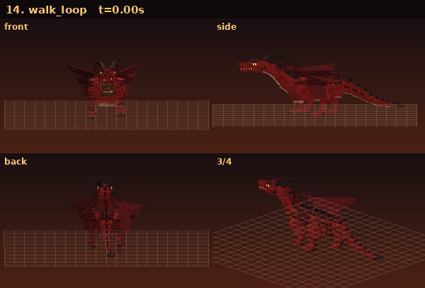
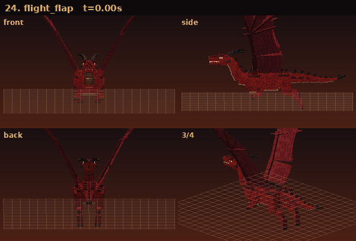
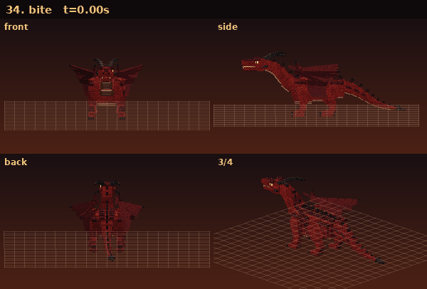
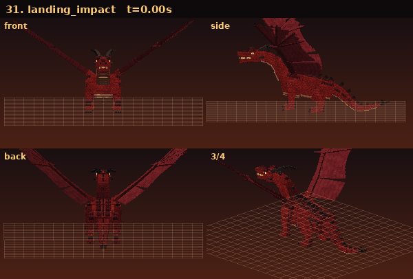
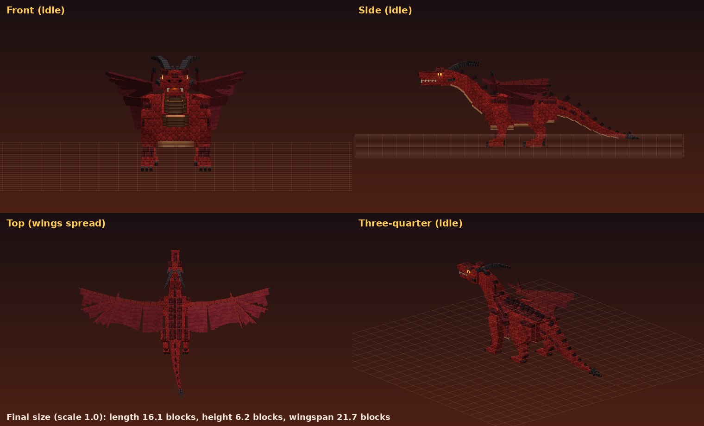
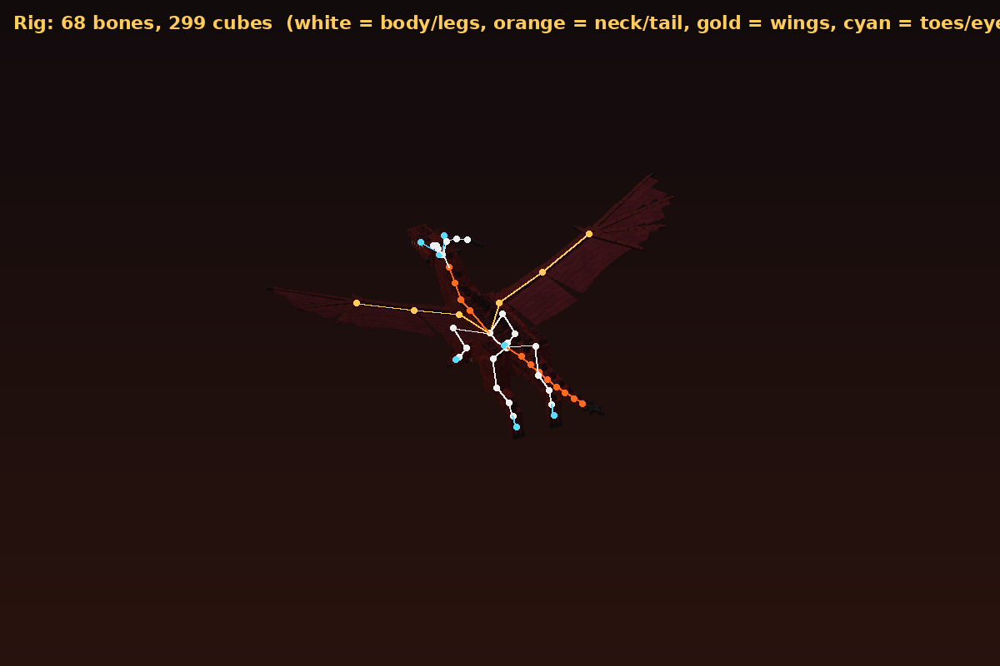
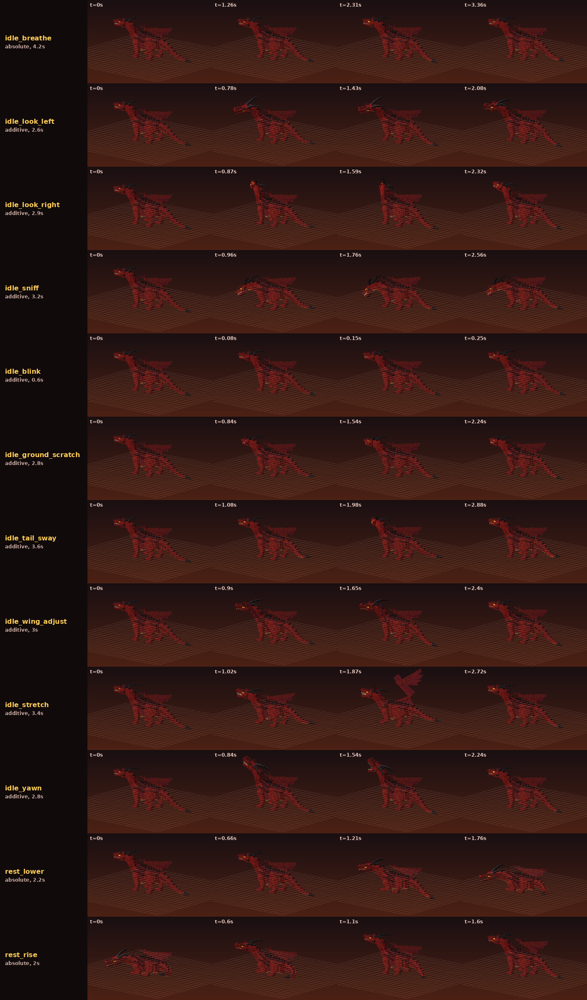
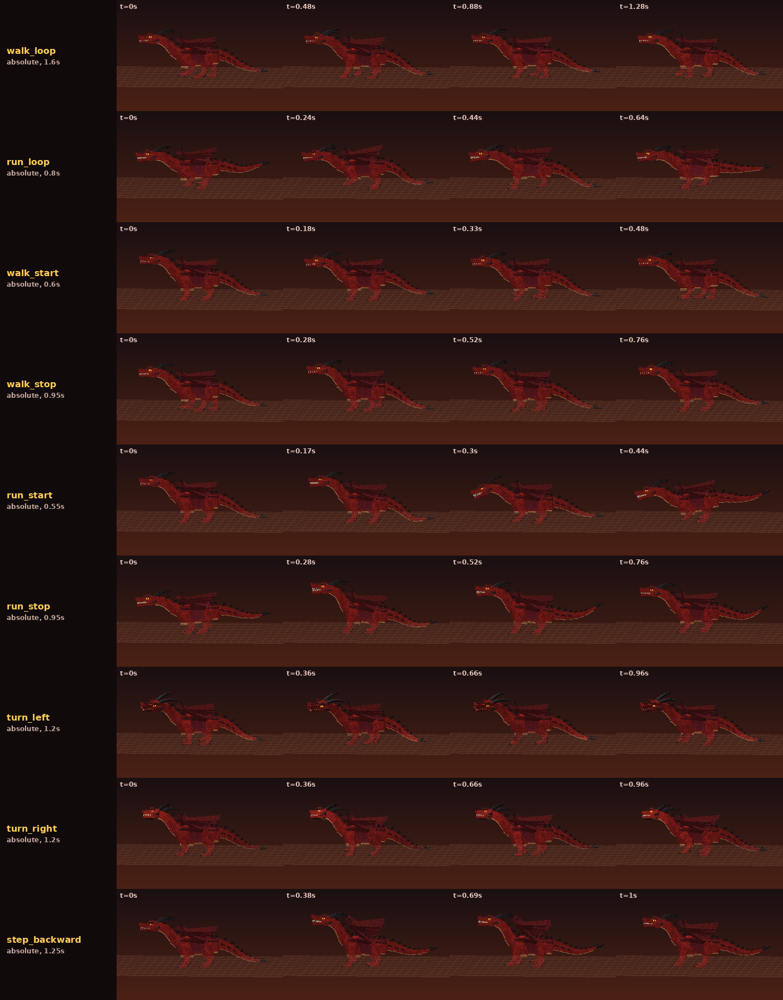
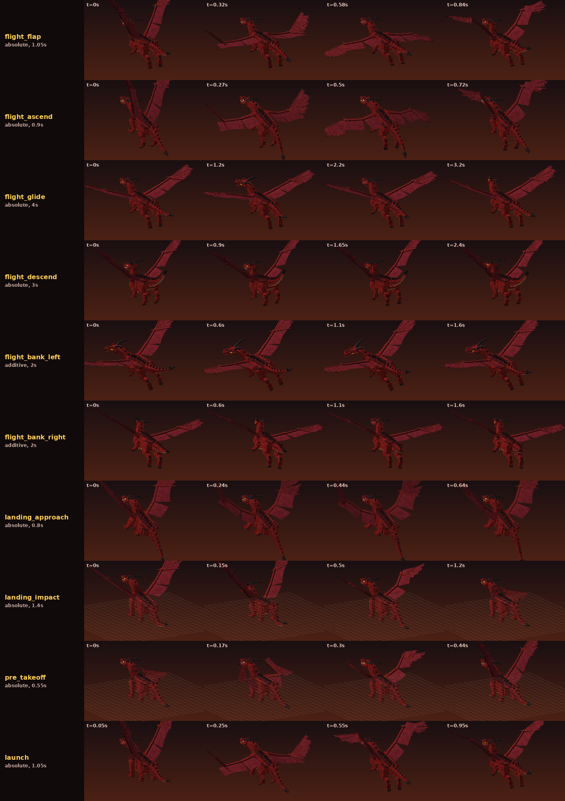
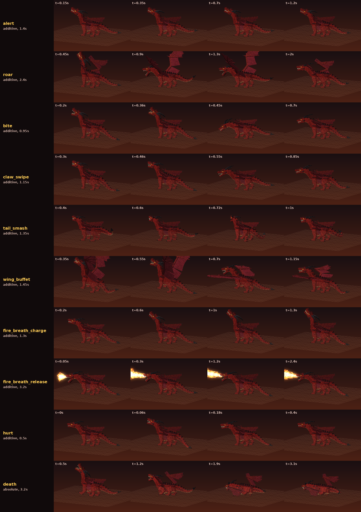

# Dragon or Draco — Phase 1: Red Dragon

แอดออน Minecraft Bedrock ชื่อ **Dragon or Draco** เวอร์ชันแรกนี้เพิ่มมังกรสายพันธุ์แรกคือ **Red Dragon** (`dod:red_dragon`)
เป็น custom entity ตัวใหม่ทั้งหมด ไม่ได้แทนที่ Ender Dragon หรือม็อบวานิลลาตัวไหน

**ไฟล์ติดตั้ง:** [`dist/Dragon_or_Draco_Red_Dragon_v1.mcaddon`](dist/Dragon_or_Draco_Red_Dragon_v1.mcaddon) (530 KB รวม Behavior Pack และ Resource Pack)

| | |
|---|---|
| เวอร์ชันแพ็ก | **1.1.0** (Animation Overhaul V2) — UUID เดิมทุกตัว นำเข้าทับเวอร์ชันก่อนได้ |
| เวอร์ชันเกม | Bedrock **1.26.60** ขึ้นไป (iPhone / iPad / Android / Windows / Console) |
| Script API | `@minecraft/server` **2.11.0** (stable) |
| Experimental toggles | **ไม่ต้องเปิด** |
| Entity ID | `dod:red_dragon` |
| เรียกมังกร | `/summon dod:red_dragon` หรือ Spawn Egg ใน Creative Inventory |

> **ยังไม่ได้ทดสอบในเกมจริง** ทั้งเวอร์ชันนี้และเวอร์ชันก่อน สภาพแวดล้อมที่ใช้สร้างไม่มีตัวเกม และการเปิดเซิร์ฟเวอร์ทดสอบผ่าน Creator Tools MCP
> ต้องรอผู้ใช้ยอมรับ Minecraft EULA ด้วยตัวเองก่อน (ดูหัวข้อ 5) ภาพและวิดีโอทุกชิ้นในหน้านี้ **เรนเดอร์ด้วยโปรแกรมจากไฟล์จริงของแพ็ก**
> (geometry, texture และ keyframe ที่เกมจะเล่น) **ไม่ใช่ภาพจากตัวเกม**

---

## เวอร์ชัน 1.1.0 — Red Dragon Animation Overhaul V2

ยังเป็นมังกรตัวเดิมทุกอย่าง แต่เปลี่ยนระบบการเคลื่อนไหวทั้งหมด

* **มังกรตัวเดิม ดีไซน์ สี และสัดส่วนเดิม:** cube เดิมทั้ง 297 ชิ้นมี origin/size/rotation/UV เหมือนเดิมทุกไบต์ ทุกมุมของ cube อยู่ตำแหน่งเดิมในท่าพัก
  และพิกเซลเดิมของ texture ไม่ถูกแตะ (`tools/rig_v2.py` ตรวจทั้ง 3 ข้อนี้ทุกครั้งที่ build ถ้าผิดแม้จุดเดียว build จะล้ม)
* **Rig ขั้นสูง:** เพิ่ม bone 6 ตัว (62 → **68**) คือนิ้วเท้า 4 ข้าง `toes_fl/fr/hl/hr` (เท้าม้วนส้นได้ นิ้วงอตอนก้าว) และเปลือกตา `eyelid_l/r` (กะพริบตา)
* **แอนิเมชันใหม่ 41 ท่า** (นับจริง ไม่มีท่าว่างหรือท่าสำเนา): หมวด A 12 + B 9 + C 10 + D 9 + **ท่าตายที่ปรับปรุงแล้ว** 1
  และ layer เสริม 2 ตัว (`rest_breathe`, `look_at_target`) ที่ไม่นับรวม
* **Animation Controller 6 ตัว** (move 19 สถานะ, idle 9, action 9, look, blink, hurt) blend ทุกจุด 0.05–0.5 วินาที
* **เท้าไม่ไถล:** วัดจากไฟล์ที่เกมเล่นจริง เท้าที่วางบนพื้นขยับได้ไม่เกิน **0.93 หน่วย** ตอนเดิน (เดิม **21.5–29.1 หน่วย** ≈ 1.3–1.8 บล็อกต่อก้าว)
* **ทุกท่ามีทริกเกอร์จริงในเกม** smoke test ยืนยันว่าสคริปต์ส่งค่าครบทุกค่าของ `dod:flight` (7), `dod:action` (11) และ `dod:idle` (11)
* ไม่มีสกิลหรือความสามารถต่อสู้ใหม่ ท่าโจมตียังเป็น 5 ท่าเดิม ดาเมจลงตรงเฟรมเดิม (กัด 0.45 / ตะปบ 0.55 / ฟาดหาง 0.72 / กระพือปีก 0.7 วินาที)

**วิดีโอและภาพเคลื่อนไหว** (เรนเดอร์จากไฟล์จริง ดูรายละเอียดหัวข้อ 3.6)
* วิดีโอรวมทุกท่า: [`docs/preview/showreel.mp4`](docs/preview/showreel.mp4)
* GIF ทีละท่า 4 มุม (หน้า / ข้าง / หลัง / เฉียง 3/4): [`docs/preview/anim/`](docs/preview/anim/)

| เดิน (`walk_loop`) พื้นตารางเลื่อนตามความเร็วจริง เท้าต้องติดพื้น | บิน (`flight_flap`) |
|---|---|
|  |  |
| **กัด (`bite`)** | **ลงจอด (`landing_impact`)** |
|  |  |

**วิธีอัปเดตบน iPhone:** เปิดไฟล์ `.mcaddon` ใหม่ได้เลย (เลขเวอร์ชันสูงกว่าเดิม UUID เดิม จึงทับของเดิม)
ถ้าเกมยังใช้ของเก่า ให้ลบแพ็ก "Dragon or Draco" ทั้ง 2 แพ็กที่ Settings → Storage แล้วนำเข้าใหม่ และแนะนำให้ทดสอบใน **โลกใหม่**

<details>
<summary>เวอร์ชัน 1.0.1 (แก้ "โมเดลไม่ขึ้น" บน iPhone)</summary>

* locator 5 ตัวที่ชื่อซ้ำกับ bone เปลี่ยนชื่อเป็น `chest_front`, `claw_fl/fr/hl/hr` และ locator ทุกตัวเขียนเป็น array `[x, y, z]` แบบโมเดลวานิลลา
* geometry ใช้ format `1.12.0` และ `npm run validate` มีกฎกันปัญหานี้ไม่ให้เกิดซ้ำ
* แก้แผ่นพังผืดปีกที่เคยถูกหมุนซ้ำ 2 รอบ

**ถ้ายังไม่เห็นโมเดล:** เปิด Settings → Creator → **Content Log GUI** แล้วเรียกมังกรใหม่ แคปข้อความ error สีแดงส่งมา
</details>



---

## 1. ติดตั้งบน iPhone

1. ดาวน์โหลดไฟล์ `Dragon_or_Draco_Red_Dragon_v1.mcaddon` ลงแอป **Files**
2. แตะที่ไฟล์ (หรือกด Share แล้วเลือก Minecraft) เกมจะเปิดขึ้นและนำเข้าแพ็กทั้งสองให้เอง รอจนขึ้นข้อความว่านำเข้าสำเร็จ 2 แพ็ก
3. สร้างโลกใหม่ (แนะนำให้ทดสอบในโลกใหม่ก่อน)
   * เปิด **Activate Cheats** ถ้าต้องการใช้คำสั่ง `/summon`
   * ไปที่ **Behavior Packs** แล้วเปิด **Dragon or Draco** (Resource Pack จะถูกเปิดตามมาเอง เพราะ BP อ้างถึง RP)
4. เข้าโลก แล้วเรียกมังกรด้วย Spawn Egg **Red Dragon Spawn Egg** (หมวดไข่เกิดใน Creative Inventory) หรือคำสั่ง
   `/summon dod:red_dragon ~ ~ ~12`

## 2. ขั้นตอนทดสอบในเกม (เช็กลิสต์)

มังกร **ไม่โจมตีผู้เล่นโหมด Creative / Spectator** (เหมือนม็อบวานิลลา) ทดสอบการต่อสู้ต้องใช้ `/gamemode survival`

| # | ทำอะไร | สิ่งที่ควรเห็น |
|---|---|---|
| 1 | `/summon dod:red_dragon ~ ~ ~12` | ยืนสี่ขา ปีกพับแนบตัว อกขยายหายใจ น้ำหนักโยกซ้าย-ขวาเบา ๆ หางแกว่ง กะพริบตาเป็นระยะไม่สม่ำเสมอ หัวหันตามผู้เล่น |
| 2 | ยืนดูห่าง ๆ (Creative ได้) รอ 1–2 นาที | ทุก 14–26 วินาทีจะทำพฤติกรรมหนึ่งอย่าง: มองซ้าย, มองขวา, ก้มดมพื้น, คุ้ยดิน, แกว่งหาง, จัดปีก, ยืดตัว, หาว หรือบินลาดตระเวน แล้วกลับมายืนปกติทุกครั้ง |
| 3 | ถอยออกไปไกลกว่า 40 บล็อก รอสักพัก | บางครั้ง **นอนลง** (ขาหลังพับก่อน ขาหน้าตาม คอกับหางขดมาด้านซ้าย) นอน 20–45 วินาทีแล้ว **ลุกขึ้น** เอง |
| 4 | ระหว่างที่มันนอน เดินเข้าไปในระยะ 28 บล็อก | ลุกขึ้นก่อน (หัว → ขาหน้า → ขาหลัง → หาง) แล้วจึงเตือน |
| 5 | `/gamemode survival` เดินเข้าไปที่ระยะประมาณ 20 บล็อก | **Alert** (หัวสะบัดหา ย่อตัว ปีกยกจากหลัง หางชี้) ต่อด้วย **คำรามเตือน** ทันที ระหว่างนั้นหันตัวหาเราแบบค่อย ๆ ก้าวเท้าหมุน ไม่ทำดาเมจ |
| 6 | ยืนแช่ในระยะเตือนเกิน 8 วินาที หรือเข้าใกล้กว่า 14 บล็อก | โหมดต่อสู้: ออกตัววิ่ง (`run_start`) → วิ่ง → เบรก (`run_stop`) เมื่อถึงตัว |
| 7 | ดูมันเดินช้า ๆ ตอนสงบ | เริ่มเดิน → เดิน → หยุด (ก้าวสุดท้ายเข้าที่แล้วโยกตัวตั้งหลัก) เท้าที่แตะพื้นต้องไม่ไถล |
| 8 | ยืนชิดหน้ามันมาก (น้อยกว่า 4 บล็อก) | บางครั้ง **ถอยหลัง 2 ก้าว** (ราว 1.4 บล็อก) เพื่อเว้นระยะ ไม่ทำดาเมจ |
| 9 | ยืนด้านข้างในระยะ 12 บล็อก | **หมุนตัวอยู่กับที่** ก้าวเท้าทแยงรอบจุดกลางลำตัว |
| 10 | ยืนตรงหน้าในระยะ 4–10 บล็อก | **กัด** (หดคอ อ้าปาก → พุ่ง → งับพร้อมสะบัด → ดึงกลับ) หรือ **ตะปบ** ถ้าอยู่ใกล้มาก |
| 11 | อ้อมไปด้านข้าง/ด้านหลัง ไม่เกิน 10 บล็อก | **ฟาดหาง** (ม้วนหางง้าง → เหวี่ยงโดยปลายหางตามหลังโคน → ฟาด → เลยไปแล้วกลับ) |
| 12 | ชวนเพื่อน 2 คนยืนใกล้ด้านหน้า | **กระพือปีก** (ยืนสองขาหลัง กางปีกง้างสูง → ตีลม → ตีซ้ำ → ลงสี่ขา พับปีก) |
| 13 | ยืนตรงหน้า 10–20 บล็อกในที่โล่ง | **ชาร์จไฟ** (คอขด S อกพอง ปากเรือง หัวสั่นแรงขึ้นเรื่อย ๆ) → **พ่นไฟ** (คอสะบัดไปข้างหน้า ลำไฟออกจากปาก) |
| 14 | ขึ้นไปยืนบนเสาสูงกว่าพื้นเกิน 5 บล็อก | ย่อตัวกางปีก (`pre_takeoff`) → ถีบตัวขึ้น (`launch`) → บินกระพือ/ไต่ระดับ/ร่อน/เอียงตัวตอนเลี้ยว → ร่อนลง → เบรกกลางอากาศ (`landing_approach`) → แตะพื้นย่อรับแรงแล้วพับปีก (`landing_impact`) |
| 15 | ตีจนตาย (หรือ `/kill @e[type=dod:red_dragon]`) | ท่า **ตาย** 3.2 วินาที (เซ ขาหน้าพับ ล้มตะแคง ปีกแผ่ หัวกระแทกพื้นแล้วเด้ง หางฟาด หายใจครั้งสุดท้าย) ระหว่างนี้ไม่รับดาเมจ |
| 16 | เอามังกรลงลาวาหรือไฟ | ไม่โดนดาเมจจากไฟและลาวา |

คำสั่งที่มีประโยชน์ระหว่างทดสอบ:
* `/kill @e[type=dod:red_dragon]` ลบมังกรทั้งหมด
* `/effect @s resistance 9999 4 true` ยืนดูท่าโจมตีได้โดยไม่ตาย
* Settings → Creator → Content Log GUI ดู error ของแพ็ก

---

## 3. รายงานระบบ

### 3.1 โมเดล 3D และ Rig

* **68 bones, 299 cubes** (cube เดิม 297 + แผ่นเปลือกตา 2) สไตล์ voxel มีมิติจริง
* โครงข้อต่อ: `head` แยกจากคอ, คอหลายข้อ `neck_1`–`neck_4`, `jaw`, `chest`, `body`, `pelvis`,
  ขาหน้า `leg_f?_upper → leg_f?_lower → foot_f? → toes_f?`, ขาหลัง `leg_h?_thigh → leg_h?_shin → leg_h?_meta → foot_h? → toes_h?`,
  ปีก `wing_?_upper → wing_?_fore → wing_?_hand → wing_?_f1..f4` + พังผืด `wing_?_mem_*`, หาง `tail_1`–`tail_8`, เปลือกตา `eyelid_l/r`
* **ส่วนที่เพิ่มใน V2 (ไม่เปลี่ยนรูปลักษณ์):**
  * `toes_*` : ย้ายลูกบาศก์นิ้วเท้าและกรงเล็บ (เท้าละ 6 ชิ้น) จาก bone เท้าไปเป็น bone ลูกที่หมุนตรงอุ้งเท้า ตำแหน่งในท่าพักเท่าเดิมทุกจุด
  * `eyelid_*` : แผ่นเปลือกตาบาง ๆ ใหม่ ในท่าพักพับเก็บอยู่ในกะโหลก (มองไม่เห็น) ท่ากะพริบจะหมุนลงมาปิดตา สีของเปลือกตาวาดลงพื้นที่ว่างของ texture เท่านั้น
* ขนาด (scale 1.0): ยาว **16.1** บล็อก, สูง **6.2** บล็อก, กางปีก **21.7** บล็อก, collision 3 × 4, hitbox 7 × 6
* Texture 512×512 พาเลตที่อนุมัติ: `#9D211E` `#BD392C` `#4B171A` `#79222B` `#C98150` `#292427` `#FFCD57` `#FF6B1E`



### 3.2 แอนิเมชัน V2 — นับจริง 41 ท่า

absolute = ท่าหลักที่กำหนดท่าทั้งตัว, additive = ท่าที่ซ้อนบนท่าหลัก (เช่นมองซ้ายขณะยืนหายใจ) ทุกท่ามีทริกเกอร์จากเกมจริง (คอลัมน์ขวา)

**A. Living Behaviour (12)** — P2 (ยกเว้น `idle_breathe` P1)

| # | animation id | ยาว | ทำอะไร | ทริกเกอร์ในเกม |
|---|---|---|---|---|
| 1 | `idle_breathe` | 4.2 วิ loop | อกและสีข้างขยาย ไหล่และปีกยกตามจังหวะหายใจเข้า น้ำหนักโยกซ้าย-ขวาบนเท้าที่วางนิ่ง หางแกว่ง ควันจมูก | ยืนนิ่ง (ท่าฐาน) |
| 2 | `idle_look_left` | 2.6 วิ | ตา/หัวนำ คอตามทีละข้อ เอียงหัวสงสัย มองซ้ำ หัวกลับก่อน | สุ่มทุก 14–26 วิ เมื่อสงบและอยู่บนพื้น |
| 3 | `idle_look_right` | 2.9 วิ | ยกคอมองข้ามไหล่ขวาช้า ๆ มองซ้ำ ดม 2 ครั้ง สะบัดปลายหาง | 〃 |
| 4 | `idle_sniff` | 3.2 วิ | ลดอกและหัวลงดมพื้น กวาดซ้าย-ขวาเป็นจังหวะ ขากรรไกรกระตุก ควันจมูก | 〃 |
| 5 | `idle_blink` | 0.3 วิ | เปลือกตาปิด-เปิด | ตัวจับเวลาฝั่งเครื่องผู้เล่น 2 รอบที่ไม่ลงตัวกัน (4.3/6.9 วิ) → กะพริบไม่สม่ำเสมอ งดตอนหาว/นอน/ลุก |
| 6 | `idle_ground_scratch` | 2.8 วิ | ถ่ายน้ำหนักไปขาซ้าย คุ้ยดินด้วยขาหน้าขวา 3 ครั้ง (กรงเล็บงอทุกครั้ง) มองเท้าตัวเอง ฝุ่น | สุ่มเมื่อสงบ |
| 7 | `idle_tail_sway` | 3.6 วิ | คลื่นรูปตัว S วิ่งไปตามหาง (ปลายตามหลังและแกว่งกว้างกว่า) สะโพกโยกสวน เหลียวมองหาง | 〃 |
| 8 | `idle_wing_adjust` | 3.0 วิ | กางปีกซ้ายครึ่งหนึ่ง (ไหล่ → ศอก → นิ้ว) สะบัด พับกลับ แล้วยักปีกขวาเล็กน้อย | 〃 |
| 9 | `idle_stretch` | 3.4 วิ | ยืดแบบแมว: ขาหน้ายื่น อกลดลงแต่สะโพกค้าง คอยืด ปีกยกครึ่ง หางยืดสั่น แล้วก้าวกลับ | 〃 |
| 10 | `idle_yawn` | 2.8 วิ | หายใจเข้า ยกหัว อ้าปากช้า ๆ ถึง 46° หลับตา สั่น หุบปากฉับ ส่ายหัว | 〃 |
| 11 | `rest_lower` | 2.2 วิ แล้วค้าง | นอนลง: ขาหลังพับก่อน ขาหน้าตาม ท้องแตะพื้น คอและหางขดไปทางซ้าย (+ layer `rest_breathe` หายใจช้าลึก) | สุ่มได้เฉพาะเมื่อไม่มีผู้เล่นในระยะ 40 บล็อก และห่างจากการนอนครั้งก่อน ≥ 90 วิ นอน 20–45 วิ |
| 12 | `rest_rise` | 2.0 วิ | ลุก: หัวยกและคอคลายก่อน ขาหน้าดันอกขึ้น ขาหลังตาม หางคลายสุดท้าย สะบัดตัว | ครบเวลานอน, ผู้เล่นเข้าระยะ 28 บล็อก, หรือถูกโจมตี |

**B. Ground Locomotion (9)** — P1

| # | animation id | ยาว | ทำอะไร | ทริกเกอร์ในเกม |
|---|---|---|---|---|
| 13 | `walk_start` | 0.6 วิ | ถ่ายน้ำหนักไปข้างหน้า ก้าวแรก จบตรงเฟสเริ่มของ `walk_loop` พอดี | ความเร็วพื้น > 0.45 บล็อก/วิ |
| 14 | `walk_loop` | 1.6 วิ loop | เดิน 4 จังหวะแบบ lateral-sequence (หลังซ้าย → หน้าซ้าย → หลังขวา → หน้าขวา) IK วางเท้า ส้นยก นิ้วม้วน **ความเร็วรอบผูกกับความเร็วจริง** | เดินต่อเนื่อง |
| 15 | `walk_stop` | 0.95 วิ | ชะลอบนเท้าที่วาง ก้าวสุดท้ายเข้าที่เป็นสี่เหลี่ยม ลำตัวโยกกลับแล้วนิ่ง | ความเร็ว < 0.3 |
| 16 | `run_start` | 0.55 วิ | ย่อลงบนขาหลัง (anticipation) แล้วถีบออกตัว จบตรงเฟสเริ่มของ `run_loop` | ไล่เป้าหมายที่ห่างเกิน 8 บล็อก และความเร็ว > 1.6 |
| 17 | `run_loop` | 0.8 วิ loop | ควบแบบ transverse gallop กระดูกสันหลังงอ-ยืด ลำตัวโยกหน้า-หลัง IK เท้า ความเร็วรอบผูกกับความเร็วจริง | วิ่งไล่ |
| 18 | `run_stop` | 0.95 วิ | เบรก: ขาหน้าปักไปข้างหน้า น้ำหนักเทไปขาหลัง หัวกับหางเหวี่ยงขึ้น แล้วตั้งหลัก ฝุ่น | ความเร็วลดลงหรือเลิกไล่ |
| 19 | `turn_left` | 1.2 วิ loop | หมุนอยู่กับที่ไปทางซ้าย: ก้าวทแยงรอบจุดกลางลำตัว อกนำ หัวมองเข้าโค้ง หางเหวี่ยงออก | หันเร็วกว่า 25°/วิ ขณะยืน (รอบท่าผูกกับความเร็วการหัน) |
| 20 | `turn_right` | 1.2 วิ loop | เหมือนกันแต่ไปทางขวา (solve IK แยกด้วยทิศกลับกัน) | 〃 |
| 21 | `step_backward` | 1.25 วิ | ถอยระวังตัว 2 ก้าว น้ำหนักไปข้างหลัง หัวดึงขึ้น ปีกกางนิดหนึ่ง หางยก | เป้าหมายชิดหน้าน้อยกว่า 4 บล็อก (โอกาส 35%, คูลดาวน์ 7 วิ) สคริปต์เลื่อนตัวถอย 22 หน่วยด้วยกราฟความเร็วเดียวกับท่า |

**C. Aerial Movement (10)** — P1

| # | animation id | ยาว | ทำอะไร | ทริกเกอร์ในเกม |
|---|---|---|---|---|
| 22 | `pre_takeoff` | 0.55 วิ | ย่อลงบนขาหลัง ปีกกางจากไหล่ก่อนแล้วง้างสูง หัวเงย หางยก | สคริปต์สั่งบิน (เป้าหมายอยู่สูง, ไล่ไม่ถึง, พ่นไฟระยะไกล, ลาดตระเวน) |
| 23 | `launch` | 1.05 วิ | ถีบขาบนเท้าที่วาง ตีปีกลงสุดแรก ขาห้อยแล้วเก็บ ไต่อีก 2 จังหวะ จบตรงเฟรมแรกของ `flight_flap` | เฟรมกระโดด 0.55 วิ (สคริปต์ปิดแรงโน้มถ่วงที่เฟรมเดียวกัน) |
| 24 | `flight_flap` | 1.05 วิ loop | ตีปีกลงเร็ว (power stroke) ยกกลับแบบพับครึ่ง ปลายปีกตามหลังโคน ลำตัวขึ้นลงสวนปีก หัวนิ่ง | บิน |
| 25 | `flight_ascend` | 0.9 วิ loop | ตีลึกและเร็วขึ้น ลำตัวเชิดขึ้น ขาห้อย หางต่ำเป็นหางเสือ | ผสมตามความเร็วไต่ขึ้นจริง (`q.vertical_speed`) |
| 26 | `flight_glide` | 4.0 วิ loop | ร่อน ปีกกางแต่ไม่นิ่ง: มุมปีกค่อย ๆ ยก-ลด นิ้วปีกพลิ้ว พังผืดสั่น หัวกวาดมอง หางคุมทิศ | ร่อน |
| 27 | `flight_descend` | 3.0 วิ loop | ร่อนลง ปีกยกเป็นรูปตัว V กวาดไปข้างหลัง ปลายปีกสั่นจากลม หัวก้ม ขาเริ่มลง หางยกเป็นเบรก | ผสมตามความเร็วดิ่งลงจริง |
| 28 | `flight_bank_left` | 2.0 วิ loop (additive) | เอียงตัวเข้าโค้ง หัวมองเข้าโค้งแต่คงระดับ ปีกด้านนอกเอื้อม หางลากออก | น้ำหนักตามอัตราการเลี้ยวซ้าย |
| 29 | `flight_bank_right` | 2.0 วิ loop (additive) | เหมือนกันแต่ไปทางขวา | น้ำหนักตามอัตราการเลี้ยวขวา |
| 30 | `landing_approach` | 0.8 วิ loop | เบรกกลางอากาศ: หัวเชิด ตีปีกถอยหลัง ขายื่นหาพื้น หางลง ตาจ้องจุดลง | ช่วงสุดท้ายก่อนแตะพื้น |
| 31 | `landing_impact` | 1.4 วิ | ขารับน้ำหนักบนเท้าที่วาง ตัวยุบแล้วเด้ง ปีกสะบัดขึ้นแล้วพับ ไหล่ → ศอก → นิ้ว หางกระแทกแล้วนิ่ง ฝุ่นวง | เฟรมแตะพื้น (สคริปต์เปิดแรงโน้มถ่วงที่เฟรมเดียวกัน) |

**D. Combat และ Reaction (9 + ท่าตาย)** — P3 ทุกท่าโจมตีแบ่งเป็น anticipation → action → impact → recovery

| # | animation id | ยาว | ทำอะไร (เฟรมกระทบ) | ทริกเกอร์ในเกม |
|---|---|---|---|---|
| 32 | `alert` | 1.4 วิ | หัวสะบัดหาผู้บุกรุก ย่อตัวเกร็ง ไหล่และปีกยกจากหลัง หางชี้แข็ง คำรามต่ำ | ผู้เล่นเข้าระยะเตือน / ก่อนเริ่มสู้ → ต่อด้วย roar ทันที |
| 33 | `roar` | 2.4 วิ | ง้าง: ถอยหัวหายใจเข้า อกพอง / action: พุ่งไปข้างหน้า อ้าปากกว้าง ปีกกางครึ่งสั่น ส่ายหัว / recovery: ตั้งหลัก | ต่อจาก alert |
| 34 | `bite` | 0.95 วิ | ขดคอถอย อ้าปาก ขาหน้ายัน → พุ่งเร่ง → **งับที่ 0.45 วิ** พร้อมสะบัด → ดึงกลับ เลยนิดแล้วนิ่ง | เป้าหมายข้างหน้า 4–10 บล็อก |
| 35 | `claw_swipe` | 1.15 วิ | ยกตัวลงน้ำหนักซ้าย ขาหน้าขวาง้างสูง → กวาด → **กระทบ 0.55 วิ** → บิดตัวตาม → วางเท้ากลับ | เป้าหมายใกล้ด้านหน้า |
| 36 | `tail_smash` | 1.35 วิ | บิดตัวง้าง หางม้วนสูงไปข้างหนึ่ง เหลียวหลัง → เหวี่ยงข้ามแนวหลัง (ปลายหางตามหลังโคน) → **ฟาด 0.72 วิ** → เลยแล้วกลับ | เป้าหมายด้านข้าง/หลัง |
| 37 | `wing_buffet` | 1.45 วิ | ยืนสองขาหลัง ปีกกางเต็มง้างสูงไปข้างหลัง → ตีไปข้างหน้า → **ลม 0.7 วิ** → ตีซ้ำ → ขาหน้าลงพื้น พับปีก | ศัตรูหลายตัวใกล้ด้านหน้า |
| 38 | `fire_breath_charge` | 1.3 วิ | คอขดเป็นตัว S อกพอง ปากแง้มเรืองแสง หัวสั่นแรงขึ้นเรื่อย ๆ หางสะบัด | เลือกพ่นไฟ (10–20 บล็อก) |
| 39 | `fire_breath_release` | 3.2 วิ (ค้าง) | คอสะบัดไปข้างหน้า (เลยนิดหนึ่ง) ปากเปิดสุด ลำไฟต่อเนื่อง มีแรงสะท้อนสั่น กวาดช้า ๆ มุมเล็งก้ม-เงยจากเซิร์ฟเวอร์ ลำไฟงอกออกจากปาก | ต่อจาก charge ทันที (สคริปต์พ่น 2.5 วิ) |
| 40 | `hurt` | 0.5 วิ (additive) | สะดุ้ง: หัวกระตุกหนี ลำตัวถอยใน 0.06 วิ บนเท้าที่วางนิ่ง ปีกและหางกระตุก แล้วคืนตัวแบบสั่นหน่วง | โดนดาเมจ (`q.hurt_time`) เล่นซ้อนกับท่าอื่นได้ |
| 41 | `death` | 3.2 วิ (ค้าง) | **(ปรับปรุงจากเดิม)** เซเจ็บ ขาหน้าพับ อกลง กลิ้งตะแคง ปีกแผ่ (ไม่จมพื้น) หัวกระแทกพื้นแล้วเด้ง หางฟาด หายใจครั้งสุดท้าย ประกายไฟ | ดาเมจที่จะทำให้ตาย |

**Layer เสริม (ไม่นับใน 41):** `rest_breathe` (หายใจช้าขณะนอน ปลายหางกระตุก) และ `look_at_target` (หันหัวตามผู้เล่นโดยกระจายมุมไปทุกข้อคอ ทำงานเฉพาะตอนยืนเฉย)






#### หลักการเคลื่อนไหวที่ใช้จริง (ไม่ใช่การหมุนค่าเดียวซ้ำ ๆ หรือขยับแค่ root)
ท่าทั้งหมดสร้างด้วยโปรแกรม (`tools/gen_animations.py` + `anim_kit.py` + `gait.py`) ที่คำนวณบนโครงกระดูกจริงของโมเดล แล้ว bake เป็น keyframe 30 fps
และลดจำนวนคีย์โดยตรวจกับสูตร catmull-rom ของ Bedrock ว่าคลาดไม่เกินเกณฑ์ (รวม **1,562 channel ที่มีคีย์จริง** สูงสุด 88 คีย์ต่อ channel)
* **ขา: Inverse Kinematics** (damped least squares) บนขาหน้า 3 ข้อและขาหลัง 4 ข้อ เท้าที่วางบนพื้นถูกตรึงในพิกัดโลก ส้นยกก่อน นิ้วเท้าม้วนตามความสูงของการก้าว
* **ความเร็วเท้าตรงกับความเร็วจริง:** `walk_loop` / `run_loop` / `turn_*` ใช้ `anim_time_update` ที่เร่ง-ชะลอรอบท่าตามความเร็วพื้นจริง (`q.ground_speed`) หรืออัตราการหันจริง (เทคนิคเดียวกับอูฐและแมงมุมวานิลลา)
* **หัวคงที่ (head stabilisation):** เมื่อลำตัวโยก ข้อคอทั้ง 4 ชดเชยให้หัวนิ่งในพิกัดโลกตามสัดส่วนที่กำหนด
* **ปีก:** พับแบบปลายก่อน (นิ้ว → มือ → ศอก → ไหล่) กางแบบไหล่ก่อน ตอนกระพือ ศอก มือ และนิ้วแต่ละนิ้วล่าช้ากว่าโคนเป็นลำดับ (overlap) พังผืดหดตอนยกปีกกลับ
* **หาง:** สปริงต่อกัน 8 ข้อขับด้วยการหมุนและการเร่งขึ้นลงของสะโพกจริง → ปลายหางตามหลัง (follow-through) และในท่าที่จบ สปริงจะนิ่งก่อนเฟรมสุดท้ายเสมอ (ไม่กระตุกตอนออกจากท่า)
* **ไม่มีทุกข้อจังหวะเดียวกัน:** ทุกส่วนมีเฟสและ easing ของตัวเอง มีจังหวะง้าง-ปล่อย-เลย-คืนตัว
* **ไม่จมดิน:** ทุกท่าบนพื้นผ่านขั้นตอนตรวจการสัมผัสพื้น (นิ้วเท้าและหางทีละข้อ) ท่า additive ตรวจโดยซ้อนบนท่าฐานจริง

### 3.3 Animation Controllers และการเปลี่ยนท่า

| คอนโทรลเลอร์ | สถานะ | หน้าที่ | blend |
|---|---|---|---|
| `move` | 19 | ท่าหลักทั้งตัว: idle, walk_start/walk/walk_stop, run_start/run/run_stop, turn_left/right, step_back, rest/rest_rise, pre_takeoff, launch, fly, glide, landing, touchdown, dead | 0.15–0.5 วิ |
| `idle` | 9 | พฤติกรรมชีวิต (additive) จาก `dod:idle` เฉพาะตอนอยู่บนพื้น | 0.3 วิ |
| `action` | 9 | alert, roar, 4 ท่าโจมตี, charge, release จาก `dod:action` | 0.18 วิ |
| `look` | 2 | หันหัวตามผู้เล่นตอนยืนเฉย | 0.4 วิ |
| `blink` | 2 | กะพริบตา | 0.05 วิ |
| `hurt` | 2 | สะดุ้ง | 0.12 วิ |

ลำดับการเปลี่ยนท่าที่บรีฟกำหนด:
* **Idle → Walk → Run → Stop:** `idle` →(ความเร็ว > 0.45)→ `walk_start` →(จบท่า)→ `walk` →(ไล่ + ความเร็ว > 1.6)→ `run_start` → `run` →(ช้าลง)→ `run_stop` → `walk` หรือ `idle`; เดินแล้วหยุด → `walk_stop` → `idle`
* **Idle → Alert → Roar:** สคริปต์ตั้ง `dod:action` = alert แล้วต่อเป็น roar **ในเฟรมเดียวกับที่ alert จบ** (มีคิวการกระทำ) ระหว่างนั้นตัวค่อย ๆ หัน ท่า `turn_*` จึงก้าวเท้าหมุนตามจริง
* **Ground → Takeoff → Flight:** `pre_takeoff` → (เฟรม 0.55 วิ แรงโน้มถ่วงปิด) `launch` → `fly` (ผสม `flight_ascend` ตามความเร็วไต่)
* **Flight → Glide → Landing → Ground:** `fly` ↔ `glide` (ผสม `flight_descend` ตามความเร็วดิ่ง, `flight_bank_*` ตามอัตราเลี้ยว) → `landing` (`landing_approach`) → (แตะพื้น แรงโน้มถ่วงกลับ) `touchdown` (`landing_impact`) → `idle`
* **Rest → Rise → Idle:** `rest` (`rest_lower` + `rest_breathe`) → `rest_rise` → `idle`

**กันท่าค้าง:**
* ทุกสถานะ (ยกเว้น dead) มีทางออก และทุกสถานะที่เล่นท่ามี `blend_transition` (`npm run validate` ตรวจทั้งสองข้อ)
* ท่าที่เล่นครั้งเดียวออกด้วย `q.all_animations_finished` ร่วมกับ `hold_on_last_frame` ซึ่งเป็นรูปแบบเดียวกับคอนโทรลเลอร์ armadillo ของ Mojang
* ท่าที่ผูกกับค่าของสคริปต์ออกทันทีเมื่อค่าเปลี่ยน และสคริปต์ตั้งเวลาเท่าความยาวท่าพอดี (smoke test ตรวจทุกครั้งว่าแต่ละพฤติกรรมยาวเท่าท่าเป๊ะ)
* `dod:flight` กลับเป็น ground เสมอ (ลงจอดเองที่ 24 วิ, บังคับลงที่ 40 วิ, โหลดโลกใหม่รีเซ็ตเป็นพื้นดิน) และ `dod:idle` / `dod:action` ถูกรีเซ็ตเป็น none เมื่อโหลดหรือเกิด error

### 3.4 ทริกเกอร์จากเกม (ฝั่งเซิร์ฟเวอร์ → เครื่องผู้เล่น)
สคริปต์ส่งสถานะผ่าน entity property ที่ซิงก์ไปเครื่องผู้เล่น (ส่งเฉพาะตอนค่าเปลี่ยน ไม่ส่งทุก tick)
* `dod:flight` : ground / takeoff / launch / fly / glide / landing / touchdown
* `dod:action` : none / alert / roar / bite / claw / tail / buffet / fire_charge / fire_breath / step_back / death
* `dod:idle` : none / look_left / look_right / sniff / scratch / tail_sway / wing_adjust / stretch / yawn / rest / rise
* `dod:aim` (มุมก้มเงยตอนพ่นไฟ), `dod:run` (กำลังไล่), `dod:jet` (ความยาวลำไฟ)

ฝั่งเครื่องผู้เล่นคำนวณเองด้วย Molang (`pre_animation` 12 บรรทัด ไม่มีงานเพิ่มบนเซิร์ฟเวอร์):
ความเร็วพื้นแบบหน่วง (`v.spd`), อัตราการหัน (`v.turn` จาก `q.body_y_rotation`), ความเร็วแนวตั้ง (`v.climb` / `v.dive`), น้ำหนักการเอียงตัว (`v.bank_l/r`), ตัวจับเวลากะพริบตา (`v.blink`)

### 3.5 รายงานการแก้แอนิเมชันเดิม (v1 → V2)

| ปัญหาใน v1 | หลักฐาน | V2 แก้อย่างไร | ผลที่วัดได้ |
|---|---|---|---|
| เท้าไถลตอนเดิน | ขาใช้ sine ตาม `q.modified_distance_moved` ไม่มี IK วัดด้วยวิธีเดียวกันได้ **21.5–29.1 หน่วย** ต่อก้าว (1.3–1.8 บล็อก) | IK ตรึงเท้า + รอบท่าผูกกับความเร็วจริง | เดิน **≤ 0.93**, วิ่ง **≤ 1.11** หน่วย (< 0.07 บล็อก) |
| `wing_spread` / `wing_fold` ไม่เคยถูกเล่น | ไม่มีคอนโทรลเลอร์ไหนอ้างถึงเลย | การพับ/กางปีกอยู่ในท่าที่ใช้จริง (`pre_takeoff`, `launch`, `landing_impact`, `idle_wing_adjust`, `idle_stretch`, `roar`, `wing_buffet`) และมีกฎ validate ห้ามท่าที่ไม่ถูกเล่น | 41/41 ท่าถูกเล่นโดยคอนโทรลเลอร์ |
| ทุกข้อต่อใช้ sine จังหวะเดียวกัน | idle/walk/run/glide เป็นสูตร sine 13–29 channel ต่อท่า | keyframe ที่คำนวณบนโครงจริง มีเฟสต่างกันทุกส่วน มี overlap และ follow-through | 1,562 channel ที่มีคีย์จริง |
| ไม่มีท่าเริ่ม/หยุด/หัน | เดิน → หยุดเป็นการ blend ตรง ๆ | `walk_start/stop`, `run_start/stop`, `turn_left/right` | ครบทุกลำดับในหัวข้อ 3.3 |
| ร่อนปีกนิ่ง | `glide` เดิมกางปีกค้าง | `flight_glide` มีมุมปีก นิ้ว พังผืด หัว หาง ขยับตลอด + ผสม `flight_descend` และ `flight_bank_*` | — |
| บินขึ้น/ลงเป็นท่ายาวท่าเดียว | ท่าไม่รู้ว่าตัวขึ้นจากพื้นหรือแตะพื้นจริงเมื่อไร | แยกเป็น `pre_takeoff` + `launch` และ `landing_approach` + `landing_impact` สคริปต์เปิด/ปิดแรงโน้มถ่วงตรงเฟรมเปลี่ยนท่า | smoke test ยืนยันเฟรมตรงกัน |
| พฤติกรรมว่างซ้ำ ๆ | มีแค่ `look_around` และ `wing_stretch` | 8 พฤติกรรม + นอน/ลุก + กะพริบตา สุ่มแบบถ่วงน้ำหนัก | 20 นาทีจำลองเกิดครบทุกแบบ ห่างกันอย่างน้อย 14 วิ |
| หัวโยกตามตัว หางแข็ง | — | head stabilisation และสปริงหาง | — |
| หันตัวกระตุก | สคริปต์ `setRotation` ไปหาเป้าหมายทันทีตอนเริ่มท่า | หันทีละ 3–6° ต่อ tick ระหว่างท่า ท่า `turn_*` เล่นตาม | smoke test: ไม่เกิน 5°/tick |
| ท่าตายจมดิน/ทื่อ | 2.8 วิ ล้มตรง ๆ | 3.2 วิ มีจังหวะเซ ขาพับ กลิ้ง หัวเด้ง หางฟาด ปีกไม่จมพื้น | จุดต่ำสุดของทุกท่าบนพื้น ≥ −0.89 หน่วย |

### 3.6 ภาพพรีวิวการเคลื่อนไหว
* `docs/preview/anim/<animation>.gif` : **42 ไฟล์** (41 ท่า + `rest_breathe`) แต่ละไฟล์มี **4 มุมพร้อมกัน: หน้า / ข้าง / หลัง / เฉียง 3/4** 12 fps
  ท่าเคลื่อนที่ พื้นตารางเลื่อนด้วยความเร็วเดินทางของท่า เท้าที่วางต้องดูติดพื้น ท่า additive แสดงซ้อนบนท่าฐานแบบเดียวกับคอนโทรลเลอร์
* `docs/preview/showreel.mp4` : วิดีโอ 960×540 24 fps ไล่ทุกท่าตามลำดับ (มุมเฉียง)
* `docs/preview/animations_A_living.png`, `_B_ground`, `_C_aerial`, `_D_combat` : contact sheet ท่าละ 4 เฟรม (ท่าโจมตีแสดงเฟรม ง้าง / action / กระทบ / คืนตัว)
* สร้างใหม่ได้ด้วย `npm run preview` (ต้องมี Python 3 + numpy + Pillow + ffmpeg)

### 3.7 Behavior AI (`scripts/brain.js`, `flight.js`)
* **สำรวจพื้นที่:** เดินสุ่มรอบบริเวณ จำจุดเกิดเป็น "บ้าน" ใน dynamic property `dod:home`
* **พฤติกรรมชีวิต:** ทุก 14–26 วินาทีเมื่อสงบ เลือกพฤติกรรมแบบถ่วงน้ำหนัก (มองซ้าย 14, มองขวา 14, ดม 13, แกว่งหาง 12, คุ้ยดิน 10, จัดปีก 10, ยืด 8, หาว 8, นอน 7) หรือบินลาดตระเวน (15%)
  ระหว่างพฤติกรรมล็อกการเดินไว้ (เท้าไม่ไถลจาก AI เดิน) และหยุดทันทีเมื่อมีเหตุการณ์ (นอนอยู่จะลุกก่อนเสมอ)
* **เตือน:** ผู้เล่นเข้าระยะ 28 บล็อก (มองเห็น) → alert → คำรามเตือน (คูลดาวน์ 25 วินาที) ไม่ทำดาเมจ
* **โจมตีเมื่อถูกคุกคาม:** เข้าใกล้กว่า 14 บล็อก, ยืนแช่เกิน 8 วินาทีหลังโดนเตือน, หรือทำร้ายมังกร → alert + roar ประกาศ แล้วเข้าสู้
* **ติดตามเป้าหมาย:** เดิน/วิ่งไล่ด้วย pathfinding ของเกม เลิกเมื่อเป้าหมายตายหรือหายไปนาน 20 วินาที
* **ระยะประชิด:** ชิดหน้าน้อยกว่า 4 บล็อก บางครั้งถอยหลัง 2 ก้าว (การเคลื่อนที่ ไม่ใช่การโจมตี) / เป้าหมายอยู่ด้านข้างและยังไม่มีท่าที่ใช้ได้ → หมุนตัวอยู่กับที่ 3.5°/tick
* **เลือกท่าตามระยะและตำแหน่ง**, **บินขึ้น/ลงตามสถานการณ์**, **สู้ได้ทั้งพื้นดินและกลางอากาศ**, **ไม่บินค้าง**, **ไม่สแปมท่า** (เว้น 1.2 วินาที + คูลดาวน์แยก) เหมือนเวอร์ชันก่อน
* **การตาย:** ดาเมจที่จะทำให้ตายถูกยกเลิกด้วย `world.beforeEvents.entityHurt` เล่นท่าตาย 3.2 วินาที (อมตะระหว่างนั้น) แล้ว `kill()` จริง
* **การเกิดตามธรรมชาติ:** ยากมาก เฉพาะ windswept hills, stony peaks (Y ≥ 90) และ badlands (Y ≥ 70) weight 1, รอดคัด 10%, ครั้งละ 1 ตัว ตัวที่เกิดเองหายเมื่อผู้เล่นอยู่ไกล

### 3.8 ระบบต่อสู้ (`scripts/combat.js`) — ไม่เปลี่ยนจากเวอร์ชันก่อน
ดาเมจของทุกท่าเกิด **ตรงเฟรมกระทบของแอนิเมชัน** (ตรวจด้วย smoke test)
* **Bite:** จุดกัดคำนวณจากตำแหน่งปากจริงในเฟรมงับ รัศมี 3.2 บล็อก
* **Claw Swipe:** โค้งด้านหน้า ±75° ไม่เกิน 6.5 บล็อก + กระเด็นเล็กน้อย
* **Tail Smash:** ด้านข้างและด้านหลัง (มุมเกิน 85°) ไม่เกิน 10.5 บล็อก + กระเด็น
* **Wing Buffet:** ครึ่งหน้า ±110° ไม่เกิน 8 บล็อก ดาเมจน้อยแต่ผลักแรง + ยกตัว
* **Fire Breath:** ชาร์จ 1.3 วินาที → พ่น 2.5 วินาที หันตามเป้าหมายช้า ๆ มุมก้มเงยส่งผ่าน `dod:aim`
  ตำแหน่งปาก **วัดจาก forward kinematics ของไฟล์โมเดลและแอนิเมชัน V2 จริง** (`tools/gen_offsets.py`) ดาเมจเฉพาะในกรวย ±14° ระยะ 16 บล็อก ไม่เลยกำแพงแรก
* **ทนไฟและลาวา**, **ไม่ทำลายภูมิประเทศ** (ไม่มีระเบิด ไม่วางไฟ ไม่ทำลายบล็อก), ไม่ทำร้ายมังกรแดงตัวอื่นและผู้เล่น Creative/Spectator

### 3.9 เอฟเฟกต์และเสียง
* **14 particle** (เพิ่มฝุ่นเท้า `dod:dust_puff` ตอนเดิน/วิ่ง/คุ้ยดิน) emitter ทุกตัวจบเอง สคริปต์มีงบไม่เกิน 12 emitter ต่อ tick
* **เสียง 26 event** (เพิ่มคุ้ยดินและหาว) เสียงก้าวเท้ามาจากคีย์เฟรมของท่าเดิน/วิ่ง/หัน/ถอย ตรงจังหวะเท้าแตะพื้น
  ใช้ไฟล์เสียงที่มากับเกมเท่านั้น (88 path ตรวจกับ Mojang `bedrock-samples` 1.26.60.5 แล้ว) แพ็กไม่แจกจ่ายไฟล์เสียงเอง

---

## 4. ค่าทดลอง (ยังไม่ใช่ค่าสุดท้าย รออนุมัติ)

ค่าทั้งหมดอยู่ไฟล์เดียว: **[`balance.json`](balance.json)** แก้แล้วรัน `npm run build` ระบบจะเขียนค่าลงทั้ง entity JSON และสคริปต์ให้เอง
(ถ้าจะแก้ในแพ็กที่ติดตั้งแล้วโดยตรง: HP/ความเร็วอยู่ใน `entities/red_dragon.json`, ค่าต่อสู้อยู่ใน `scripts/balance.js`)

ดาเมจเป็นหน่วย "ครึ่งหัวใจ" (2 = 1 หัวใจ) เวลาเป็นวินาที ระยะเป็นบล็อก

| หมวด | ค่า |
|---|---|
| HP | 300 (Ender Dragon = 200) |
| ความเร็วเดิน / วิ่งไล่ | 0.2 / ×1.45 |
| ความเร็วบิน / ร่อน | 0.55 / 0.62 บล็อกต่อ tick |
| Knockback resistance | 1.0 (ไม่กระเด็น) |
| ระยะเตือน / ระยะอันตราย | 28 / 14 บล็อก |
| พฤติกรรมชีวิต | ทุก 14–26 วินาที |
| เว้นระหว่างท่า | 1.2 วินาที |
| Bite | ดาเมจ 14, คูลดาวน์ 2.5, ระยะ 4–10, มุม ±32° |
| Claw Swipe | ดาเมจ 10, คูลดาวน์ 4, ระยะ ≤ 6.5, มุม ±75° |
| Tail Smash | ดาเมจ 12, คูลดาวน์ 6, ระยะ ≤ 10.5, มุม > 85° |
| Wing Buffet | ดาเมจ 4 + ผลัก 2.4, คูลดาวน์ 10, ระยะ ≤ 8 |
| Fire Breath | 4 ต่อ 0.25 วินาที + ติดไฟ 5 วินาที, คูลดาวน์ 12, ระยะใช้ 7–20, ไฟยาว 16, กรวย ±14° |
| การบิน | ลงจอดเองที่ 24 วินาที, บังคับลงที่ 40 วินาที |
| XP เมื่อตาย | 50 (ลูกแก้ว XP ของเกม ไม่ใช่ไอเท็มดรอป) |
| เกิดตามธรรมชาติ | รอดคัด 10%, weight 1 |

ถ้าเปลี่ยน `entity.scale` จังหวะเท้าจะปรับตามให้เองตอน build (ความยาวก้าวคูณ scale)

---

## 5. ผลการทดสอบ

**ทดสอบแล้ว (อัตโนมัติ) ผ่านทั้งหมด** — `npm run build` รันครบทุกขั้นในคำสั่งเดียว
1. **Rig V2 guarantee** (`tools/rig_v2.py`): cube เดิม 297 ชิ้นไม่เปลี่ยนทั้งข้อมูลและตำแหน่งในท่าพัก, พิกเซลเดิมของ texture ไม่ถูกเขียนทับ, เปลือกตาซ่อนในกะโหลกตอนพักและปิดตาได้จริงตอนกะพริบ
2. **TypeScript** `strict` ผ่านกับ typings ทางการ `@minecraft/server` 2.11.0
3. **Minecraft Creator Tools 0.20.0 `validate`: 0 error**
   * warning 2 รายการเป็นเรื่อง schema เดิม (`uv_anim` ที่ไม่บังคับใน render controller, รูปแบบ string ใน `item_texture.json`)
   * recommendation 91 รายการ: 88 คือ "ลิงก์ไปเสียงวานิลลา" (ตั้งใจ) และ 3 คือแนะนำเลข format version ใหม่กว่า
4. **ตรวจการอ้างอิงข้ามไฟล์ 5,669/5,669** (`npm run validate`) เพิ่มกฎของ V2:
   ทุกท่าในไฟล์ถูก map ใน client entity และถูกเล่นโดยคอนโทรลเลอร์ (ไม่มีท่ากำพร้า), ทุกค่าของ `dod:flight/action/idle` มีทั้งทางเข้าในคอนโทรลเลอร์และถูกตั้งโดยสคริปต์,
   ทุกสถานะเข้าถึงได้และไม่มีทางตัน, ทุกสถานะที่เล่นท่ามี blend, ทุกท่า loop ปิดรอยต่อ (คีย์แรก = คีย์สุดท้าย), bone ของ rig V2 ครบ, UUID เดิมของแพ็ก
   รวมกฎเดิม: ชื่อ bone/locator ตรงกับ geometry, UV ไม่เกินขอบ, enum ที่ Molang เปรียบเทียบมีอยู่จริง, event/particle/เสียงมีอยู่จริง ฯลฯ
5. **Motion checks** (`npm run motion`, `tools/motion_checks.py`) วัดจากไฟล์ที่เกมเล่นจริง:
   เท้าไถลขณะวาง เดิน ≤ 0.93 / วิ่ง ≤ 1.11 หน่วย (v1 วัดวิธีเดียวกัน 21.5–29.1), จุดต่ำสุดของทุกท่าบนพื้น ≥ −0.89 หน่วย (≈ 0.06 บล็อก, ท่า additive วัดโดยซ้อนบนท่าฐาน),
   รอยต่อ loop ปิดครบ 14 ท่า, และท่า additive ที่เล่นครั้งเดียวทั้ง 16 ท่าเริ่มและจบที่ท่าพัก (คลาดสูงสุด 0.66° ที่ปลายหาง) จึงไม่กระตุกตอนเข้า/ออกท่า
   (charge → release ต่อกันโดยตรงและค้างท่า จึงไม่อยู่ในเกณฑ์นี้)
6. **Smoke test 104/104** (`npm run smoke`) รันสคริปต์ที่ compile แล้วบน mock ของ `@minecraft/server` ที่ตรวจ id ทุกตัวกับไฟล์จริง เพิ่มฉากของ V2:
   จำลอง 20 นาทีให้พฤติกรรมชีวิตเกิดครบทุกแบบ แต่ละแบบยาวเท่าท่าเป๊ะ ไม่ต่อกันเอง ล็อกการเดินระหว่างเล่น, alert → roar ต่อกันในเฟรมที่ alert จบ และหันตัวไม่เกิน 5°/tick,
   นอนแล้วลุกเมื่อผู้เล่นเข้าใกล้ก่อนจะเตือน, ถอยหลังได้ระยะ 1.37 บล็อก (ท่ากำหนด 1.38) และไม่ทำดาเมจ, หมุนตัวอยู่กับที่,
   ลำดับการบิน takeoff → launch → fly/glide → landing → touchdown → ground เท่านั้น และแรงโน้มถ่วงเปิด/ปิดตรงเฟรมกระโดด/แตะพื้น,
   ทุกค่าของ `dod:flight` (7) `dod:action` (11) `dod:idle` (11) ถูกสคริปต์ส่งจริง
   รวมฉากเดิมทั้งหมด (ดาเมจตรงเฟรมกระทบ, พ่นไฟออกจากปากตามแนวเล็ง ไม่ย้อนกลับ ไม่ทะลุกำแพง, ไม่บินค้าง, ตาย, รีเซ็ตเมื่อโหลดโลก, ไม่ทำร้าย Creative)
7. **Package:** Creator Tools `exportaddon` → `.mcaddon` 530 KB 62 ไฟล์ ตรวจแล้วว่ามีทุกไฟล์ของทั้ง 2 แพ็ก

**ยังไม่ได้ทดสอบในเกมจริง** — สภาพแวดล้อม cloud ไม่มีตัวเกม และการเปิด Bedrock Dedicated Server ผ่าน MCP (`createMinecraftSessionWithContent`)
ต้องให้ผู้ใช้ยอมรับ Minecraft EULA ด้วยตัวเองก่อน (`npx -y @minecraft/creator-tools@0.20.0 eula`) จึง **ยืนยันไม่ได้ว่าท่าทั้งหมดแสดงผลในเกมตรงกับพรีวิว**
ถ้ายอมรับ EULA แล้ว สามารถสั่งให้ทดสอบผ่าน MCP ต่อได้

## 6. ข้อจำกัดและสิ่งที่ต้องตรวจในเกม

1. **ยังไม่ได้ทดสอบในเกม** (ดูหัวข้อ 5) ตัวเลขทุกตัวในหน้านี้มาจากการคำนวณบนไฟล์จริงและ mock ของ Script API
2. **ทิศการหัน:** ท่า `turn_left/right` และ `flight_bank_left/right` เลือกจากเครื่องหมายของการเปลี่ยน `q.body_y_rotation` (สมมติว่าค่าเพิ่ม = หันขวา ตามระบบ yaw ของ Minecraft) ถ้าในเกมเห็นท่าหันสลับข้าง แก้ได้ที่เครื่องหมายบรรทัดเดียวใน `pre_animation`
3. **เกณฑ์ความเร็ว** (เริ่มเดิน 0.45, หยุด 0.3, เริ่มวิ่ง 1.6 บล็อก/วิ, หัน 25°/วิ) ตั้งจากการคำนวณ อาจต้องปรับหลังเห็นในเกม
4. `turn_right` และ `flight_bank_right` สร้างด้วยฟังก์ชันเดียวกับฝั่งซ้ายแต่กลับทิศ (solve IK ใหม่ ไม่ได้คัดลอกคีย์) จึงสมมาตรกับฝั่งซ้าย
5. `step_backward` เป็นการเคลื่อนที่ถอยหลังตามบรีฟหมวด B ไม่ใช่ท่าโจมตีและไม่ทำดาเมจ
6. **ลำไฟ geometry** ใช้ material วานิลลา `entity_beam_additive` ถ้าในเกมไม่แสดงหรือดูแปลก แจ้งได้ (อนุภาคไฟฝั่งเซิร์ฟเวอร์ยังแสดงอยู่ดี)
7. **ประสิทธิภาพบน iPhone:** 68 bones และไฟล์แอนิเมชัน ~1 MB (โหลดครั้งเดียว บีบอัดในแพ็กเหลือราว 0.5 MB) งานต่อ tick ฝั่งเซิร์ฟเวอร์ไม่เพิ่ม (พฤติกรรมใช้ตัวจับเวลา ตรวจสภาพแวดล้อมทุก 5 tick)
   เปิด `should_update_bones_and_effects_offscreen` ไว้เพื่อให้ค่าความเร็ว/การหันไม่กระโดดเมื่อมังกรกลับเข้าจอ ถ้าพบว่าหนัก ปิดได้
8. ช่วงเปลี่ยนจาก charge เป็น release คอขยับเร็ว (ต่างกันสูงสุด 16° ใน 0.18 วินาที) ซึ่งตั้งใจให้เป็นจังหวะสะบัดคอ
9. **Hitbox** เป็นกล่องเดียว 7×6 บล็อก (Bedrock ไม่มี hitbox หลายชิ้นสำหรับแอดออน) และ collision 3×4 ทำให้หัว/หางทะลุบล็อกได้บ้าง
10. **Pathfinding** ของม็อบกว้าง 3 บล็อกในภูเขาแคบอาจติด มีระบบบินขึ้นเมื่อไล่ไม่ถึง 8 วินาทีช่วย
11. หลังท่าตาย เกมจะเล่นการตายแบบวานิลลาต่ออีกราว 1 วินาที (ควันแดง) ซึ่งแอดออนปิดไม่ได้
12. Bedrock ไม่มีภาษาไทยในรายการภาษา UI ชื่อในเกมจึงเป็น "Red Dragon" / "Red Dragon Spawn Egg"
13. **ระบบที่ยังไม่อนุมัติและไม่ได้เพิ่ม:** Fireball, โหมดคลั่ง, การขี่, การเลี้ยง, ไอเท็มดรอปพิเศษ, boss bar, การทำลายบล็อก, สกิลต่อสู้ใหม่

---

## 7. โครงสร้างโปรเจกต์

```
dragon-or-draco-addon/
├─ dist/Dragon_or_Draco_Red_Dragon_v1.mcaddon   ← ไฟล์ติดตั้ง
├─ balance.json                                  ← ค่าทดลองทั้งหมด (แก้ที่นี่)
├─ addon/
│  ├─ behavior_packs/dragon_or_draco/            ← manifest, entities/, spawn_rules/, scripts/ (compile แล้ว)
│  └─ resource_packs/dragon_or_draco/            ← manifest, entity/, models/, textures/, animations/,
│                                                   animation_controllers/, render_controllers/, particles/, sounds/, texts/
├─ scripts-src/        ← สคริปต์ TypeScript (main, brain, combat, flight, dragon, fx, vec + balance/offsets ที่ generate)
├─ tools/
│  ├─ gen_model.py        โมเดล + texture             ├─ rig_v2.py        เพิ่ม bone นิ้วเท้า/เปลือกตา + ตรวจว่ารูปลักษณ์ไม่เปลี่ยน
│  ├─ gen_animations.py   41 ท่า + คอนโทรลเลอร์       ├─ anim_kit.py      easing, keyframe, ลดคีย์, สปริง, solver
│  ├─ gait.py             IK ขา, ท่าเดิน, หัวคงที่, หาง, การสัมผัสพื้น
│  ├─ gen_fx.py           particle + client entity + render controller
│  ├─ gen_sounds.py, gen_entity.py, gen_offsets.py
│  ├─ motion_checks.py    วัดเท้าไถล/จมดิน/รอยต่อ loop   ├─ motion_preview.py  GIF 4 มุม + showreel.mp4
│  ├─ kinematics.py, render_preview.py, preview_sheets.py, icons.py   ← เรนเดอร์ภาพพรีวิว
│  ├─ anim_report.json, anim_manifest.json, motion_report.json, preview_spec.json   ← ผลที่ generate
│  └─ validate.mjs, smoke/ (mock-server.mjs + smoke.mjs), package.mjs
├─ docs/preview/       ← ภาพพรีวิว, anim/*.gif, showreel.mp4     docs/reference/ ← ภาพต้นแบบที่ได้รับอนุมัติ
```

**สิ่งที่ใช้ Minecraft Creator Tools (0.20.0)**

| เครื่องมือ | ใช้ทำอะไร |
|---|---|
| Skills `create-mob`, `design-model` | ขั้นตอนอ้างอิง |
| `createMinecraftContent` | โครง BP/RP, manifest และ UUID ตั้งต้น |
| `writeImageFileFromPixelArt` | ไอคอน Spawn Egg |
| `validateFile` + CLI `validate` | ตรวจไฟล์ทั้งโปรเจกต์ |
| CLI `exportaddon` | แพ็ก `.mcaddon` |
| `createMinecraftSessionWithContent` | เปิดเซิร์ฟเวอร์ทดสอบ (รอผู้ใช้ยอมรับ EULA) |

### Build เอง
```bash
cd dragon-or-draco-addon
npm install
npm run build     # assets → compile → validate → motion checks → smoke test → package
npm run preview   # contact sheets + GIF 4 มุมทุกท่า + showreel.mp4 (Python 3 + numpy + Pillow + ffmpeg)
```
ถ้าจะออกเวอร์ชันใหม่ให้ iPhone นำเข้าทับของเดิมได้ ให้เพิ่ม `version` ใน `header` และ `modules` ของ manifest ทั้งสองไฟล์ (และ dependency ของ BP ที่ชี้ไป RP) โดยคง UUID เดิม
