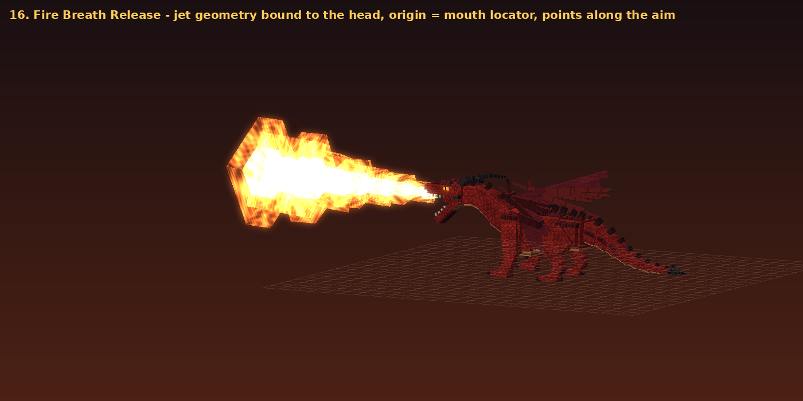
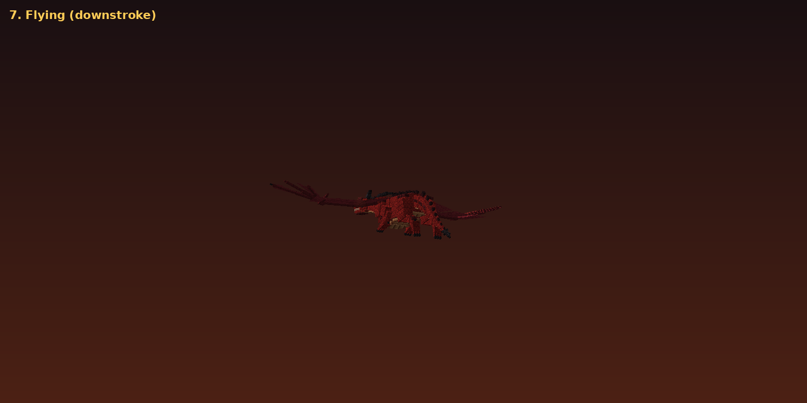
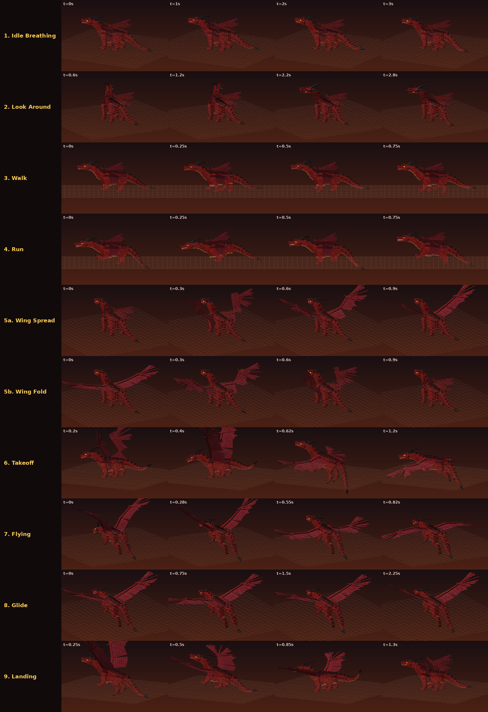
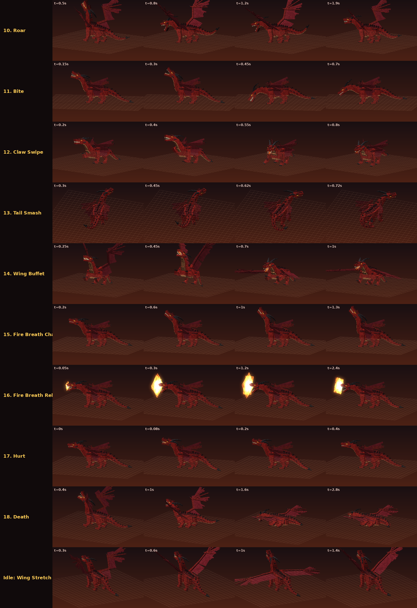

# Dragon or Draco — Phase 1: Red Dragon

แอดออน Minecraft Bedrock ชื่อ **Dragon or Draco** เวอร์ชันแรกนี้เพิ่มมังกรสายพันธุ์แรกคือ **Red Dragon** (`dod:red_dragon`)
เป็น custom entity ตัวใหม่ทั้งหมด ไม่ได้แทนที่ Ender Dragon หรือม็อบวานิลลาตัวไหน

**ไฟล์ติดตั้ง:** [`dist/Dragon_or_Draco_Red_Dragon_v1.mcaddon`](dist/Dragon_or_Draco_Red_Dragon_v1.mcaddon) (446 KB รวม Behavior Pack และ Resource Pack)

| | |
|---|---|
| เวอร์ชันเกม | Bedrock **1.26.60** ขึ้นไป (iPhone / iPad / Android / Windows / Console) |
| Script API | `@minecraft/server` **2.11.0** (stable) |
| Experimental toggles | **ไม่ต้องเปิด** |
| Entity ID | `dod:red_dragon` |
| เรียกมังกร | `/summon dod:red_dragon` หรือ Spawn Egg ใน Creative Inventory |

> ภาพทั้งหมดในหน้านี้เรนเดอร์ด้วยโปรแกรมจากไฟล์จริงของแพ็ก (geometry, texture และ keyframe ของแอนิเมชัน) ด้วย `tools/render_preview.py`
> **ไม่ใช่ภาพจากตัวเกม** เพราะสภาพแวดล้อมที่ใช้สร้างไม่มี Minecraft (ดูหัวข้อ "ผลการทดสอบ")


| พ่นไฟ (Fire Breath Release) | บิน (Flying) |
|---|---|
|  |  |

---

## 1. ติดตั้งบน iPhone

1. ดาวน์โหลดไฟล์ `Dragon_or_Draco_Red_Dragon_v1.mcaddon` ลงแอป **Files**
2. แตะที่ไฟล์ (หรือกด Share แล้วเลือก Minecraft) เกมจะเปิดขึ้นและนำเข้าแพ็กทั้งสองให้เอง รอจนขึ้นข้อความว่านำเข้าสำเร็จ 2 แพ็ก
3. สร้างโลกใหม่ (แนะนำให้ทดสอบในโลกใหม่ก่อน)
   * เปิด **Activate Cheats** ถ้าต้องการใช้คำสั่ง `/summon`
   * ไปที่ **Behavior Packs** แล้วเปิด **Dragon or Draco** (Resource Pack จะถูกเปิดตามมาเอง เพราะ BP อ้างถึง RP)
4. เข้าโลก แล้วเรียกมังกรด้วย Spawn Egg **Red Dragon Spawn Egg** (หมวดไข่เกิดใน Creative Inventory) หรือคำสั่ง
   `/summon dod:red_dragon ~ ~ ~12`

ถ้าเคยติดตั้งเวอร์ชันเก่าแล้วจะอัปเดต ให้ลบแพ็กเก่าออกจาก Settings → Storage ก่อน หรือเพิ่มเลขเวอร์ชันใน manifest (ดูหัวข้อ "Build เอง")

## 2. ขั้นตอนทดสอบในเกม (เช็กลิสต์)

มังกร **ไม่โจมตีผู้เล่นโหมด Creative / Spectator** (เหมือนม็อบวานิลลา) ทดสอบการต่อสู้ต้องใช้ `/gamemode survival`

| # | ทำอะไร | สิ่งที่ควรเห็น |
|---|---|---|
| 1 | `/summon dod:red_dragon ~ ~ ~12` | มังกรขนาดราว 16 บล็อก ยืนสี่ขา พับปีกแนบลำตัว หายใจ (อกขยับ) หางแกว่งเบา ๆ |
| 2 | ถอยออกไปไกลกว่า 30 บล็อก แล้วรอสัก 1 นาที | เดินสำรวจ, หยุดพัก, บางครั้งมองไปรอบ ๆ (Look Around), ยืดปีก (Wing Stretch) หรือบินลาดตระเวนสั้น ๆ แล้วลงจอด |
| 3 | `/gamemode survival` แล้วเดินเข้าไปที่ระยะประมาณ 20 บล็อก | หันมาหาแล้ว **คำรามเตือน** (ไม่ทำดาเมจ) |
| 4 | ยืนอยู่ในระยะเตือนต่อเกิน 8 วินาที หรือเข้าใกล้กว่า 14 บล็อก หรือตีมันก่อน | เปลี่ยนเป็นโหมดต่อสู้ วิ่งไล่ (ท่า Run) |
| 5 | ยืนตรงหน้าในระยะ 4–10 บล็อก | **กัด** (หดคอ → พุ่ง → งับ) หรือ **ตะปบ** ด้วยกรงเล็บขาหน้าขวาถ้าอยู่ใกล้มาก |
| 6 | อ้อมไปยืนด้านข้าง/ด้านหลัง ระยะไม่เกิน 10 บล็อก | **ฟาดหาง** กวาดไปด้านหลัง พร้อมกระแทกกระเด็น |
| 7 | ชวนเพื่อน 2 คนยืนใกล้ด้านหน้า | **กระพือปีก** ผลักทุกคนกระเด็นพร้อมฝุ่นและลม |
| 8 | ถอยไปยืนตรงหน้า 10–20 บล็อก ในที่โล่ง | **ชาร์จไฟ** (เงยหัว ปากเรืองแสง มีควันจากจมูก) แล้ว **พ่นไฟ** ออกจากปาก ลำไฟชี้ไปทางที่เล็ง ถ้ามีกำแพงขวางลำไฟจะหยุดที่กำแพง |
| 9 | ขึ้นไปยืนบนเสาสูงกว่าพื้นเกิน 5 บล็อก (หรือหนีจนมังกรไล่ไม่ถึง 8 วินาที) | **บินขึ้น** (ย่อตัว → กระโดดกางปีก) บินวนรอบเป้าหมาย พ่นไฟจากกลางอากาศ แล้ว **ร่อนลงจอด** เอง |
| 10 | ตีจนตาย (หรือ `/kill @e[type=dod:red_dragon]`) | เล่นท่า **ตาย** ราว 2.8 วินาที (เซ ล้มลง ปีกแผ่ คอฟาดพื้น) ระหว่างนี้ไม่รับดาเมจ แล้วจึงตายจริง |
| 11 | เอามังกรลงลาวาหรือไฟ | ไม่โดนดาเมจจากไฟและลาวา |

คำสั่งที่มีประโยชน์ระหว่างทดสอบ:
* `/kill @e[type=dod:red_dragon]` ลบมังกรทั้งหมด
* `/effect @s resistance 9999 4 true` ยืนดูท่าโจมตีได้โดยไม่ตาย (ยังเห็นตัวเลขดาเมจ/กระเด็นตามปกติ)
* ถ้าต้องการดู content log ให้เปิด Settings → Creator → Content Log GUI

---

## 3. รายงานระบบที่สร้างเสร็จ

### 3.1 โมเดล 3D และโครงกระดูก
* **62 bones, 297 cubes** สไตล์ voxel แบบมีมิติจริง ไม่มีชิ้นไหนเป็นภาพแบน
* โครงข้อต่อครบตามที่กำหนด: `head`, `jaw`, `neck_1`–`neck_4`, `chest`, `body`, `pelvis`,
  ขาหน้า `leg_f?_upper → leg_f?_lower → foot_f?`, ขาหลัง `leg_h?_thigh → leg_h?_shin → leg_h?_meta → foot_h?`,
  ปีก `wing_?_upper → wing_?_fore → wing_?_hand → wing_?_f1..f4` (กระดูกนิ้วปีก 4 นิ้ว + กรงเล็บนิ้วโป้ง),
  แผ่นพังผืดปีกเป็น bone แยก `wing_?_mem_a / mem_b / mem_f1..f3`, หาง `tail_1`–`tail_8`
  (`l` = ซ้าย, `r` = ขวา ฝั่งขวาสร้างจากการสะท้อนฝั่งซ้ายแบบแม่นยำ)
* รายละเอียดตามดีไซน์: เขาหลักสีดำ 2 เขาโค้งไปด้านหลัง (3 ท่อนต่อเขา), ตาสีทองอำพันรูม่านตาแนวตั้ง (เรืองแสง),
  ฟัน, ปากด้านในเรืองแสงสีไฟ, คิ้วเกราะ, แผ่นท้องเป็นปล้อง, สันหนามตามหลังและหาง, แผ่นเกราะสีเข้มที่ไหล่ สะโพก และหลัง,
  กรงเล็บดำทุกนิ้ว, ปลายหางเป็นหนามกระดูก
* Texture 512×512 วาดด้วยโปรแกรมทีละหน้าลูกบาศก์ (เกล็ดซ้อนแบบกระเบื้อง, ปล้องท้อง, เกราะ, เส้นเลือดบนพังผืดปีก)
  ใช้โทนสีที่อนุมัติทุกสี: `#9D211E` `#BD392C` `#4B171A` `#79222B` `#C98150` `#292427` `#FFCD57` `#FF6B1E`
  สีฟันใช้สีงาช้างที่ไล่มาจากสีท้อง เพราะในพาเลตไม่มีสีขาว
* ลำไฟเป็น geometry แยก (`red_dragon_fire.geo.json`, 8 ท่อน) ผูกกับกระดูกหัว จุดเริ่มคือ locator `mouth` จึง **ออกจากปากเสมอและชี้ไปทางที่หัวหันเสมอ**

**ขนาดสุดท้าย (scale 1.0):** ยาว **16.1** บล็อก (หัวถึงปลายหาง), สูง **6.2** บล็อก (ยืน), กางปีก **21.8** บล็อก
กล่องชน (collision) กว้าง 3 × สูง 4 บล็อก, กล่องรับการโจมตี (hitbox) 7 × 6 บล็อก


### 3.2 แอนิเมชัน (22 ตัว ครบ 18 ท่าที่กำหนด + ตัวเสริม 4)

| ท่าตามบรีฟ | animation id (`animation.dod.red_dragon.*`) | รายละเอียด |
|---|---|---|
| 1 Idle Breathing | `idle` + `breathe` | อกและลำตัวขยาย-หด, หัวขยับ, หางแกว่ง, ควันจากจมูกเป็นระยะ |
| 2 Look Around | `look_around` (+ `look_at_target`) | กวาดคอซ้าย-ขวา เอียงหัว ดมกลิ่น และหันหัวตามเป้าหมายโดยกระจายมุมไปตามข้อคอ |
| 3 Walk | `walk` | เดินสี่ขาแบบทแยง (หน้าซ้ายคู่หลังขวา) ทุกข้อต่อขยับแยกกัน จังหวะผูกกับระยะทางที่เดินจริง |
| 4 Run | `run` | วิ่งแบบควบ ลำตัวโยกลงน้ำหนัก ยืดคอไปข้างหน้า |
| 5 Wing Fold / Spread | `wing_fold`, `wing_spread`, `wing_stretch` | ปีกพับ-กางจริงทุกข้อ (ไหล่ ศอก ข้อมือ นิ้ว) และพังผืดหดเข้าเมื่อพับ |
| 6 Takeoff | `takeoff` | ย่อตัว → กางปีกสูง → กระพือลงพร้อมกระโดด (วินาทีที่ 0.55) → ไต่ระดับ ฝุ่นกระจายวงกลม |
| 7 Flying | `fly` | รอบกระพือ 1.1 วินาที ปีกช่วงนอกตามหลังช่วงใน ลำตัวขึ้นลงตรงข้ามปีก ขาเก็บ หางโบก |
| 8 Glide | `glide` | ปีกกางนิ่ง โยกเอียงเล็กน้อย |
| 9 Landing | `landing` | กระพือถอยหลังเบรก เหยียดขาลงพื้น ย่อรับแรง แล้วพับปีก |
| 10 Roar | `roar` | เงยหัว อ้าปากกว้าง ส่ายหัว กางปีกครึ่งหนึ่ง อกพอง ไอร้อนออกจากปาก |
| 11 Bite | `bite` | หดคอ → พุ่ง → งับที่ 0.45 วินาที |
| 12 Claw Swipe | `claw` | ยกตัว ขาหน้าขวาตะปบกวาดที่ 0.55 วินาที |
| 13 Tail Smash | `tail_smash` | บิดตัว เหวี่ยงหางกวาดไปด้านหลังที่ 0.72 วินาที |
| 14 Wing Buffet | `wing_buffet` | ยืดตัวขึ้น กางปีกสูง ตีปีกไปข้างหน้าที่ 0.7 วินาที |
| 15 Fire Breath Charge | `fire_charge` | เงยหัว อกพอง ปากเปิดมีแสงไฟ ควันจากจมูก (1.3 วินาที) |
| 16 Fire Breath Release | `fire_breath` | ยืดคอเล็งระดับ อ้าปาก ลำไฟงอกออกจากปากใน 0.25 วินาที กวาดซ้ายขวาเล็กน้อย |
| 17 Hurt | `hurt` | สะดุ้งเมื่อโดนตี (เล่นซ้อนกับท่าอื่นได้) |
| 18 Death | `death` | เซ ล้ม ขาพับ ปีกแผ่ คอฟาดพื้น ค้างท่าสุดท้าย |

**การเปลี่ยนสถานะ:** สคริปต์ฝั่งเซิร์ฟเวอร์ตั้งค่า entity property ที่ซิงก์ไปยังเครื่องผู้เล่น ได้แก่
`dod:flight` (ground / takeoff / fly / glide / landing), `dod:action` (none / roar / bite / claw / tail / buffet / fire_charge / fire_breath / look / stretch / death),
`dod:aim` (มุมก้มเงยของการพ่นไฟ), `dod:run` และ `dod:jet` (ความยาวลำไฟ)
แอนิเมชันคอนโทรลเลอร์ 4 ตัว (move / action / look / hurt) อ่านค่าเหล่านี้และ blend ระหว่างท่า 0.18–0.5 วินาที
* `dod:action` เป็นค่าเดียว จึง **เล่นท่าโจมตีได้ครั้งละท่าเดียวเสมอ** และทุกสถานะออกจากท่าทันทีที่ค่าเปลี่ยน → ไม่ค้างท่าโจมตี
* ท่าบิน/ลงจอดผูกกับ `dod:flight` ซึ่งสคริปต์รับประกันว่ากลับเป็น ground เสมอ (ดู 3.3) → ไม่ค้างท่าบิน




### 3.3 Behavior AI (`scripts/brain.js`, `flight.js`)
* **สำรวจพื้นที่:** เดินสุ่ม (random stroll) รอบบริเวณ จำจุดเกิดเป็น "บ้าน" ไว้ใน dynamic property `dod:home`
* **หยุดพักและสังเกต:** ทุก 14–26 วินาที เลือกทำ Look Around / Wing Stretch / บินลาดตระเวน 12–20 วินาทีแล้วลงจอด / หรือยืนเฉย ๆ
* **คำรามเตือน:** ผู้เล่นเข้าระยะ 28 บล็อก (มองเห็น) → หันไปหาแล้วคำรามเตือน 1 ครั้ง (คูลดาวน์ 25 วินาที) ไม่ทำดาเมจ
* **โจมตีเมื่อถูกคุกคาม:** เข้าใกล้กว่า 14 บล็อก, อยู่ในระยะเตือนต่อเกิน 8 วินาทีหลังโดนเตือน, หรือทำร้ายมังกร → เป็นศัตรู
  ก่อนเริ่มสู้จะคำรามประกาศ (คูลดาวน์ 30 วินาที)
* **ติดตามเป้าหมาย:** เดิน/วิ่งไล่ด้วย pathfinding ของเกม (`move_towards_target`) เลิกไล่เมื่อเป้าหมายตาย ออกนอกระยะ (28+8 บล็อก หรือห่างบ้านเกิน 64) นาน 20 วินาที
* **เลือกท่าตามระยะและตำแหน่ง:** คำนวณระยะและมุมของเป้าหมายเทียบกับทิศหน้ามังกร (ดูตารางค่าทดลอง) แล้วสุ่มแบบถ่วงน้ำหนักจากท่าที่เข้าเงื่อนไข
* **บินขึ้นและลงจอดตามสถานการณ์:** บินเมื่อเป้าหมายอยู่สูงกว่า 5 บล็อก, ไล่ไม่ถึงนาน 8 วินาที, หรือสุ่ม 30% เมื่อจะพ่นไฟระยะไกล
  ต้องมีที่โล่งเหนือหัว 10 บล็อก (ในถ้ำจะไม่บิน) ลงจอดเมื่อพ่นไฟกลางอากาศครบ 2 ครั้ง, เป้าหมายหาย, หรือบินครบ 24 วินาที
* **ต่อสู้ได้ทั้งพื้นดินและกลางอากาศ:** บนพื้นใช้ครบ 5 ท่า กลางอากาศบินวนรอบเป้าหมาย (รัศมี 14 สูงกว่า ~9 บล็อก) แล้วพ่นไฟหรือกัด
* **ไม่บินค้าง:** ลงจอดเองที่ 24 วินาที ถ้ายังไม่ลงถึง 40 วินาทีจะเปิดแรงโน้มถ่วงทันที, หลังลงจอดห้ามบินซ้ำ 10 วินาที, โหลดโลกใหม่จะรีเซ็ตเป็นพื้นดินเสมอ
* **ไม่สแปมท่า:** เว้นอย่างน้อย 1.2 วินาทีระหว่างท่า + คูลดาวน์แยกทุกท่า
* **การบิน** ควบคุมด้วยสคริปต์ (velocity ทุก tick) จำกัดการเลี้ยว 6°/tick มีการเช็กสิ่งกีดขวางข้างหน้าและความสูงจากพื้น และสลับกระพือ/ร่อนแบบมีหน่วงเวลาไม่ให้ท่ากระตุก
* **การตาย:** ดาเมจที่จะทำให้ตายถูกยกเลิกด้วย `world.beforeEvents.entityHurt` แล้วเล่นท่าตาย 2.8 วินาทีก่อน (ระหว่างนี้อมตะ ถ้าตายกลางอากาศจะตกลงพื้น) จากนั้น `kill()` จริง
* **การเกิดตามธรรมชาติ:** ยากมาก เกิดได้เฉพาะ windswept hills (`extreme_hills`), stony peaks (`mountains` ที่ไม่ใช่ frozen/meadow) สูง Y ≥ 90 และ badlands (`mesa`) Y ≥ 70
  weight 1, ครั้งละ 1 ตัว, จำกัด 1 ตัวต่อพื้นที่, ต้องห่างผู้เล่น 32–96 บล็อก และในจังหวะเกิดจะถูกคัดทิ้ง 90% (เหลือรอด 10%)
  ตัวที่เกิดเองจะหายเมื่อผู้เล่นอยู่ไกลเกิน 64–128 บล็อก ส่วนตัวที่เรียกด้วยไข่หรือคำสั่งไม่หายเอง
* **Spawn Egg** อยู่ใน Creative Inventory (ไอคอน 16×16 วาดด้วย MCP `writeImageFileFromPixelArt`) และรองรับ `/summon dod:red_dragon`

### 3.4 ระบบต่อสู้ (`scripts/combat.js`)
ดาเมจของทุกท่าเกิด **ตรงเฟรมกระทบของแอนิเมชัน** (ตรวจด้วย smoke test)
* **Bite:** จุดกัดคำนวณจากตำแหน่งปากจริงในเฟรมงับ รัศมี 3.2 บล็อก
* **Claw Swipe:** โค้งด้านหน้า ±75° ไม่เกิน 6.5 บล็อก + กระเด็นเล็กน้อย
* **Tail Smash:** ด้านข้างและด้านหลัง (มุมเกิน 85°) ไม่เกิน 10.5 บล็อก + กระเด็น
* **Wing Buffet:** ครึ่งหน้า ±110° ไม่เกิน 8 บล็อก ดาเมจน้อยแต่ผลักแรง + ยกตัว
* **Fire Breath:** ชาร์จ 1.3 วินาที → พ่น 2.5 วินาที
  * ระหว่างพ่น มังกรหันตามเป้าหมายได้ช้า ๆ (2.5°/tick) และคำนวณมุมก้มเงยให้หัวชี้ไปที่เป้าหมาย ส่งมุมไปเครื่องผู้เล่นผ่าน `dod:aim`
  * ตำแหน่งปากที่ใช้คำนวณ **วัดจาก forward kinematics ของไฟล์โมเดลและแอนิเมชันจริง** (`tools/gen_offsets.py` → `scripts/offsets.js`) ทั้งตอนอยู่พื้นและกลางอากาศ
  * ดาเมจทุก 0.25 วินาที เฉพาะสิ่งที่อยู่ใน **กรวย ±14° ตามแนวเล็ง ระยะ 16 บล็อก ไม่เลยกำแพงแรก และมองเห็นจากปาก** + ติดไฟ 5 วินาที
  * อนุภาคเปลวไฟฝั่งเซิร์ฟเวอร์ปล่อยตามแนวเล็ง (ทิศทางส่งผ่าน `variable.jet` แบบเดียวกับ particle `dragon_breath_fire` ของ Mojang) และมีไฟกระทบ/ควัน/ประกายตรงจุดที่ลำไฟชนกำแพง
  * ลำไฟ geometry ถูกย่อให้ยาวเท่าระยะถึงกำแพงแรก (`dod:jet`) → ไฟไม่ทะลุกำแพงให้เห็น
* **ทนไฟและลาวา:** `minecraft:fire_immune` + damage sensor กันไฟ ลาวา magma campfire (และกันดาเมจตก/ชนกำแพงตอนบิน)
* **ไม่ทำลายภูมิประเทศ:** ไม่มีระเบิด ไม่วางบล็อกไฟ ไม่มี block breaking ใด ๆ
* ไม่ทำร้ายมังกรแดงตัวอื่น ผู้เล่น Creative/Spectator, ไอเท็มที่ตกพื้น, ลูกแก้ว XP, ขาตั้งเกราะ และยานพาหนะ

### 3.5 เอฟเฟกต์และเสียง
* **13 particle** ใช้ texture atlas เดียว 128×128 วาดด้วยโปรแกรม: แสงชาร์จที่ปาก, ประกายดูดเข้าปาก, เปลวไฟพ่น, ไฟกระทบ, ประกายถ่าน, ควัน, ควันจมูก, ไอคำราม, ฝุ่นวงกลม, ประกายกรงเล็บ, ลมจากปีก, ถ่านไฟตอนตาย
  * emitter ทุกตัว **จบเองเสมอ** (lifetime once) อายุอนุภาคไม่เกิน 2 วินาที และสคริปต์มีงบ **ไม่เกิน 12 emitter ต่อ tick** (smoke test วัดได้สูงสุด 7)
  * ไม่สร้าง entity เพิ่มเลยสำหรับเอฟเฟกต์
* **เสียง 24 event** ประกอบจากไฟล์เสียงวานิลลาของ Minecraft เอง (ปรับ pitch ให้เข้ากับสัตว์ขนาดนี้): คำราม (growl ของ Ender Dragon + roar ของ Ravager), ปีก, ก้าวเท้า, กัด, ตะปบ, ฟาดหาง, ลมปีก, ชาร์จไฟ, พ่นไฟ, เจ็บ, ตาย
  * แพ็ก **ไม่มีไฟล์เสียงของตัวเองและไม่แจกจ่ายไฟล์ใด** อ้างถึง path ที่ติดตั้งมากับเกมแล้วเท่านั้น จึงไม่มีปัญหาสิทธิ์การใช้งาน
  * ทุก path (80 ไฟล์) ตรวจแล้วว่ามีอยู่จริงใน Mojang `bedrock-samples` 1.26.60.5

---

## 4. ค่าทดลอง (ยังไม่ใช่ค่าสุดท้าย รออนุมัติ)

ค่าทั้งหมดอยู่ไฟล์เดียว: **[`balance.json`](balance.json)** แก้แล้วรัน `npm run build` ระบบจะเขียนค่าลงทั้ง entity JSON และสคริปต์ให้เอง
(ถ้าจะแก้ในแพ็กที่ติดตั้งแล้วโดยตรง: HP/ความเร็วอยู่ใน `entities/red_dragon.json`, ค่าต่อสู้อยู่ใน `scripts/balance.js`)

ดาเมจเป็นหน่วย "ครึ่งหัวใจ" (2 = 1 หัวใจ) เวลาเป็นวินาที ระยะเป็นบล็อก

| หมวด | ค่า |
|---|---|
| HP | 300 (Ender Dragon = 200) |
| ความเร็วเดิน / วิ่งไล่ | 0.2 / ×1.45 |
| ความเร็วบิน / ร่อน | 0.55 / 0.62 บล็อกต่อ tick |
| Knockback resistance | 1.0 (ไม่กระเด็น) |
| ระยะเตือน / ระยะอันตราย | 28 / 14 บล็อก |
| เว้นระหว่างท่า | 1.2 วินาที |
| Bite | ดาเมจ 14, คูลดาวน์ 2.5, ระยะ 4–10, มุม ±32° |
| Claw Swipe | ดาเมจ 10, คูลดาวน์ 4, ระยะ ≤ 6.5, มุม ±75° |
| Tail Smash | ดาเมจ 12, คูลดาวน์ 6, ระยะ ≤ 10.5, มุม > 85° |
| Wing Buffet | ดาเมจ 4 + ผลัก 2.4, คูลดาวน์ 10, ระยะ ≤ 8 |
| Fire Breath | 4 ต่อ 0.25 วินาที (≈ 16/วินาที, สูงสุดราว 40 ต่อครั้งถ้ายืนรับเต็ม ๆ) + ติดไฟ 5 วินาที, คูลดาวน์ 12, ระยะใช้ 7–20, ไฟยาว 16, กรวย ±14° |
| การบิน | ลงจอดเองที่ 24 วินาที, บังคับลงที่ 40 วินาที |
| XP เมื่อตาย | 50 (ลูกแก้ว XP ของเกม ไม่ใช่ไอเท็มดรอป ตั้งเป็น 0 ได้ถ้าไม่ต้องการ) |
| เกิดตามธรรมชาติ | รอดคัด 10%, weight 1 |

---

## 5. ผลการทดสอบ

**ทดสอบแล้ว (อัตโนมัติ) ทั้งหมดผ่าน**
1. TypeScript `strict` ผ่าน typecheck กับ typings ทางการ `@minecraft/server` 2.11.0
2. Minecraft Creator Tools `validate` (CLI และ MCP `validateFile`): **0 error**
   * warning 2 รายการเป็น noise ของ schema: `uv_anim` ที่ไม่บังคับใน render controller และรูปแบบ string ของ `item_texture.json` (รูปแบบเดียวกับแอดออนก่อนหน้าที่ทดสอบบน iPhone แล้ว)
   * recommendation 83 รายการคือ "ลิงก์ไปยังเสียงวานิลลา" ซึ่งตั้งใจ (ดู 3.5)
3. ตรวจการอ้างอิงข้ามไฟล์ **2985/2985** รายการ (`npm run validate`) ได้แก่
   JSON syntax ทุกไฟล์, UUID และ dependency ของ manifest, import ของสคริปต์ต้องมี `.js`, ชื่อ bone/locator ในแอนิเมชันตรงกับ geometry,
   bone ของ geometry ลำไฟตรงกับโครงหลัก, UV ไม่เกินขอบ texture, texture เป็น power-of-two, ทุกค่า enum ที่ Molang เปรียบเทียบมีอยู่จริงและซิงก์ไปเครื่องผู้เล่น,
   event/คอมโพเนนต์กรุ๊ปทุกตัวที่สคริปต์เรียกมีอยู่จริง, particle/เสียงทุกตัวมีอยู่จริง, emitter ทุกตัวจบเอง, ชื่อและไอคอน spawn egg
4. Smoke test **73/73** (`npm run smoke`) รันสคริปต์ที่ compile แล้วบน mock ของ `@minecraft/server` แบบเข้มงวดที่ตรวจ id ทุกตัวกับไฟล์จริง ครอบคลุม
   การเกิด, พฤติกรรมว่าง, คำรามเตือนแล้วโจมตีเมื่อยืนแช่, กัด/ตะปบตรงเฟรมกระทบและเคารพคูลดาวน์, ไม่สแปม, ไม่มีท่าซ้อนกัน,
   พ่นไฟ (ไฟอยู่หน้ามังกรเสมอ ทิศทางตรงกับการเล็ง ผู้เล่นด้านหลัง/นอกกรวย/หลังกำแพงไม่โดน ลำไฟหยุดที่กำแพง), ฟาดหาง, กระพือปีกผลักหลายคน,
   บินขึ้นไปสู้เป้าหมายบนเสา พ่นไฟกลางอากาศ ลงจอดเอง ไม่บินค้าง ไม่บินซ้ำทันที, ตายบนพื้นและกลางอากาศ, รีเซ็ตเมื่อโหลดโลกกลางอากาศ,
   ไม่โจมตีผู้เล่น Creative, ลบมังกรกลางท่าได้โดยไม่ error, มังกรไม่ทำร้ายกันเอง
5. ภาพพรีวิวทุกท่าเรนเดอร์จาก keyframe จริง และตรวจด้วยตัวเลข เช่น ขนาดสุดท้าย, เท้าแตะพื้น, ท่าตายไม่จมดิน, หัวชี้ระดับตอนพ่นไฟที่ `dod:aim = 0` (คลาดเคลื่อน < 2°)

**ยังไม่ได้ทดสอบในเกมจริง** — สภาพแวดล้อม cloud ไม่มีตัวเกม Minecraft และการเปิด Bedrock Dedicated Server ผ่าน MCP (`createMinecraftSessionWithContent`) ถูกปฏิเสธ
เพราะต้องให้ผู้ใช้ยอมรับ Minecraft EULA ด้วยตัวเองก่อน (`npx -y @minecraft/creator-tools@0.20.0 eula`) จึง **ยังไม่สามารถยืนยันว่าทำงานสมบูรณ์ในเกม**
ถ้ายอมรับ EULA แล้ว สามารถสั่งให้ทดสอบผ่าน MCP ต่อได้

## 6. ข้อจำกัดและสิ่งที่ต้องตรวจในเกม

1. **ลำไฟ geometry** ใช้ material วานิลลา `entity_beam_additive` (แบบเดียวกับลำแสงตอน Ender Dragon ตาย) ถ้าในเกมไม่แสดงหรือดูแปลก ให้แจ้ง จะเปลี่ยน material ได้ทันที (อนุภาคไฟฝั่งเซิร์ฟเวอร์ยังแสดงอยู่ดี)
2. **ส่วนเรืองแสง** (ตา ปากด้านใน) ใช้ `entity_emissive` + ค่า alpha ต่ำ ควรตรวจความสว่างจริง
3. **Hitbox:** Bedrock ไม่มี hitbox หลายชิ้นที่หมุนตามตัวสำหรับแอดออน จึงใช้กล่องเดียว 7×6 บล็อกกลางลำตัว การตีที่ปลายหัวหรือปลายหางที่อยู่นอกกล่องจะไม่โดน
   และกล่องชน 3×4 บล็อกทำให้หัว/หางทะลุบล็อกได้บ้าง (ข้อจำกัดของม็อบขนาดใหญ่ใน Bedrock)
4. **Pathfinding** ของม็อบกว้าง 3 บล็อกในภูเขาที่แคบอาจติด มีระบบบินขึ้นเมื่อไล่ไม่ถึง 8 วินาทีช่วยอยู่
5. **จังหวะเท้าตอนเดิน** ผูกกับ `q.modified_distance_moved × 22` อาจต้องปรับถ้าเห็นเท้าไถลในเกม
6. **การบิน** สั่งความเร็วด้วยสคริปต์ทุก tick ความลื่นไหลขึ้นกับ latency ของเซิร์ฟเวอร์ ควรดูว่ากระตุกหรือไม่
7. **การหัน** ระหว่างท่าโจมตีใช้ `setRotation` + `minecraft:body_rotation_always_follows_head` ควรตรวจว่าลำตัวหันตามจริง
8. **ท่าตาย:** หลังท่าตาย 2.8 วินาทีเกมจะเล่นการตายแบบวานิลลาต่ออีกราว 1 วินาที (ควันแดงและอาจล้มตะแคง) ซึ่งแอดออนปิดไม่ได้
9. **ปีกพับ** มีบางมุมที่พังผืดซ้อนกับลำตัวเล็กน้อย ตามธรรมชาติของโมเดล voxel
10. **ภาษาไทย:** Bedrock ไม่มีภาษาไทยในรายการภาษา UI ชื่อในเกมจึงเป็นภาษาอังกฤษ "Red Dragon" / "Red Dragon Spawn Egg"
11. **ความถี่การเกิดตามธรรมชาติ** ต้องดูในเกมจริงแล้วปรับ `spawn.keep_chance_percent` และ `spawn.weight`
12. **ระบบที่ยังไม่อนุมัติและไม่ได้เพิ่ม:** Fireball, โหมดคลั่ง, การขี่, การเลี้ยง, ไอเท็มดรอปพิเศษ, boss bar, การทำลายบล็อก

---

## 7. โครงสร้างโปรเจกต์

```
dragon-or-draco-addon/
├─ dist/Dragon_or_Draco_Red_Dragon_v1.mcaddon   ← ไฟล์ติดตั้ง
├─ balance.json                                  ← ค่าทดลองทั้งหมด (แก้ที่นี่)
├─ addon/
│  ├─ behavior_packs/dragon_or_draco/            ← manifest, entities/, spawn_rules/, scripts/ (compile แล้ว)
│  └─ resource_packs/dragon_or_draco/            ← manifest, entity/, models/, textures/, animations/,
│                                                   animation_controllers/, render_controllers/, particles/, sounds/, texts/
├─ scripts-src/        ← สคริปต์ TypeScript (main, brain, combat, flight, dragon, fx, vec + balance/offsets ที่ generate)
├─ tools/
│  ├─ gen_model.py      โมเดล + rig + texture (modelkit.py)    ├─ gen_animations.py  แอนิเมชัน + คอนโทรลเลอร์
│  ├─ gen_fx.py         particle + client entity + render controller
│  ├─ gen_sounds.py     sound definitions (ตรวจกับ bedrock-samples ได้)
│  ├─ gen_entity.py     entity BP + spawn rules + lang จาก balance.json
│  ├─ gen_offsets.py    วัดตำแหน่งปาก/มุมหัวจากโมเดลจริงให้สคริปต์
│  ├─ kinematics.py, render_preview.py, preview_sheets.py, icons.py   ← เรนเดอร์ภาพพรีวิว
│  ├─ validate.mjs, smoke/ (mock-server.mjs + smoke.mjs), package.mjs
├─ docs/preview/       ← ภาพพรีวิว     docs/reference/ ← ภาพต้นแบบที่ได้รับอนุมัติ
```

**สิ่งที่ใช้ Minecraft Creator Tools MCP**

| เครื่องมือ | ใช้ทำอะไร |
|---|---|
| Skills `create-mob`, `design-model` | ขั้นตอนอ้างอิงตลอดงาน |
| `createMinecraftContent` | โครง BP/RP, manifest และ UUID, entity ตั้งต้น `dod:red_dragon` |
| `writeImageFileFromPixelArt` | ไอคอน Spawn Egg |
| `validateFile` + CLI `validate` | ตรวจไฟล์ทั้งโปรเจกต์ |
| CLI `exportaddon` | แพ็ก `.mcaddon` |
| `createMinecraftSessionWithContent` | พยายามเปิดเซิร์ฟเวอร์ทดสอบ แต่ต้องรอผู้ใช้ยอมรับ EULA |

โมเดลมังกร (297 cubes) สร้างด้วย generator ของโปรเจกต์เองแทน `designModel` เพราะต้องควบคุม UV รายหน้า,
texture ที่รู้ทิศของแต่ละหน้า, โครงกระดูก 62 ข้อ และ geometry ลำไฟที่ต้องตรงกับโครงหลักทุกจุด ซึ่ง designModel ไม่รองรับ

### Build เอง
```bash
cd dragon-or-draco-addon
npm install
npm run build     # assets → compile → validate → smoke test → package
npm run preview   # ภาพพรีวิว (ต้องมี Python 3 + Pillow + numpy)
```
ถ้าจะออกเวอร์ชันใหม่ให้ iPhone นำเข้าทับของเดิมได้ ให้เพิ่ม `version` ใน `header` และ `modules` ของ manifest ทั้งสองไฟล์ (และ dependency ของ BP ที่ชี้ไป RP)
