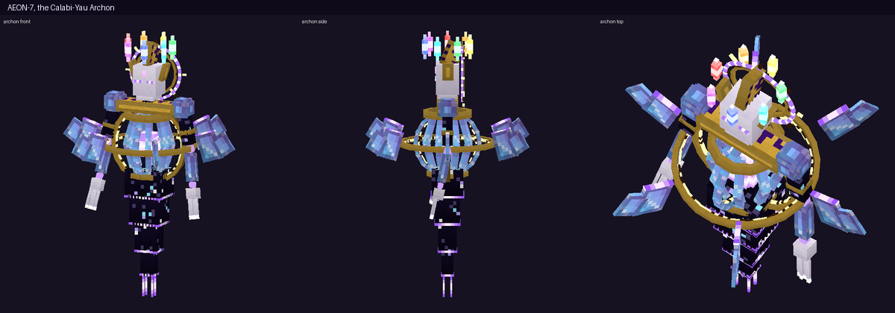
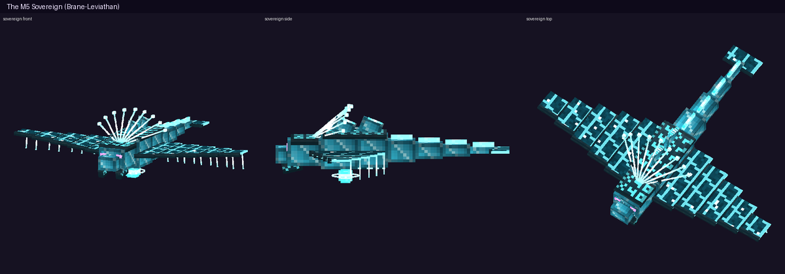
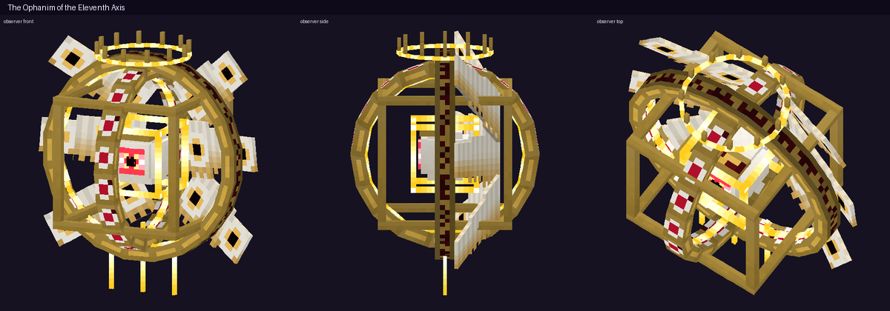

# Intelligent Beings of the 11th Dimension — Minecraft Bedrock Add-on

แอดออนนี้เพิ่ม **สิ่งมีชีวิตทรงปัญญาระดับเทียร์สูง 3 ตนจากมิติที่ 11** ซึ่งออกแบบตามแนวคิด M-theory
ที่ว่าจักรวาลมี 11 มิติ ได้แก่ 4 มิติที่เรารับรู้ได้ และอีก 7 มิติที่ม้วนพับซ่อนอยู่
ทั้งสามตนเป็นบอสที่มี AI ตัดสินใจเอง มีแถบพลังชีวิตบอส มี 3 เฟส มีสกิลตนละ 5 อย่าง และมีท่าไม้ตายแบบภาพยนตร์ตนละ 1 ท่า

**ไฟล์ติดตั้ง:** [`dist/Eleventh_Dimension.mcaddon`](dist/Eleventh_Dimension.mcaddon)
(มีไฟล์ `.mcpack` แยก BP/RP ให้ด้วยในโฟลเดอร์เดียวกัน)

| | |
|---|---|
| เกมที่รองรับ | Minecraft Bedrock **1.26.60 ขึ้นไป** |
| Script API | `@minecraft/server` 2.11.0 · `@minecraft/server-ui` 2.3.0 (stable ทั้งคู่) |
| Experimental | **ไม่ต้องเปิด** |

---

## วิธีเริ่มเล่น
1. เปิดไฟล์ `.mcaddon` ด้วย Minecraft แล้วเปิด Behavior Pack **Intelligent Beings of the 11th Dimension** ในโลก
2. คราฟต์ **Eleventh-Dimensional Resonator** ที่โต๊ะคราฟต์ตามแพตเทิร์นด้านล่าง
   ```
   [อเมทิสต์] [เพชร]          [อเมทิสต์]
   [เพชร]     [ตาเอนเดอร์]     [เพชร]
   [อเมทิสต์] [ออบซิเดียนร้องไห้] [อเมทิสต์]
   ```
   หรือพิมพ์ `/dim11:resonator` (ต้องเปิดโกง)
3. ถือ Resonator แล้วกดใช้ เลือกสิ่งมีชีวิต อ่านข้อมูลใน Bestiary แล้วกด **SUMMON**
4. พิธีอัญเชิญใช้เวลา 5 วินาที มีวงเวทหมุนบนพื้น อักษรรูนลอยขึ้น และเสาแสง 7 สี จากนั้นสิ่งมีชีวิตจะปรากฏตัว

คำสั่งอื่น ๆ:
* `/dim11:bestiary` เปิดอ่านข้อมูลอย่างเดียว ใครก็ใช้ได้
* `/dim11:summon <archon|sovereign|observer>` เริ่มพิธีอัญเชิญทันที (ต้องเปิดโกง)
* มี Spawn Egg ใน Creative inventory ด้วย และตัวที่เกิดจากไข่ก็ใช้ AI ตัวเดียวกัน

---

## สิ่งมีชีวิตทั้ง 3

### 1. AEON-7 — The Calabi-Yau Archon (สีม่วง · 720 HP)


**แนวคิด:** ใน M-theory มิติที่ซ่อนอยู่จะม้วนตัวเป็นรูปทรงที่เรียกว่า Calabi-Yau manifold
AEON-7 คือจิตที่วิวัฒน์ขึ้นภายในรอยพับนั้น
**รูปลักษณ์ (314 cubes, 25 bones):** หน้ากากพอร์ซเลนที่มีดวงตา 3 ดวง และรัศมีทองหมุนอยู่ด้านหลัง
มี**วงแหวนไจโรสโคป 3 วง**หมุนรอบแกนต่างกัน รอบแกนพลังงานที่อยู่ในกรงคริสตัล 16 ซี่ และมีกลีบคริสตัล 6 กลีบโคจรรอบตัว
มี**มงกุฎแสง 7 สี**ตามจำนวนมิติที่ซ่อนอยู่ แขนเป็นท่อนลอยที่ข้อต่อเรืองแสง และเสื้อคลุมสี่ชั้นที่ภายในเป็นท้องฟ้าดาว

| สกิล | กลไก |
|---|---|
| Manifold Lance | ยิงลำแสงเกลียวคู่ 3 นัด **เล็งไปยังจุดที่คาดว่าผู้เล่นจะไปถึง** โดยคำนวณจากความเร็ว |
| Spatial Fold | พับพื้นที่ เพื่อ**ดึงผู้เล่นที่อยู่ไกลหรือซ่อนตัว**มาตรงหน้าแล้วบดขยี้ |
| Compactification | วงเวทเตือนบนพื้น 1.5 วินาที แล้วพื้นที่ยุบตัวเข้ากลาง ทำ 10 ดาเมจและติด Slowness III |
| Petal Storm *(เฟส 2)* | กลีบคริสตัล 6 กลีบหมุนวนออกไปเป็นใบมีด |
| Calabi Blink | ถ้าผู้เล่นรุมเข้าใกล้ จะวาร์ปไปอยู่อีกฝั่ง |
| **ULT: THE SEVEN UNFOLD** | ลอยขึ้นสูง จอมืดลง แล้วปล่อย**คลื่นมิติ 7 สี**ทีละลูก แต่ละสีให้ผลต่างกัน: ไฟ · แรงกระแทก · ลอยตัว · พิษ · ช้า · อ่อนแรง · ความว่างเปล่า **ต้องกระโดดข้ามแต่ละคลื่น** จากนั้นเข้าสู่ Recompactification ที่ดูดทุกคนกลับเข้าหาตัวเพื่อระเบิด 14 ดาเมจ ต้องวิ่งหนีออกด้านนอก |

### 2. The M5 Sovereign — Brane-Leviathan (สีฟ้า · 680 HP)


**แนวคิด:** ใน M-theory จักรวาลของเราอาจเป็นแผ่นเยื่อ (brane) ที่ลอยอยู่ในอวกาศ 11 มิติ Sovereign คือแผ่นเยื่อนั้นที่มีชีวิต
**รูปลักษณ์ (131 cubes, 27 bones):** สัตว์คล้ายปลากระเบนยักษ์ที่มีปีกกว้าง 5.7 บล็อก
**ปีกเป็นแผ่นเยื่อพลังงานโปร่งแสง** 5 ท่อนต่อข้าง ซึ่งกระพือเป็นคลื่นต่อเนื่องจากโคนไปปลายปีก
มีเส้นเชือกห้อยใต้ปีก มี**มงกุฎสาย string 9 เส้นที่สั่นตลอดเวลา** ดวงตาชมพู 4 ดวง หัวใจพลังงานแขวนอยู่ใต้ท้อง และหาง 4 ท่อนที่ปลายเป็นครีบเรืองแสง

| สกิล | กลไก |
|---|---|
| String Resonance | สายสั่นยาว 32 บล็อกพุ่งทะลุทุกตัวในแนว ทำ 8 ดาเมจ |
| Brane Dive | วงเตือนสีแดงเรียงตามเส้นทาง แล้วโฉบทะลุผ่านเป้าหมาย ทำ 10 ดาเมจพร้อมแรงผลักมหาศาล |
| Brane Wall | ผนังเยื่อเคลื่อนเข้ามาผลักทุกคนถอยหลัง |
| Harmonic Chorus *(เฟส 2)* | ปล่อย **Closed-String Wisp** ที่ไล่ตามผู้เล่นแล้วระเบิด และผู้เล่นฆ่าทิ้งได้ |
| Tidal Shear | ฟาดปีกใส่ผู้เล่นที่อยู่ใกล้ |
| **ULT: GENESIS COLLISION** | สร้าง**ร่างเงาของตัวเอง 2 ร่าง**ที่สองฝั่งสนาม พร้อมแผ่น brane ขนาด 34×14 บล็อกที่บีบเข้าหากันนาน 4 วินาทีและผลักทุกคนเข้ากลาง เมื่อชนกันจะเกิด **BIG BANG**: แสงวาบ จอขาว ทำดาเมจสูงสุด 26 ตามระยะ แล้วตามด้วยช่วงพองตัวของจักรวาลใหม่ที่ทำให้ผู้เล่นลอยขึ้น วิธีรอดคือหนีอ้อมขอบแผ่น brane |

### 3. The Ophanim of the Eleventh Axis (สีทอง · 640 HP)


**แนวคิด:** ถ้าเวลาเป็นเพียงอีกแกนหนึ่ง สิ่งที่อยู่นอกเวลาก็มองเห็นเวลาเป็นถนนทั้งเส้น
Ophanim ผสมระหว่างทูตสวรรค์ "วงล้อที่เต็มไปด้วยดวงตา" กับ hypercube (ทรงลูกบาศก์ 4 มิติ)
**รูปลักษณ์ (157 cubes, 18 bones):** **กรอบ tesseract สองชั้น** คือกรอบนอกสีทองกับกรอบในที่เรืองแสง หมุนสวนทางกันเพื่อให้ดูเหมือนการหมุนใน 4 มิติ
ตรงกลางมี**ดวงตาใหญ่ที่กะพริบได้** ล้อมด้วย**วงล้อ 2 วงที่มีดวงตาทุกช่อง** มีปีกเซราฟิม 6 ปีกที่มีดวงตาบนขนนก มีรัศมีด้านบน และมีแสงห้อยลงด้านล่าง

| สกิล | กลไก |
|---|---|
| Gaze of Judgement | เส้นสีแดงติดตามผู้เล่น 1 วินาที แล้วล็อกตำแหน่งและยิง **ต้องเปลี่ยนทิศตอนมันล็อก** |
| Timeline Echoes | เรียก**ร่างจากอดีต 3 ร่าง**มาล้อมผู้เล่น แล้วยิงทีละร่าง |
| Causality Lock | ทำเครื่องหมายบนตัวผู้เล่น ถ้าภายใน 1 วินาทียังมองเห็นอยู่ ผู้เล่นจะถูกตรึงและโดนโจมตี วิธีรอดคือ**หลบให้พ้นสายตา** |
| Revelation Blink | ถ้าผู้เล่นยกโล่ หรือซ่อนหลังกำแพง มันจะวาร์ปไป**ข้างหลังผู้เล่น**แล้วยิงทันที |
| Ophanim Spin | วงล้อฟาดใส่ผู้เล่นที่อยู่ใกล้ |
| **ULT: THE ELEVENTH AXIS** | จอเป็นสีซีเปีย และ**ผู้เล่นทุกคนถูกหยุดเวลา** จากนั้นมัน**ย้อนเวลา**: ส่งทุกคนกลับไปยังตำแหน่งเมื่อ 8 วินาทีก่อน และย้อนดาเมจที่ตัวเองได้รับกลับคืน (สูงสุด 15% ของ HP) ตามด้วย **"ทุกอนาคตที่เป็นไปได้"**: เสาแสง 12 ต้นที่เล็งไปยังตำแหน่งที่คาดว่าผู้เล่นจะไปถึง โดยมีวงเตือนก่อน 1 วินาที |

---

## ความ "ทรงปัญญา" (AI ที่ทั้งสามตนใช้ร่วมกัน)
* **ตารางภัยคุกคาม:** จำว่าใครทำดาเมจใส่ตัวเองมากที่สุดแล้วเปลี่ยนเป้าไปหาคนนั้น ในร่างจริง (เฟส 3) จะเลือกล่าผู้เล่นที่เลือดน้อย และจะพูดเรียกชื่อพร้อมแซวอาวุธที่ผู้เล่นถืออยู่
* **ปรับตัวต้านทาน:** ถ้าผู้เล่นใช้ดาเมจประเภทเดียวเกิน 65% (ดาบ ธนู หรือเวทมนตร์) มันจะต้านดาเมจประเภทนั้นได้ 65% เป็นเวลา 30 วินาที และประกาศให้ผู้เล่นรู้ ผู้เล่นจึงต้องสลับวิธีโจมตี
* **ให้คะแนนการตัดสินใจ:** เลือกสกิลจากระยะห่าง จำนวนผู้เล่นที่ยืนกระจุกกัน การมองเห็น เฟส และคูลดาวน์
* **เล็งล่วงหน้า:** สกิลระยะไกลคาดการณ์ตำแหน่งจากความเร็วของผู้เล่น
* **ต่อต้านการเอาเปรียบ:** ถ้าผู้เล่นซ่อนตัวพ้นสายตาเกิน 3 วินาที ใช้โล่ หรือหนีไกล บอสแต่ละตนมีวิธีจัดการของตัวเอง ได้แก่ Spatial Fold, Brane Dive และ Revelation Blink บอสยังถูกผูกไว้ในรัศมี 30 บล็อกจากจุดที่ปรากฏตัว
* **3 เฟส:** ที่ HP 66% และ 33% มันจะเปลี่ยนร่าง อมตะชั่วครู่ ขึ้นข้อความเต็มจอ และ**บังคับใช้ท่าไม้ตายทันที** ในเฟส 3 จะเร็วขึ้นและคูลดาวน์สั้นลง 30% ส่วนแอนิเมชันก็เร็วขึ้นตามเฟสผ่าน property ที่ sync ไปยัง client
* **ช่วงเปิดโอกาส:** หลังท่าไม้ตาย มันจะ **EXPOSED** เป็นเวลา 4 วินาที คือลอยลงมาที่พื้นและรับดาเมจเพิ่ม 50%
* **HUD:** แสดงเฟส ประเภทดาเมจที่มันต้านอยู่ และเกจท่าไม้ตาย คู่กับแถบพลังชีวิตบอสของเกม
* **ฉากตาย:** แอนิเมชันสลายตัวนาน 4.5 วินาที มีเอฟเฟกต์ของแต่ละตน จอวาบ แล้วดรอปของรางวัลพร้อม XP

## ของรางวัล (ใช้งานได้จริง)


| ไอเท็ม | ได้จาก | ความสามารถ |
|---|---|---|
| Folded Petal | AEON-7 | วาร์ปไปข้างหน้าได้ไกลสุด 12 บล็อก โดยหยุดก่อนชนกำแพง |
| String of Creation | Sovereign | สายสั่นยาว 28 บล็อก ทะลุมอนสเตอร์ทุกตัวในแนว 10 ดาเมจ |
| Eye of the Eleventh Axis | Ophanim | **ย้อนตัวเองกลับไป 5 วินาที** ทั้งตำแหน่งและเลือด และขณะถืออยู่จะเห็นมอนสเตอร์ในรัศมี 32 บล็อก |

---

## เทคนิคที่ใช้
* **โมเดล** สร้างด้วยโค้ด Python (`tools/modelkit.py`, `tools/shapes.py`, `tools/beings.py`)
  มีฟังก์ชันสำหรับวงแหวน กรอบ hypercube ทรงกลม และการคำนวณมุมหมุนของ cube ให้อยู่ระหว่างสองจุด
  texture วาดแบบ procedural เช่น ผ้าท้องฟ้าดาว คริสตัลหลายสี โลหะสลักรูน เยื่อพลังงาน ขนนกที่มีดวงตา และพอร์ซเลน
* **การเรนเดอร์ 2 ชั้น:** ทุกโมเดลถูกส่งออกเป็นชั้นของแข็ง (`entity_alphatest`) และชั้นพลังงาน (`entity_beam_additive`)
  ทั้งสองชั้นใช้โครงกระดูกเดียวกัน ทำให้ส่วนที่เป็นพลังงานดูเรืองแสง
* **แอนิเมชัน:** 22 แอนิเมชัน และ animation controller 7 สถานะต่อบอส (idle, cast, channel, ultimate, stagger, dying, shift)
  ควบคุมผ่าน property `dim11:state` และ `dim11:phase` ที่ sync ไปยัง client ความเร็วแอนิเมชันสะสมผ่าน `variable.t` จึงเปลี่ยนเฟสได้โดยไม่กระตุก
* **Particle 65 แบบ:** ได้แก่ mote, burst, sphere wave, ground wave, column และ ring ในสีต่าง ๆ รวมถึงวงเวทหมุน วงเตือนอันตราย อักษรรูนลอย แสงวาบ และท้องฟ้าดาว
  บางแบบรับค่า Molang จากสคริปต์ เช่น รัศมีหรือระยะเวลา
* **กล้อง:** `camera.fade` และ `camerashake` ใช้กับท่าไม้ตาย การเปลี่ยนเฟส และฉากตาย

### Build เอง
```bash
cd eleventh-addon
npm install
npm test        # typecheck → build → validate → fight simulation
```
ต้องมี Python 3 และ Pillow

---

## สิ่งที่ทดสอบแล้ว และสิ่งที่ยังไม่ได้ทดสอบ

**✅ ทดสอบแล้ว (อัตโนมัติ):**
1. **TypeScript strict typecheck** กับ typings ทางการ `@minecraft/server` 2.11.0 และ `server-ui` 2.3.0 ไม่มี error
2. **Static validation 10,466 checks ไม่มี error:**
   * JSON ทุกไฟล์ และ manifest/UUID/dependency
   * การอ้างอิงระหว่าง geometry, client entity, render controller, texture, animation และ animation controller ครบทุกจุด
   * bone ที่ถูกแอนิเมตต้องมีอยู่จริง และ UV ต้องไม่เกินขอบ texture
   * ชั้น solid และ glow ต้องมีโครงกระดูกตรงกัน
   * component ของ entity และ item ต้องมีอยู่ใน vanilla
   * particle, sound, effect, entity, item และ cooldown category ทุกตัวที่สคริปต์เรียกต้องมีอยู่จริง (อ้างอิง Mojang/bedrock-samples 1.26.60)
3. **จำลองการต่อสู้เต็มรูปแบบ 73 assertions ผ่านทั้งหมด:** รันสคริปต์ที่ compile แล้วจริงบน mock API ที่เข้มงวด กับผู้เล่น 2 คนที่เดิน ซ่อน ยกโล่ และโจมตี
   บอสทุกตนผ่านขั้นตอนครบ: พิธีอัญเชิญผ่าน UI → เฟส 1 ถึง 3 → ใช้สกิลอย่างน้อย 4 จาก 5 อย่าง (ส่วนใหญ่ใช้ครบ 5) → ท่าไม้ตาย → ปรับตัวต้านดาบ → ช่วง EXPOSED → ฉากตาย → ดรอปของรางวัลและ XP
   นอกจากนี้ยังยืนยันว่าบอสทำดาเมจผู้เล่นได้จริง (160 ถึง 260 ต่อการต่อสู้หนึ่งครั้ง) ไม่เหลือ minion ค้าง ของรางวัลทั้ง 3 ชิ้นทำงาน และบอสที่เกิดจาก spawn egg ถูก AI รับไปดูแล
4. **ภาพพรีวิวโมเดล** เรนเดอร์จาก geometry และ texture จริงด้วย software renderer

**⚠️ ยังไม่ได้ทดสอบในเกมจริง** เพราะสภาพแวดล้อมนี้ไม่มี Minecraft สิ่งที่ต้องยืนยันในเกม ได้แก่
* ทิศทางการหมุนของชิ้นส่วนโมเดล (คำนวณตามแบบแผนของ Bedrock/Blockbench)
* ลักษณะของ material `entity_beam_additive` ในแสงกลางวัน ซึ่งอาจดูจางกว่าตอนกลางคืน
* ขนาดของ particle ที่รับค่า Molang จากสคริปต์ (วงเวท วงเตือน วงคลื่น)
* ความยากของบอส ตัวเลขดาเมจตั้งไว้สำหรับผู้เล่นที่ใส่เกราะเพชรหรือเนเธอไรต์
* ประสิทธิภาพบนมือถือรุ่นเก่าระหว่างท่าไม้ตายที่มี particle จำนวนมาก
