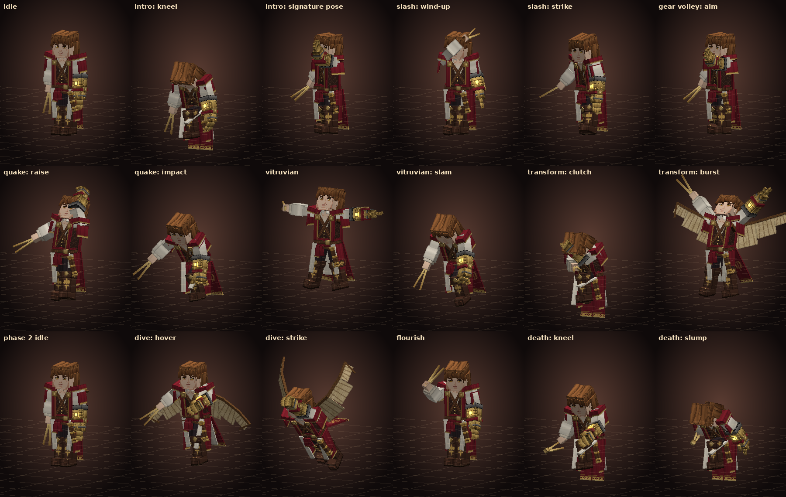
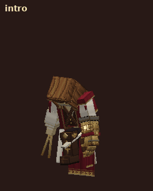
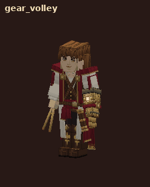
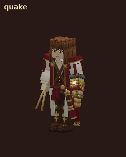
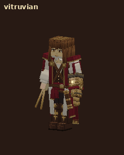
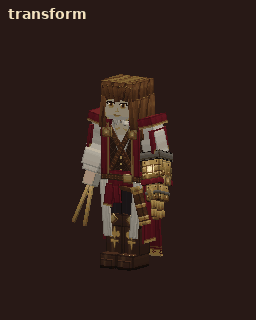
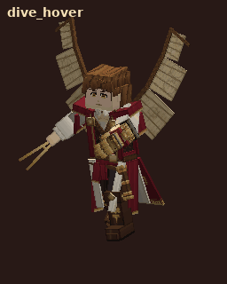
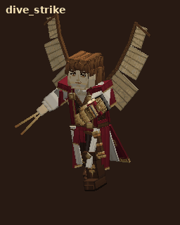

# Extra Super Boss — บอสที่ 1: Leonardo da Vinci

แอดออน Minecraft Bedrock ชื่อ **Extra Super Boss** บอสตัวแรกคือ **เลโอนาร์โด ดา วินชี — จอมปราชญ์แห่งกลไก** (`esb:da_vinci`)
เป็น custom entity ใหม่ทั้งตัว (โมเดล, เท็กซ์เจอร์, แอนิเมชัน, AI) ออกแบบตามภาพอ้างอิงที่ส่งมา ไม่ได้แทนที่ม็อบวานิลลาตัวไหน

**ไฟล์ติดตั้ง:** [`dist/Extra_Super_Boss_Da_Vinci_v1.mcaddon`](dist/Extra_Super_Boss_Da_Vinci_v1.mcaddon) (มีทั้ง Behavior Pack และ Resource Pack)

| | |
|---|---|
| เวอร์ชันแพ็ก | **1.0.1** (หน้าตาเป็นผู้ชายชัดเจนขึ้น: คิ้วหนา ตาคม กราม คาง หู ผมปัดขึ้นเห็นหน้าผาก) — UUID เดิม นำเข้าทับ 1.0.0 ได้ |
| เวอร์ชันเกม | Bedrock **1.26.60** ขึ้นไป (iPhone / iPad / Android / Windows / Console) |
| Script API | `@minecraft/server` **2.11.0** (stable) |
| Experimental toggles | **ไม่ต้องเปิด** |
| Entity ID | `esb:da_vinci` |
| เรียกบอส | Spawn Egg **Spawn Leonardo da Vinci**, คำสั่ง `/summon esb:da_vinci` หรือคราฟต์ **Da Vinci's Sealed Blueprint** |

> **ยังไม่ได้ทดสอบในเกมจริง** เครื่องที่ใช้สร้างไม่มีตัวเกม (การเปิดเซิร์ฟเวอร์ทดสอบของ Creator Tools ต้องให้ผู้ใช้ยอมรับ Minecraft EULA เอง)
> สิ่งที่ตรวจแล้ว: Creator Tools validate **0 error**, ตรวจการอ้างอิงข้ามไฟล์ **1590 รายการผ่านทั้งหมด**, และ smoke test ที่รันสคริปต์จริงกับ
> `@minecraft/server` จำลอง **92 รายการผ่านทั้งหมด** ภาพและ GIF ทุกชิ้นในหน้านี้ **เรนเดอร์ด้วยโปรแกรมจากไฟล์จริงของแพ็ก** ไม่ใช่ภาพจากตัวเกม
>
> ข้อความในเกม (ชื่อบอส, ชื่อไอเท็ม, บทพูด) เป็น**ภาษาอังกฤษ** เพราะ Bedrock ไม่มีภาษาไทยในรายการภาษาของเกม ไฟล์ `th_TH.lang` จะไม่ถูกโหลด


---

## 1. ตัวบอส

* **รูปลักษณ์จากภาพอ้างอิง:** ผมยาวสีน้ำตาลเป็นลอนมัดครึ่งหัว ตาสีอำพัน เสื้อเชิ้ตขาวคอเปิดแขนพอง เสื้อกั๊กลายดามัสก์สีน้ำตาลเข้ม
  สายหนังไขว้อกพร้อมเหรียญทองเหลือง ผ้าคลุมไหล่สีแดงเลือดหมูขลิบทอง ชายเสื้อคลุมยาวด้านหลังมีลายเข็มทิศและใบลอเรลสีทอง
  ผ้าคาดเอวแดง เข็มขัดหนัง กระบอกม้วนกระดาษทองเหลืองที่สะโพกซ้าย กางเกงสีเข้ม รองเท้าบูทยาวพับขอบมีลายดอกลิลลี่สีทอง
* **แขนซ้ายเป็นถุงมือกลไกทองเหลือง** (แหวนเฟืองเหล็กที่ข้อศอก แกนพลังงานสีอำพันเรืองแสง นิ้วกลไกขยับได้ทีละนิ้ว)
  **มือขวาถือวงเวียนทองเหลือง** (drafting compass) เป็นอาวุธ
* **Phase 2** กางปีก **ออร์นิธอปเตอร์** (เครื่องบินกระพือปีกตามสมุดบันทึกของดา วินชี): โครงไม้ ผืนผ้ากระดาษมีภาพสเก็ตช์สีซีเปียและลายมือเขียนกลับด้าน
* โมเดล **40 bones, 115 cubes**, texture 512×512 (4 พิกเซลต่อหน่วย), ขยายตอนเรนเดอร์ 1.6 เท่า → สูงประมาณ **3.7 บล็อก**
* แถบพลังบอส (boss bar) ขึ้นเมื่ออยู่ในระยะ 48 บล็อก, พลังชีวิต **500**, ไม่ถูกผลักกระเด็น, ไม่ despawn เอง



## 2. สกิลและการต่อสู้

ดาเมจที่เขียนคือค่าใน `balance.json` (ระดับ Normal) บอส**ไม่โจมตีผู้เล่นโหมด Creative / Spectator**

| สกิล | เมื่อไร | ทำอะไร | วิธีหลบ |
|---|---|---|---|
| **Compass Slash** (ตีปกติ) | ตลอด เมื่อเข้าใกล้ | ง้างวงเวียนเหนือหัวแล้วฟันเฉียงลง ดาเมจ 9 (Phase 2 ฟันเร็วขึ้น 25%) | ถอยออกตอนเห็นเขาง้าง |
| **Gear Volley** | เป้าห่าง 5–26 บล็อก, มองเห็นกัน | **ท่าเดียวกับภาพอ้างอิง** ยื่นถุงมือกลไกไปข้างหน้า ยิงเฟืองทองเหลืองหมุน 3 ชุด ชุดละ 3 ลูกแบบพัด (Phase 2 ชุดละ 5) ลูกละ 6 | วิ่งด้านข้าง หรือ**ตีเฟืองให้สะท้อนกลับ** (ตั้งค่า `reflect_on_hurt` ไว้ ยังไม่ได้ลองในเกม) |
| **Gauntlet Quake** | เป้าห่างไม่เกิน 5 บล็อก | ชูถุงมือขึ้นสุดแขนแล้วทุบพื้น คลื่นกระแทกรัศมี 6 บล็อก ดาเมจ 12 (ขอบวงเหลือ 50%) + กระเด็น | เห็นชูแขนขึ้นให้ถอยออกเกิน 6 บล็อก |
| **Vitruvian Judgement** | เป้าอยู่ใกล้วงเวท | ลอยขึ้นในท่า "Vitruvian Man" วงเวทสีทอง (วงกลม + สี่เหลี่ยม + รูปคน) ปรากฏใต้เท้า ชาร์จ 2.4 วินาที แล้วระเบิด ดาเมจ 16 + ดีดลอย รัศมี 7 (Phase 2: 9) | **ออกจากวงทอง** (มีข้อความเตือนบน action bar) |
| **Codex Unleashed** (เปลี่ยนร่าง) | พลังเหลือ 50% (ครั้งเดียว) | คุกเข่ากุมถุงมือ แล้วลุกกางแขน ปีกออร์นิธอปเตอร์กางออก หน้ากระดาษปลิวรอบตัว ผลักทุกคนรอบตัวออก ไม่ทำดาเมจ อมตะระหว่างท่า 3.6 วินาที | — |
| **Ornithopter Dive** (Phase 2) | เป้าห่าง 5–26 บล็อก | ย่อตัวกระโดดขึ้นสูง 8 บล็อก กระพือปีกลอยค้าง 1.4 วินาที **วงทองเล็กตามเป้าไปบนพื้น** แล้วล็อกตำแหน่ง 0.6 วินาทีก่อนพุ่ง พุ่งดิ่งชกพื้น รัศมี 5 ดาเมจ 14 | วิ่งออกจากวงหลังวงหยุดตาม |
| **Flourish** | ไม่มีเป้าหมาย ทุก 12–22 วิ | หมุนวงเวียนในมือ แล้วยกถุงมือขึ้นดูงอนิ้วกลไกทีละนิ้ว | — |

**Phase 2:** ปีกปรากฏ เดินเร็วขึ้น (0.30 → 0.36) ฟันเร็วขึ้น cooldown ทุกสกิลเหลือ 80% ได้สกิล Dive เพิ่ม

**ตอนตาย:** ไม่ล้มทันที แต่เล่นท่าตาย 4.2 วินาที (เซ → คุกเข่า → วงเวียนหลุดมือ → ถุงมือกระตุกมีประกายไฟ → ทรุดตัว หน้ากระดาษปลิว)
ระหว่างนั้นไม่รับดาเมจ จากนั้นตายโดยนับว่า**ผู้เล่นคนสุดท้ายที่ตีเป็นคนฆ่า** จึงได้ XP 500 และของดรอปครบ

**ของดรอป:** Leonardo's Codex 1 (แน่นอน), เพชร 4–8, ทอง 8–16, มรกต 6–12, ขวด XP 8–16, เศษเนเธอไรต์ 1–2 (50%), Totem of Undying (35%)

| ท่า | GIF |
|---|---|
| เปิดตัว (`intro`) |  |
| Gear Volley |  |
| Gauntlet Quake |  |
| Vitruvian Judgement |  |
| เปลี่ยนร่าง Phase 2 |  |
| Dive (ลอยค้าง / พุ่ง) |   |

GIF ทุกท่าอยู่ที่ [`docs/preview/anim/`](docs/preview/anim/) (idle, walk, slash, flourish, death, phase2_walk ฯลฯ)

## 3. ไอเท็ม

| ไอเท็ม | ได้จาก | ใช้ทำอะไร |
|---|---|---|
| **Da Vinci's Sealed Blueprint** (`esb:da_vinci_blueprint`) | คราฟต์ (ด้านล่าง) | แตะใช้ → วงเวทวาดบนพื้น 6 บล็อกข้างหน้า 2.5 วินาที แล้วดา วินชีปรากฏพร้อมท่าเปิดตัว ใช้ 1 ชิ้นต่อครั้ง (Creative ไม่เสีย) ต้องมีพื้นที่โล่ง 3×3 สูง 4 บล็อก และต้องไม่มีดา วินชีอยู่ในระยะ 96 บล็อก |
| **Leonardo's Codex** (`esb:leonardo_codex`) | ดรอปจากบอส | แตะใช้ → Haste II + Speed I + Night Vision 90 วินาที, cooldown 120 วินาที |

สูตร Blueprint (โต๊ะคราฟต์):

```
กระดาษ   ทอง     กระดาษ
ทอง      นาฬิกา   ทอง
กระดาษ   เพชร     กระดาษ
```

## 4. ติดตั้งบน iPhone

1. ดาวน์โหลด `Extra_Super_Boss_Da_Vinci_v1.mcaddon` ลงแอป **Files**
2. แตะไฟล์ (หรือ Share → Minecraft) เกมจะนำเข้าทั้ง 2 แพ็ก
3. สร้างโลกใหม่ → **Behavior Packs** → เปิด **Extra Super Boss** (Resource Pack เปิดตามเอง) → เปิด **Activate Cheats** ถ้าจะใช้ `/summon`
4. เรียกบอส: Spawn Egg ในหมวดไข่ของ Creative Inventory, `/summon esb:da_vinci ~ ~ ~8` หรือใช้ Blueprint

## 5. เช็กลิสต์ทดสอบในเกม

ใช้ `/gamemode survival` ตอนทดสอบการต่อสู้ (บอสไม่ตี Creative) และ `/effect @s resistance 9999 4 true` ถ้าอยากยืนดูท่า

| # | ทำอะไร | สิ่งที่ควรเห็น |
|---|---|---|
| 1 | `/summon esb:da_vinci ~ ~ ~8` | คุกเข่า → หน้ากระดาษระเบิดออก + เสียงระฆัง → ชื่อบอสขึ้นกลางจอ → ลุก สะบัดผม → ยื่นถุงมือท่าเดียวกับภาพ → boss bar ขึ้น |
| 2 | ยืนดูเฉย ๆ | หายใจ ผ้าคลุมและผมไหว นิ้วกลไกกระตุก หัวหันตามผู้เล่น |
| 3 | เดินหนีให้เขาตาม | เดินก้าวยาว ชายเสื้อคลุมพลิ้วไปด้านหลัง แขนแกว่ง |
| 4 | ยืนใกล้ ๆ | ฟันด้วยวงเวียน (ดาเมจลงตอนวงเวียนฟาดลง) |
| 5 | ถอยไป 10–20 บล็อก | Gear Volley: ยิงเฟืองหมุน 3 ชุด มีไอน้ำพ่นจากถุงมือทุกนัด |
| 6 | ยืนชิดตัว | Gauntlet Quake: ชูถุงมือ → ทุบพื้น วงคลื่นสีทองกับฝุ่นแผ่ออก |
| 7 | อยู่ใกล้ราว 5–8 บล็อก | Vitruvian: ลอยกางแขนขา วงเวทสีทองหมุนบนพื้น มีข้อความ "Step out of the golden circle!" → ระเบิดเป็นแสงทอง |
| 8 | ตีจนเหลือครึ่งหลอด | เปลี่ยนร่าง: ปีกกางออก ข้อความ Phase 2 ตีไม่เข้าระหว่างท่า |
| 9 | Phase 2 ยืนห่าง 10 บล็อกขึ้นไป | Dive: กระโดดขึ้นสูง ปีกกระพือ วงทองเล็กตามเท้าเรา → หยุด → พุ่งลงมาตรงวง |
| 10 | Dive ในถ้ำเพดานต่ำ | ยกเลิกการบินเอง ไม่ติดเพดาน |
| 11 | ตีจนหมดหลอด | ท่าตาย 4.2 วินาที แล้วดรอป Codex + ของ, XP |
| 12 | คราฟต์ Blueprint แล้วแตะใช้ | วงเวท + เสาประกาย 2.5 วินาที → บอสปรากฏ |
| 13 | ใช้ Codex สองครั้งติดกัน | ครั้งแรกได้บัฟ 3 อย่าง ครั้งที่สองขึ้นเวลารอ |

คำสั่งที่มีประโยชน์: `/kill @e[type=esb:da_vinci]`, Settings → Creator → **Content Log GUI** ดู error ของแพ็ก

**ถ้าเจอปัญหา (เช่นโมเดลไม่ขึ้น หรือบอสยืนนิ่ง):** เปิด Content Log GUI แล้วเรียกบอสใหม่ แคปข้อความสีแดงส่งมา

## 6. สิ่งที่ยังไม่ได้พิสูจน์ในเกมจริง

* ชื่อเสียงของเกมที่สคริปต์เรียก (`mob.blaze.shoot`, `random.anvil_land`, `beacon.activate`, `block.bell.hit`, `random.totem` ฯลฯ) เป็นเสียงวานิลลา
  ถ้าชื่อไหนไม่มีในเวอร์ชันของคุณ เสียงนั้นจะเงียบเฉย ๆ ไม่ทำให้เกมพัง
* ท่าฟันวงเวียนผูกกับ AI โจมตีของวานิลลา (`minecraft:behavior.delayed_attack` + `q.is_delayed_attacking` แบบเดียวกับ Ravager)
* การตีเฟืองสะท้อนกลับ (`reflect_on_hurt`)
* สมดุลดาเมจ/เลือดตั้งไว้สำหรับผู้เล่น 1–2 คนชุดเพชร ปรับได้ใน `balance.json` แล้ว build ใหม่

## 7. โครงสร้างโปรเจกต์และการ build

```
extra-super-boss-addon/
  addon/behavior_packs/extra_super_boss/   entities (บอส, เฟือง, วงเวท), items, loot, recipe, scripts (คอมไพล์แล้ว)
  addon/resource_packs/extra_super_boss/   โมเดล, texture, animations, controllers, particles, render controllers, ภาษา
  balance.json                             ตัวเลขทั้งหมดของบอส (แหล่งเดียว)
  scripts-src/*.ts                         AI ของบอส (TypeScript)
  tools/                                   ตัวสร้างไฟล์ทั้งหมด (Python), validate, smoke test, packager, เรนเดอร์ภาพตัวอย่าง
  dist/Extra_Super_Boss_Da_Vinci_v1.mcaddon
```

| คำสั่ง | ทำอะไร |
|---|---|
| `npm install` | ติดตั้ง TypeScript + typings `@minecraft/server` 2.11.0 |
| `npm run assets` | สร้างโมเดล, texture, entity JSON, animations, particles, offsets จาก Python |
| `npm run compile` | คอมไพล์ `scripts-src` → `addon/behavior_packs/extra_super_boss/scripts` |
| `npm run validate` | Creator Tools validate (ต้อง 0 error) + ตรวจการอ้างอิงข้ามไฟล์ |
| `npm run smoke` | รันสคริปต์จริงกับเกมจำลอง: เปิดตัว, ทุกสกิล, เปลี่ยนร่าง, Dive, เพดานต่ำ, ท่าตาย, ไอเท็ม, สู้ยาว 3 นาที |
| `npm run package` | สร้าง `dist/Extra_Super_Boss_Da_Vinci_v1.mcaddon` |
| `npm run build` | ทำทั้งหมดตามลำดับ |
| `npm run preview` | เรนเดอร์ภาพท่าและ GIF ใน `docs/preview/` |

ไฟล์ที่ AI กับแอนิเมชันต้องตรงกันถูกสร้างจากแหล่งเดียว: ความยาวท่าและจังหวะดาเมจอยู่ใน `tools/spec.py`
(สร้างทั้งไฟล์แอนิเมชันและ `scripts-src/spec.ts`) และตำแหน่งฝ่ามือ/อกที่สคริปต์ใช้ปล่อยเฟืองหรือคลื่นกระแทกวัดจากโมเดลจริงใน `tools/gen_offsets.py`
