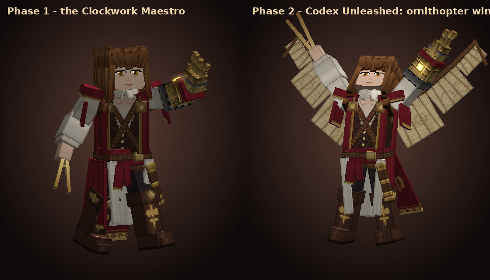
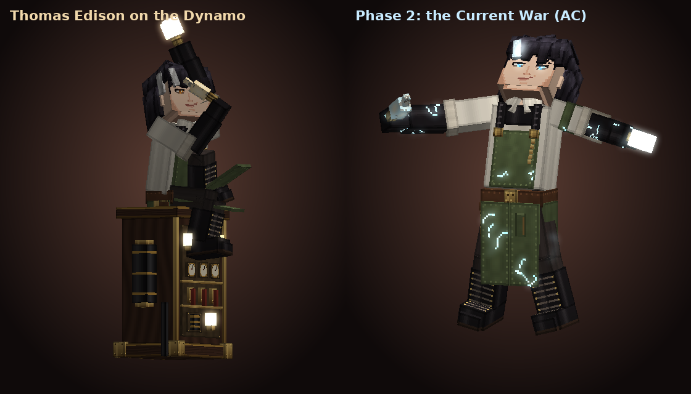
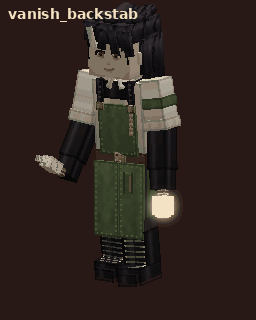
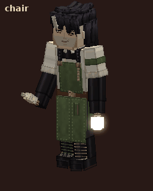

# Extra Super Boss

A Minecraft Bedrock boss add-on. Every boss is a brand-new custom entity (model, textures, animations, AI);
no vanilla mob is replaced.

| # | Boss | Entity ID | Summon item |
|---|---|---|---|
| 1 | **Leonardo da Vinci — the Clockwork Maestro** | `esb:da_vinci` | Da Vinci's Sealed Blueprint |
| 2 | **Thomas Edison — the Wizard of Menlo Park** | `esb:edison` | Edison's Patent |

**Install file:** [`dist/Extra_Super_Boss_v1.mcaddon`](dist/Extra_Super_Boss_v1.mcaddon) (behavior pack + resource pack)

| | |
|---|---|
| Pack version | **1.1.0** (adds Thomas Edison). Same pack UUIDs, so it imports over 1.0.x |
| Game version | Bedrock **1.26.60** or newer (iPhone / iPad / Android / Windows / consoles) |
| Script API | `@minecraft/server` **2.11.0** (stable) |
| Experimental toggles | **None needed** |

> **Not yet tested in the real game.** The machine that built this has no Minecraft client (starting a Creator Tools test
> server needs the user to accept the Minecraft EULA themselves). What was checked: Creator Tools validation **0 errors**,
> **3244/3244** cross-file reference checks, and a smoke test that runs the real boss scripts against a mocked
> `@minecraft/server`: **172/172** checks. Every image and GIF here is **rendered from the pack's own files**, not captured in-game.

---

## Boss 1 — Leonardo da Vinci



Long wavy brown hair tied half-up, a stern face with heavy brows, white shirt, brocade vest, crimson mantle with gold
trim and a compass-rose emblem, tall boots. His **left arm is a brass clockwork gauntlet**; his **right hand holds a
drafting compass** as a weapon. In phase 2 he unfolds **ornithopter wings** from his notebooks.
500 HP, boss bar, about 3.7 blocks tall (40 bones, 115 cubes).

| Ability | When | What happens | How to dodge |
|---|---|---|---|
| **Compass Slash** | close range | Overhead swing with the compass, 9 damage (25% faster in phase 2) | Back off when he winds up |
| **Gear Volley** | 5–26 blocks, line of sight | The reference-art pose: gauntlet thrust forward, 3 bursts of spinning brass gears (3 per burst, 5 in phase 2), 6 damage each | Strafe sideways, or hit the gears back (`reflect_on_hurt`) |
| **Gauntlet Quake** | within 5 blocks | Raises the gauntlet and slams the ground: radius 6, 12 damage (50% at the edge) + knockback | Get more than 6 blocks away when he raises his arm |
| **Vitruvian Judgement** | near the circle | Rises in the Vitruvian-Man pose over a golden sigil, charges 2.4 s, then detonates: 16 damage + launch, radius 7 (9 in phase 2) | **Leave the golden circle** (action-bar warning) |
| **Codex Unleashed** (phase 2) | at 50% HP, once | Kneels, then rises as ornithopter wings unfold; pushes everyone back, invulnerable for 3.6 s | — |
| **Ornithopter Dive** (phase 2) | 5–26 blocks | Leaps 8 blocks up, hovers 1.4 s while a small golden circle follows you, locks 0.6 s before the dive, then slams down: radius 5, 14 damage | Run out of the circle once it stops following |

**Death:** a 4.2 s sequence (stagger, kneel, the compass slips, the gauntlet sparks, pages fly), then the last player who
hit him gets the kill. **Drops:** Leonardo's Codex (always), diamonds, gold, emeralds, XP bottles, netherite scrap (50%),
Totem of Undying (35%), 500 XP.

GIFs: [`intro`](docs/preview/anim/intro.gif), [`gear_volley`](docs/preview/anim/gear_volley.gif),
[`quake`](docs/preview/anim/quake.gif), [`vitruvian`](docs/preview/anim/vitruvian.gif),
[`transform`](docs/preview/anim/transform.gif), [`dive_strike`](docs/preview/anim/dive_strike.gif) — all poses:
[`poses.png`](docs/preview/poses.png)

---

## Boss 2 — Thomas Edison (assassin)



Messy black hair with a white streak, amber eyes and a smirk, rolled-up white shirt, olive work apron with black
leather straps and brass buckles, long black gloves, lace-up boots. He fights like an assassin with a **broken
light bulb** as a shiv, and brings two machines to the fight: **the Dynamo** (his generator cabinet) and
**the Electric Chair**. Phase 1 electricity is warm amber (DC); in phase 2, **the Current War**, it turns blue-white (AC).
420 HP, boss bar, about 3.1 blocks tall, fast (movement 0.34, 0.40 in phase 2).

| Ability | When | What happens | How to counter |
|---|---|---|---|
| **Intro** | on spawn | Sits on top of his Dynamo holding a glowing bulb (the reference pose), then hops down | — |
| **Bulb Shank** | close range | Quick lunge with the broken bulb, 7 damage (faster in phase 2) | Keep moving |
| **Bulb Toss** | 4–22 blocks, line of sight | Three side-arm throws of glowing bulbs (two per throw in phase 2): 4 on impact + 4 electric burst (radius 2.5) and slowness | Strafe; don't stand still at range |
| **Blackout** | up to 26 blocks | Crushes the bulb in his fist: **darkness** for players within 20 blocks, he turns **invisible**, then reappears **behind you** and backstabs: 13 (15 in phase 2). **Sparks crackle where he will appear** 0.7 s before (0.45 s in phase 2). In phase 2 he does it twice in a row | Watch for the sparks behind you and turn or step away |
| **Overload** | his Dynamo is standing | Blinks to the Dynamo's levers and wrenches them; its bulbs flare for 1.4 s, then lightning hits every creature within 18 blocks of the Dynamo that can see it: 8 (10 in phase 2), and each bolt jumps to one more creature nearby at half damage | **Break line of sight** (any wall) or get out of range |
| **Electric Chair** | a player within 22 blocks | Points his shiv and snaps his fingers: a chair materializes under you. **If you are still on it 0.8 s later you are strapped in** for 3 s, shocked 2 (3) every half second | **Step off** in time, or have a friend **break the chair** (20 HP) |
| **The Dynamo** | always | Destructible (90 HP, 120 in phase 2). **Destroying it stuns Edison for 3 s and he takes 1.5× damage** while stunned. No Dynamo, no Overload | Smash it |
| **The Current War** (phase 2) | at 50% HP, once | Hunches over the surge, then stands in a burst of AC light; textures turn blue, **the Dynamo is rebuilt** (or repaired) and supercharged; invulnerable 3.6 s | — |

**Death:** 4 s — he falls to his knees, the bulb in his hand flickers out, the Dynamo powers down with him.
**Drops:** the **Volt Shiv** (always), copper, gold, diamonds, glowstone, emeralds, netherite scrap (50%), Totem (35%), 500 XP.

GIFs: [`edison_intro`](docs/preview/anim/edison_intro.gif), [`edison_vanish_backstab`](docs/preview/anim/edison_vanish_backstab.gif),
[`edison_bulb_toss`](docs/preview/anim/edison_bulb_toss.gif), [`edison_overload`](docs/preview/anim/edison_overload.gif),
[`edison_chair`](docs/preview/anim/edison_chair.gif), [`edison_transform`](docs/preview/anim/edison_transform.gif) —
all poses: [`edison_poses.png`](docs/preview/edison_poses.png), machines: [`edison_props.png`](docs/preview/edison_props.png)

| Blackout → backstab | Electric Chair |
|---|---|
|  |  |

---

## Items

| Item | From | Use |
|---|---|---|
| **Da Vinci's Sealed Blueprint** | crafted | Use it: a golden circle is drawn 6 blocks ahead for 2.5 s, then Da Vinci appears |
| **Edison's Patent** | crafted | Use it: the ground crackles with current for 2.5 s, then Edison appears on his Dynamo |
| **Leonardo's Codex** | Da Vinci drop | Use it: Haste II + Speed I + Night Vision for 90 s (120 s cooldown) |
| **Volt Shiv** | Edison drop | Weapon (sword enchantments): 8 attack damage, 900 durability, sparks on every hit and a 30% chance of an extra 3 lightning damage + slowness |

The summon items need open ground (3×3, 4 blocks high) in front of you, and the same boss must not already be within 96 blocks.
Creative mode does not use up the item.

```
Blueprint (crafting table)        Patent (crafting table)
paper  gold    paper              redstone  gold       redstone
gold   clock   gold               copper    glowstone  copper
paper  diamond paper              redstone  paper      redstone
```

## Install on iPhone

1. Save `Extra_Super_Boss_v1.mcaddon` to the **Files** app.
2. Tap it (or Share → Minecraft). The game imports both packs.
3. Create a world → **Behavior Packs** → enable **Extra Super Boss** (the resource pack follows) → turn on **Activate Cheats** to use `/summon`.
4. Summon: spawn eggs in the creative inventory, `/summon esb:da_vinci ~ ~ ~8`, `/summon esb:edison ~ ~ ~8`, or the summon items.

If the game keeps an older version, delete both "Extra Super Boss" packs under Settings → Storage and import again.

## In-game test checklist

Bosses ignore Creative and Spectator players: use `/gamemode survival`, and `/effect @s resistance 9999 4 true` to watch the attacks.

| # | Do | Expect |
|---|---|---|
| 1 | `/summon esb:edison ~ ~ ~8` | He appears sitting on the Dynamo holding a glowing bulb, title "Thomas Edison", then hops down |
| 2 | Stand 10+ blocks away | Bulb toss: glowing bulbs shatter into sparks and glass |
| 3 | Fight him a while | Blackout: screen goes dark, he vanishes, sparks crackle behind you, he reappears there and stabs |
| 4 | Stay near the Dynamo in the open | Overload: he blinks to the levers, the Dynamo's bulbs flare, lightning bolts jump between players. Hide behind a wall and it misses |
| 5 | Wait for the chair | A chair appears under you with a warning; stay on it and you are strapped in and shocked; break it or step off in time |
| 6 | Break the Dynamo | "Edison is unplugged!", he kneels dazed for 3 s and takes extra damage |
| 7 | Bring him to half health | AC transformation: blue lightning textures, the Dynamo comes back, he blinks twice |
| 8 | Kill him | Death sequence, the Dynamo powers down, Volt Shiv drops |
| 9 | Da Vinci: `/summon esb:da_vinci ~ ~ ~8` | Intro, gear volley, quake, Vitruvian circle, wings at half health, dive |

Useful: `/kill @e[type=esb:edison]`, `/kill @e[type=esb:da_vinci]`, Settings → Creator → **Content Log GUI** for pack errors
(screenshot any red line if something looks wrong).

## Not yet proven in-game

* Vanilla sound event names called by the scripts (`random.glass`, `ambient.weather.lightning.impact`, `block.bell.hit`, …):
  a wrong name is just silent.
* The basic melee attacks are vanilla `minecraft:behavior.delayed_attack` (like the Ravager) with `q.is_delayed_attacking`.
* Edison's invisibility relies on the vanilla `invisibility` effect hiding mobs; the Blackout uses the vanilla `darkness` effect.
* Hitting gears back (`reflect_on_hurt`).
* Balance targets 1–2 players in diamond gear; tune everything in `balance.json` and rebuild.
* In-game text is English: Bedrock has no Thai UI language, so a `th_TH.lang` would never load.

## Project layout and build

```
extra-super-boss-addon/
  addon/behavior_packs/extra_super_boss/   entities, items, loot, recipes, compiled scripts
  addon/resource_packs/extra_super_boss/   models, textures, animations, controllers, particles, render controllers, text
  balance.json                             every boss number (single source)
  scripts-src/*.ts                         boss AI: boss.ts (shared), abilities.ts + brain.ts (Da Vinci), edison.ts, items.ts, main.ts
  tools/                                   Python generators, validator, smoke test + mock server, packager, preview renderer
  dist/Extra_Super_Boss_v1.mcaddon
```

| Command | Does |
|---|---|
| `npm install` | TypeScript + `@minecraft/server` 2.11.0 typings |
| `npm run assets` | Generate models, textures, entity JSON, animations, particles and script offsets |
| `npm run compile` | Compile `scripts-src` into the behavior pack |
| `npm run validate` | Creator Tools validation (must be 0 errors) + cross-file checks |
| `npm run smoke` | Run the real scripts against a mocked game: intros, every ability, phase changes, the chair, the Dynamo stun, deaths, items, 3-minute soaks |
| `npm run package` | Build `dist/Extra_Super_Boss_v1.mcaddon` |
| `npm run build` | All of the above in order |
| `npm run preview` | Render the pose sheets, GIFs and icons into `docs/preview/` |

Animation lengths and hit frames live in `tools/spec.py`, which generates both the animation files and
`scripts-src/spec.ts`, so damage lands on the frame the client shows. Points the scripts use (Da Vinci's palm,
Edison's bulb hand, the Dynamo's top, the chair seat) are measured from the real models by `tools/gen_offsets.py`.
