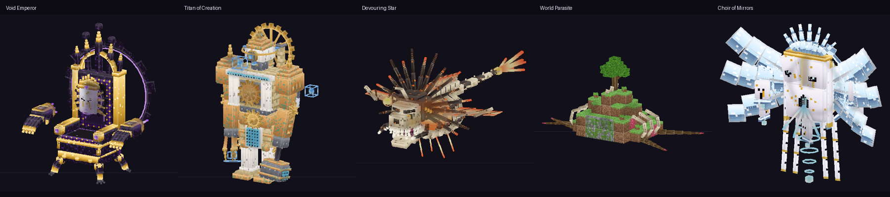
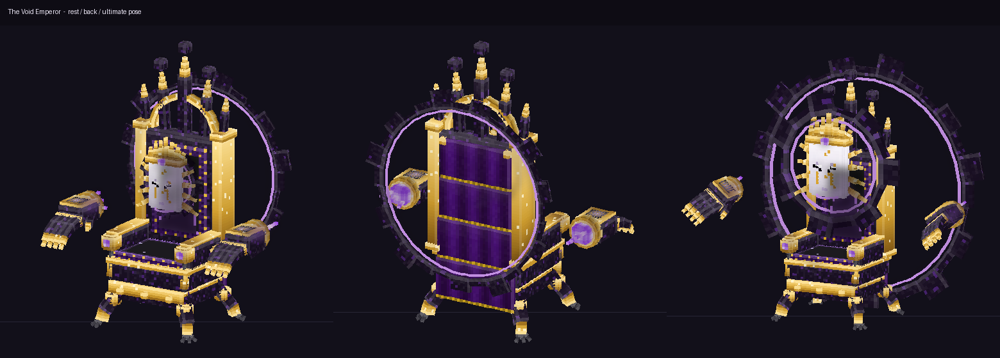
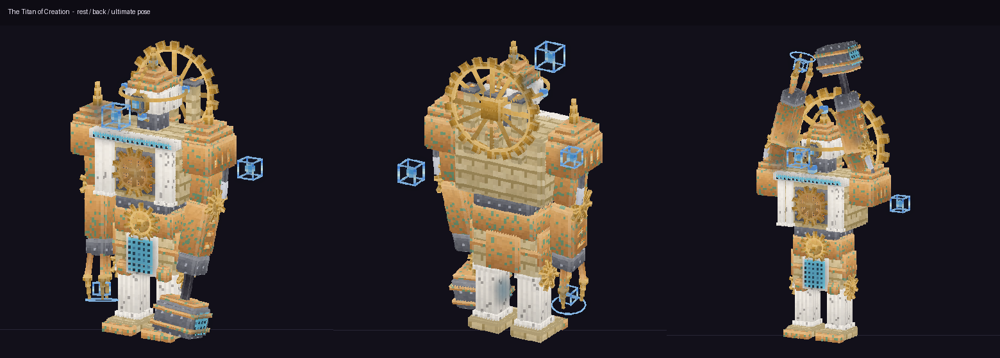
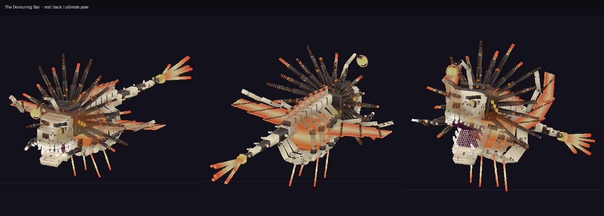
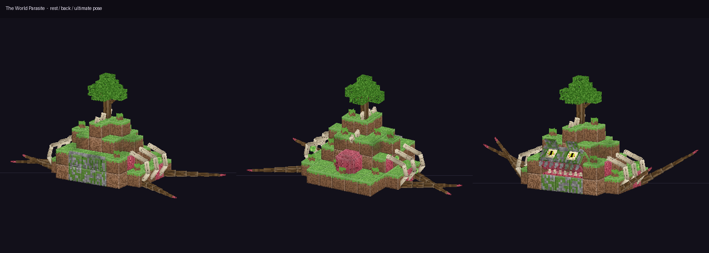
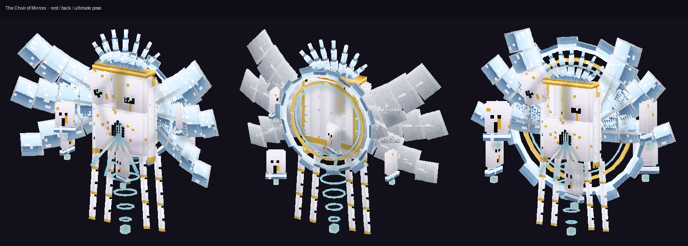

# FIVE FINAL BOSSES — Minecraft Bedrock Add-on

แอดออนนี้เพิ่ม **Final Boss 5 ตัว** แต่ละตัวมีโมเดล 3D ความละเอียดสูงของตัวเอง แอนิเมชันครบชุด
สกิล 5 อย่าง กลไกเฉพาะตัว และ **Ultimate ที่ไม่ซ้ำกันเลย**

**ไฟล์ติดตั้ง:** [`dist/Five_Final_Bosses.mcaddon`](dist/Five_Final_Bosses.mcaddon) (มี `.mcpack` แยก BP/RP ให้ด้วย)

| | |
|---|---|
| เกมที่รองรับ | Minecraft Bedrock **1.26.60 ขึ้นไป** (เวอร์ชัน stable ล่าสุด ณ วันพัฒนา) |
| Script API | `@minecraft/server` 2.11.0 · `@minecraft/server-ui` 2.3.0 (stable) |
| Experimental | **ไม่ต้องเปิด** |
| ระบบเดิมของเกม | ไม่ override ม็อบหรือไฟล์ vanilla ใด ๆ (**Ender Dragon ยังอยู่ครบ**) บล็อกที่บอสสร้างหรือเปลี่ยนจะถูกคืนสภาพทั้งหมด |



## วิธีเรียกบอส
1. คราฟต์ **Sigil of the Final Hour** จาก บล็อกทอง 4 + ตาเอนเดอร์ 2 + เพชร 2 + echo shard 1
   ```
   [ทอง]  [ตาเอนเดอร์] [ทอง]
   [เพชร] [echo shard]  [เพชร]
   [ทอง]  [ตาเอนเดอร์] [ทอง]
   ```
   หรือพิมพ์ `/fb:sigil` (ต้องเปิดโกง)
2. ถือ Sigil แล้วกดใช้ จะเปิดหน้า Bestiary ให้เลือกบอส อ่านกลไกและวิธีรับมือ แล้วกด **SUMMON**
3. พิธีอัญเชิญใช้เวลา 5 วินาที: วงเวทหมุน มีเสาแสงและเศษหิน แล้วบอสจะปรากฏตัวพร้อมแอนิเมชันเปิดตัว
   * **World Parasite** จะ "ซ่อนตัว" เป็นเนินดินที่มีต้นไม้ ห่างออกไปประมาณ 14 บล็อก ผู้เล่นต้องหามันให้เจอ
4. ทางอื่น: `/fb:summon <void_emperor|titan|devouring_star|world_parasite|choir>` (ต้องเปิดโกง), Spawn Egg ใน Creative หรือ `/fb:bosses` เพื่ออ่าน Bestiary อย่างเดียว

## ระบบที่บอสทุกตัวใช้ร่วมกัน
* แถบพลังชีวิตบอส (Boss Bar) และ HUD ที่แสดงเฟส สถานะกลไกเฉพาะ และเกจ Ultimate
* **3 เฟส** (HP 66% และ 33%) การเปลี่ยนเฟสจะอมตะชั่วครู่ แล้ว**บังคับใช้ Ultimate** เฟสสุดท้ายเร็วขึ้นและคูลดาวน์ลดลง 28%
* AI เลือกเป้าตามตารางภัยคุกคาม (threat) และเลือกสกิลจากระยะ จำนวนผู้เล่นที่กระจุกกัน การมองเห็น และคูลดาวน์ การโจมตีระยะไกลเล็งไปยังจุดที่คาดว่าผู้เล่นจะไปถึง
* **ทุกการโจมตีหนักมีสัญญาณเตือน** เช่น วงแดงบนพื้น เส้นอันตราย ข้อความใหญ่กลางจอ เสียง หรือกล้องสั่น
* หลัง Ultimate บอสจะ **EXPOSED** เป็นเวลา 4 ถึง 7 วินาที (รับดาเมจเพิ่ม 50%)
* ฉากตายยาว 5 วินาที แล้วดรอปของรางวัลพร้อม XP

---

## Boss 01 — The Void Emperor (จักรพรรดิแห่งความว่างเปล่า)


**รูปลักษณ์ (404 cubes · 34 bones):**
* บัลลังก์โกธิกมีชีวิต ยืนบนขาสิงห์ 4 ขาที่มีกรงเล็บ ตกแต่งด้วยหิน obsidian ลายเส้นม่วง ทองสลักลาย และกำมะหยี่ปักลาย
* **เบาะนั่งเป็นรูแห่งความว่างเปล่า** ที่ยังมีเส้นเรืองแสงของร่างจักรพรรดิที่ไม่อยู่แล้ว
* มงกุฎยอดแหลม 7 ยอดพร้อมลูกแก้ว void และผ้าคลุมยาว 4 ท่อนที่พลิ้ว
* **ถุงมือยักษ์สองข้างลอยแยกจากตัว** นิ้วงอได้ทีละข้อ
* **หน้ากากพอร์ซเลนสวมมงกุฎลอย**อยู่ตรงที่ใบหน้าควรอยู่ ข้างหลังมีวงเศษหินดำ 4 บล็อก

**กลไกเฉพาะ:**
* Imperial Presence: ผู้เล่นที่เข้าใกล้จะช้าลง
* พระราชโองการจะลงโทษผู้ที่จ้องมองมัน
* แทบไม่เคลื่อนที่ ให้ถุงมือทำงานแทน

| สกิล | |
|---|---|
| Hand of Dominion | ถุงมือทุบลงในวงที่เตือนไว้ (11) |
| Imperial Grasp | จับผู้เล่นขึ้นไปลอยในมือ ถ้าทำดาเมจใส่มันได้ 8% ของ HP จะหลุดออกมา และบอสจะ stagger |
| Void Rifts | หลุมดำ 3 จุดที่ดูดและเผาผู้เล่น |
| Decree: Kneel (เฟส 2) | **ต้องหันหน้าหนี** ตอนพระราชโองการจบ ใครจ้องมันอยู่จะโดน 9 ดาเมจและตาบอด |
| Throne Charge | บัลลังก์ควบตะบึงไปตามเส้นแดง (12) |
| **ULT: CORONATION OF NOTHING** | ทั้งสนามกลายเป็นความว่างเปล่า (3 ดาเมจทุกครึ่งวินาที) ที่ปลอดภัยมีเพียง**เทียนแห่งการดำรงอยู่ 4 เล่ม** ที่ดับลงทีละเล่ม ใครไม่ได้ยืนในเทียนเล่มสุดท้ายจะถูก "ลบ" (18) |

## Boss 02 — The Titan of Creation (ไททันแห่งการสร้างสรรค์)


**รูปลักษณ์ (509 cubes · 27 bones, สูง 6.5 บล็อก):** วิหารผสมโรงหลอมที่เดินได้ **ไม่ใช่โกเลมหิน**
* หน้าแข้งเป็นเสาหินอ่อนมีร่อง ฐานเป็นหินทราย เข่าเป็นเฟือง
* อกก่อด้วยอิฐ มีเสาเรียงด้านหน้า และ**เตาหลอมที่ลุกโชนหลังเฟืองที่หมุนอยู่**
* หัวเป็นหอดูดาวทรงโดม มีเลนส์ม่านรับแสง และวงแหวน astrolabe ที่หมุน
* ป้อมบนไหล่ ปล่องควัน 3 ปล่อง วงเฟืองด้านหลัง
* แขนหนึ่งถือค้อนหลอม อีกแขนเป็นกรงเล็บวัดระยะของสถาปนิก
* มีทรงเรขาคณิตพิมพ์เขียวเรืองแสงโคจรรอบตัว

**กลไกเฉพาะ:** **สร้างบล็อกจริงในโลก** เช่น กำแพงขังผู้เล่น เสาที่ดันขึ้นจากพื้น และกำแพงกำบัง ทุกบล็อกถูกบันทึกและคืนสภาพทีหลัง

| สกิล | |
|---|---|
| Forge Hammer | คลื่นกระแทกเป็นเส้นยาว 13 บล็อก (13) |
| Blueprint Prison | สร้างกำแพงบล็อกล้อมผู้เล่น แล้วทิ้งหมุดหลอมเหลวลงมา |
| Pillars of Creation | เสาหินพุ่งขึ้นใต้เท้าผู้เล่น |
| Molten Rivets | หมุดไฟ 6 ลูก วิถีโค้ง |
| Gear Halo Sweep | ลงโทษผู้ที่เข้ามาใกล้ |
| **ULT: PRIME MOVER** | สร้างกำแพงกำบังจริง 4 ด้าน แล้วกวาดลำแสงสร้างสรรค์รอบสนาม 2 รอบ **ต้องหลบให้กำแพงบังเลนส์ของมันไว้** (ตรวจ line of sight กับบล็อกจริง) |

## Boss 03 — The Devouring Star (ดวงดาวผู้กลืนกิน)


**รูปลักษณ์ (452 cubes · 22 bones, ยาว 8 บล็อก):** สัตว์ทะเลลึกโครงกระดูกจากอวกาศ
* กะโหลกไหม้เกรียมเรียวเป็นสามช่วง อยู่ในวงหนามที่ลุกเป็นไฟแบบ corona ของดวงอาทิตย์
* ดวงตาสีอำพันหลายแถว และ**ปากซ้อนกัน 3 ชั้น** ภายในมีดาวจิ๋วลุกอยู่ในคอ
* เหยื่อล่อแบบปลาตกเบ็ดที่ปลายถือดวงอาทิตย์จิ๋ว
* **ซี่โครงเปิดล้อมดาวที่มีชีวิต** ปีกเป็นเปลวสุริยะ และหางกระดูกที่ปลายเป็นหางดาวหาง

**กลไกเฉพาะ:**
* แรงโน้มถ่วงดาวคอยดึงผู้เล่นเข้าหามัน
* **DEVOUR:** กลืนผู้เล่นเข้าปาก ต้อง**กด Sneak รัว ๆ 5 ครั้ง**เพื่อฉีกท้องออกมา ถ้าหนีออกมาได้บอสจะ stagger

| สกิล | |
|---|---|
| Solar Flare Breath | ลำแสงไฟที่กวาดไปมา |
| Devour | พุ่งเข้ามากลืน |
| Meteor Spit | อุกกาบาตตกเป็นหลุมไฟ |
| Hypnotic Lure (เฟส 2) | **กด Sneak ค้าง**เพื่อต้านแรงดูด |
| Comet Tail | หมุนตัวฟาดหาง |
| **ULT: EVENT HORIZON** | มันยุบตัวเป็นหลุมดำ ดูดทั้งสนามเข้าหาวงแดงพร้อมยิงเปลวสุริยะ ตอน**ซูเปอร์โนวา**ใครยังอยู่ในวงจะถูกกลืน (24) ที่เหลือโดนแรงระเบิดผลักกระเด็น |

## Boss 04 — The World Parasite (ปรสิตกลืนโลก)


**รูปลักษณ์ (239 cubes · 28 bones, 7×6 บล็อก):**
* สร้างจากก้อนขนาดเท่าบล็อกจริง ใช้ texture 16 px ต่อบล็อกแบบ vanilla **จึงดูเหมือนเนินหญ้าที่มีต้นโอ๊กจริง ๆ**
* เมื่อตื่น ด้านหน้าเนินอ้าออกเป็นปากถ้ำที่มีฟันหินย้อยและเนื้อสด เปลือกตาหินกลิ้งเปิดดวงตาม่านตาเป็นขีด
* ซี่โครงฟอสซิลโผล่ออกมา รากหนวดดิ้นได้ 4 เส้น เส้นละ 5 ท่อน
* ด้านหลังฉีกออกเห็นหัวใจที่เต้นและตุ่มเรืองแสง
* ต้นไม้บนหลังคือเหยื่อล่อที่โยกไปมา

**กลไกเฉพาะ:**
* **ซ่อนตัวในสภาพหลับ** ไม่มีแถบพลังชีวิตจนกว่าจะตื่น การโจมตีครั้งแรกถูกดูดซับและปลุกมันขึ้นมา
* มุดดินได้ (อมตะระหว่างอยู่ใต้ดิน) แล้วโผล่ขึ้นใต้ผู้เล่น
* **รากปรสิต**ดูดเลือดผู้เล่นเพื่อฟื้นตัวเอง ต้องวิ่งให้ห่างเกิน 16 บล็อกถึงจะดึงรากหลุด

| สกิล | |
|---|---|
| Burrow Ambush | มุดดินแล้วโผล่ใต้ผู้เล่น (14) |
| Root Spikes | หนามรากปะทุขึ้นเป็นแนว |
| Parasitic Tethers | ดูดเลือดผู้เล่นได้สูงสุด 3 คน |
| Spore Cloud | พิษและอาการเวียนหัว |
| Tectonic Slam | **กระโดด**เพื่อหลบ |
| **ULT: CONTINENTAL BITE** | มุดลงดิน พื้นสั่น แล้วโผล่เป็นปากยักษ์ใต้กลุ่มผู้เล่น (22) จากนั้น**เปลี่ยนพื้นดินรัศมี 12 บล็อกเป็นเนื้อเยื่อจริง** (crimson nylium คืนสภาพภายใน 11 วินาที) ใครยืนบนพื้นที่ติดเชื้อจะเสียเลือดและบอสได้เลือดคืน |

## Boss 05 — The Choir of Mirrors (คณะประสานเสียงแห่งกระจก)


**รูปลักษณ์ (313 cubes · 31 bones, ปีกกว้าง 8 บล็อก):**
* หน้ากากพอร์ซเลนขนาดใหญ่ที่แตกเป็นรอยทองแบบ kintsugi มีเศษชิ้นหนึ่งหลุดลอยอยู่ข้าง ๆ
* **กำลังร้องเพลงด้วยแสงที่พวยพุ่งจากปาก**
* วงเศษกระจก มงกุฎแก้ว และ**ปีกกระจกมีกรอบ 3 ชั้น**
* ริบบิ้นลูกไม้ คอลัมน์วงแหวนแก้วที่พาเสียงลงไปด้านล่าง
* **หน้ากากนักร้องประสานเสียง 6 ใบ**ที่มีสีหน้าต่างกัน โคจรรอบตัว

**กลไกเฉพาะ:**
* **MIRROR WARD:** เมื่อวงแหวนเรืองแสงเงิน 60% ของดาเมจที่ผู้เล่นทำจะสะท้อนกลับไปหาผู้ตี
* ภาพสะท้อนของมันช่วยยิง และลงโทษใครก็ตามที่ตีภาพสะท้อน

| สกิล | |
|---|---|
| Harmonic Chord | ลำแสงเสียงเพลง 3 ทิศ |
| Reflections | ภาพสะท้อน 4 ร่างที่ยิงผู้เล่น |
| Reflection Swap | สลับตำแหน่งผู้เล่นกัน |
| Shattered Choir | ฝนเศษแก้วตกลงตรงจุดที่คาดว่าผู้เล่นจะไปถึง |
| Chorister Orbit | หน้ากากโคจรออกมาฟาดรอบตัว |
| **ULT: HALL OF INFINITE REFLECTIONS** | บอสอมตะ แล้วกระจก 6 บานล้อมสนามยิงลำแสงหักเหเป็นรูปดาว **มีเพียงบานเดียวที่เป็นของจริง** (เรืองแสงและส่งเสียงสีทอง) ถ้าทุบบานจริงได้ เพลงจะจบและบอส EXPOSED 7 วินาที ถ้าทุบบานปลอมจะโดนดาเมจสะท้อนกลับ ถ้าหมดเวลาจะเกิด **REQUIEM** (16) |

## ของรางวัล (ใช้งานได้จริง)


| ไอเท็ม | ได้จาก | ความสามารถ | คูลดาวน์ |
|---|---|---|---|
| Crown of Absence | Void Emperor | วาร์ปผ่านความว่างเปล่า 10 บล็อก และล่องหน 6 วินาที | 30s |
| Heart of the Forge | Titan | สร้างกำแพงหิน 5×3 ชั่วคราว | 20s |
| Heart of the Devouring Star | Star | ลำแสงไฟ 22 บล็อก (9 ดาเมจ + ติดไฟ) | 5s |
| Parasite Seed | Parasite | ดูดพลังชีวิตจากม็อบรอบตัว | 30s |
| Shard of Truth | Choir | สะท้อนดาเมจครึ่งหนึ่งกลับไปหาผู้โจมตี 6 วินาที | 45s |

---

## คุณภาพโมเดลและแอนิเมชัน
* **ความละเอียด texture 2 เท่า** (2 pixel ต่อ 1 หน่วยโมเดล) วาดแบบ procedural พร้อมแสงเงาในตัว: หน้าบนสว่าง หน้าล่างมืด ด้านข้างมีเงาไล่ระดับ และขอบมีไฮไลต์กับเส้นเงา
* วัสดุออกแบบเฉพาะกว่า 25 แบบ เช่น obsidian ลายเส้น, ทองสลักลาย, กำมะหยี่ปักลาย, หินอ่อนลายเส้น, อิฐหินทราย, ทองเหลืองขึ้นสนิมเขียว, กระดูกมีรอยร้าว, เนื้อ, กระจกสะท้อนท้องฟ้า และพอร์ซเลนรอยทอง
* ใช้กล่องที่ลบมุม (bevel), วงแหวนและเฟืองที่ต่อชิ้นแบบสลับขนาด และหนามที่เรียวลงทีละช่วง แทนกล่องเหลี่ยมธรรมดา
* **ชั้นพลังงานเรืองแสง:** ทุกโมเดลมี geometry สองชั้นที่ใช้โครงกระดูกเดียวกัน คือชั้นของแข็ง (`entity_alphatest`) กับชั้นพลังงาน (`entity_beam_additive`)
* **ตรวจคุณภาพโมเดลอัตโนมัติ:**
  * **Z-fighting:** หาหน้าที่ซ้อนทับกันบนระนาบเดียวและมองเห็นได้ แล้วแก้อัตโนมัติด้วยการดันชิ้นเล็กออกมาเล็กน้อย ผลสุดท้ายคือ **0 จุดในทุกโมเดล**
  * **Detached parts:** หาชิ้นที่ลอยหลุดจากร่าง (ยกเว้นชิ้นที่ออกแบบให้ลอยโดยตั้งใจ เช่น หน้ากากหรือถุงมือ) ผลคือ **0 ชิ้น**
* **แอนิเมชัน 57 แบบ**:
  * ทุกบอสมี idle, move, attack 4 แบบ, channel, ultimate, stagger, death และ spawn ส่วน Parasite มีเพิ่ม dormant และ burrow
  * ท่าโจมตีใช้ keyframe จังหวะที่โจมตีโดนตรงกับ tick ที่สคริปต์ทำดาเมจ
  * ควบคุมด้วย animation controller 12 ถึง 13 สถานะ ผ่าน property `fb:state` และ `fb:phase` ที่ sync ไปยัง client
* **Particle 78 แบบ** เช่น ควัน void, เศษหิน, เศษแก้ว, ประกายไฟ, หลุมดำ, วงเตือนอันตราย, วงเทียนที่ปลอดภัย, วงเวท, แสงวาบ และคลื่นวง

## Build เอง
```bash
cd final-bosses
npm install
npm test                 # typecheck → build (+model QA) → validate → fight simulation
python3 tools/preview.py out_dir [boss]   # พรีวิวหลายมุม + QA
```
ต้องมี Python 3 และ Pillow โค้ดต้นฉบับอยู่ใน `tools/boss_*.py` (โมเดล), `tools/anims.py` (แอนิเมชัน) และ `src/` (ระบบเกม)

---

## ผลการตรวจสอบ

**✅ ทดสอบแล้ว (อัตโนมัติ ทำซ้ำได้ด้วย `npm test`):**
1. **TypeScript strict typecheck** กับ typings ทางการ 2.11.0 / 2.3.0 ไม่มี error
2. **Static validation 27,274 checks ไม่มี error:**
   * JSON และ manifest ทุกไฟล์
   * การอ้างอิงข้ามไฟล์: geometry ↔ client entity ↔ render controller ↔ material ↔ texture ↔ animation ↔ animation controller
   * bone ที่ถูกแอนิเมตมีอยู่จริง และ UV ไม่เกินขอบ
   * ชั้น solid และ glow มีโครงกระดูกตรงกัน
   * entity/item component ต้องมีอยู่ใน vanilla
   * sound/particle/effect/entity/item/block id ทุกตัวที่สคริปต์ใช้มีอยู่จริง (เทียบกับ Mojang bedrock-samples 1.26.60) ซึ่งช่วยจับ sound id ที่ไม่มีจริงได้ 1 ตัว และแก้ไปแล้ว
   * ผลตรวจ z-fighting และชิ้นส่วนลอยของทุกโมเดล
3. **จำลองการต่อสู้ครบทั้ง 5 บอส ผ่าน 97 assertions** โดยรันสคริปต์ที่ compile แล้วจริงบน mock API ที่เข้มงวด ซึ่งจำลองบล็อกในโลก, ray-cast และ event การ sneak ได้ด้วย
   * ทุกบอสผ่านครบ: อัญเชิญผ่าน UI → เปิดตัว → 3 เฟส → ใช้สกิลอย่างน้อย 4 จาก 5 อย่าง (ส่วนใหญ่ครบ 5) → Ultimate เฉพาะตัว → EXPOSED → ตาย → ดรอปของรางวัลและ XP
   * Void Emperor: ลงโทษเฉพาะผู้เล่นที่จ้องมองมัน
   * Titan: สร้างบล็อกจริง (สูงสุด 72 บล็อก)
   * Parasite: ซ่อนตัวและการโจมตีครั้งแรกปลุกมัน ทำให้พื้นติดเชื้อจริง (441 บล็อก)
   * Devouring Star: กลืนผู้เล่นและระบบดิ้นหนีด้วย Sneak ทำงาน
   * Choir: ตีกระจกได้
   * **หลังการต่อสู้ทุกครั้ง พื้นที่กลับสู่สภาพเดิม 100%** ไม่มีบล็อกหรือ entity หลงเหลือ
   * ไอเท็มรางวัลทั้ง 5 ชิ้นทำงาน
4. **ภาพพรีวิวโมเดล** เรนเดอร์จาก geometry และ texture จริงหลายมุม รวมถึงท่า Ultimate (`docs/images`)

**⚠️ ยังไม่ได้ทดสอบในเกมจริง** เพราะสภาพแวดล้อมนี้ไม่มี Minecraft สิ่งที่ต้องยืนยันในเกม:
* ทิศทางการหมุนของชิ้นส่วน (ใช้แบบแผน rotation ของ Bedrock/Blockbench)
* การเรนเดอร์ของ `entity_beam_additive` ในแสงกลางวัน
* ขนาดของ particle ที่รับค่า Molang จากสคริปต์
* ความรู้สึกของแรง knockback และความยากโดยรวม ซึ่งตั้งไว้สำหรับผู้เล่นที่ใส่เกราะเนเธอไรต์และพกยา
* ประสิทธิภาพบนอุปกรณ์สเปกต่ำระหว่าง Ultimate
* บอสเคลื่อนที่ด้วยการ teleport ทีละ tick จึงลอยทะลุสิ่งกีดขวางได้ (เป็นการออกแบบโดยตั้งใจ) แต่ควรต่อสู้ในพื้นที่โล่ง
