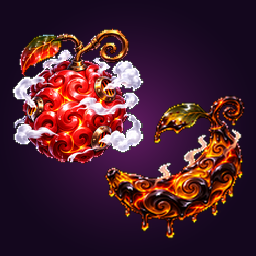
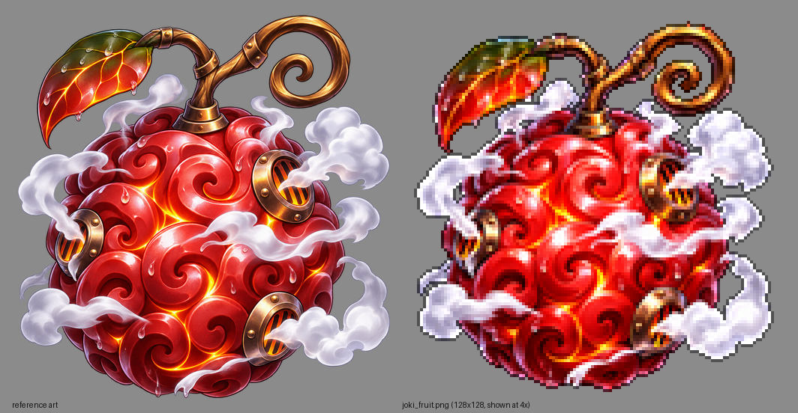

# Forbidden Fruits — Minecraft Bedrock Add-on

แอดออนรวม **ผลไม้ปีศาจ 2 ผล** (ออกแบบเอง ไม่ได้ลอกจากของจริง) ไว้ในแพ็กเดียว:

| | ผลไม้ | ประเภท | รายละเอียดเต็ม |
|---|---|---|---|
|  | **Jōki Jōki no Mi** — ไอน้ำแรงดันสูง | Paramecia | [joki-joki-addon/README.md](../joki-joki-addon/README.md) |
| | **Sekiyu Sekiyu no Mi** — น้ำมันปิโตรเลียม | Logia | [sekiyu-addon/README.md](../sekiyu-addon/README.md) |

**กฎสำคัญ: หนึ่งร่างกินได้ผลเดียว** ถ้ากินผลหนึ่งไปแล้ว อีกผลจะกินไม่ได้ (ผลไม้ไม่หาย คืนอยู่ในกระเป๋า)
ผู้ดูแลเซิร์ฟเวอร์ใช้ `/joki:revoke` หรือ `/sekiyu:revoke` ถอนพลังออกได้ หลังจากนั้นจะกินอีกผลก็ได้

**ไฟล์ติดตั้ง:** [`dist/Forbidden_Fruits.mcaddon`](dist/Forbidden_Fruits.mcaddon) (มีไฟล์ `_BP.mcpack` / `_RP.mcpack` แยกให้ด้วย)

| | |
|---|---|
| เวอร์ชันเกม | Bedrock **1.26.60** ขึ้นไป (iPhone / iPad / Android / Windows) |
| Script API | `@minecraft/server` 2.11.0, `@minecraft/server-ui` 2.3.0 (stable) |
| Experiments | **ไม่ต้องเปิด** |

> ⚠️ **ใช้แพ็กนี้แทนแพ็กเดี่ยว** อย่าเปิด Forbidden Fruits พร้อมกับแพ็ก Jōki หรือ Sekiyu ตัวเดี่ยวในโลกเดียวกัน
> ทุกแพ็กต้องแก้ไฟล์ตัวผู้เล่น (`minecraft:player`) ถ้าเปิดซ้อนกันจะเหลือทำงานแค่แพ็กเดียว
> (ถ้าโลกเดิมเคยเปิดแพ็กเดี่ยวไว้ ให้ถอดออกก่อนแล้วค่อยเปิด Forbidden Fruits)

## ติดตั้งบน iPhone / iPad

1. ดาวน์โหลด `Forbidden_Fruits.mcaddon` (ใน GitHub กดเข้าไฟล์ → **Download raw file**) แล้วบันทึกลง **Files**
2. เปิดแอป Files → แตะไฟล์ (หรือ **แชร์ → Minecraft**) เกมจะขึ้นว่า *Successfully imported*
3. สร้างหรือ **แก้ไข** โลก → **Behavior Packs** → **Available** → เปิด **Forbidden Fruits** (Resource Pack จะเปิดตามเอง) ไม่ต้องเปิด Experiments
4. หยิบผลไม้: **Creative inventory → แท็บ Equipment** หรือเปิดโกงแล้วพิมพ์
   * `/give @s joki:joki_fruit` — ผลไอน้ำ
   * `/give @s sekiyu:sekiyu_fruit` — ผลน้ำมัน
5. ถือผลไม้แล้ว**กดจอค้าง**เพื่อกิน จะได้ไอเทมควบคุม: **Steam Valve** (ไอน้ำ) หรือ **Crude Core** (น้ำมัน)

## วิธีควบคุม (เหมือนกันทั้งสองผล)

| ทำอะไร | ผลลัพธ์ |
|---|---|
| **ใช้** (กดจอค้าง / คลิกขวา) | ใช้สกิลที่เลือกอยู่ |
| **ใช้อีกครั้ง** ระหว่างสกิลทำงาน *(ผลน้ำมัน)* | จุดไฟ / เร่งเครื่อง / กลับร่าง |
| **กดย่อ 1 ครั้ง** | ไปสกิลถัดไป (เงยหน้ามองฟ้า = ย้อนกลับ) ไม่ยิงสกิลออก |
| **ย่อ + ใช้** | เปิดเมนูของผลนั้น (เลือกสกิล, โหมด/ร่าง, HUD, คู่มือ, ไอเทมใหม่) |

## สรุปพลัง

**Jōki Jōki no Mi (ไอน้ำ)** — 9 สกิล: Steam Boost, Pressure Dash, Boiler Jump, Steam Cannon, Scald Burst, Steam Knuckle,
Jet Kick, Mist Veil, Redline · มีโหมด NORMAL / HEAT / PRESSURE / REDLINE (ตัวแดงขึ้นตามความร้อน, มีไอพ่นออกจากตัว)
· มีเกจความร้อน 0–100 ถ้าเต็มจะ **OVERHEAT** ใช้สกิลไม่ได้ 10 วินาที



**Sekiyu Sekiyu no Mi (น้ำมัน, Logia)** — 8 สกิล: Black Tide, Petroleum Body, Black Geyser, Tar Prison, Oil Jet,
Black Serpent, Petroleum Infiltration, Black Inferno · **ไม่มีเกจน้ำมัน** ใช้ได้ไม่จำกัด ติดแค่คูลดาวน์
· แปลงร่างเป็นน้ำมันได้ ระหว่างเป็นน้ำมันการโจมตีทางกายภาพจะทะลุตัวไป · **จุดอ่อน:** ลงน้ำแล้วพลังถูกผนึก,
ตรีศูล (trident) / drowned / guardian ตีโดนจริง, และไฟแรงขึ้น 60% ตอนเป็นน้ำมัน


## วิธีรวมแพ็ก (สำหรับคนแก้โค้ด)

```
forbidden-fruits-addon/
├─ dist/                 ← Forbidden_Fruits.mcaddon (+ .mcpack)
├─ src/
│  ├─ main.ts            ← โหลด shared + steam + oil
│  ├─ shared/fruits.ts   ← กฎ "หนึ่งร่างหนึ่งผล" + ข้อความต้อนรับรวม
│  ├─ steam/             ← สคริปต์ผลไอน้ำ (มาจาก joki-joki-addon/src)
│  └─ oil/               ← สคริปต์ผลน้ำมัน (มาจาก sekiyu-addon/src)
└─ tools/
   ├─ build.py           ← สร้าง asset ด้วยตัวสร้างของแต่ละผล แล้วรวม
   ├─ validate.py        ← ตรวจการรวม (1,203 checks)
   └─ smoke/             ← run.mjs: เทสต์ของทั้งสองผลบนสคริปต์ที่รวมแล้ว + cross.mjs
```

* โมเดล, texture, particle, เสียง และแอนิเมชัน **สร้างจากเครื่องมือเดิมของแต่ละผล** (`../joki-joki-addon/tools`, `../sekiyu-addon/tools`)
  แล้วรวมเข้าด้วยกัน ถ้ามีไฟล์ชื่อชนกันการ build จะหยุดทันที
* ไฟล์ที่ทั้งสองผลต้องใช้ร่วมกันถูก**รวมด้วยมือ**:
  * ไฟล์ผู้เล่น (BP + RP): มี property ของทั้งสองผล
  * render controller ของผู้เล่น: ตอนเป็นร่างน้ำมันจะเป็นสีน้ำมัน, ตอนใช้ไอน้ำจะเรืองแดง, ตอนโดนตียังกะพริบแดงตามปกติ
  * รายการไอเทม, รายการเสียง และไฟล์ภาษา
* สกิลไอน้ำไม่โดนสิ่งที่ผลน้ำมันสร้างขึ้น (บ่อน้ำมัน, งู ฯลฯ)
* ID เดิมไม่เปลี่ยน (`joki:...`, `sekiyu:...`) คำสั่งและ `/give` จึงใช้ได้เหมือนเดิม

```bash
cd forbidden-fruits-addon
npm install          # และต้องเคย npm install ใน joki-joki-addon กับ sekiyu-addon ด้วย
npm test             # typecheck → build → validate → smoke (ทั้งสามชุด)
```

## ผลการทดสอบ

| การทดสอบ | ผล |
|---|---|
| TypeScript `strict` (typings ทางการ 2.11.0 / 2.3.0) รวมสคริปต์ทั้งสองผล | ✅ ไม่มี error |
| **Minecraft Creator Tools 0.21.0** | ✅ **0 errors** (คำเตือนเป็นชนิดเดียวกับที่แต่ละผลมีอยู่แล้ว) |
| `tools/validate.py` — **1,203 checks** | ✅ ไฟล์ทุกไฟล์ของทั้งสองผลอยู่ในแพ็กรวมครบและไม่ถูกแก้ ไฟล์ผู้เล่นมีของทั้งสองผลครบ, เสียง/ไอเทม/ภาษาครบ และทุก ID ที่สคริปต์ใช้มีอยู่จริง |
| เทสต์ผลไอน้ำบนสคริปต์ที่รวมแล้ว | ✅ **180** assertions |
| เทสต์ผลน้ำมันบนสคริปต์ที่รวมแล้ว | ✅ **143** assertions |
| เทสต์ข้ามผล (`cross.mjs`) | ✅ **20** assertions: โหลดได้ทั้งคู่, ข้อความต้อนรับขึ้นครั้งเดียว, กินผลที่สองไม่ได้ทั้งสองทาง (และคืนผลไม้กรณีกดแข่งกัน), property/HUD แยกกัน, สกิลไอน้ำไม่ทำลายบ่อน้ำมัน, ถอนพลังแล้วกินอีกผลได้ |

ระหว่างรวมแพ็กพบปัญหาจริงหนึ่งข้อและแก้แล้ว (แก้ในแพ็ก Sekiyu ตัวเดี่ยวด้วย): ระบบหมอกของ Black Inferno สั่งลบหมอกให้ผู้เล่น**ทุกคน**ทุกครั้งที่เกิดใหม่
ตอนนี้จะลบเฉพาะคนที่เคยโดนหมอกจริง

**ยังไม่ได้ทดสอบในเกมจริง** ที่นี่ไม่มีตัวเกม และเซิร์ฟเวอร์ทดสอบของ Creator Tools ต้องให้คุณยอมรับ EULA ของ Minecraft ก่อน
(`npx -y @minecraft/creator-tools@0.21.0 eula`) สิ่งที่ควรตรวจในเกมดูได้ใน README ของแต่ละผล
