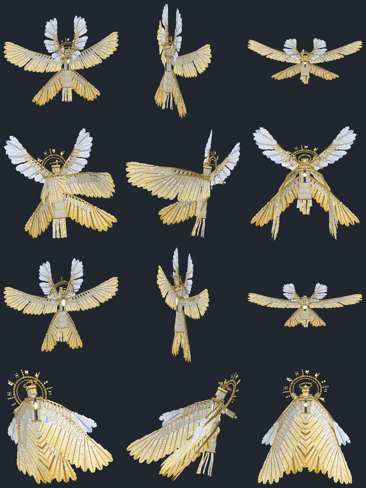
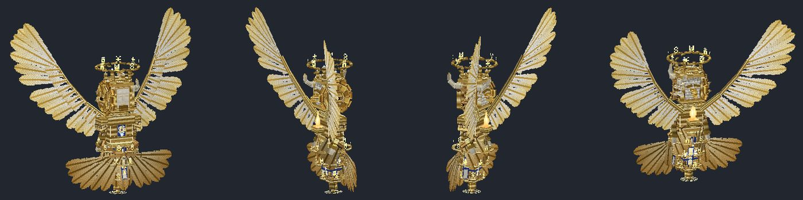
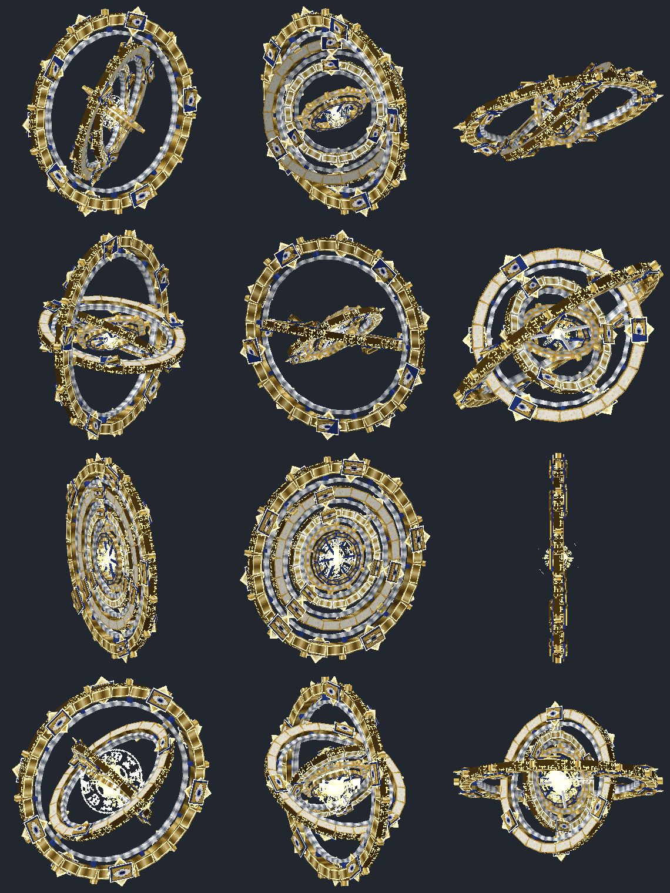
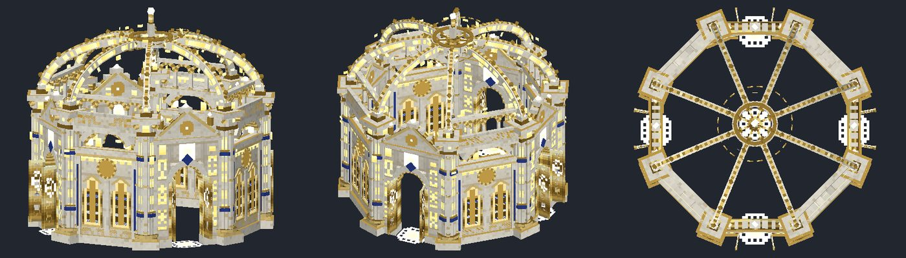
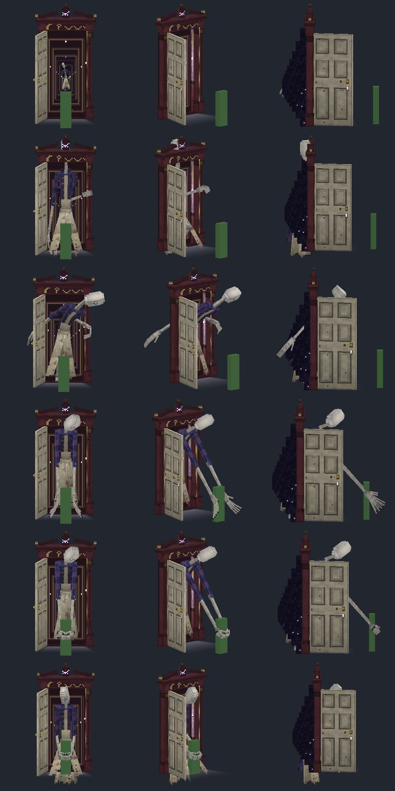
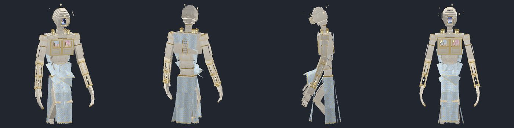
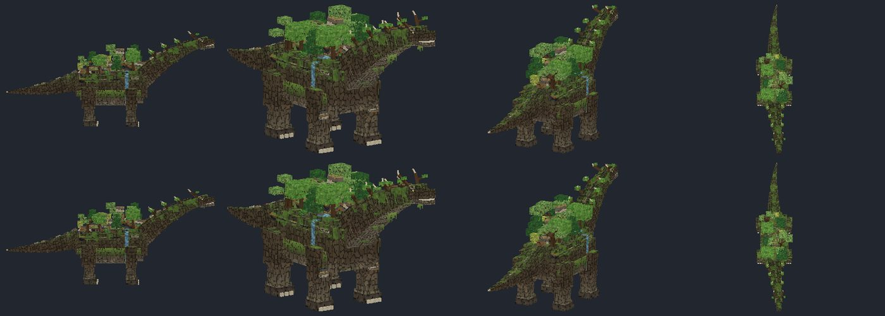
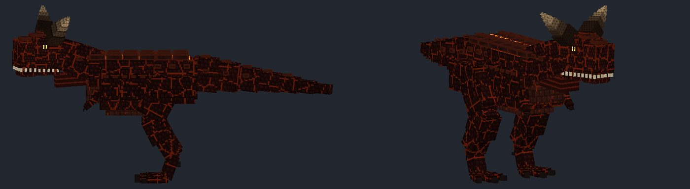
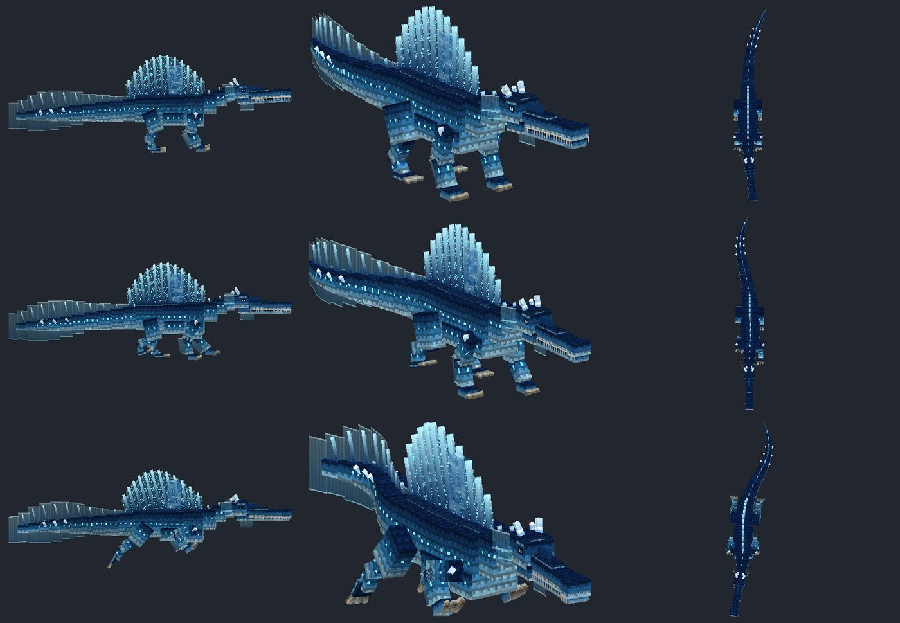
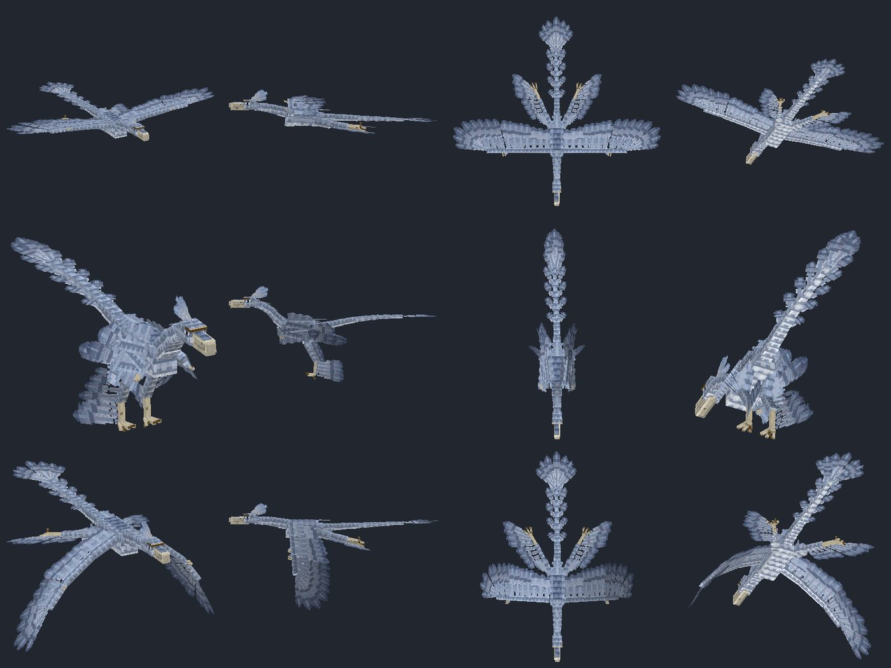

# Grimoire: Rebirth of the Arcane

An original magic add-on for **Minecraft Bedrock Edition**: three Grimoires, eighteen spells
(twelve signature spells, three Imperial Ultimates, three five-phase Extra Ultimates), each built
around its own original animated 3D model. No mana, no spell items, no custom camera.

Installable file: [`dist/Grimoire_Rebirth_of_the_Arcane.mcaddon`](dist/Grimoire_Rebirth_of_the_Arcane.mcaddon)

## เริ่มเล่นแบบย่อ (ภาษาไทย)

1. เปิดไฟล์ `Grimoire_Rebirth_of_the_Arcane.mcaddon` บนเครื่องที่มี Minecraft Bedrock 26.60 ขึ้นไป (บน iPhone: เปิดจากแอป Files แล้วเลือกเปิดด้วย Minecraft)
2. สร้างหรือแก้ไขโลก แล้วเปิดใช้ Behavior Pack "Grimoire: Rebirth of the Arcane" (Resource Pack จะตามมาเอง) ไม่ต้องเปิด Experiments
3. หยิบหนังสือจาก Creative Inventory หมวด Equipment หรือพิมพ์ `/grimoire:give`
4. ถือหนังสือในมือหลัก แล้ว **ย่อตัวหนึ่งครั้ง** เพื่อเลื่อนไปเวทถัดไป (01 ถึง 06 แล้ววนกลับ 01)
5. ยืนขึ้น **กดปุ่ม Use ค้างไว้** เพื่อเตรียมเวท แล้ว **ปล่อย** เพื่อร่าย
6. แต่ละเวทมีคูลดาวน์ของตัวเองเท่านั้น ไม่มีมานา ไม่เสียเลือด หนังสือไม่สึกหรอ

## Requirements and compatibility

| | |
|---|---|
| Game | Minecraft Bedrock Edition **26.60 or newer** (`min_engine_version` 1.26.60) |
| Script API | `@minecraft/server` **2.11.0** (stable; ships with the 26.60 line) |
| Experiments | **None required.** No beta APIs, no experimental toggles |
| Rendering | Standard rendering. No RTX, shaders, custom clients or custom materials |
| Platforms | Any Bedrock platform that can import add-ons (iOS/iPadOS, Android, Windows, consoles via Realms/world transfer) |

Version research (checked 13 November 2026): the stable line is 26.6x. 26.60 shipped on
27 October 2026 together with `@minecraft/server` 2.11.0; 26.62 is a hotfix from 6 November; a
26.63 hotfix exists for some platforms (Windows, servers, PlayStation 5). All of them satisfy
this add-on. Preview/beta builds (26.70) are not required. Older builds (26.50 and earlier) will
refuse to load the script module because they do not provide API 2.11.0.

## Installing

1. Copy `dist/Grimoire_Rebirth_of_the_Arcane.mcaddon` to the device and open it; Minecraft imports
   both packs. (iPhone/iPad: open it from the Files app and choose Minecraft.)
2. Create or edit a world, open **Behavior Packs**, activate **Grimoire: Rebirth of the Arcane**.
   The resource pack is a declared dependency and is applied with it.
3. No experiments are needed. Enable **cheats** only if you want the test commands below.

The two packs are also available separately as `.mcpack` files in `dist/`.

## Getting the Grimoires

Exactly three items exist; every spell is unlocked from the start.

| Item | Identifier | Where |
|---|---|---|
| Codex of the First Word | `grimoire:divine_word` | Creative inventory, Equipment |
| The Unawakened Codex | `grimoire:dream_nightmare` | Creative inventory, Equipment |
| Codex of the Four Primordial Dragons | `grimoire:elemental_dragon` | Creative inventory, Equipment |

Commands (cheats on): `/grimoire:give` gives all three; or `/give @s grimoire:divine_word`.

## Controls

1. Hold a Grimoire in the main hand.
2. **Crouch once** to advance one spell: 01 → 02 → 03 → 04 → 05 → 06 → 01. Holding crouch does
   not keep cycling. Each Grimoire remembers its own selection.
3. **Stop crouching.** Casting is refused while crouched.
4. **Press and hold Use** to prepare. The book opens and the spell's charging construct forms.
5. **Release Use** to cast. Nothing is cast on press, and nothing casts by itself while you hold.

Crouching during preparation, switching item or hotbar slot, dying, changing dimension or
leaving cancels the preparation with no cooldown. A very short tap (under 0.3 s) is ignored.

The action bar shows the Grimoire, spell number and name, and `READY` or the time remaining,
plus six pips for the whole book (green ready, red cooling down).

### Rules

* No mana, MP, stamina, ammunition, health cost or durability. The books are never consumed.
* Every spell has only its own cooldown, per player, stored on the player (it survives relogs and
  cannot be bypassed with a second copy of a book). There is no global cooldown.
* A cooldown starts only when a spell actually activates.

## The eighteen spells

Spell 05 of each book is its Imperial Ultimate, spell 06 its Extra Ultimate.

### Grimoire 01 - Divine Word Magic (Codex of the First Word)

| # | Spell | Cooldown | What it does |
|---|---|---|---|
| 01 | Seraphic Litany: The Sixfold Sanctus | 15 s | A six-winged Seraphim unveils itself and chants three times; each chant drops columns of judgment on nearby enemies; enemies struck by all three receive a verdict |
| 02 | Cherubic Testament: The Four Living Witnesses | 28 s | A four-faced, four-winged Cherubim turns its faces in sequence: Human marks enemies, Ox raises a wing wall that absorbs damage and retaliates, Lion roars and knocks back, Eagle drops feather-blades on marked enemies |
| 03 | Ophanim: The Unblinking Judgment | 35 s | Interlocking eye-covered wheels survey the field, mark enemies, then sweep geometric routes whose rim damages what it passes |
| 04 | Divine Edict: Let There Be Sanctuary | 45 s | A cathedral is written into existence letter by letter around the caster; for 12 s it blocks, repels and shields, with finite durability |
| 05 | Imperial Edict: The Threefold Heavenly Throne | 180 s | Three heavenly gates open; Seraphim, Cherubim and Ophanim act together; an empty throne forms and declares the verdict |
| 06 | The Word Before Creation | 360 s | Five phases: silence and the great page, letters that become marble structures, seven written laws, descending lines of text, and the unwriting |

### Grimoire 02 - Dream & Nightmare Magic (The Unawakened Codex)

| # | Spell | Cooldown | What it does |
|---|---|---|---|
| 01 | Reverie Procession: Parade of the Sleeping Moon | 16 s | A dream-road unrolls and a porcelain horse, mist-glass stag, curtain-winged bird and floating star doll parade along it and strike on four different paths; successive hits on one enemy stack |
| 02 | Nightmare Intrusion: The Guest Behind the Door | 24 s | A door appears behind the target, opens on an endless corridor, and a tall faceless Guest reaches out, holds and drags the target before the door slams |
| 03 | House of Shifting Sleep | 38 s | A dollhouse unfolds into a full-size maze that rearranges itself for 12 s, splitting and redirecting enemies with real walls |
| 04 | Lullaby and Scream | 46 s | A musical tapestry heals and shields allies with dream ribbons while nightmare scream-waves damage, slow and disorient enemies |
| 05 | Imperial Edict: The City That Sleeps Above the World | 180 s | A floating city assembles, comes alive, turns into a nightmare that hunts enemies with doors, windows, corridors and stairs, then folds into a miniature and releases a dream-wave |
| 06 | The Dreamer Who Never Wakes | 360 s | Five phases: the bed above the sky, the colossal Dreamer rising, dream zones and nightmare zones, the Great Unreality, and the forgotten morning |

### Grimoire 03 - Elemental Dragon Magic (Codex of the Four Primordial Dragons)

Four separate species with separate rigs: Nature (sauropod-inspired), Heat (Carnotaurus-inspired),
Water & Ice (Spinosaurus-inspired), Air (Microraptor-inspired, four feathered wings).

| # | Spell | Cooldown | What it does |
|---|---|---|---|
| 01 | Genesis Colossus: The Walking Continent | 28 s | The Nature Dragon rises from strata, walks with ground-shaking steps, grows its forest, binds enemies with roots and pillars, then slams the ground |
| 02 | Thermal Tyrant: Furnace of the Carnotaur | 24 s | The Heat Dragon ignites, charges a lane on two legs, then opens its vents and sends a superheated wave back along the lane |
| 03 | Abyssal Cryotitan: The Frozen Tidal Crown | 32 s | The Water & Ice Dragon swims out of suspended water, throws currents with its tail, freezes them from its sail, and shatters an ice crown onto the enemies |
| 04 | Aether Raptor: Symphony of the Four Wings | 20 s | The Air Dragon flies curving passes that leave air ribbons; crossing ribbons become vortices; it finishes with a supersonic dive and delayed shockwaves |
| 05 | Imperial Edict: The Chronicle of Buried Kingdoms | 180 s | Four fossil tablets rise; four dragon skeletons emerge and attack in their own ways; the fossil impressions then project elemental attacks and the tablets fracture |
| 06 | The World Before Names | 360 s | Five phases: four heartbeats, the four living dragons arrive, their overlapping dominions, the Fourfold Concord finisher, and the world remembering |

## Who gets hit, who gets helped

* **Enemies**: entities in the `monster` family, plus any entity you tag with `grimoire_target`
  (`/tag @e[type=pig,r=10] add grimoire_target` makes test dummies).
* **Allies**: players (including the caster). Player-versus-player is off by default.
* Spells never break or replace existing blocks. Walls and lights are temporary blocks placed only
  into air; they are removed when the spell ends, and a ledger repairs them at the next world load
  if the game was closed mid-spell.

## Test and admin commands (cheats on)

| Command | Effect |
|---|---|
| `/grimoire:give` | Gives the three Grimoires |
| `/grimoire:reset` | Clears your spell cooldowns |
| `/grimoire:cleanup` | Ends every active spell and removes its constructs |
| `/scriptevent grimoire:cast dw03` | Casts a spell directly (ids `dw01`-`dw06`, `dn01`-`dn06`, `ed01`-`ed06`) |
| `/scriptevent grimoire:config pvp on` | Treat other players as enemies instead of allies |
| `/scriptevent grimoire:config heartbeat on` | Input fallback, see Known limitations |

## Configuration

All balance values are plain constants: `src/config/global.ts` (targeting, limits, input) and one
file per spell in `src/config/` (damage, radii, durations, speeds). Cooldowns are the approved
registry in `src/core/registry.ts`. After editing, run `npm run bundle` and `npm run package`.

## Building from source

Requirements: Node 20+, Python 3.11+ with `numpy` and `pillow`, `ffmpeg` with libvorbis.

```
npm install
python3 tools/build.py        # models, textures, animations, particles, sounds -> packs
npm run typecheck && npm run bundle
node tests/run.mjs            # headless tests
python3 tools/validate.py     # cross-reference validation
python3 tools/package.py      # dist/*.mcaddon, *.mcpack
```

`DEVELOPING.md` describes the asset toolkit and the gameplay framework.

## Gallery

Renders from the project's own previewer (`tools/kit/render.py`), not in-game screenshots:

| | |
|---|---|
|  |  |
|  |  |
|  |  |
|  |  |
|  |  |

More in `docs/gallery/` (the three books, the dollhouse, the city spire, the porcelain horse).

## Verification status

**Nothing in this add-on has been run inside Minecraft.** No game client was available in the build
environment, and running a Bedrock Dedicated Server requires accepting the Minecraft EULA, which
was not done on the user's behalf. Everything below is verification outside the game.

| Check | Result |
|---|---|
| TypeScript type check against the official `@minecraft/server` 2.11.0 typings | clean |
| Headless tests (`node tests/run.mjs`) | **76 passed, 0 failed** |
| Cross-reference validation (`tools/validate.py`) | 0 errors, 0 warnings |
| Mojang's published JSON schemas (`tools/schema_check.py`) | 3 items, 140 entities, 267 particles: 0 violations |
| Minecraft Creator Tools 0.21.0 `validate` on the two packs | 0 errors, 0 warnings (3 notes it classes as likely noise, 429 optional format-version recommendations) |

What the headless tests cover (a strict mock of the Script API, not the engine):

* **Controls and cooldowns, 22 tests**: exactly three items; one crouch press = one step; holding
  crouch does not repeat; 06 wraps to 01; per-book selection; no cast on press, no auto-cast while
  holding, exactly one cast on release even with duplicate or reordered callbacks; no casting while
  crouched; crouch / item change / book change / death cancel without cooldown; an item-stop is
  never treated as a release; all 18 approved cooldown values; per-spell and per-player
  independence; duplicate books cannot bypass a cooldown; books are not consumed and cost no health.
* **Every spell, 54 tests** (3 each): a full cast with enemies, a cast with no enemies, and the
  caster leaving mid-spell. Each must run without script warnings, use only entity / particle /
  sound ids that exist in the packs, keep entity properties in range, deal real damage (offensive
  spells), and leave no entity and no temporary block behind.

Measured in those tests:

| Spell | Runtime | Peak entities | | Spell | Runtime | Peak entities |
|---|---|---|---|---|---|---|
| DW01 | 10.5 s | 27 | | DN04 | 13.5 s | 4 |
| DW02 | 14.9 s | 28 | | DN05 | 35.3 s | 25 |
| DW03 | 14.5 s | 14 | | DN06 | 63.6 s | 24 |
| DW04 | 21.3 s | 33 | | ED01 | 15.3 s | 24 |
| DW05 | 35.3 s | 47 | | ED02 | 12.3 s | 8 |
| DW06 | 65.7 s | 58 | | ED03 | 14.6 s | 20 |
| DN01 | 9.5 s | 19 | | ED04 | 14.1 s | 24 |
| DN02 | 11.8 s | 4 | | ED05 | 36.7 s | 23 |
| DN03 | 20.0 s | 24 | | ED06 | 65.4 s | 51 |

## Known limitations and things to check in game

* **In-game behaviour is unverified** (see above). In particular, none of these have been seen on
  a device: touch-screen hold and release on iPhone, model orientation and texture mapping, glow
  (emissive) rendering, particle appearance, sound levels and mix, frame rate, and how far away the
  largest models stay visible.
* **Hold-to-cast** depends on `minecraft:use_modifiers` making the book a hold-to-use item. Mojang's
  1.26.30 notes state that this component itself starts item use, and the vanilla spear relies on
  it, but it was not tested on a device. If a platform never raises the hold event, turn on the
  fallback with `/scriptevent grimoire:config heartbeat on`: it infers hold and release from
  repeated use events. That works with keyboard, mouse and controller; on touch it would behave
  like tap-to-cast, so it is off by default.
* **Model conventions.** Coordinates, rotations and face mapping follow the conversion Blockbench
  uses for Bedrock, cross-checked against vanilla animation values. Creator Tools' own preview
  renderer disagrees with it in places (it ignores bind-pose bone rotation and swaps east/west face
  mapping), so one of them is wrong; the game was not available to settle it. If models appear
  mirrored or side textures swapped in game, the conversion lives in one place:
  `Model.to_geo` / `_cube_json` in `tools/kit/geo.py`.
* **Held book placement** (first and third person) was set by estimate from the player model's
  hand position. The offsets are in one constants block at the top of each
  `tools/assets/books_*.py`.
* **The held book cannot know which spell is selected** (an engine limit on held-item models). The
  selected spell is shown by the action bar, a short vision above the book, and the charging
  construct. For the same reason the Dream book shows its nightmare state as a recurring "bad
  dream" on the held model rather than per selected spell.
* **Enemy targeting interference** (DN04) is limited to weakness, a stagger and a forced turn; the
  stable API cannot clear a mob's attack target.
* **Mob AI is not simulated in the tests**, so damage wards and projectile dissolution are exercised
  by type checking and targeted mock runs, not by real attacks.
* **Some spells run longer than their nominal length**: DN03 is 20 s in total (12 s active plus
  unfolding and folding), DW04 is 21 s (12 s active after about 6 s of construction), ED04 14 s.
* **Temporary barrier blocks** are invisible, but a Creative player holding a barrier item will see
  their markers while a spell is active.
* **Sounds were synthesized and never auditioned.** Levels are set by calculation.
* Game versions older than 26.60 are not supported.

## Licence and originality

Every model, texture, animation, particle, glyph and sound in this add-on is generated by the
code in `tools/` and is original to this project. The lettering is an invented script, not a real
alphabet or scripture. Sounds are synthesized; no samples or existing melodies are used.
