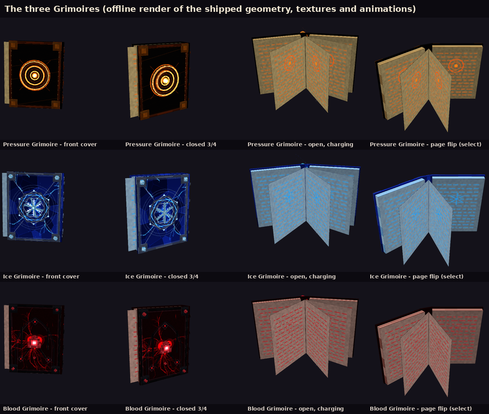
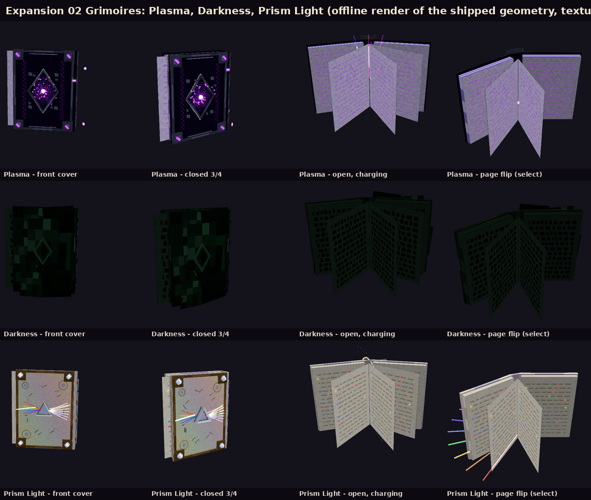

# Grimoire: Imperial Magic

A Minecraft **Bedrock Edition** add-on with six grimoires, each holding **15 spells** (90 in total), all available
from the start:

* **Grimoires 01–03:** Pressure, Ice and Blood.
* **Grimoires 04–06 (Expansion 02):** Plasma, Darkness and Prism Light.

**No mana.** There is no MP, gauge, ammunition, stamina, health or blood cost, charge counter or consumable. The only
limit is a **per-spell cooldown**, tracked separately for every player, grimoire and spell.




| | |
|---|---|
| Add-on version | 1.0.0 |
| Minimum game version | **1.26.60** (`min_engine_version`) |
| Tested on | Bedrock Dedicated Server **1.26.63.1**, the latest stable release when it was built (preview 1.26.70.x is not targeted) |
| Script API | `@minecraft/server` **2.11.0** (stable). No beta modules, no experimental toggles |
| Platforms | Every Bedrock platform that runs 1.26.60+ (Windows, Android, iOS, consoles), with no platform-specific code. Only a server was available for testing (see [Testing](#testing)) |

## Install

1. Download `dist/Grimoire_Imperial_Magic.mcaddon`.
   * **Windows:** double-click it.
   * **Android / iOS:** open it with Minecraft. On iOS that means Files → Share → Minecraft.

   Minecraft imports both packs. The separate `_BP.mcpack` and `_RP.mcpack` files are there if you need them.
2. Create or edit a world. Under **Behavior Packs**, activate **Grimoire: Imperial Magic BP**. The resource pack is
   added automatically because the behavior pack depends on it. **No experiments are needed.**
3. Get the books:
   * **Craft them** at a crafting table. Each recipe unlocks once you hold a book.

     | Grimoire | Recipe |
     |---|---|
     | Pressure | book in the center, blaze powder left/right, breeze rods top/bottom, copper ingots in the corners |
     | Ice | book in the center, amethyst shards left/right, blue ice top/bottom, diamonds in the corners |
     | Blood | book in the center, ghast tears left/right, nether wart blocks top/bottom, redstone blocks in the corners |
     | Plasma | book in the center, lightning rods left/right, glowstone dust top/bottom, amethyst blocks in the corners |
     | Darkness | book in the center, ink sacs left/right, obsidian top/bottom, sculk in the corners |
     | Prism Light | book in the center, glass panes left/right, quartz top/bottom, gold ingots in the corners |
   * **Or, as an operator with cheats on:** `/grimoire:getbook all` (or `pressure`, `ice`, `blood`, `plasma`,
     `darkness`, `prism_light`).

## Controls

| Action | Keyboard & mouse | Touch | Controller |
|---|---|---|---|
| **Select the next spell** (01 → 15 → 01) | Press Sneak (Shift) once while holding a grimoire | Tap the sneak button | Press sneak |
| **Prepare** | Stop sneaking, then **hold** right mouse | Press and hold (use) | Hold the use trigger |
| **Cast** | **Release** right mouse | Lift your finger | Release the trigger |

* One crouch press advances **exactly one** spell. Holding crouch never keeps cycling. Every player keeps a separate
  selection for each of the six grimoires.
* **Nothing is cast when you press Use, and nothing is cast when preparation finishes.** The spell fires once, on
  release.
  * Releasing before the spell's minimum preparation time *fizzles*: nothing is cast and no cooldown starts.
  * Holding longer is always safe.
* Preparation is cancelled safely (no cast, no cooldown) when you:
  * crouch,
  * switch items or move the book,
  * die,
  * change dimension,
  * or disconnect.
* A cooldown starts **after** the spell activates. Switching items, dying, relogging or picking up another copy of the
  same grimoire does **not** reset it.
* The **I11 Wings of the Winter Seraph** cooldown starts when the flight ends. It is the only exception.
* The grimoire is never eaten, used up or damaged. It works with a full hunger bar, in Survival and in Creative.

**HUD** (the action bar, readable on phones). Line 1 shows the school, number and spell, e.g. `Ice Magic | 07/15 Chains of Niflheim`. Line 2 shows one of:

* `READY`
* `Cooldown 12.4s / 30s`
* a preparation bar
* `Release to cast`
* `Active (cooldown starts when it ends)`

`/grimoire:guide` lists the 15 spells of the book you are holding.

## Spells and cooldowns

<!-- COOLDOWNS -->
**Grimoires 01-03**

| # | Pressure (orange) | CD | # | Ice (sapphire) | CD | # | Blood (crimson) | CD |
|---|---|---|---|---|---|---|---|---|
| P01 | Pressure Lance | 6 s | I01 | Glacial Sovereign's Lance | 8 s | B01 | Crimson Stiletto Rain | 7 s |
| P02 | Atlas Piston | 18 s | I02 | Boreal Dragon's Roar | 20 s | B02 | Guillotine of the Red Court | 16 s |
| P03 | Isobaric Severance | 10 s | I03 | Winter's Guillotine | 14 s | B03 | Sanguine Leviathan | 24 s |
| P04 | Cataclysm Salvo | 22 s | I04 | Thousandfold Crystal Rain | 25 s | B04 | Crown of a Thousand Blades | 26 s |
| P05 | Aegis of Isobars | 25 s | I05 | Lotus of the Eternal Frost | 28 s | B05 | Aegis of the Scarlet Rose | 25 s |
| P06 | Counterpressure Mantle | 22 s | I06 | Mirror of the Frozen Throne | 32 s | B06 | Royal Reprisal | 28 s |
| P07 | Titan's Vise | 30 s | I07 | Chains of Niflheim | 30 s | B07 | Veinbound Marionette | 30 s |
| P08 | Atmospheric Labyrinth | 35 s | I08 | Labyrinth of the Pale Moon | 40 s | B08 | Garden of the Crimson Thorns | 35 s |
| P09 | Resonance Cage | 28 s | I09 | Whiteout Dominion | 45 s | B09 | Hematic Maelstrom | 40 s |
| P10 | Pressure Step | 5 s | I10 | Frost Mirror Traverse | 8 s | B10 | Bloodstep: Shattered Ruby | 7 s |
| P11 | Skyline Pressure Rail | 14 s | I11 | Wings of the Winter Seraph | 20 s* | B11 | Arterial Current | 18 s |
| P12 | Barometric Omniscience | 25 s | I12 | Imperial Frost Legion | 60 s | B12 | Crimson Familiar: The Royal Stag | 55 s |
| P13 | Equilibrium Theft | 35 s | I13 | Hourglass of Still Winter | 50 s | B13 | Sovereign's Pulse | 45 s |
| P14 | Isobaric Citadel | 75 s | I14 | Grand Magic: Citadel of the Everlasting Winter | 90 s | B14 | Grand Magic: Scarlet Sea of Lament | 90 s |
| P15 | Imperial Edict: Thousand Atmospheres | 180 s | I15 | Imperial Edict: The Last Winter | 180 s | B15 | Imperial Edict: Heart of the Crimson Moon | 180 s |

**Grimoires 04-06 (Expansion 02)**

| # | Plasma (violet) | CD | # | Darkness (dark green) | CD | # | Prism Light (pearl) | CD |
|---|---|---|---|---|---|---|---|---|
| PL01 | Coronal Lash | 7 s | D01 | Umbral Origami | 7 s | PR01 | Sevenfold Verdict | 7 s |
| PL02 | Helix Borer | 12 s | D02 | Maw of the Unseen | 17 s | PR02 | Total Internal Reflection | 13 s |
| PL03 | Prominence Uprising | 19 s | D03 | The Unwritten Sentence | 13 s | PR03 | Caustic Bloom | 19 s |
| PL04 | Arc-Shear Cascade | 24 s | D04 | Sevenfold Eclipse | 26 s | PR04 | Fraunhofer Lattice | 26 s |
| PL05 | Stellarator Ward | 25 s | D05 | Velvet of the Hollow King | 27 s | PR05 | Brewster's Veil | 27 s |
| PL06 | Corona Molt | 30 s | D06 | Shadow Latch | 32 s | PR06 | Parallax Displacement | 32 s |
| PL07 | Fieldline Harp | 29 s | D07 | Curtainfall Divide | 35 s | PR07 | Chromatic Turnstile | 35 s |
| PL08 | Polarity Orchestra | 38 s | D08 | Dusk Mosaic | 38 s | PR08 | Kaleidoscope Theater | 40 s |
| PL09 | Static Horizon | 42 s | D09 | Censor's Seal | 42 s | PR09 | Interference Tapestry | 43 s |
| PL10 | Ion Skates | 10 s | D10 | Silhouette Traverse | 9 s | PR10 | Rayline Stride | 9 s |
| PL11 | Prominence Sling | 18 s | D11 | Stairway of the Unlit Sky | 22 s | PR11 | Iridescent Sail | 20 s |
| PL12 | Living Circuit: The Auroral Manta | 55 s | D12 | The Inkless Doppelgänger | 55 s | PR12 | Spectral Diagnosis | 48 s |
| PL13 | Magnetic Reconnection | 45 s | D13 | Footfall Reversal | 45 s | PR13 | Whitepoint Benediction | 55 s |
| PL14 | Grand Magic: Stellarator Cathedral | 90 s | D14 | Grand Magic: Court of the Unseen | 90 s | PR14 | Grand Magic: The Chromatic Observatory | 90 s |
| PL15 | Imperial Edict: Heavenwide Reconnection | 180 s | D15 | Imperial Edict: The World Without an Outline | 180 s | PR15 | Imperial Edict: The Colorless Coronation | 180 s |

\* I11's cooldown starts when the flight ends (the only exception).
<!-- /COOLDOWNS -->

[docs/SPELLS.md](docs/SPELLS.md) is the full reference: what each spell does, its preparation time and its tuning
values (damage, radius, duration).

Constructs and summons are offline renders of the shipped models. They are **not** in-game screenshots.

* [Pressure constructs](docs/images/constructs_pressure.png)
* [Ice constructs](docs/images/constructs_ice.png)
* [Blood constructs](docs/images/constructs_blood.png)
* [Summons: the Frost Legion and the Royal Stag](docs/images/summons.png)
* [Plasma constructs](docs/images/constructs_plasma.png)
* [Darkness constructs](docs/images/constructs_darkness.png)
* [Prism Light constructs](docs/images/constructs_prism_light.png)

### The expansion grimoires at a glance

| Grimoire | Visual language | Signature mechanics |
|---|---|---|
| **04 Plasma**, the Celestial Ion Furnace | Violet-indigo ceramic metal, titanium-silver reinforcements, braided plasma filaments, white-hot cores. Never flames or plain lightning. | Whips, drills and arches; magnetic confinement wards; polarity pylons; the Auroral Manta companion; reconnection events |
| **05 Darkness**, the Hollow Codex | Dark forest-green, light-absorbing planes with muted jade edges. No smoke, vines or purple voids. | Origami blades, jaws, erased glyphs; eclipse overlap; curtains and masks that misdirect mobs; a delayed doppelgänger; walkable shadow stairs |
| **06 Prism Light**, the Chromatic Codex | Pearlescent ivory and champagne gold, with prisms, lenses, mirrors and gratings. Colour appears only where light is dispersed. | Dispersion and recombination, timed multi-reflection routes, diffraction bands, polarising deflection, weak-point analysis, healing white light |

## Rules for operators

`/grimoire:config <rule> <value>` (or `/scriptevent grimoire:config <rule> <value>`). Rules are saved in the world.

| Rule | Default | Effect |
|---|---|---|
| `pvp` | `false` | Spells may damage other players and other players' summons |
| `friendlyFire` | `false` | With PvP on, players sharing a `grimoire_team:<name>` tag are still allies unless this is on |
| `harmPassiveMobs` | `false` | Area spells also hit passive animals |
| `temporaryBlocks` | `true` | Labyrinths and citadels may raise temporary walls. Walls are placed only into air and always removed |
| `damagePvE` | `1` | Multiplier for spell damage against mobs (0–10) |
| `damagePvP` | `0.5` | Multiplier for spell damage against players, used only when PvP is on (0–10) |
| `cameraEffects` | `true` | Camera shake and screen fades near big spells |

`/grimoire:resetcooldowns` clears your own cooldowns (operators; a testing aid).

## Who gets hit

* Spells damage **hostile mobs**.
* They also damage **any creature that attacked you or your summons in the last 20 seconds**, even one that would
  normally be protected (an angry iron golem, for example).
* Otherwise they never damage:
  * you,
  * your own summons, or other players' summons while `pvp` is off,
  * villagers, wandering traders, iron and snow golems, allays,
  * tamed or named mobs.
* Other players can be hit only when `pvp` is on, and teammates (a shared `grimoire_team:<name>` tag) only when
  `friendlyFire` is also on. Passive animals can be hit only when `harmPassiveMobs` is on.

Each construct, ward, bind, temporary block and summon belongs to the cast that created it. It is removed when:

* the spell ends,
* the caster disconnects,
* or the caster changes dimension.

If the world was closed mid-spell, leftovers are swept the next time their chunk loads. Temporary blocks also carry a
self-check that removes them if they are ever orphaned.

## Building from source

Requirements:

* Node 20+
* Python 3.10+ with `numpy` and `Pillow`
* `ffmpeg` with libvorbis (to synthesize the sounds)

```sh
npm ci
npm run typecheck                  # tsc --noEmit
python3 tools/build.py             # packs/ + dist/*.mcaddon (all models, textures, animations, particles, sounds)
python3 tools/validate.py          # static cross-reference checks (see docs/TESTING.md)
python3 tools/preview.py books     # offline renders: books | fx [prefix] | mobs  (needs Chromium + Playwright)
python3 tests/run_bds.py --bds <bedrock_server dir> controls pressure ice blood robustness cleanup
python3 tools/docs.py docs/test-evidence/final_run.json   # regenerate docs/SPELLS.md, docs/TESTING.md
```

Everything in the packs is generated by `tools/gen/`:

* geometry and textures are painted in code,
* the 67 sounds are synthesized,
* the particle sprites are drawn procedurally.

No third-party art or audio is included. three.js and Playwright are used only by the offline preview tool.

| Path | Contents |
|---|---|
| `src/core/` | Controls state machine, cooldown state, HUD, damage bus, wards, binds, temporary blocks, FX constructs, routines scheduler, diagnostics |
| `src/spells/{pressure,ice,blood}/` | Spell definitions (`index.ts`) and implementations (`spells.ts`) |
| `tools/gen/` | Model kit, texture painters, the six books, 160 construct models, 4 mobs, particles, sounds, fogs, player poses |
| `tests/` | BDS runner, world generator, development-only harness pack with the test suites |
| `packs/`, `dist/` | Built behavior and resource packs, `.mcaddon` and `.mcpack` files |
| `docs/` | Spell reference, testing matrix, test evidence, offline renders |

## How it works (key decisions)

* **Hold-to-prepare without eating.** The items use `minecraft:use_modifiers` with a one-hour use duration.
  * This makes them usable (Use can be held), but not food, not throwable and not consumable.
  * The scripts react to the item-use events this way:

    | Event | Effect |
    |---|---|
    | `itemStartUse` | Start preparing (ignored while sneaking) |
    | `itemReleaseUse` | Cast |
    | `itemStopUse` without a release (slot switch) | Cancel |
    | `itemCompleteUse` | Cancel; it never auto-casts |
  * All four were measured on the real server.
* **Cooldowns live in the script, not in item cooldown categories.**
  * They are stored per player in a dynamic property, so they survive death, relogging, item switches and duplicate
    books.
  * I11's timer starts from the end of its routine.
* **Spell behaviour runs as coroutine routines** owned by the cast.
  * Every sub-effect is registered with the cast and torn down by one cleanup path, whichever way the spell ends:
    expiry, disconnect, dimension change or world shutdown.
* **Damage** goes through one damage bus that respects Bedrock's hurt cooldown (hits in the same 10 ticks are merged).
  * Spells deal `magic` damage.
  * Counterattacks use `thorns` damage, so two reflective wards cannot bounce damage forever.
* **Constructs** are invulnerable, non-colliding entities. Synced properties (phase, yaw, pitch, size, length,
  variant) drive their animation controllers.
  * Each one has a self-despawn timer.
  * Each one carries a session id so that leftovers are removable.

## Polish pass (visual and bug fixes)

This pass followed a report that the spells looked bad and were buggy. Everything below was changed in the generator
or the spell scripts, then rebuilt and re-tested on the server (see [Testing](#testing)).

**Bugs fixed**

* **The book floated above the hand.** In third person it sat about 21 model pixels (1.3 blocks) above the right hand.
  It is now held in front of the hand at chest height. This was checked by rendering the vanilla player model with the
  attachable bound to its hand bone ([docs/images/hand_books.png](docs/images/hand_books.png)).
* **Constructs vanished at the edge of the screen.** 15 constructs were larger than their culling bounds, and stretched
  ones (beams, jets, strings, bands) disappeared once their origin left the view. Bounds are now computed from the
  real geometry, doubled for the size property, and stretched constructs get 52 blocks.
* **Constructs worn by the caster blocked the first-person view.** Cloaks, wings, halos, the doppelganger and the
  afterimages now hide the parts that pass through the caster's eyes, only while the camera is within 2.3 blocks.
  Other players, and the caster in third person, still see them whole.
* **D10 Silhouette Traverse and PR10 Rayline Stride locked the camera.** The dash re-applied the starting rotation on
  every step. You can now look around while dashing (the PR06, B10 and I10 teleports no longer force a rotation either).
* **PR11 Iridescent Sail hovered.** Its push set the vertical speed to 0 every 3 ticks, so the caster stayed at one
  height for the whole spell. It now glides down at a steady rate.
* **D11 Stairway of the Unlit Sky dropped the caster.** All steps vanished at once when the spell ended. The stair now
  folds back one step at a time, the step underfoot last, with slow falling and fall immunity. The same protection
  applies if the spell is cancelled.
* **Area spells aimed at the sky landed in mid-air.** Aiming above the horizon, or past the range over a drop, now
  lands the spell on the ground ahead of the caster.
* **PR13 Whitepoint Benediction put its white core inside the caster's chest.** It now burns in the middle of the halo,
  above the head.

**Visual changes**

* Construct textures are twice as sharp (one texel per model pixel instead of one per two).
* Glowing details on solid parts are now self-lit. Before, they were shaded like a surface and went dark at night.
* **Darkness** constructs were nearly black. Their plates, shadow sheets and voids are lighter and carry thin
  self-lit jade seams, so they read as dark obsidian panels instead of black boxes.
* **Blood** liquid surfaces use broad, glossy ripples. Bodies built from many small cubes (the beast, pillar, hand and
  ribbon) used to read as noisy red pixels.
* **Plasma** containment metal gets violet seams. Membranes are smooth glowing sheets instead of speckled noise.
* **Prism Light** spectral colours are softened to luminous pastels and also colour the glow's falloff (it used to stay
  grey). Specific constructs:
  * The ground band is a soft ribbon of light instead of a flat painted strip.
  * Afterimages glow evenly instead of showing stripes.
  * The light curtain is translucent and fades upward, instead of being an opaque wall.

## Testing

[docs/TESTING.md](docs/TESTING.md) has the full per-spell matrix and every check. The raw harness output is in
`docs/test-evidence/`.

**Final run:** **524 of 524** automated checks passed on Bedrock Dedicated Server 1.26.63.1, with 0 Content Log
errors or warnings.

* All 90 spells passed: the original 45 (regression) and the 45 of Expansion 02.
* The behavior pack under test is byte-identical to the one in `dist/`.
* One robustness check failed in the first pass because the new test expected the wrong spell number. The test was
  corrected and the suite re-run; [docs/TESTING.md](docs/TESTING.md) records this.

* **Verified in-engine (automated):** all of the following were run on Bedrock Dedicated Server 1.26.63.1 by
  simulated players using the real inputs (crouch, hold Use, release, switch slots):
  * all 90 spells (Pressure, Ice, Blood, Plasma, Darkness, Prism Light),
  * the controls and cancellation rules,
  * cooldown independence,
  * PvP and team rules,
  * two simultaneous casters,
  * disconnects and dimension changes mid-spell,
  * temporary blocks,
  * cleanup.
* **Not verified in a game client:** no Bedrock client was available, so everything the client draws or plays has only
  passed static validation and offline renders. That covers:
  * models in first and third person,
  * animations, particles, sounds, fog and camera effects,
  * the feel of knockback-driven movement.
* **No performance figures are claimed.** Frame rate was not measured on any device.

## Version research

The target versions were checked when the add-on was built:

* **Game:** the official Bedrock Dedicated Server download listing showed **1.26.63.1** as the latest stable release
  (the preview channel was at 1.26.70.24).
* **Script API:** the npm registry showed `@minecraft/server` **2.11.0** as the latest stable script module (newer
  versions were beta only) and `@minecraft/vanilla-data` at 1.26.60.
* **File formats:** item, block and recipe files use format **1.26.60**; behavior entities use **1.26.30**. These
  follow Mojang's `bedrock-samples` repository at 1.26.60.5.
* **Engine behavior:** the item-use event order, sneaking, knockback and the hurt cooldown were measured on the server
  itself instead of being assumed.

## Known issues and limitations

* **Client presentation is unverified.** This covers:
  * the book's first-person placement (third person was checked on the vanilla player model offline; first person follows
    vanilla attachable conventions),
  * every animation, particle, sound and fog,
  * how the HUD fits on small screens.

  These need a pass on real devices.
* **The engine ignores a new Use press for about 0.35 s after a release** (measured on BDS: about 7 ticks). If you
  release and immediately press again, the second press may not start preparing until that window has passed.
* **P11, I11 and B11 movement uses knockback impulses.** Simulated players ignore knockback, so the flight and riding
  feel, and how it behaves under network latency, is untested.
* **Summoned knights and the stag use vanilla mob AI** (melee, follow owner). Pathing in cluttered terrain is
  vanilla-quality.
* **Heavy constructs exist.** The largest are 840, 600 and 501 cubes (the Pressure layered field, the Ice crystal sword
  rain and the Pressure dome). They appear in limited numbers and for limited durations, but no device benchmark was
  done.
* **The test worlds were flat.** Line of sight, ground snapping and teleport safety were checked on flat ground with
  walls. Caves, water and steep terrain were not covered by automated tests.
* **Expansion 02: mob misdirection** (D07 Curtainfall Divide, D09 Censor's Seal, PR06 Parallax Displacement,
  PR08 Kaleidoscope Theater, PR09 Interference Tapestry) works through vanilla AI.
  * An invisible decoy strikes the mob for 1 damage, and the mob's own `hurt_by_target` behaviour turns it on the
    decoy.
  * Mobs without that behaviour ignore decoys.
  * Other players are blinded instead; no spell ever takes control of a player.
* **Expansion 02: player movement** for PL10 Ion Skates, PL11 Prominence Sling and PR11 Iridescent Sail uses speed and
  slow-falling effects plus knockback impulses. As with P11, I11 and B11, the feel is untested without a client.
* **Expansion 02: D11 stairs** are real blocks, placed only into air and removed afterwards. Each step rises half a
  block, which is within the player's automatic step height. Walking up them has not been tried by a person.
* **Expansion 02: D12 doppelgänger** repeats the caster's movement and melee hits after 1.5 s. It does not repeat
  spells or ranged attacks.
* **Expansion 02: PR12 weak point.** Spell damage to the marked target is multiplied immediately. Melee and other
  vanilla damage get their bonus as a separate hit 0.55 s later, after Bedrock's hurt cooldown.
* `/grimoire:getbook`, `/grimoire:config` and `/grimoire:resetcooldowns` need operator permission and cheats.
  Survival players without cheats use the crafting recipes.
