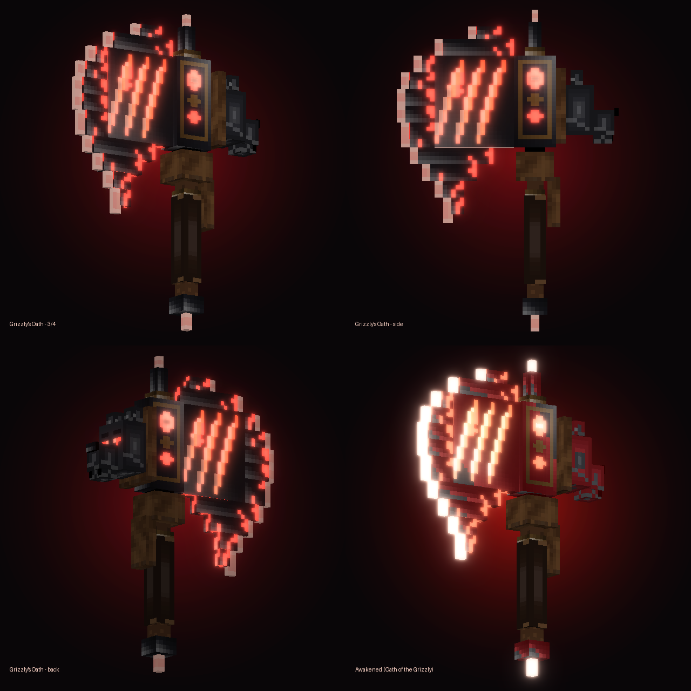
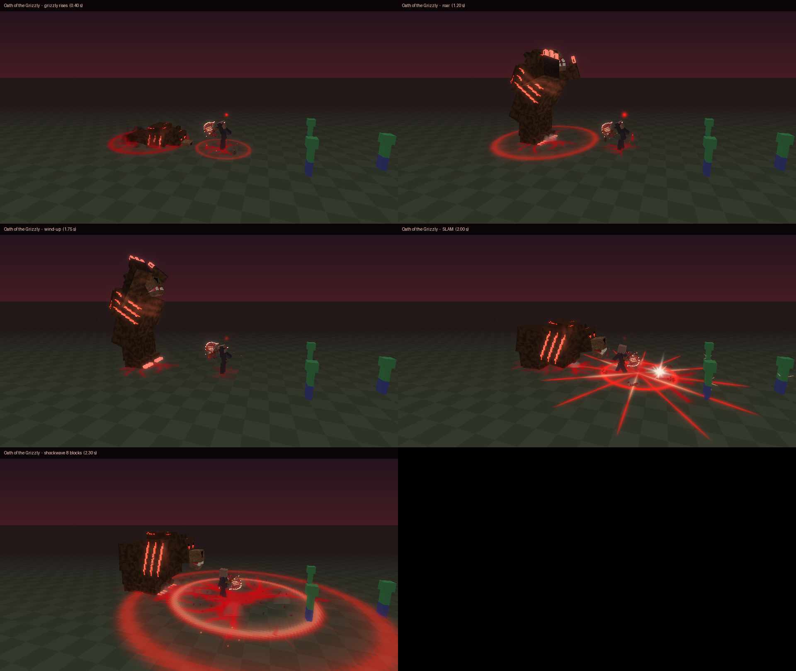
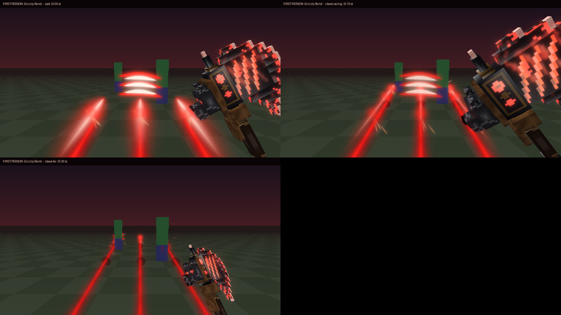
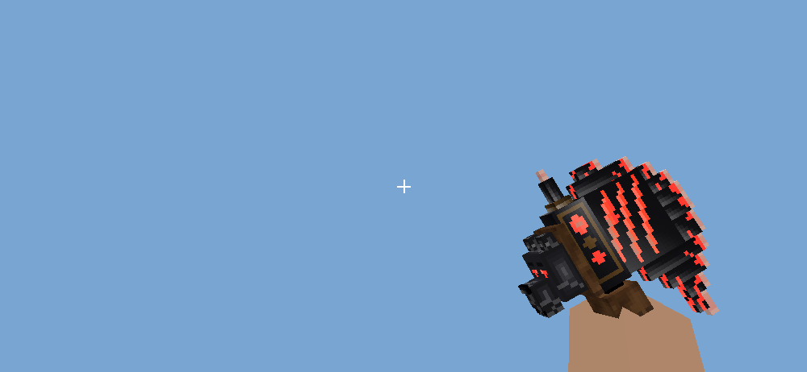
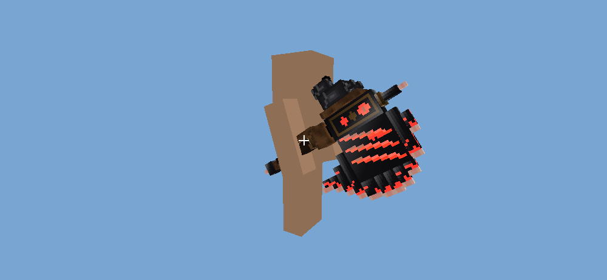
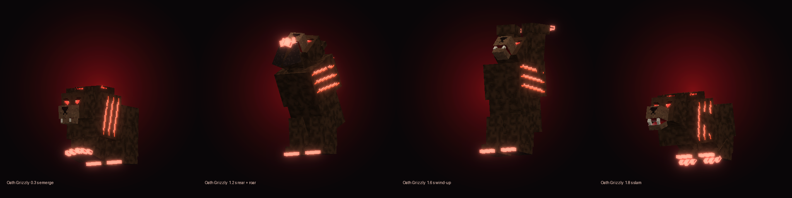

# Historical Artifacts 001: Grizzly's Oath (Hugh Glass)

แอดออน Minecraft Bedrock ที่เพิ่ม Artifact ชิ้นแรกของซีรีส์ **Historical Artifacts** ชื่อ
**Grizzly's Oath, the Unbroken Survivor** เป็นขวานใหญ่แนว Japanese Anime Dark Fantasy
ได้แรงบันดาลใจจาก Hugh Glass นักล่าขนสัตว์ที่รอดชีวิตจากการถูกหมีกริซลีขย้ำเมื่อปี 1823

**ไฟล์ติดตั้ง:** [`dist/Grizzlys_Oath_Historical_Artifacts_001.mcaddon`](dist/Grizzlys_Oath_Historical_Artifacts_001.mcaddon) (ประมาณ 120 KB รวม BP และ RP)

| | |
|---|---|
| เวอร์ชันเกม | Bedrock **1.26.60** ขึ้นไป (iPhone / iPad / Android / Windows / Console) |
| Script API | `@minecraft/server` **2.11.0** (stable) |
| Experimental toggles | **ไม่ต้องเปิด** |
| Item ID | `grizzly_oath:grizzlys_oath` |



### เวอร์ชัน 1.0.2 (ยกระดับเอฟเฟกต์และแอนิเมชัน)
* **วาดเอฟเฟกต์ใหม่ทั้งชุด** (atlas 256×256)
  * แสงฟันจันทร์เสี้ยวที่วาดตัวเองเข้ามา 4 เฟรม มีขอบแดงกับแกนขาวร้อน
  * ดาวประกายตอนกระทบแบบอนิเมะ
  * ประกายไฟเป็นเส้นที่ยืดตามทิศที่พุ่ง
  * รอยกรงเล็บเรืองแสงที่ทิ้งแผลไว้บนพื้น
  * รอยร้าวพื้นและวงคลื่นกระแทกที่แนบพื้นจริง
  * เปลวไฟดำแดง 4 เฟรม ฝุ่น และเศษหิน
* **วงคลื่นและรอยร้าวแนบพื้นแน่นอน:**
  * ใช้ `emitter_transform_xz` สำหรับวงคลื่นและรอยร้าว
  * ประกายไฟและรอยกรงเล็บใช้ `lookat_direction` ซึ่งตรวจทิศแกนกับ particle `ominous_spawning` ของ Mojang แล้ว
* **เอฟเฟกต์ของแต่ละสกิล:**
  * **Rend:** รอยกรงเล็บหนาและสว่าง พร้อมแผลบนพื้นที่ค่อย ๆ จาง
  * **Pursuit:** ภาพติดตาสีแดงดำตอนพุ่ง ฝุ่นที่เท้า และตอนฟันลงมีรอยร้าว วงคลื่น 2 ชั้น และเศษหิน
  * **Unbroken Will:** เปลวไฟดำแดงรอบเท้า
  * **Ultimate:** เปลวไฟเกลียวตอนชาร์จ รอยร้าวใหญ่ใต้หมี วงคลื่นตอนหมีคำราม และตอนตะปบมีรัศมี 12 ทิศ แสงระเบิดขาวร้อน และถ่านไฟที่ลอยตามหลัง
* **แอนิเมชัน:** ใช้เส้นโค้ง catmull-rom ทุกท่า ด้วยจังหวะอนิเมะ เงื้อ → ฟันเร็ว → ค้างตอนกระทบ → ตามแรง
  * มุมบุคคลที่ 3 ใช้ทั้งลำตัว หัว แขนซ้าย และขา เช่น ก้าวเท้าตอนฟัน เอนตัววิ่งตอนพุ่ง ตั้งท่ากว้างตอนคำราม และแขนสั่นด้วยพลังตอนชาร์จ Ultimate
  * หมีกริซลีโผล่จากพื้นแบบเด้งเลยเล็กน้อย สะบัดหัวและขากรรไกรตอนคำราม แล้วยุบตัวตอนตะปบ
* **ไม่บังจอ:**
  * หมีเกิดห่าง 6 บล็อก และก้มตัวน้อยลงตอนตะปบ เพราะการจำลองพบว่าเดิมหัวหมีจะลงมาอยู่ที่ตำแหน่งกล้องพอดี
  * ท่าฟันในมุมบุคคลที่ 1 ทุกท่าปรับให้ขวานไม่ค้างทับกากบาท
* **สีเรืองแสงของขวานและหมี:** ดันเป็นแดงสด เดิมเป็นแดงหม่นเพราะ overlay ผสมกับเหล็กดำ
* **storyboard:** ทุกภาพเรนเดอร์จากสิ่งที่สคริปต์จริงปล่อยออกมา (`tools/fx_preview/`) ทั้งมุมบุคคลที่ 3 และมุมบุคคลที่ 1
  * เป็นภาพจำลองจาก particle JSON ไม่ใช่ภาพจากตัวเกม
  * ภาพอยู่ใน `docs/preview/fx_*.png` และ `docs/preview/fp_*.png`

| Ultimate (มุมบุคคลที่ 3) | Grizzly Rend (มุมบุคคลที่ 1) |
|---|---|
|  |  |

### เวอร์ชัน 1.0.1 (แก้จากผลทดสอบบน iPhone)
* **ขวานบังกลางจอ:** สาเหตุคือไฟล์ geometry ที่ `designModel` สร้างเป็น `format_version` 1.12.0 ซึ่งยังไม่รองรับ `binding`
  ขวานจึงไม่ถูกผูกกับมือ และถูกวาดตั้งตรงกลางตัวผู้เล่นทะลุกล้อง
  ตอนนี้เปลี่ยนเป็น 1.16.0 (แบบเดียวกับ trident ของ Mojang) และเพิ่มกฎใน `npm run validate` ไว้ป้องกันไม่ให้เกิดซ้ำ
* **ตำแหน่งในมือ:** คำนวณจากข้อมูลจริงของ Mojang ได้แก่ท่าแขน `first_person.empty_hand` และ `holding` ของผู้เล่น
  จุดผูกเทียบกับโล่และ trident ของ Mojang และ attachable ตัวอย่างของ Microsoft
  * มุมบุคคลที่ 1: ขวานอยู่มุมขวาล่าง กากบาทกลางจอโล่ง
  * มุมบุคคลที่ 3: ถือขวานชี้ไปข้างหน้า ใบขวานอยู่ด้านล่าง
* **ท่าฟันและท่าสกิล:** แยกค่ามุมบุคคลที่ 1 กับที่ 3 ออกจากกัน
  * มุมบุคคลที่ 1 ขวานจะฟันเป็นแนวทแยงที่ด้านขวาของจอ และไม่หมุนลำตัว (ถ้าหมุน แขนจะกวาดทั้งจอ)
  * มุมบุคคลที่ 3 ยังเป็นท่ายกขวานเหนือหัวแล้วฟันลงเต็มแขน
* **เอฟเฟกต์:** เอฟเฟกต์ใหญ่ทุกชิ้นย้ายออกห่างจากกล้องและลดขนาดลง
  * แสงฟันและแฟลชกรงเล็บเล็กลง และอยู่ไกลออกไป 2.6 ถึง 3.2 บล็อก ต่ำกว่ากากบาท
  * รอยกรงเล็บวิ่งเลียดพื้น
  * เส้นพลังตอนพุ่งอยู่ด้านหลังตัว
  * ออร่า Unbroken Will อยู่ระดับเท้าถึงเอว
  * smoke test มีข้อตรวจเพิ่มว่าไม่มีเอฟเฟกต์ใหญ่อยู่หน้าตาผู้ร่าย
* เลขเวอร์ชันแพ็กเป็น 1.0.1 (ตอนนี้เป็น 1.0.2) เพื่อให้ iPhone นำเข้าทับของเดิมได้

| มุมบุคคลที่ 1 (จำลอง) | มุมบุคคลที่ 3 (จำลอง) |
|---|---|
|  |  |

---

## ติดตั้งบน iPhone

1. ดาวน์โหลดไฟล์ `.mcaddon` ลงแอป Files แล้วแตะเปิด (หรือกด Share แล้วเลือก Minecraft) เกมจะนำเข้าทั้งสองแพ็กให้
2. สร้างโลกใหม่หรือแก้ไขโลกเดิม แล้วเปิด Behavior Pack **Grizzly's Oath** (Resource Pack จะถูกเปิดตามมาเอง)
3. รับขวานได้จาก Creative Inventory หมวด Equipment (กลุ่มขวาน) หรือใช้คำสั่ง `/give @s grizzly_oath:grizzlys_oath` ถ้าเปิดโกงไว้

## การควบคุม

| การกระทำ | ผล |
|---|---|
| **ตี** (แตะมอนสเตอร์ / คลิกซ้าย) | **Frontier Cleave** การตีปกติ |
| **ใช้** (แตะพื้นหรืออากาศ / คลิกขวา) | ร่ายสกิลพิเศษที่เลือกไว้ |
| **ย่อ (Sneak) + ใช้** | เปลี่ยนไปสกิลถัดไป 1 → 2 → 3 → 4 → 1 |

* ขณะถือขวาน **Action bar** เหนือแถบไอเท็มจะแสดงสองบรรทัด
  * บรรทัดบน: ชื่อสกิลที่เลือกพร้อมสถานะ `READY` หรือเวลาคูลดาวน์ที่เหลือ
  * บรรทัดล่าง: คูลดาวน์ของทั้ง 4 ช่อง โดยช่องที่เลือกอยู่มีกรอบ `[ ]` และถ้า Unbroken Will ทำงานอยู่จะแสดงระดับและเวลาที่เหลือด้วย
* สกิลที่เลือกจะถูกบันทึกไว้กับตัวผู้เล่น จึงยังอยู่หลังออกจากเกมแล้วกลับมา
* ครั้งแรกที่ถือขวาน แชทจะแสดงวิธีควบคุม 1 ครั้ง
* เหตุผลที่เลือกระบบนี้: Bedrock บน iPhone ไม่มีปุ่มเพิ่มให้แอดออน ปุ่มที่ใช้ได้แน่นอนคือ "ตี", "ใช้" และ "ย่อ" จึงเก็บ "ตี" ไว้ให้การตีปกติ ใช้ "ใช้" สำหรับร่ายสกิล และใช้ "ย่อ + ใช้" สำหรับเปลี่ยนสกิล
  * การแตะพื้นบนมือถือนับเป็น "ใช้กับบล็อก" สคริปต์จึงรับทั้งการแตะอากาศและการแตะพื้น
  * ถ้าแตะบล็อกที่เปิดหรือกดได้ เช่น หีบ ประตู หรือโต๊ะคราฟต์ บล็อกนั้นจะทำงานตามปกติและไม่ร่ายสกิล
  * มีระบบกันกดซ้ำ ทำให้การแตะค้างไม่ร่ายหรือเปลี่ยนสกิลหลายครั้ง

## การตีปกติและสกิลทั้ง 4

| | รายละเอียด | ตัวเลข |
|---|---|---|
| **Frontier Cleave** (ตีปกติ) | ฟันหนักสลับขวาไปซ้ายและซ้ายไปขวาทุกครั้งที่เหวี่ยง มีแสงจันทร์เสี้ยวสีแดงกับประกายตามแนวคมขวานในทิศที่เล็ง เมื่อโดนเป้าจะมีประกายไฟและเสียงกระแทก | ดาเมจ 9 (ค่าของไอเท็ม) |
| **1. Grizzly Rend** | เหวี่ยงขวานกวาดแนวนอน ส่งรอยกรงเล็บพลังงานสีแดงสามเส้นวิ่งไปข้างหน้า ทะลุกำแพงไม่ได้ และเล็งขึ้นลงได้เล็กน้อย | ระยะ 12 บล็อก, ดาเมจ 8, เลือดไหล 2/วินาที นาน 3 วินาที, **คูลดาวน์ 7 วินาที** |
| **2. Relentless Pursuit** | พุ่งไปข้างหน้าพร้อมเส้นพลังสีแดงดำ หยุดก่อนชนกำแพง แล้วฟันขวานลงจากเหนือหัว เกิดวงคลื่นกระแทกผลักศัตรู กล้องสั่นเล็กน้อย | พุ่ง 7 บล็อกใน 0.25 วินาที, ดาเมจ 10 (รัศมี 3.5), แรงผลักรัศมี 4.5, **คูลดาวน์ 12 วินาที** |
| **3. Unbroken Will** | ชูขวานขึ้นและคำราม เงาหมีกริซลีโปร่งแสงตาแดงโผล่ด้านหลังมายืนสองขาคำราม แล้วจมหายลงดิน รอบตัวมีออร่าสีแดงดำ ได้ฟื้นเลือดทันที 2 ถึง 8 หน่วยตาม HP ที่ขาดไป แล้วประเมินใหม่ทุกวินาที | HP มากกว่า 60%: Resistance I และฟื้น 1/วินาที<br>HP 30–60%: Resistance II และฟื้น 2/วินาที<br>HP ต่ำกว่า 30%: Resistance III และฟื้น 3/วินาที<br>**นาน 8 วินาที, คูลดาวน์ 25 วินาที** |
| **4. Oath of the Grizzly** (Ultimate) | ขวานเปลี่ยนเป็นร่าง **Awakened** สีแดงเข้มเรืองแสงและมีเปลวไฟ ผู้เล่นชูขวาน **หมีกริซลี 3D ขนาดมหึมา** (สูงราว 6 บล็อกตอนยืน) โผล่จากพื้นด้านหลัง ยืนสองขาคำราม แล้วตะปบลงพื้นพร้อมจังหวะฟาดขวาน เกิดคลื่นกระแทกวงใหญ่ เศษหิน รอยกรงเล็บแผ่รอบทิศ และกล้องสั่น | รัศมี 8 บล็อก, ดาเมจ 18 ที่ใจกลางลดลงเหลือ 10 ที่ขอบวง, ผลักกระเด็นและติด Slowness II 2 วินาที, **คูลดาวน์ 60 วินาที** |



**ความปลอดภัยของสกิล**
* ไม่ทำลายบล็อกเลย เพราะไม่ใช้ระเบิด และเศษหินเป็นแค่อนุภาค
* ไม่ทำร้ายผู้ร่าย, ชาวบ้าน, พ่อค้าเร่, โกเลม, Allay, ขาตั้งเกราะ และสัตว์ที่เชื่องแล้ว
* ผู้เล่นคนอื่นจะโดนสกิลก็ต่อเมื่อเปิดกฎ PvP ของโลกไว้

**การเก็บกวาด**
* หมีกริซลีและเงาหมีถูกลบตรงเวลาที่แอนิเมชันจบพอดี
* มีระบบสำรองอีกสามชั้น
  1. entity มี timer ที่จะ despawn ตัวเองใน 5–6 วินาที แม้สคริปต์จะหยุดทำงาน
  2. ตอนโหลดโลกจะลบตัวที่ค้างจากรอบก่อน
  3. ถ้าผู้ร่ายออกจากเกมกลางสกิล จะลบตัวที่เขาเรียกออกทันที
* ขวานร่าง Awakened จะกลับเป็นร่างปกติเสมอ โดย durability, enchantment, ชื่อ และ lore ยังอยู่ครบ แม้ผู้เล่นจะตายหรือย้ายช่องระหว่างใช้ Ultimate

**ประสิทธิภาพ (iPhone)**
* อนุภาคทั้งหมดใช้ texture atlas เดียวขนาด 128×128
* ช่วงที่หนักที่สุดคือ Ultimate ปล่อยอนุภาคสูงสุด 49 ตัวต่อ tick (วัดจาก smoke test)
* เสียงทุกเสียงประกอบจากไฟล์เสียง vanilla ที่ปรับ pitch ใหม่ แพ็กจึงไม่ต้องมีไฟล์เสียงของตัวเองและมีขนาดเล็ก

---

## โครงสร้างโปรเจกต์

```
grizzly-oath-addon/
├─ dist/            ← ไฟล์ .mcaddon สำหรับติดตั้ง
├─ addon/           ← โปรเจกต์ Minecraft Creator Tools (behavior_packs/ + resource_packs/)
├─ scripts-src/     ← สคริปต์ TypeScript (compile ไปที่ addon/behavior_packs/grizzly_oath/scripts)
├─ art/             ← ผลลัพธ์ดิบจาก designModel + design_packs สำหรับแก้โมเดลต่อ
├─ tools/           ← post-process, animations, sounds, validate, smoke test, package, preview,
│                     hold_sim.py (จำลองภาพมือถือขวานมุมบุคคลที่ 1/3)
└─ docs/preview/    ← ภาพพรีวิวที่เรนเดอร์จากโมเดลจริง
```

**สิ่งที่สร้างด้วย Minecraft Creator Tools MCP**

| เครื่องมือ / Skill | ใช้ทำอะไร |
|---|---|
| `createMinecraftContent` | โครงโปรเจกต์ BP/RP, manifest และไอเท็ม/entity ตั้งต้น |
| `designModel` | โมเดล 3D ของขวาน (ทำ 2 รอบ) และหมีกริซลี พร้อม texture |
| `writeImageFileFromPixelArt` | ไอคอน 32×32 แบบปกติและแบบ Awakened |
| Skills `create-item`, `design-model`, `create-mob`, `debug-addon` | ใช้เป็นขั้นตอนอ้างอิงตลอดงาน |
| CLI `validate`, `exportaddon`, `rendermodel` | ตรวจไฟล์, แพ็ก .mcaddon และเรนเดอร์ภาพ |

ส่วนที่เขียนเพิ่มเอง เพราะ Skills ระบุว่ายังไม่รองรับ:
* attachable สำหรับถือขวาน 3D ในมือ
* material เรืองแสง
* แอนิเมชันผู้เล่นและแอนิเมชันหมี
* particle และ sound definitions
* Script API ทั้งหมด

หมายเหตุ: ได้สร้างไฟล์ `addon/.mct/mcp/prefs.json` (`allowImageFileWritesInDescendentFolders: true`) เพื่ออนุญาตให้ MCP เขียนไฟล์ภาพได้เฉพาะในโฟลเดอร์โปรเจกต์นี้ ไฟล์นี้ไม่ถูกแพ็กลง .mcaddon

### Build เอง
```bash
cd grizzly-oath-addon
npm install
npm run build   # assets → compile → validate → smoke test → package
python3 tools/render_preview.py   # ภาพพรีวิวโมเดล (ต้องมี Pillow + numpy)
node tools/fx_preview/scenes.mjs && python3 tools/fx_preview/render.py   # storyboard เอฟเฟกต์ทุกสกิล
```

## ผลการทดสอบ

**ทดสอบแล้ว (อัตโนมัติ):**
1. TypeScript `strict` ผ่าน typecheck กับ typings ทางการ `@minecraft/server` 2.11.0
2. Creator Tools `validate` ไม่พบ error
   * มี warning 5 รายการที่ debug-addon skill ระบุว่าเป็น noise ที่ Bedrock ยอมรับ เช่น `uv_anim` ใน render controller
3. ตรวจการอ้างอิงข้ามไฟล์ผ่าน **584/584** รายการ ได้แก่
   * ชื่อ bone และ locator ในแอนิเมชันตรงกับ geometry
   * UV ไม่เกินขอบ texture และ texture เป็น power-of-two
   * attachable, client entity, render controller, ไอคอน และชื่อไอเท็มเชื่อมกันครบ
   * ไฟล์เสียง vanilla ทั้ง 40 ไฟล์มีอยู่จริงใน bedrock-samples 1.26.60
4. Smoke test ผ่าน **82/82** โดยรันสคริปต์ที่ compile แล้วบน mock ของ `@minecraft/server` แบบเข้มงวด ถ้าเรียก id ของ particle, เสียง, แอนิเมชัน, entity, effect หรือตัวแปร Molang ผิด จะนับว่า fail ครอบคลุม
   * การตีปกติ: สลับซ้ายขวา และเอฟเฟกต์ตามทิศที่เล็ง
   * สกิลครบทั้ง 4: ระยะ, ดาเมจ, เลือดไหล, คูลดาวน์, ไม่ทะลุกำแพง, พุ่งหยุดก่อนกำแพง, ระดับบัฟตาม HP, จังหวะตะปบของหมีตรงกับฟาดขวาน
   * การลบโมเดลและการคืนขวานพร้อมข้อมูลไอเท็ม
   * การเปลี่ยนสกิลและการกันกดซ้ำ
   * การแตะหีบเทียบกับการแตะพื้น, PvP และการเก็บกวาดเมื่อออกจากเกม

**ยังไม่ได้ทดสอบในเกมจริง:** สภาพแวดล้อม cloud ไม่มีตัวเกม Minecraft และการเปิด Bedrock Dedicated Server ผ่าน MCP ต้องให้ผู้ใช้ยอมรับ EULA ด้วยตัวเองก่อน
ส่วนที่ควรตรวจในเกม:
* **ตำแหน่งและมุมของขวานในมือ** ได้มาจากตัวจำลอง `tools/hold_sim.py` ที่สร้างจากข้อมูลของ Mojang ถ้าในเกมยังเพี้ยน ให้แก้ `rotation`, `position` และ `scale` ใน `animations/grizzlys_oath.attachable.animation.json` แล้วรัน `python3 tools/hold_sim.py` เพื่อดูภาพก่อน
* ความสว่างของส่วนเรืองแสง (material `entity_emissive`), ทิศของรอยกรงเล็บและวงคลื่นบนพื้น (particle แบบ `direction_y`) และขนาดเอฟเฟกต์จริง
* ความรู้สึกของท่าทางผู้เล่นที่เล่นผ่าน `playAnimation` (ท่ามุมบุคคลที่ 1 ปรับจากภาพจำลอง ยังไม่ได้เห็นในเกม)
* การแตะจอ iPhone แล้วร่ายสกิล รวมถึงแรงผลัก เสียง และกล้องสั่น ว่าถูกใจหรือต้องปรับตัวเลข (ตัวเลขทั้งหมดอยู่ใน `scripts-src/config.ts`)
