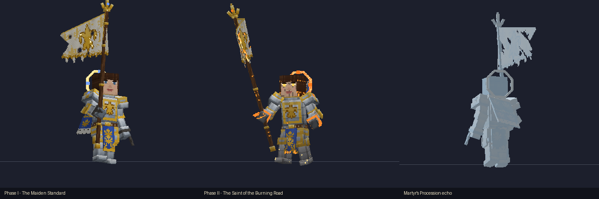
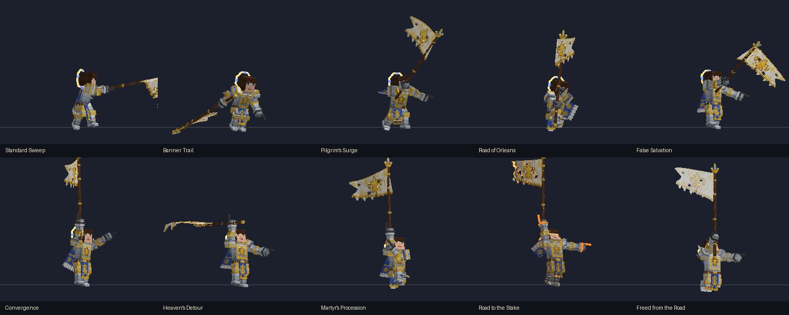
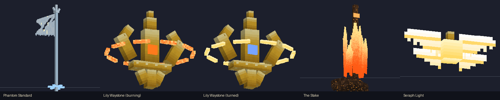
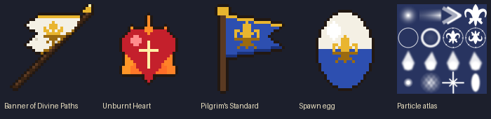

# BOSS 001 — Joan of Arc · The Banner of Divine Paths

Minecraft Bedrock Boss Add-on ที่มีบอสหนึ่งตัว: **Joan of Arc (โจนออฟอาร์ก)** ผู้ถือธงศึกสีขาว
และมีพลัง **Divine Pathway** — สร้าง ควบคุม และบิดเบือน "เส้นทาง" ที่ผลักพาผู้เล่น ม็อบ และกระสุนได้จริง

**ไฟล์ติดตั้ง:** [`dist/Joan_of_Arc_Boss.mcaddon`](dist/Joan_of_Arc_Boss.mcaddon)
(มี `Joan_of_Arc_Boss_BP.mcpack` / `Joan_of_Arc_Boss_RP.mcpack` แยกให้ในโฟลเดอร์เดียวกัน)

| | |
|---|---|
| เวอร์ชันเกม | Bedrock **1.26.60** ขึ้นไป (`min_engine_version` 1.26.60) |
| Script API | `@minecraft/server` **2.11.0** (stable ล่าสุดของ 1.26.60) |
| Experimental toggles | **ไม่ต้องเปิด** — ใช้เฉพาะ API/คอมโพเนนต์ที่เป็น stable |
| ความยาก | Easy / Normal / Hard (ใน Peaceful เกมจะลบม็อบ monster ทิ้ง) |



---

## ติดตั้งและเริ่มเล่น

1. เปิดไฟล์ `Joan_of_Arc_Boss.mcaddon` บนอุปกรณ์ที่มี Minecraft เกมจะนำเข้าทั้ง Behavior Pack และ Resource Pack
2. สร้าง/แก้ไขโลก แล้วเปิด Behavior Pack **BOSS 001 - Joan of Arc** (Resource Pack ถูกเปิดตามมาเอง)
3. เรียกบอสได้ 3 วิธี
   * **Spawn Egg** ในแท็บ Equipment/ไข่ของโหมดสร้างสรรค์ (`Spawn Joan of Arc`)
   * **Pilgrim's Standard** (เอาชีวิตรอด): คราฟต์บนโต๊ะคราฟต์
     ```
     ลาพิส  ขนแกะขาว  ลาพิส
     ทอง    ขนแกะขาว  ทอง
            ไม้
     ```
     ถือแล้วกดใช้ → เส้นทางแสงก้นหอยถูกเขียนลงพื้นข้างหน้า แล้ว Joan จะลงมาจากฟ้า (ไอเท็มถูกใช้หมดไป)
   * คำสั่ง `/joan:summon` (ต้องเปิด cheats)
4. คำสั่งสำหรับทดสอบ (ต้องเปิด cheats): `/joan:skill <ชื่อสกิล>` บังคับให้ Joan ใช้สกิลถัดไป,
   `/joan:phase` เข้าเฟส 2, `/joan:clear` ลบบอสและสิ่งที่เกี่ยวข้องทั้งหมด

แนะนำให้สู้ในพื้นที่ค่อนข้างโล่ง รัศมีประมาณ 26 บล็อก (ขอบสนามคือวง **Processional Ring** ที่ Joan เขียนไว้)

---

## 1. Character Design

ตีความ Joan of Arc ใหม่เป็นบอสแฟนตาซี โดยคงสัญลักษณ์ที่ทำให้จำได้ทันที

* **ผมบ็อบสั้นสีน้ำตาลเข้ม** แบบที่ปรากฏในภาพวาดและรูปปั้นของเธอ ใบหน้าตาสีฟ้าเทาที่แน่วแน่
* **เกราะเพลตอัศวินฝรั่งเศสสีเงิน** ขอบทอง บ่าเกราะซ้อนชั้นประดับอัญมณีสีน้ำเงิน **ดอกลิลลี่ (fleur-de-lis) ทองบนอก**
* **ผ้าคาดสะโพกและเสื้อคลุมไหล่สีน้ำเงินราชวงศ์** โรยลายลิลลี่ทอง ขอบขนเออร์มีน (สัญลักษณ์ราชสำนักฝรั่งเศส)
* **รัศมี (halo) สีทอง** หมุนช้า ๆ หลังศีรษะ — นักบุญ และเป็น "เส้นทางวงปิด" ชิ้นแรกของเธอ
* **ธงศึกสีขาวผืนใหญ่ = อาวุธชิ้นเดียว** ไม่มีดาบ โล่ หรือหอก: ผ้าลินินขาวขาดแหว่ง รูไหม้ ชายครุยไหมทอง ปลายหางนกนางแอ่น
  ลิลลี่ทองใหญ่กลางผืน โรยลิลลี่เล็ก ตัวอักษร **IHS** ใกล้เสา ริบบิ้นน้ำเงินสองเส้นใต้ยอดเสาที่เป็นลิลลี่ทอง
* **เฟส 2:** เกราะเปื้อนเขม่า มีรอยแตกเรืองไฟ ธงไหม้จากปลาย รัศมีกลายเป็นวงไฟ ดวงตาเรืองทอง และ**โซ่ตรวนขาดห้อยข้อมือ** (ปรากฏเฉพาะเฟสนี้)

**โมเดล:** 37 bones / 105 cubes, เทกซ์เจอร์ HD 2 พิกเซลต่อหน่วย (256×256) วาดแบบ procedural ต่อพิกเซลตามตำแหน่งบนตัวโมเดล
มีเทกซ์เจอร์ 6 ชุด: ปกติ, เผาไหม้ (เฟส 2), ขาวบริสุทธิ์ (ฉากพ่ายแพ้), วิญญาณ (เงาขบวนแห่) และชั้นเรืองแสงเฟส 1/เฟส 2 (render layer แยกที่ `ignore_lighting`)

**ผืนธง:** ผ้า 6 ท่อนต่อกันเป็นโซ่ + ผ้าขาดห้อย 3 ชิ้น + ริบบิ้น 2 เส้น × 2 ท่อน
* ทุกท่าโจมตี/สกิล **จำลองผ้าด้วยฟิสิกส์ (Verlet chain) จากการเคลื่อนไหวจริงของเสาธง** (น้ำหนัก แรงลม แรงต้าน ความแข็งของผ้า แรงสะบัด) แล้ว bake ลงคีย์เฟรม — ผ้าจึงตามหลังการเหวี่ยง มีน้ำหนัก เหวี่ยงเลยแล้วค่อยนิ่ง
* ตอนยืน/เดิน/วิ่ง ใช้ลูปผ้าที่จำลองไว้สองแบบ (ลมเบา / ลมจากการวิ่ง) ผสมกันตามความเร็วจริงของ Joan (`query.ground_speed`)
  และผ้า**เอนตามการหันตัว** (คำนวณความเร็วการหมุนตัวจาก `query.body_y_rotation` ใน Molang)

---

## 2. Core Ability — Divine Pathway

เส้นทางเป็น **วัตถุจริงในสคริปต์** มีทิศไหล ความเร็ว รัศมีจับ ช่วงความสูง อายุ และการเชื่อมต่อกับเส้นอื่น ทุก tick เส้นทางจะ

| สิ่งที่สัมผัส | ผลจริงในเกม |
|---|---|
| ผู้เล่น | ถูกพาไปตามกระแสด้วย `applyKnockback` (เกราะที่มี knockback resistance ต้านได้จริง) |
| ม็อบ | ถูกพาไปด้วยความเร็วตามกระแส |
| กระสุน (ธนู ตรีศูล สโนว์บอล ไข่ เพิร์ล ลูกไฟ wind charge ยา ฯลฯ) | **ถูกหักวิถีให้วิ่งตามเส้นทาง** โดยคงความเร็วเดิม |
| Joan | ขี่เส้นทางด้วยความเร็วสูง ตามวิถีที่ผิดธรรมชาติ (โค้งกลางอากาศ ลูปตีลังกา) แล้วโจมตีจากปลายทาง |

ความสามารถของ engine ที่สกิลนำไปใช้: **บิดทิศ · พาไปตามวิถี · หักวิถีกระสุน · วงปิด · รวมเส้น (merge) · แยกแขนง (split) ·
ทางแยกกลางเส้น (junction) · ย้อนทิศพร้อมสัญญาณเตือน · ถนนกระสับกระส่ายที่ย้อนเอง · จุดตัดที่กลายเป็นกองไฟ · ความจำเส้นทาง (รอยแผลถนน)**

**กติกาที่ผู้เล่นเรียนรู้และใช้รับมือได้**
* **ย่อตัว (sneak)** = ต้านกระแส: ถูกพาช้าลง 60% และไม่ถูกดึงเข้ากลางเส้น เดินออกด้านข้างได้
* **กระโดดข้าม** ถนนบนพื้นได้ (เฟส 1) — ช่วงจับความสูงต่ำ
* ออกจากท่อจับทางด้านข้าง
* ทำลาย **ธงผี** (ฟาด 3 ครั้ง) เพื่อให้ถนนของมันกลับทิศเหวี่ยงออก / ฟาด **Lily Waystone** เพื่อกลับทิศถนนใน Ultimate
* **Turned Road:** ลูกธนูที่ "ขี่" ถนนของ Joan แล้วไปโดนตัวเธอ ทำดาเมจ **2 เท่า** และทำให้เธอเซ เช่น ยิงไปตามเลนขาเข้าของ Road of Orléans

**ภาษาภาพที่คงที่ทั้งไฟต์**
* เส้นทองประ + ลูกศรนิ่ง = เส้นกำลังก่อตัว (ยังไม่ทำงาน) บอกทิศล่วงหน้า · มีเสียง chime
* สายธารฟ้า-ขาว-ทอง + ลูกศรวิ่ง = กระแสทำงาน · สายธารส้ม-แดงมีไฟ = ถนนเผาไหม้ (เฟส 2)
* ลูกศรแดง-ทองชี้ทางใหม่ = กำลังจะย้อนทิศ · เสียงลมกลับทิศ
* ลิลลี่ทองบนพื้นที่ขยายตัว = จุดที่จะถูกกระแทก · ลิลลี่กลับหัว = ทางลวง · วงแหวนแดงที่จุดตัด = กองไฟกำลังจะปะทุ
* ระฆังทุ้ม = ท่าหนักกำลังมา · คณะนักร้อง = ฉากใหญ่/Ultimate

ภาพของเส้นทางเป็น **segment emitter**: สคริปต์ส่ง particle หนึ่งครั้งต่อช่วงถนน (≤ 2.4 บล็อก) พร้อมตัวแปร Molang
(ทิศ ความยาว ความเร็ว สี) แล้วฝั่งไคลเอนต์วาดสายธารที่ไหลต่อเนื่องเอง จึงประหยัดเครือข่ายและเหมาะกับมือถือ

---

## 3. Combat Design



### การโจมตีประชิดด้วยธง (ทุกการสะบัดเขียนกระแสสั้น ๆ ตามทิศสะบัด)
| ท่า | ผล |
|---|---|
| **Standard Sweep / Back-sweep** | กวาดโค้ง 150° ระยะ ~3.9 บล็อก กระแสรูปเสี้ยวพาเหยื่อไปด้านข้าง |
| **Pole Thrust** | แทงแนวตรง 4.8 บล็อก แล้วทิ้งกระแสพุ่งออก (มักต่อด้วย Pilgrim's Surge) |
| **Standard Plant** | ปักธงกระแทกรัศมี 3 บล็อก (มีลิลลี่เตือนก่อน) แล้วแตกเป็นซี่ล้อกระแส 6 เส้น |
| **Banner Wrap** (เฟส 2) | สะบัดผ้าพันเหยื่อในกรวยแคบ แล้วเหวี่ยงลงบนถนนที่ใกล้ที่สุด |

### 7 สกิลหลัก
1. **Banner Trail** — เขียนถนนซิกแซก (เห็นก่อน) แล้ววิ่งลากธงตามไป ทุกช่วงกลายเป็นกระแสที่ไหลตามทิศที่เธอวิ่ง พาผู้เล่นเข้าหาท่าถัดไป
   *เฟส 2 — Crossroads Judgment:* สามช่วงที่ช่วงแรกกับช่วงสุดท้ายตัดกันบนตัวผู้เล่น → จุดตัดกลายเป็นกองไฟ
2. **Pilgrim's Surge** — ขี่ถนนเดิมที่ปลายทางอยู่ใกล้ผู้เล่น (ใช้เส้นทางที่สร้างไว้ก่อนหน้า) ถ้าไม่มีจะเขียน "ถนนโค้งฟ้า" ลงจุดที่เล็งล่วงหน้า
   กระแทกปลายทาง + คลื่นกระแทกวงแหวนที่**กระโดดหลบได้** · *เฟส 2 — Burning Pilgrimage:* ลูปตีลังกากลางอากาศและต่อหลายช่วง
3. **Road of Orléans** — ปักธงวางถนน 3 เลนผ่านผู้เล่น ไหล**ออก**ก่อน (ลูกธนูที่ยิงใส่เธอถูกพาออกไป) → เตือน → **ย้อนทิศ**ดูดกลับเข้าหา **Siege Breaker**
   *เฟส 2:* เลนกลางไหลสวนเลนข้าง และสลับทิศเป็นระยะ (เลนที่ปลอดภัยเปลี่ยนใต้เท้า)
4. **False Salvation** — วงปิด "รัศมีแห่งการพิพากษา" ล้อมผู้เล่น ภายในวงจะถูกพิพากษาเมื่อหมดเวลา วงแตกเป็น 3 ทางออก
   2 ทางจริง 1 ทาง**ลวง** (ลิลลี่กลับหัว) ที่วกกลับเข้าวง · *เฟส 2:* วงสูงกระโดดข้ามไม่ได้ ทางลวงพาไปส่งถึงตัว Joan ที่รอฟาดอยู่
5. **Convergence of the Standard** — ขว้างธงผี 3 ผืนรอบผู้เล่น ทุกผืนเขียนถนนที่**รวมกัน**ที่จุดเดียว ดูดทุกอย่าง (รวมกระสุน) ไปเจอเสาแสงพิพากษา
   ทำลายธงผีได้ → ถนนของมันกลับทิศเป็นทางหนี · *เฟส 2:* 4 ผืน และจุดรวมคือตัว Joan เอง
6. **Heaven's Detour** — หมุนธงเหนือหัวสร้างวงโคจรไขว้กันสองวง **จับกระสุนแล้วเหวี่ยงคืน**ผู้เล่นที่ใกล้ที่สุด กวาดผู้ที่เข้ามาประชิดออกไป
   พร้อมปล่อย **Seraph Light** ที่บินตาม "ถนนอ้อม" ที่วาดให้เห็นก่อน (อ้อมสิ่งกีดขวาง/ข้ามกำแพงเมื่อมองไม่เห็นผู้เล่น)
   *เฟส 2:* ถนนแยกเป็น 2 แขนง ลูกแสงแตกตัวที่ทางแยก · ลูกแสงฟาดทำลายได้
7. **Martyr's Procession** — ปลุก "รอยแผลถนน" ที่ Joan เคยเขียนไว้ในไฟต์ (ความจำเส้นทาง 40 วินาที) ให้กลับมาทีละเส้น
   แล้ว **เงาขบวนแห่** (ร่างโปร่งแสงของ Joan) เดินตามรอยเดิม ชนใครทำดาเมจ ฟาดทีเดียวสลาย และถนนของมันดับตาม
   *เฟส 2:* เงาลุกไฟ ถนนเผาไหม้ และรอยที่ตัดกันกลายเป็นกองไฟ

### Ultimate — Road to the Stake (เฟส 2, HP ≤ 30%)
หลักเพลิงแห่งรูอ็องโผล่กลางสนาม Joan ลอยเหนือหลักเพลิง ถนนก้นหอย 5 แขนงดูดทุกอย่างเข้าหาหลัก และมีกองไฟวิ่งไปตามแขนงที่ยังลุกเป็นระยะ
ปากแขนงแต่ละเส้นมี **Lily Waystone** — ฟาด/ยิงเพื่อ**กลับทิศแขนงนั้น** มันจะกลายเป็นสีขาว ไม่ลวก และพาผู้เล่นออก
* หมดเวลา → หลักเพลิงปะทุ (ดาเมจหนักในรัศมี 7 บล็อก) **ยกเว้นผู้ที่ยืนบนแขนงสีขาว**
* กลับทิศครบทุกแขนงทัน → ทุกถนนไหลออกจากหลักเพลิง… และไหลเข้าหา Joan เอง: เธอถูกลากลงมามัดกับหลักเพลิงของตัวเอง
  (**Martyr's Echo**: มึน ~6.5 วินาที รับดาเมจ +50%)

---

## 4. Boss Phases

| | Phase I — The Maiden Standard | Phase II — The Saint of the Burning Road |
|---|---|---|
| ลักษณะเส้นทาง | เรขาคณิตสะอาด ทิศเดียว ไม่ทำดาเมจ ใช้จัดตำแหน่ง/วางกับดัก | **ลวกไฟ**ทุกเส้น, **จุดตัด = กองไฟ**, **ถนนย้อนทิศเอง**, ที่จุดตัดกระแสหนึ่ง**แย่ง**ผู้ขี่จากอีกกระแส |
| สัญญาณเตือน | ~0.9 วินาที | ~0.6 วินาที (ยังมีเสมอ) |
| ท่าใหม่ | — | Banner Wrap, Crossroads Judgment, Burning Pilgrimage, เลนสวนทาง, ทางลวงส่งถึงตัว, ธงผีรวมที่ตัว Joan, ลูกแสงแตกตัว, เงาลุกไฟ, **Ultimate** |
| จังหวะ | มีช่วงพักชัด | **ต่อท่าเป็นโซ่** (สูงสุด 2 ต่อ) จากสถานการณ์ที่ท่าก่อนหน้าสร้างไว้ แล้วจึงพัก |

**ฉากเปลี่ยนเฟส** (ที่ 50%): Joan เซ คุกเข่า ปักธง ถนนทุกเส้นมีถ่านไฟวิ่งเตือนแล้วลุกเป็นไฟ ท้องฟ้ามืดลง เทกซ์เจอร์เปลี่ยน
แล้วลุกขึ้นพร้อมชูธงลุกไฟ (ระหว่างฉากไม่รับดาเมจ และดาเมจก้อนใหญ่ข้ามเฟสไม่ได้ HP จะหยุดที่ 50% พอดี)

---

## 5. Combat Intelligence

* **สังเกตผู้เล่นทุกคน:** ระยะ, line of sight, การง้างธนู/หน้าไม้/ตรีศูล, การยิงโดน, การตีประชิด, การกระโดดข้ามถนน,
  จำนวนครั้งที่ถูกกระแสพา, การวิ่งหนี (kiting), การยืนนิ่ง, ผู้เล่นที่กำลังขี่ถนน และจำนวนรอยแผลถนนที่มีอยู่
* **เลือกเป้า** ตามระยะ ความอันตราย และดาเมจที่ทำใส่เธอ (เปลี่ยนเป้าไม่ถี่กว่า 15 วินาที)
* **เลือกท่า** ด้วย utility score ตามสถานการณ์ เช่น ผู้เล่นยิงธนู → Heaven's Detour/Road of Orléans, หลบหลังกำแพง → Surge แบบโค้งฟ้า/Seraph อ้อม,
  ยืนนิ่ง → False Salvation, หลายคน → Convergence/Procession, รอยแผลเยอะ → Martyr's Procession
  แล้วสุ่มถ่วงน้ำหนักจาก 3 อันดับแรก (อ่านทางได้แต่ไม่ซ้ำซาก) ห้ามใช้ท่าเดิมติดกัน และบังคับพักหลังท่าใหญ่ 2 ท่า
* **คอมโบ:** Trail → Surge บนถนนที่ผู้เล่นกำลังขี่ · Thrust → Surge เมื่อผู้เล่นหลุด · Convergence → Surge · ทางลวง → ฟาดที่ปลายทาง · เฟส 2 ต่อท่าเป็นโซ่
* **ใช้เส้นทางเดิม:** Surge ขี่ถนนที่มีอยู่, Procession ปลุกรอยเก่า, Wrap เหวี่ยงลงถนนที่ใกล้ที่สุด, กองไฟเกิดจากการตัดกันของถนนเก่า-ใหม่
* **ความยุติธรรม:** ทุกท่ามีสัญญาณเตือน (ภาพ + เสียง) ปรับตามความยาก (Easy นานขึ้น 30%, Hard สั้นลง 15%), ผู้เล่นในโหมดสร้างสรรค์/ผู้ชมไม่ถูกโจมตี
* **ผู้เล่นหลายคน:** ดาเมจที่ Joan ได้รับลดตามจำนวนผู้เล่นในสนาม และทุกคนที่ร่วมสู้ได้รางวัล
* **Leash/Reset:** ถูกดึงออกนอกสนามจะเขียนถนนฟ้ากลับ, ถ้าไม่มีผู้เล่นในสนาม 40 วินาทีไฟต์จะรีเซ็ต

---

## 6. Animation & Effects

**แอนิเมชัน 33 ท่า** (ทุกท่ามีผ้าธงจำลองฟิสิกส์ของตัวเอง) + ชั้นพื้นฐาน: ยืน (หายใจ รัศมีหมุน), เดิน, วิ่ง, มองตามเป้า, ผ้าตามลม/ความเร็ว/การหัน, ผ้าขาด-ริบบิ้นพลิ้ว
* Spawn (ขี่ถนนลงจากฟ้า → คุกเข่าปักธง → ยืน → ชูธงคลี่) · Melee 5 ท่า · ท่าเฉพาะของทุกสกิล (windup/ride/slam, plant/hold/breaker,
  point, throw/call, spin/release, raise/hold) · Ultimate (rise/channel/bound) · เปลี่ยนเฟส (kneel/rise) · stagger · listen · recover · taunt · Death
* แอนิเมชันถูกสั่งจากสคริปต์ผ่าน entity property (`joan:action` + `joan:seq` ให้ท่าเดิมเล่นซ้ำได้) และ controller ที่ build สร้างขึ้นอัตโนมัติ
* เสียงสะบัดผ้า/ปักธงฝังในไทม์ไลน์ของแอนิเมชัน จึงตรงกับท่าพอดี

**Particle 20 ชนิด** (atlas ของตัวเอง): สายธาร, ลูกศรทิศ, หมึกเตือน, ไฟถนน, รอยแผล, ตราลิลลี่บนพื้น, วงแหวน, เสาแสง, ประกาย, ถ่านไฟ, ควัน, กลีบดอก,
ออร่ารอบตัวเฟส 1/2 (ปล่อยจากแอนิเมชันฝั่งไคลเอนต์) · มี**เพดาน 110 emitter ต่อ tick** และไม่วาดเส้นทางที่ไม่มีผู้เล่นในระยะ 80 บล็อก

**เสียงสังเคราะห์เอง 24 ชุด (28 ไฟล์ .ogg, ~0.7 MB)** สร้างจากโค้ดทั้งหมด: ผ้าสะบัด 3 แบบ, ผ้ากระชาก, ปักธง, chime เขียนเส้นทาง, กระแสเริ่มไหล, กลับทิศ,
ระฆังโบสถ์ (partial แบบระฆังจริง), คณะนักร้องสว่าง/มืด (formant synthesis), ไฟลุก, ไฟคำราม, แรงกระแทกศักดิ์สิทธิ์, รองเท้าเกราะ, หลักเพลิงโผล่,
Waystone กลับทิศ, Seraph, พุ่งตัว, ลากธง, การปะทุของหลักเพลิง, ฉากตาย, เปลี่ยนเฟส, หัวใจเต้น · ผสมเสียง vanilla ในบางจังหวะ

---

## 7. องค์ประกอบเพิ่มเติม



* **สนามประลอง:** Processional Ring รัศมี 26 บล็อกที่ Joan เขียนตอนลงมา — ลูกธนูที่ยิงจากนอกสนามถูกกวาดไปตามวงแทนที่จะถึงตัวเธอ (กันการซุ่มยิงไกล)
* **ฉากเปิดตัว / ฉากพ่ายแพ้:** ไฟดับ ธงกลายเป็นขาว ถนนทุกเส้นกลายเป็นแสงพุ่งขึ้นฟ้า ร่างสลายเป็นกลีบดอก
* **ตัวช่วยในไฟต์:** เงาขบวนแห่และ Seraph Light แตกเมื่อผู้เล่นตีหรือยิงโดนครั้งเดียว, ธงผีพังเมื่อตี 3 ครั้ง (ไม่รับดาเมจจากเกมโดยตรง จึงไม่มีจังหวะตายที่ยังทำร้ายได้)
* **กลไกลับ**
  * **ระฆังแห่ง Domrémy:** ตีระฆัง (บล็อก bell) ใกล้สนาม Joan จะหยุดฟัง "เสียงสวรรค์" ~3.6 วินาทีและรับดาเมจเพิ่ม (เฟสละครั้ง)
  * **Turned Road:** ดูหัวข้อ Divine Pathway
  * **Unburnt Heart:** ชนะ Joan หลังจากทำ Martyr's Echo สำเร็จ จะได้ "หัวใจที่ไม่มอดไหม้" (ตามตำนาน) ใช้อัญเชิญเธอมาสู้อีกครั้ง
* **รางวัล:** **Banner of Divine Paths** (คนละผืนสำหรับผู้ร่วมสู้ สูงสุด 4) — อาวุธดาเมจ 7 และ
  *ใช้* = เขียนถนนข้างหน้าที่พาตัวเองและเพื่อนพุ่งไป พร้อมพากระสุนศัตรูไปด้วย, *ย่อตัว+ใช้* = วงโคจรรอบตัว 6 วินาทีที่เหวี่ยงกระสุนและม็อบออก
  + ทอง เพชร ลาพิส แอปเปิลทอง และ XP 320 ต่อคน



---

## โครงสร้างโปรเจกต์และการ build

```
joan-addon/
├─ dist/                      ← .mcaddon + .mcpack (ไฟล์ส่งมอบ)
├─ src/                       ← สคริปต์ TypeScript (Script API 2.11.0)
│  ├─ main.ts                 ← events, custom commands, main loop
│  ├─ paths/                  ← Divine Pathway engine (path, shapes, field)
│  ├─ boss/                   ← JoanBoss, brain (AI), scenes, run loop, minions
│  │  └─ skills/              ← melee, trail+surge, orleans, salvation, convergence, detour, procession, stake (ULT)
│  ├─ core/                   ← vector, fx, targets/damage, terrain
│  ├─ rewards.ts              ← loot, Banner of Divine Paths, การอัญเชิญ
│  └─ generated/anims.ts      ← ID แอนิเมชันที่ build สร้าง (ใช้ร่วมกับ RP)
├─ tools/
│  ├─ modelkit.py / models.py / materials.py / art.py   ← โมเดล+เทกซ์เจอร์ HD แบบ procedural, renderer
│  ├─ rig.py / anims.py       ← FK, IK ธง/มือ, จำลองผ้า Verlet, แอนิเมชัน 33 ท่า, controller
│  ├─ particles.py / sounds.py / icons.py               ← particle atlas+effects, เสียงสังเคราะห์, ไอคอน
│  ├─ build.py / validate.py / docs.py                  ← build, static validation, ภาพเอกสาร
│  └─ smoke/                  ← mock @minecraft/server แบบเข้มงวด + เทสการต่อสู้เต็มไฟต์
└─ docs/DESIGN.md, docs/images/
```

```bash
cd joan-addon
npm install     # typings @minecraft/server 2.11.0 + vanilla-data + TypeScript
npm test        # typecheck → build → validate → smoke test
```
ต้องมี Python 3 + Pillow + numpy และ ffmpeg (เข้ารหัส .ogg)

---

## สิ่งที่ตรวจสอบแล้ว และข้อจำกัดที่ยังไม่ได้ทดสอบในเกมจริง

**ผ่านการตรวจสอบแล้ว (อัตโนมัติ ในสภาพแวดล้อมนี้)**
1. **TypeScript `--strict`** กับ typings ทางการ `@minecraft/server` 2.11.0 — 0 error
2. **Minecraft Creator Tools 0.21 validation** ทั้งสอง pack — **0 error, 0 warning** (เหลือเพียงคำแนะนำให้อัป `format_version`
   ซึ่งตั้งใจคงไว้เท่ากับไฟล์ vanilla ที่เป็นมาตรฐาน และ "likely noise" เรื่อง `item_texture.json` ที่เกมรองรับ)
3. **Static validation 7,083 checks — 0 error:** JSON, manifest/UUID/dependency, geometry ↔ client entity ↔ render controller ↔ texture,
   bone ที่ถูกแอนิเมตต้องมีจริง, UV ไม่เกินขอบ, controller state/transition, **Molang query ต้องเป็น query ที่ vanilla ใช้จริง**,
   `query.property` ต้องตรงกับ property ของเอนทิตีนั้น, particle/sound/locator ที่แอนิเมชันอ้างถึง, คอมโพเนนต์ BP ต้องมีใน vanilla,
   lang key, recipe, และทุก particle/sound/entity/property/event ที่สคริปต์ใช้ต้องมีอยู่จริง (ทดสอบแล้วว่า validator จับข้อผิดพลาดที่จงใจใส่ได้)
4. **Runtime smoke test 143 assertions ผ่าน และรันซ้ำภายใต้ "ความหมายของ knockback" 3 แบบ** (ตั้งค่าความเร็ว /
   ลดครึ่งแล้วบวก / บวกเพิ่ม เพราะเอกสาร API กำกวมเรื่องนี้) — รันสคริปต์ที่ compile แล้วบน mock ที่เข้มงวด
   (id ผิด/property ผิดช่วง/เรียก entity ที่ถูกลบ/เรียกคำสั่งแก้โลกใน before-event = fail) พร้อมฟิสิกส์จำลอง
   กำแพง และบล็อกที่เดินผ่านได้ (หญ้า) ครอบคลุม:
   ฉากเปิด, ถนนพาผู้เล่นจริง, ย่อตัวต้าน, กระโดดข้าม, ย้อนทิศหลังเตือน, หักวิถีลูกธนู, split/merge/junction, ทุกสกิลทั้งสองเฟส,
   AI เลือกท่าเองแบบอิสระ (เฟส 1 ใช้ 7–8 ท่า, เฟส 2 มีคอมโบต่อท่า), leash/กลับสนาม, ระฆัง, Turned Road (ดาเมจ ×2),
   กันดาเมจข้ามเฟส, เปลี่ยนเฟส, จุดตัด→กองไฟ, Ultimate ทั้งสองผลลัพธ์, ฉากตาย, รางวัล, ธงรางวัลทั้งสองโหมด,
   การอัญเชิญด้วยไอเท็ม, รีเซ็ตเมื่อทุกคนออกจากสนาม (รวมตอนที่ Ultimate ถึงรอบพอดี), `/joan:clear`, การกลับมาสู้ต่อหลังโหลดโลกใหม่,
   ถนนผ่านทุ่งหญ้าไม่ถูกตัด, กำแพงตัดถนน, วงปิดที่ถูกกำแพงตัดจะไม่ถูกปิดทะลุกำแพง, ถนนฟ้ากลับบ้านที่ถูกบังยังพากลับสนามได้,
   ผู้ขี่เร็วบนวงปิดไม่หลุดทางแยก, นาฬิกาถนนกระสับกระส่ายเริ่มใหม่หลังสั่งกลับทิศ, วงโคจรเหวี่ยงผู้เล่นออกนอกวง, เงาขบวนแห่/ลูกแสงแตกเมื่อถูกตี
   ผลวัด: particle เฉลี่ย ~5 emitter/tick (สูงสุด 110 ตามเพดาน), เวลาสคริปต์บน mock เฉลี่ย ~0.03 ms/tick,
   ผู้เล่นถูกพาไป 0.42 / 0.33 / 0.58 บล็อก/tick บนถนนความเร็ว 0.42 ภายใต้ knockback ทั้ง 3 แบบ (อยู่ในกรอบ 0.78–1.38 เท่าเสมอ)
5. **Code review อิสระ** โดย agent อีกตัวที่อ่านโค้ดเทียบกับ typings โดยไม่ยึดมุมมองเดิม พบ 14 จุดที่ mock จับไม่ได้
   (เช่น หญ้า/ดอกไม้ถูกนับเป็นกำแพง, วนลูปกลับบ้าน, Ultimate บังการรีเซ็ต, ความเร็ว knockback อาจสะสม) — แก้ครบและมีเทสกันถอยหลังทุกข้อ
6. **ทิศทางการหมุนของ bone** ยืนยันจากแอนิเมชัน vanilla 3 ตัว (แขนซอมบี้, ท่าร่ายเวทของ evoker, ส่องกล้อง) แล้วใช้ convention นั้นทั้ง FK, IK, การจำลองผ้า และ renderer
7. **ภาพพรีวิว** ทุกภาพในเอกสารเรนเดอร์จาก geometry/texture/pose จริงที่อยู่ใน pack

**ยังไม่ได้ทดสอบในเกมจริง** (สภาพแวดล้อมนี้ไม่มี Minecraft Bedrock) — สิ่งที่ควรตรวจเมื่อเล่นจริง:
* **ความรู้สึกของกระแส:** `applyKnockback` ถูกชดเชยด้วยความเร็วปัจจุบันจึงไม่สะสมเกินกรอบไม่ว่าเกมจะใช้ความหมายแบบใด แต่ยังไม่ได้สัมผัสจริง
  อาจต้องปรับ `speed` ของถนน (ค่าเริ่ม 0.36–0.6 บล็อก/tick) ใน `src/boss/skills/*` และ `src/boss/joan.ts`
  และความแม่นของ `getVelocity()` สำหรับผู้เล่นบนเซิร์ฟเวอร์จริงมีผลต่อการชดเชยนี้
* **การหักวิถีกระสุน:** อาศัย `clearVelocity` + `applyImpulse` กับกระสุนขณะบิน ซึ่งควรใช้ได้กับลูกธนูแต่กระสุนบางชนิด (เช่นลูกไฟ) อาจไม่ตอบสนองเท่ากัน
* **การขี่ถนนของ Joan** ใช้ความเร็วต่อ tick + teleport แก้ตำแหน่งเมื่อหลุดเกิน 3.2 บล็อก — อาจเห็นการกระตุกเล็กน้อยบนไคลเอนต์ที่ FPS สูง
* **Particle:** โหมด `emitter_transform_xz` (ตราลิลลี่/วงแหวนบนพื้น) และ `lookat_direction` (สายธาร/ลูกศร) อิงสเปกและไลบรารี Wintersky
  แต่ยังไม่เห็นบนจอจริง; ใช้เฉพาะ material ที่ vanilla ใช้ (`particles_blend`/`particles_alpha`)
* **Render:** ชั้นเรืองแสงใช้ `ignore_lighting` แบบเดียวกับตา breeze ของ vanilla, ผ้าธงเป็นระนาบหนาศูนย์ใช้ `entity_alphatest` (สองด้าน)
* **การเลือกเป้า/เคลื่อนที่ของ AI vanilla** (`move_towards_target`) ทำงานร่วมกับการสั่งจากสคริปต์ — ตรรกะทดสอบบน mock เท่านั้น
* **สมดุลความยาก** (HP 600, ดาเมจ, cooldown) และ**เสียง**ที่สังเคราะห์ (ตรวจระดับ/ความยาว/ไม่ clip แล้ว แต่ยังไม่ได้ฟังด้วยหู)
* **ประสิทธิภาพบนมือถือจริงและผู้เล่นหลายคนบนเซิร์ฟเวอร์จริง** — วัดได้เพียงจำนวน packet/particle และเวลาสคริปต์บน mock
