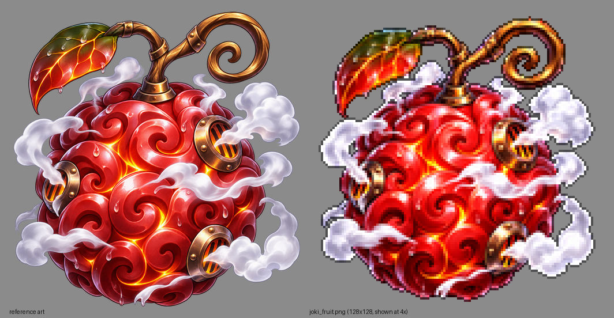

# Jōki Jōki no Mi — Steam Pressure (Minecraft Bedrock add-on)

An original, fan-made **Paramecia** Devil Fruit. Eat it and your body becomes a living boiler: you build internal heat,
vent superheated steam, rocket yourself around with pressure jets and punch with steam-driven force. The body stays
physical (no steam form). Push too hard and you **OVERHEAT**.

**Install file:** [`dist/Joki_Joki_no_Mi_Steam_Pressure.mcaddon`](dist/Joki_Joki_no_Mi_Steam_Pressure.mcaddon)
(separate `_BP.mcpack` / `_RP.mcpack` are next to it).

| | |
|---|---|
| Game version | Bedrock **1.26.60** or newer (all platforms, incl. iPhone/iPad) |
| Script API | `@minecraft/server` **2.11.0**, `@minecraft/server-ui` **2.3.0** (latest stable) |
| Experiments | **None needed** — only stable APIs |




---

## Install on iPhone / iPad

1. Download `Joki_Joki_no_Mi_Steam_Pressure.mcaddon` (on GitHub: open the file → **Download raw file**). Save it to **Files**.
2. In the **Files** app, tap the file. If it only shows a preview, tap **Share** → **Minecraft**. Minecraft opens and
   says *Import started… / Successfully imported*.
3. Create a world (or **Edit** an existing one) → **Behavior Packs** → **Available** → activate
   **Jōki Jōki no Mi - Steam Pressure**. The resource pack is added automatically. No experimental toggles.
4. Get the fruit: **Creative inventory → Equipment tab** (search "Joki"), or with cheats on: `/give @s joki:joki_fruit`
5. Hold it and **press and hold the screen** to eat. You receive the **Steam Valve**.

> Android / Windows: open the `.mcaddon` file the same way; Minecraft imports it.

## Controls (touch first)

Hold the **Steam Valve** (`joki:steam_valve`):

| Input | Touch | Keyboard / controller | Action |
|---|---|---|---|
| **Use** | press & hold the screen (or the Use button) — tapping a block also works | right-click / LT | fire the **selected** ability |
| **Sneak + Use** | toggle Sneak, then Use | Shift + right-click | open the **Steam Console** |

The **Steam Console** is a one-tap menu: tap an ability to **select it and fire it at once** (then plain Use repeats it),
shift gears (HEAT / PRESSURE / vent to NORMAL), toggle the HUD, read the power guide, summon a replacement valve, and
(operators) toggle PvP damage. Every button shows the heat cost and live cooldown.

Commands: `/joki:valve` (new valve), `/joki:console` (open menu) — anyone. Testing (op + cheats): `/joki:grant`, `/joki:revoke`, `/joki:cool` (reset heat/cooldowns).

## Gears (operating states)

| Gear | Look | Gameplay |
|---|---|---|
| **NORMAL** | normal skin; thin cooling wisps while hot | no buffs, fastest cooling (−9 heat/s). Casting any ability auto-shifts to HEAT |
| **HEAT** | skin glows red, small steam jets at shoulders & arms, heat shimmer, steam trail when moving, low engine chugs | Speed I, Strength I (+3 melee), steam shove on hits, cooling −3.5/s |
| **PRESSURE** | strong red pulse, venting from shoulders, arms, back, hips & legs, pressure-ring bursts while moving | Speed II, Strength II, abilities ×1.4 power, −15% cooldowns, ability heat ×1.35, heat creeps +0.75/s |
| **REDLINE** (ability) | deep red fast pulse, big directional jets, swirling steam, embers, pulses every 0.4 s | 12 s: Speed III, Strength III, ×1.75 power, −40% cooldowns, scalding melee (sets on fire), ability heat ×1.9 and +4/s |

Gear changes fade smoothly (the red glow eases in/out client-side) with a pressure burst, clank and hiss.

## Abilities

| # | Ability | Heat | Cooldown | What it does |
|---|---|---|---|---|
| 1 | **Steam Boost** | 15 | 16 s | 8 s of +1 Speed / +1 Strength level, dense steam trail, fast pressure pulses |
| 2 | **Pressure Dash** | 12 | 1.5 s | jets from legs & back throw you ~7 blocks where you look (≈6.8 HEAT, 7.5 PRESSURE, 8.4 REDLINE); works mid-air; walls stop you; no fall damage |
| 3 | **Boiler Jump** | 14 | 3 s | downward steam blast: apex ≈6.7 / 8 / 9.7 blocks (vanilla jump 1.25); one extra use in mid-air per landing; steam-cushioned landing, no fall damage |
| 4 | **Steam Cannon** | 16 | 2.5 s | superheated bolt from the right hand, aimed at the crosshair, 24-block range, 9.2 dmg (HEAT) + knockback, blocked by walls. PRESSURE fires a 2-bolt burst, REDLINE 3 |
| 5 | **Scald Burst** | 25 | 8 s | steam explosion around you: radius ≈4.3–5.5, 9×power damage with falloff, heavy outward knockback, lingering cloud. **Never breaks blocks** |
| 6 | **Steam Knuckle** | 10 | 4 s | pressure punch on the target in reach (10×power) + cone shockwave (50%). Nobody in reach → fist **primed 3 s**: your next real melee hit detonates it |
| 7 | **Jet Kick** | 12 | 5 s | short low lunge (~4 blocks) with an 8-tick hitbox; kicks the first enemy (9×power) far away, splash 40%, you rebound |
| 8 | **Mist Veil** | 16 | 20 s | dense mist (r 5, 8 s, thins out at the end): enemies inside get Slowness II + Blindness; you are Invisible while inside |
| 9 | **Redline** | 10 | 60 s | 0.8 s ignition (hunch, swirl, rising roar) then REDLINE for 12 s; refused above 88 heat |

Heat costs are scaled by the gear (×1.35 PRESSURE, ×1.9 REDLINE). Each ability has its own cooldown.
Abilities never hurt villagers, golems, wandering traders, tamed pets, or other players (unless an operator enables PvP).

## Overheat

* Gauge **0–100**. Passive cooling starts 1.5 s after your last ability (twice as fast standing in water).
* At **80**: "PRESSURE CRITICAL" warning. At **100**: **OVERHEAT** — gear drops to NORMAL (REDLINE / Boost / primed fist
  cancelled), **all abilities and gear shifts lock for 10 s**, Slowness III for 3.5 s, violent full-body venting,
  steam-whistle alarm, red/flicker glow. The gauge drains to 35 during the lockout, then you get
  "Pressure stabilised" and normal cooling resumes. Nothing can leave you stuck: every effect the power applies is short
  and self-refreshing.

**HUD** (action bar, shown while holding the valve or while hot): gear + REDLINE timer, colour heat bar with %, CRITICAL /
OVERHEAT warning, selected ability, active skill with time left, and all nine cooldowns (`BST DSH JMP CAN SCB KNK KCK MST RDL`).

**Death:** the boiler vents (gear, heat, overheat, timers reset) but you keep the power; a lost valve is handed back on
respawn. **World reload / rejoin:** ownership, selected ability and HUD setting are stored on the player and persist.
Eating a **second fruit** is refused (the fruit is not consumed); nothing is duplicated.

---

## How it is built

```
joki-joki-addon/
├─ dist/                         ← .mcaddon + .mcpack (install files)
├─ src/                          ← TypeScript gameplay (compiled into the BP)
│  ├─ config.ts                  ← ALL balance numbers (heat, cooldowns, damage, gears, timings)
│  ├─ main.ts                    ← events, commands, server loops
│  ├─ casting.ts heat.ts modes.ts power.ts state.ts hud.ts ui.ts
│  ├─ abilities/                 ← one file per ability
│  └─ core/                      ← vectors, task runner, FX, combat targeting
├─ tools/
│  ├─ build.py                   ← generates both packs, compiles TS, packages
│  ├─ fruit_icon.py              ← item texture from art/joki_fruit_reference.png
│  ├─ art.py / sounds.py         ← procedural particle sheet, icons, synthesized sounds
│  ├─ validate.py                ← static cross-reference validator
│  ├─ movement_sim.py            ← dash / jump / kick tuning with vanilla physics constants
│  ├─ smoke/                     ← strict @minecraft/server mock + scenario test
│  └─ vanilla/                   ← player files from Mojang/bedrock-samples 1.26.60
└─ docs/preview/                 ← images rendered from the pack's own generators
```

* **Red-hot body:** the RP overrides `player.entity.json` (vanilla 1.26.60 kept intact) and swaps the first/third-person
  player render controllers for copies that add an `overlay_color` driven by synced actor properties
  (`joki:mode`, `joki:heat`, `joki:overheat`, declared in the BP `player.json`). The glow is smoothed per frame and pulses
  faster in hotter gears; `this` is preserved so the normal hurt flash still shows.
* **Body steam:** a client animation controller (`controller.animation.joki.steam`) has a state per gear × first/third
  person; each state runs looping, entity-bound, local-space emitters for shoulders/arms/back/hips/legs. They stop exactly
  when the state exits — no per-tick server particles for the vents. First person only shows soft steam below eye level.
* **Ability FX:** 22 one-shot particles spawned by script with `MolangVariableMap` direction/power/radius (jets, cones,
  rings, clouds, bolts, embers), 9 player animations via `playAnimation`, light camera shake, 22 custom sound events
  (30 Ogg files, synthesized: hisses, jets, thumps, metal clanks, a two-tone steam whistle).
* **Server-authoritative:** all hits, heat and cooldowns live in the script per player (`Map` keyed by player id);
  propulsion is one `applyKnockback` impulse (identical whether the engine sets or adds velocity), never a teleport.

### Build it yourself
```bash
cd joki-joki-addon
npm install       # official typings @minecraft/server 2.11.0, server-ui 2.3.0, TypeScript
npm test          # typecheck → build → validate → smoke test   (needs Python 3 + Pillow + numpy, ffmpeg)
```

---

## Test report

**Verified automatically (in this repository's environment):**

| Check | Result |
|---|---|
| TypeScript `strict` typecheck against the official 2.11.0 / 2.3.0 typings | ✅ no errors |
| Minecraft **Creator Tools 0.21.0** validator on the built packs | ✅ **0 errors**; warnings are expected (intentional `minecraft:player` override, menu icons referenced only from script, format-version recommendations on the copied vanilla player files) |
| `tools/validate.py` — 2,912 static checks | ✅ 0 errors: JSON, manifests/UUIDs (unique, v4, no collision with the other add-ons here), BP↔RP dependencies, player overrides identical to vanilla except the additions, render-controller copies identical to vanilla except `overlay_color`, controller states/transitions/effects, all 37 particles (atlas UVs, Molang balance, allowed variables, mobile particle caps), animations, sounds + Ogg headers, items, lang, textures (RGBA, power-of-two, transparent fruit background), and every particle/sound/animation/effect/item/property/icon id used by the compiled scripts |
| `tools/smoke/smoke.mjs` — **120 assertions** running the compiled scripts on a strict API mock with vanilla physics | ✅ all pass |

The smoke test covers: eating the fruit and ownership; refusing / refunding a second fruit; all **9 abilities**
(boost buffs and expiry, dash distance + wall collision + mid-air + fall guard, jump height + mid-air rule + landing,
cannon hit / range limit / block collision / 2-bolt PRESSURE burst, scald falloff + knockback + protected mobs,
knuckle direct + cone + primed-by-melee, kick hit + rebound + lunge length, mist slow/blind/invisibility + dissipation,
redline ignition / buffs / self-heating / no stacking / expiry); heat accounting per gear; independent cooldowns;
Overheat trigger, lockout of abilities and gears, penalty, HUD warning, automatic recovery; multiplayer separation and
PvP rule; melee enhancement; touch block-tap casting; death + respawn valve; leave/rejoin persistence; menus, HUD toggle,
guide, commands, revoke; all tasks finishing; particle budget (≈1 server particle call per tick while running in REDLINE,
peak 16 in a single tick).

Measured movement (vanilla physics constants, no player input): dash 6.8 blocks (ground, HEAT) / 8.4 (from 6 blocks up),
Boiler Jump apex 6.7 blocks, Jet Kick lunge 4.0 blocks.

**Not verified — no in-game test was possible here.** This environment has no Minecraft client, and the Creator Tools
Bedrock Dedicated Server session refuses to start until the Minecraft EULA is accepted, which only you can do
(`npx -y @minecraft/creator-tools@0.21.0 eula`). Nothing in this report is an in-game observation. Please check in game:

1. **Red skin overlay** on the player model (classic and character-creator skins). Armor and held items are not tinted.
2. **Vent positions/orientation** of the body steam. Entity-local +Z is assumed to be "forward"; if the back vents appear
   on the chest, flip `FORWARD` in `tools/build.py` and rebuild.
3. **Movement feel:** distances come from a simulation assuming `applyKnockback` drives player velocity in blocks/tick.
   Knockback-resistant armour (netherite) may shorten dashes/jumps. Tune `TUNING` in `src/config.ts`.
4. **Sounds** were synthesized and format-checked but not auditioned by a person.
5. The animation poses (punch, kick, cannon arm, burst, ignition…) are third-person only and were not seen in game.

## Engine limitations and the alternatives used

* **No skin recolouring / shader heat distortion** in add-ons → a render-controller overlay tint (real, but unverified on
  every skin type) plus additive "heat shimmer" particles instead of screen distortion.
* **Mob vision cannot be edited** → Mist Veil uses vanilla Blindness + Slowness on enemies and Invisibility on the caster
  (which reduces how far mobs notice you). Blindness obstructs players' view; most mobs ignore it.
* **Melee bonus** uses vanilla Strength levels (the engine's own damage pipeline) plus a scripted steam shove/scald.
* **No 3D held fruit:** the fruit is a high-resolution (128×128) transparent sprite. A held 3D attachable would have to
  re-create the first-person eating animation and is the most common source of broken first-person views on mobile,
  so it was left out deliberately to keep compatibility.
* The add-on overrides `minecraft:player` (BP + RP), so it can conflict with other add-ons that also replace the player.
* The HUD uses the action bar; another add-on writing to the action bar at the same time will flicker with it.

*Original fan creation. It does not use any copyrighted character models, animation sequences or game assets; all
models, sounds and textures are generated by the scripts in `tools/` (the fruit texture is made from the provided
reference art).*
