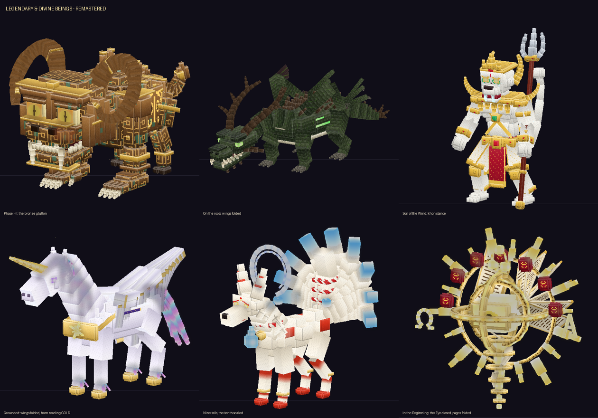

# Legendary & Divine Beings — Remastered

รีมาสเตอร์ฉบับสมบูรณ์ของแอดออน **Legendary & Divine Beings** (Minecraft Bedrock) — บอสระดับเทพ 6 ตน
และคณะเทวทูตผู้ติดตามของพระวัจนะ ได้รับการสร้างโมเดล เท็กซ์เจอร์ และแอนิเมชันใหม่ทั้งหมด
พร้อมสกิล อัลติเมต และเฟสที่ปรับปรุงใหม่



- ไฟล์สำหรับนำเข้าเกม: [`dist/Legendary_and_Divine_Beings_Remastered.mcaddon`](dist/Legendary_and_Divine_Beings_Remastered.mcaddon)
- ไฟล์ต้นฉบับที่ได้รับมา (สำรองไว้โดยไม่แก้ไข): `original_backup/Legendary_and_Divine_Beings.original.mcaddon`
- ใช้ UUID เดิมและเพิ่มเวอร์ชันเป็น **2.0.0** จึงอัปเดตทับแพ็กเดิมในโลกที่มีอยู่ได้ทันที
- **ไม่ได้แก้ไขแอดออนชุดก่อนหน้าในรีโพนี้** (`tribes-addon/`, `eleventh-addon/`, `final-bosses/`) งานทั้งหมดอยู่ในโฟลเดอร์ `legendary-remaster/` แยกต่างหาก

## วิธีเล่น

1. เปิดไฟล์ `.mcaddon` เพื่อนำเข้าเกม แล้วเปิดใช้ทั้ง Behavior Pack และ Resource Pack ในโลก
2. ผู้เล่นจะได้รับ **Codex of Legends** ตอนเข้าโลกครั้งแรก ข้างในมีวิธีเรียกและคำแนะนำการสู้ของแต่ละตน
3. คราฟต์ **Sigil** ของบอส ถือแล้วกดใช้บนพื้นโล่ง พิธีเรียกจะใช้เวลาประมาณ 5 วินาทีแล้วบอสจะปรากฏ
4. คำสั่งสำหรับทดสอบ (ต้องเปิด cheats):

   | คำสั่ง | ผล |
   |---|---|
   | `/legends:summon <boss>` | เรียกบอสทันที |
   | `/legends:phase <n>` | ข้ามไปเฟส n |
   | `/legends:sigils` | รับ Sigil ครบทุกชิ้น |
   | `/legends:clear` | ลบบอส ผู้ติดตาม และสิ่งกีดขวางทั้งหมด |

   ชื่อบอสที่ใช้ได้: `taotie`, `nidhogg`, `hanuman`, `alicorn`, `tenko`, `logos`

## ผลการตรวจต้นฉบับ: ส่วนที่คงไว้และส่วนที่ปรับปรุง

**ส่วนที่คุณภาพดีและคงไว้:**
- เอนจินสคริปต์: ระบบ coroutine ของสกิล, HP gate ที่บังคับให้เห็นครบทุกเฟส, การสเกลตามจำนวนผู้เล่น
- ภาษาสีของ telegraph: แดงคือจุดที่จะโดนโจมตี ทองคือจุดปลอดภัย
- ระบบอนุภาคแบบใส่พารามิเตอร์ได้ ระบบ projectile และพื้นที่อันตรายต่อเนื่อง
- ระบบแจ้งเตือนบน action bar ที่จำกัดความยาวและความถี่
- ไอเท็ม สูตรคราฟต์ loot และพิธีเรียกบอส
- พร็อพที่ใช้งานได้ดีอยู่แล้ว ได้แก่ ding, root spike, meteor, discus, boulder, wisp, prism, torii, tablet

**ส่วนที่คุณภาพต่ำและปรับปรุงใหม่:**

| ส่วนที่ตรวจพบ | ปัญหาในต้นฉบับ | สิ่งที่ทำ |
|---|---|---|
| โมเดลทั้งหมด | เป็นกล่องเรียบ ๆ, ปีกแบนแบบ T-pose, Alicorn และ Tenko ดูไม่ออกว่าเป็นอะไร, ผู้ติดตามดูเหมือนตุ๊กตา | สร้างใหม่ทั้ง 9 ตนด้วย pipeline โมเดลเชิงกระบวนการและเท็กซ์เจอร์ HD |
| แอนิเมชัน | ท่าส่วนใหญ่ขยับเพียง 4–7 กระดูก | เขียนใหม่ทุก act แบบ keyframe มี anticipation, impact และ follow-through ครบทั้งท่าโจมตี อัลติเมต ทรานสิชัน และท่าตาย |
| อัลติเมตซ้ำกลไก | Alicorn กับพระวัจนะใช้กลไก "ยืนในโซนปลอดภัย" เหมือนกัน, Hanuman กับ Tenko ใช้ "ใบมีดหมุนรอบตัว" เหมือนกัน | ออกแบบอัลติเมตของ Alicorn และ Hanuman ใหม่ทั้งหมด (ดูตารางด้านล่าง) |
| เฟส III ของ Nidhogg และ Tenko | แทบไม่มีอะไรต่างจากเฟส II | เพิ่มชุดสกิลใหม่เฉพาะเฟส III |
| คณะเทวทูต | ไม่มีท่าตาย (หายวับไปเฉย ๆ), ถ้าโหลด chunk ใหม่จะเกิดตัวซ้ำหรือตัวที่ลอยค้างไร้การควบคุม, วงโคจรตามไม่ทัน | แก้บั๊กทั้งหมด และเพิ่มบทบาทสนับสนุนใหม่ |
| ข้อความบนจอ | มีป้ายชื่อตอนบอสปรากฏและป้ายชื่อสกิลของผู้ติดตาม | ลบออก เหลือเฉพาะชื่อเฟส ชื่ออัลติเมต ข้อความตอนบอสพ่าย และคำใบ้สั้น ๆ ครั้งแรกของกลไกใหม่ |
| บั๊กแฝง | ถ้าอัลติเมตเกิด error จะเริ่มอัลติเมตซ้ำวนไม่รู้จบ | ตั้งคูลดาวน์ก่อนเริ่มอัลติเมต และเพิ่มตัวป้องกันค่า wait ที่เป็น NaN ในตัวรัน coroutine |

## โมเดลและแอนิเมชันใหม่

| | โมเดล (กระดูก/คิวบ์) | จุดเด่นของดีไซน์ |
|---|---|---|
| **Taotie (饕餮)** | 57 / 449 | สำริดพิธีกรรมยุคซาง ตามลักษณะเผาเซียว (Paoxiao) ใน "ซานไห่จิง" ได้แก่ ตัวแพะ มือมนุษย์มีกรงเล็บเสือ หัวหน้ากากเถาเที่ยขนาดใหญ่ เขาม้วนแบบแกะ ลายเหลยเหวิน (ลายสายฟ้า) นูน ครีบสันหลัง และตาที่รักแร้ซึ่งลืมขึ้นในเฟส II · เฟส II สำริดร้อนเรือง · เฟส III กินร่างตัวเองเหลือเพียงหัวลอยบนพายุเศษสำริด |
| **Níðhöggr** | 51 / 379 | มังกรหกรยางค์สีศพ คอยาวรูปตัว S เขาเป็นรากยักดราซิลล์ ท้องเป็นแผ่นกระดูก ปีกขาดรุ่งริ่ง · บนพื้นพับปีกไว้บนหลังด้วย IK · บินแล้วกางปีก · เฟส III เส้นพิษลุกโชน |
| **หนุมาน** | 59 / 334 | นักรบโขนลิงเผือก หน้าโขนมีเขี้ยวแก้ว กรรเจียก อินทรธนู สังวาล ห้อยหน้าผ้าแดงดิ้นทอง และตรีเพชร · เฟส II หางลุกเป็นไฟ · เฟส III สี่หน้าแปดกรถืออาวุธทิพย์ |
| **Alicorn** | 33 / 272 | ยูนิคอร์นมีปีกผิวมุก แผงคอและหางเป็นแสงออโรรา เขาคริสตัลเรืองแสง 4 สีตามประเภทการโจมตี กีบทอง ปีกหงส์ที่พับแนบลำตัวหรือกางออก · เฟส III มีมงกุฎดาว |
| **Tenko (十尾の天狐)** | 66 / 259 | จิ้งจอกสวรรค์ขาวทอง ลายคิตสึเนะสีชาด เชือกชิเมนาวะพร้อมกระดิ่งสุซุ ดวงมุกดาว (โฮชิโนะทามะ) และรัศมีจันทร์เสี้ยว · หางเก้าหางแผ่เป็นพัดปลายหางเป็นไฟจิ้งจอก · หางที่สิบถูกผนึกด้วยเชือกและยันต์ และคลายผนึกในเฟส III |
| **พระวัจนะ (The Word)** | 23 / 383 | แกนแสงมีดวงเนตรที่ค่อย ๆ ลืมขึ้นตามเฟส วงแหวนอาร์มิลลารีจารึกอักษร 3 วงหมุนคนละแกน ตราผนึกทั้งเจ็ดที่แตกทีละดวงจริง ปีกที่ทำจากหน้าคัมภีร์ (พับในเฟส I และกางในเฟส II) รัศมีลำแสง และอักษร Α กับ Ω |
| **Seraph** | 14 / 120 | ปีกเพลิงหกปีกตามอิสยาห์ 6 คู่หนึ่งปิดหน้า คู่หนึ่งปิดเท้า คู่หนึ่งใช้บิน มือถือคีมคีบถ่านไฟจากแท่นบูชา |
| **Cherub** | 14 / 165 | สำริดขัดเงาตามเอเสเคียล มีสี่หน้า (มนุษย์ สิงโต วัว อินทรี) ปีกสี่ปีกมีดวงตา กีบลูกวัว และดาบเพลิงที่หมุนทุกทิศ |
| **Ophan (Thrones)** | 5 / 176 | วงล้อซ้อนวงล้อสีเบริล ขอบเต็มไปด้วยดวงตา ซี่ล้อเป็นไฟ และแกนเพลิงตรงกลาง |

- แอนิเมชันรวม 169 ชุด ทุกท่าขยับส่วนของร่างจริง เช่น ปีก หาง ขา แขน ขากรรไกร วงแหวน และหน้าคัมภีร์ ไม่ได้แค่เลื่อนทั้งโมเดล
- จังหวะ impact ของทุกท่าตรงกับ tick ที่สคริปต์ทำดาเมจ เพราะตารางเวลา act (`generated/data.js`) ถูกสร้างจากไฟล์แอนิเมชันโดยอัตโนมัติ
- ท่าตายของบอสทุกตนจบด้วยการสลายเป็นแสง จึงไม่เห็นท่าล้มตะแคงแบบมาตรฐานของเกม
- พร็อพใหม่ ได้แก่ ต้นไม้โลกที่ล้มลง, โคมงานแต่งจิ้งจอก, ม้าออโรรา (ร่างวิญญาณของ Alicorn) และจันทร์เสี้ยวของหนุมาน · พร็อพที่สร้างใหม่ ได้แก่ ดาบเพลิงอีเดน, หางจิ้งจอก, ถ่านไฟ, ไฟจิ้งจอก และหอกแสง

ภาพพรีวิว: [Taotie](docs/preview_taotie.png) · [Nidhogg](docs/preview_nidhogg.png) · [Hanuman](docs/preview_hanuman.png) ·
[Alicorn](docs/preview_alicorn.png) · [Tenko](docs/preview_tenko.png) · [พระวัจนะ](docs/preview_logos.png) · [คณะเทวทูต](docs/preview_choir.png) ·
เฟรม QA ของแอนิเมชัน: [`docs/qa/`](docs/qa)

## อัลติเมต: แต่ละตนใช้กลไกหลักต่างกันจริง

| บอส | อัลติเมต | ผู้เล่นต้องทำอะไร |
|---|---|---|
| Taotie | **Maw of Ten Thousand Feasts** | **หลบหลังที่กำบัง** · ปากดูดโลกเข้าไป มีเพียงหม้อ ding ที่ขวางแนวสายตาที่ช่วยกันแรงดูด แต่ปากจะ "กิน" ding ที่มีคนหลบอยู่มากที่สุดทีละใบ (ding กะพริบแดงก่อนถูกลากเข้าปาก) จึงต้องย้ายที่กำบังให้ทัน แล้วขากรรไกรจะงับปิด |
| Níðhöggr | **Ragnarök: World-Tree Falls** | **หนีออกจากพื้นที่ แล้วสวนกลับ** · ฝนไฟศพตกใส่ → ลำต้นยักดราซิลล์ล้มฟาดพาดทั้งสนาม (ออกจากเงาให้ทัน) → รากระเบิดเป็นวงใหญ่ (วิ่งออกนอกวง) → มันจะหมดแรงนอนนิ่ง รับดาเมจเพิ่ม 60% |
| หนุมาน | **หาวเป็นดาวเป็นเดือน** | **กระโดดหรือหมอบ** · หาวดาวออกมาเป็นวงก้นหอยตกไล่จากขอบสนามเข้ากลาง จากนั้นจันทร์เสี้ยว 4 ลูกพุ่งกวาดทั้งสนาม ลูกต่ำต้อง **กระโดดข้าม** (เสียงเบสต่ำ) ลูกสูงต้อง **หมอบ (sneak)** ลอดใต้ (เสียงระฆังแหลม) แล้วจบด้วยลมพระพายดูดเข้าและระเบิดออก |
| Alicorn | **Dawnbreak Nova** | **อ่านช่องทางวิ่ง แล้วหันหลังให้แสง** · ฝูงม้าออโรรา 3 ระลอกควบตามเลนสีแดง ให้ยืนในช่องสีทองซึ่งย้ายที่ทุกระลอก → จากนั้นนางลอยขึ้นเป็นดวงอาทิตย์ดวงที่สอง ตอนแสงวาบใครที่ **มองนาง** จะโดนดาเมจหนักและตาบอด ต้องหันหลังให้ |
| Tenko | **Ten-Tail Eclipse** | **วิ่งตามจังหวะการหมุน** · ลำแสงไฟจิ้งจอก 10 เส้นหมุนรอบตัว ให้วิ่งตามช่องว่างระหว่างลำแสง ระวังตอนที่หมุนกลับทิศ (มีเสียงระฆังเตือน) แล้วสุริยุปราคาจะยุบตัวและระเบิด |
| พระวัจนะ | **The Final Word** | **ไปให้ถึงที่หลบภัยท่ามกลางแรงกดดันของคณะเทวทูต** · Cherub ปักดาบเพลิงเป็นประตูอีเดน Seraph ปิดวงไฟเข้าหากัน Ophan ไล่ยิงลำแสงจากดวงตา พอถึงพยางค์สุดท้าย มีเพียงอีเดนที่รอด |

## สกิลและเฟสที่เพิ่มหรือเปลี่ยน

- **Taotie:** ตาที่รักแร้กวาดลำแสงในเฟส II · เฟส III เป็นหัวลอยที่ใช้พุ่งชน งับต่อเนื่อง และหมุนตัวยิงลายเหลยเหวิน (ทุกท่ามีแอนิเมชันใหม่)
- **Níðhöggr:**
  - เฟส III เป็นแบบผสม บางช่วงลงมาสู้บนพื้น (bite, tail, coil) บางช่วงขึ้นไปสู้บนฟ้า
  - กรงราก: วงรากล้อมผู้เล่นไว้โดยมีช่องสีทองหนึ่งช่องก่อนน้ำพุพิษพุ่งขึ้นกลางวง
  - Nightfall: ไฟศพตกเป็นรูปกากบาท ไล่จากกลางออกไปด้านนอก
- **หนุมาน:** คงชุดดวลกับยามวัชระ (Vajra guard) เผาลงกา และอาวุธทิพย์แปดกรไว้ · อัลติเมตใหม่ทั้งหมด · ความสามารถคืนชีพ Vayu's Breath ใช้ได้เหมือนเดิม
- **Alicorn:** ภาษาสีของเขา (แดงคือโจมตีพื้น น้ำเงินคือกระสุน ทองคือพุ่งชน) เห็นได้ชัดบนโมเดลใหม่ · อัลติเมตใหม่ทั้งหมด
- **Tenko:** สกิลเฟส III ใหม่ "ขบวนแห่งานแต่งจิ้งจอก" (Kitsune no yomeiri): แถวโคมเดินหน้ากวาดสนามโดยมีช่องสีทองหนึ่งช่อง ระหว่างนั้นมีฝนแดดตก และเมื่อระฆังดัง โคมทุกดวงระเบิด
- **พระวัจนะและคณะเทวทูต:**
  - **Seraph** มีสกิลสนับสนุน *Six-winged Veil* ใช้ปีกห่อพระวัจนะไว้ ระหว่างนั้นลูกธนูและตรีศูลจะไหม้ก่อนถึงตัว ต้องเปลี่ยนไปใช้อาวุธระยะประชิด
  - **Ophan** มีสกิล *Eyes of the Throne* ทำเครื่องหมายผู้เล่นหนึ่งคนด้วยวงตาเบริลเหนือหัว แล้วหอกแสงกับลำแสงพิพากษาของพระวัจนะจะไล่ล่าคนนั้น
  - **Cherub** มีวอร์ดลดดาเมจที่บอสได้รับลงครึ่งหนึ่ง (ตีที่ Cherub เพื่อทำลาย)
  - **Concord:** พระวัจนะเป็นผู้นำ ทั้งสามตนเข้าโจมตีผู้เล่นคนเดียวกันจากสามทิศทีละตน
  - **Alpha & Omega (เฟส III):** หัวอักษรสองหัวไล่ตามผู้เล่นจากสองฝั่ง ทิ้งรอยตัวอักษรที่ระเบิดตามลำดับการเขียน
  - ผู้ติดตามที่ตายจะเล่นท่าตายจริง ทิ้ง XP ไว้ และจะถูกเรียกกลับในเฟส III
  - วงโคจรปรับความเร็วอัตโนมัติจึงไม่หลุดตำแหน่ง เมื่อโหลด chunk ใหม่จะผูกตัวเดิมกลับหรือลบตัวซ้ำ

## ข้อความบนหน้าจอ

ข้อความทั้งหมดออกทาง action bar เพียงบรรทัดเดียว ยาวไม่เกิน 34 ตัวอักษร เหมาะกับจอมือถือ ข้อความที่เหลืออยู่มีเพียง:
- ชื่อเฟส (เช่น `◆ Endless Hunger`)
- ชื่ออัลติเมต (`⚠ …`)
- ข้อความตอนบอสพ่าย
- คำใบ้ครั้งแรกของกลไกใหม่ ซึ่งแสดงครั้งเดียวต่อการต่อสู้: `⬆ Jump the low moon` / `⬇ Sneak under the high moon` / `☀ Turn your back to the dawn!` / `◆ Break the wind wisps`

## การตรวจสอบ

| การทดสอบ | ผล |
|---|---|
| `python3 tools/validate.py` ตรวจแบบสแตติก: ไฟล์ JSON 216 ไฟล์ · geometry 45 · แอนิเมชัน 169 · render controller 47 · เอนทิตี 29 คู่ (BP กับ RP) · bone ทุกชิ้นที่ animation และ part_visibility อ้างถึง · ความยาว act เทียบกับตารางของสคริปต์ · เสียงทุกตัวเทียบกับรายชื่อ vanilla · ชื่อในไฟล์ภาษา | **OK** |
| `node tools/smoke/smoke.mjs` จำลองการต่อสู้บน mock ของ `@minecraft/server` แบบเข้มงวด (ตรวจ ID ของเสียง อนุภาค เอฟเฟกต์ เอนทิตี อีเวนต์ และช่วงค่าของ property): บังคับรันครบทุกสกิลของบอสทั้ง 6 ตน แล้วให้ผู้เล่นจำลอง 2 คนสู้ตั้งแต่เรียกจนบอสตาย | **142/142** ผ่าน (ทดสอบซ้ำหลาย seed) |
| `python3 tools/qa_frames.py` เรนเดอร์เฟรมสำคัญของแอนิเมชัน (ท่าโจมตี, จุดพีคของอัลติเมต, ทรานสิชัน, ท่าตาย) | ตรวจด้วยตาแล้ว ([`docs/qa`](docs/qa)) |
| ตรวจ z-fighting และชิ้นส่วนลอยหลุดของโมเดล | ทุกโมเดลไม่มี z-fight ส่วนชิ้นที่ลอยแยกเป็นการออกแบบให้ลอย เช่น รัศมี วงล้อ และอักษร |

จากการจำลอง (seed 20261031): ทุกตนผ่านครบ 3 เฟส ใช้อัลติเมต และเล่นท่าตายครบ โดยไม่มี warning ใดจากสคริปต์
- Taotie กิน ding ระหว่างอัลติเมตจริง
- ต้นไม้โลกล้มลงจริง
- ผู้เล่นที่มอง Alicorn ตอนแสงวาบโดนดาเมจ ส่วนคนที่หันหลังรอด
- จันทร์เสี้ยวของหนุมานโดนผู้เล่นที่ไม่กระโดดและไม่หมอบ
- Seraph คลุมปีก, Ophan ทำเครื่องหมาย และ Cherub/Seraph ที่ถูกฆ่าเล่นท่าตาย
- ไม่มีพร็อพค้างอยู่หลังจบการต่อสู้

**ข้อจำกัดที่ต้องบอกตรง ๆ:**
- **ยังไม่ได้ทดสอบในเกม Minecraft จริง** เพราะสภาพแวดล้อมนี้ไม่มีตัวเกม การทดสอบทั้งหมดใช้ mock, validator และภาพเรนเดอร์จากซอฟต์แวร์ของเราเอง สิ่งที่ยังต้องดูในเกมจริงคือ:
  - การแสดงผลของวัสดุ additive (glow)
  - การ blend ระหว่างแอนิเมชัน
  - การเคลื่อนไหวของพร็อพเมื่อ teleport ทุก tick
- สคริปต์อ้างอิง API `@minecraft/server` 2.11.0 ตามต้นฉบับ รวมถึง `world.beforeEvents.entityHurt`, `Player.isSneaking`, `getViewDirection()` และ `camera.fade` ถ้ารุ่นเกมไม่ตรงกับเวอร์ชันนี้ อาจต้องปรับ `min_engine_version` หรือเวอร์ชันโมดูล
- `custom_hit_test` ของ Bedrock ไม่หมุนตามตัวเอนทิตี hitbox ของบอสตัวยาว เช่น Níðhöggr จึงเป็นกล่องใหญ่ตรงกลางลำตัว
- พร็อพบางชิ้นจากต้นฉบับที่คุณภาพดีอยู่แล้ว (ding, root spike, meteor, discus, boulder, wisp, prism, torii, tablet) คงไว้ตามเดิม ไม่ได้สร้างใหม่
- ภาพพรีวิวมาจากตัวเรนเดอร์ของเราเอง (orthographic) แสงในเกมจริงจะต่างออกไปเล็กน้อย

## โครงสร้างและการ build

```
legendary-remaster/
  original_backup/      ไฟล์ .mcaddon ต้นฉบับ (ไม่แก้ไข)
  src/BP/               behavior pack: สคริปต์ (ผ่านการตรวจแล้วปรับปรุง), entities, items, recipes, loot
  src/RP_static/        ส่วนของ resource pack ที่คงไว้: texts, particles, items, พร็อพเดิม
  tools/                boss_*.py / choir_*.py / props.py  สร้างโมเดล เท็กซ์เจอร์ แอนิเมชัน และ client entity
                        build.py  validate.py  smoke/  qa_frames.py  previews.py
  dist/                 ไฟล์ .mcaddon ที่ build แล้ว
  docs/                 ภาพพรีวิวและเฟรม QA
```

```
python3 tools/build.py        # สร้าง build/ และ dist/*.mcaddon
python3 tools/validate.py     # ตรวจแบบสแตติก
node tools/smoke/smoke.mjs    # จำลองการต่อสู้
```
