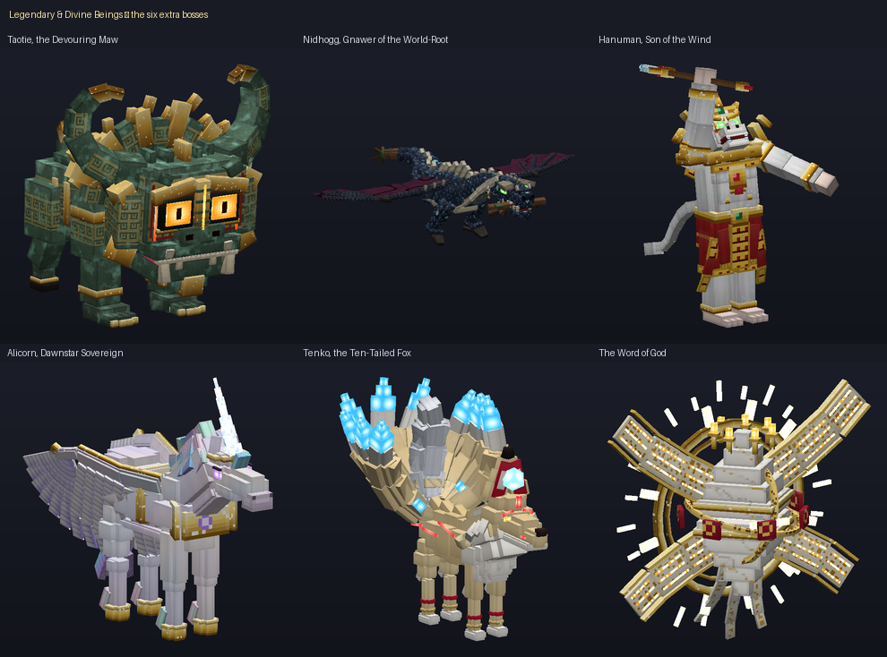
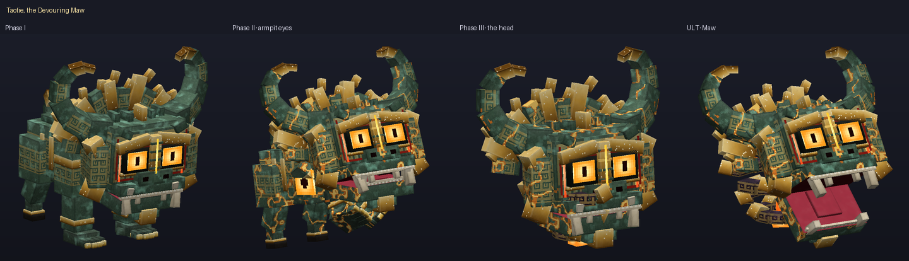
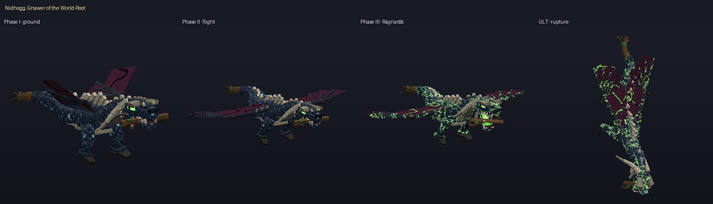
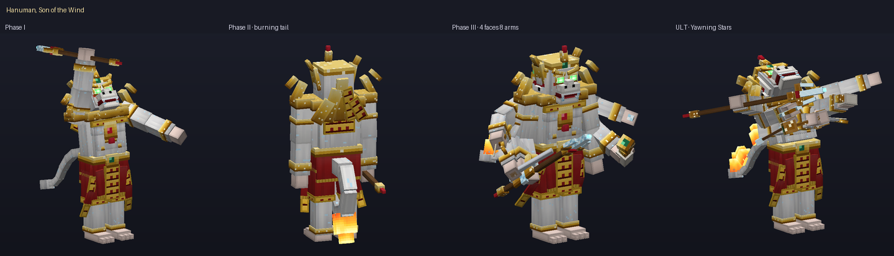
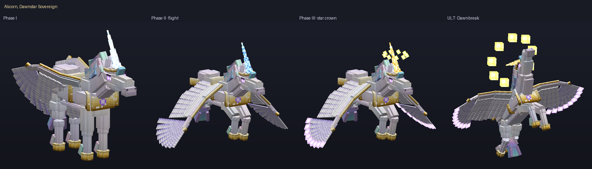
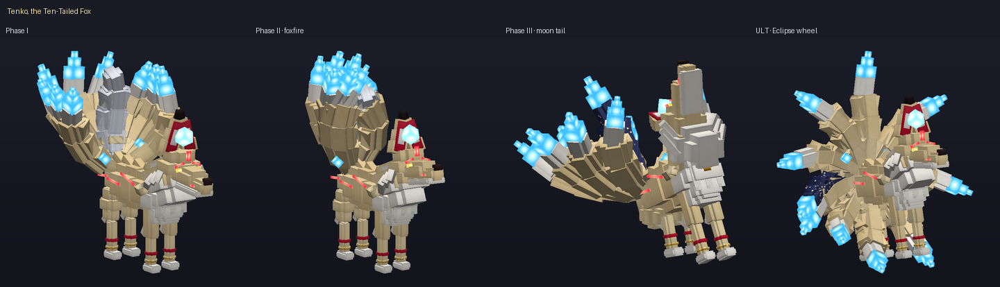
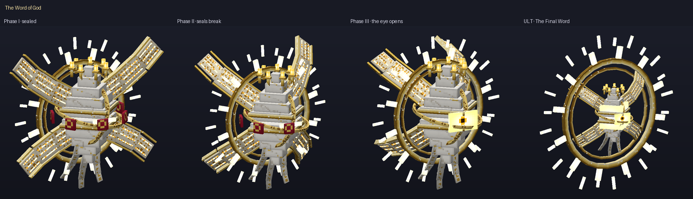
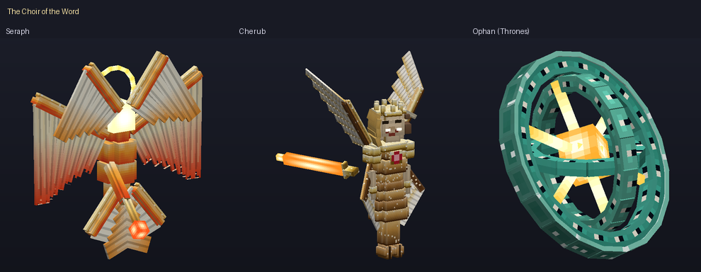

# Legendary & Divine Beings — God-Tier Extra Bosses (Minecraft Bedrock Add-on)

บอสพิเศษระดับเทพ 6 ตน ที่ยากและซับซ้อนกว่า Final Boss ทั่วไป ทุกตนมีโมเดล 3D และแอนิเมชันของตัวเอง สู้กัน 3 เฟส
แต่ละเฟสเปลี่ยนรูปแบบการต่อสู้จริง มีท่าไม้ตาย (Ultimate) อย่างน้อยหนึ่งท่า และมีจังหวะให้ผู้เล่นอ่านและหลบได้

**ไฟล์สำหรับติดตั้ง:** [`dist/Legendary_and_Divine_Beings.mcaddon`](dist/Legendary_and_Divine_Beings.mcaddon)
(มีไฟล์ `.mcpack` แยก BP/RP ให้ในโฟลเดอร์เดียวกัน)

| | |
|---|---|
| เวอร์ชันเกม | Bedrock **1.26.60** ขึ้นไป |
| Script API | `@minecraft/server` **2.11.0**, `@minecraft/server-ui` **2.3.0** (stable ล่าสุด) |
| Experimental toggles | **ไม่ต้องเปิด** |
| ชนกับแอดออนอื่นไหม | ไม่ override ผู้เล่นหรือม็อบ vanilla ใช้ namespace `legends:` ทั้งหมด จึงติดตั้งคู่กับ *Tribes of the Cosmos* ได้ |



### รอบปรับความอลังการ (Grandeur pass)
ผมปั้นใหม่ทั้งร่างให้ Nidhogg, Alicorn, จิ้งจอกสิบหาง, Seraph และ Cherub ส่วน Taotie, หนุมาน และพระวัจนะได้เครื่องประดับและแสงเพิ่ม
บอสทุกตัวตัวใหญ่ขึ้น 15–30% และปรับ hitbox, ระยะโจมตี และตำแหน่งปาก/เขาในสคริปต์ให้ตรงกับขนาดใหม่แล้ว

| | สิ่งที่เปลี่ยน |
|---|---|
| Nidhogg | กะโหลกมังกรยาว มงกุฎเขาโค้งไปด้านหลัง พัดครีบใต้กราม ขดตัวโค้งมนพร้อมหนามกระดูกสูงตามแนวหลัง ปีกสี่นิ้วขาดวิ่นขอบหยักสีเลือดนก ปลายหางเป็นรากเรืองแสง |
| Alicorn | กายวิภาคม้าจริง (อก ลำตัว สะโพกโค้งมน ขาเรียวมีขนข้อเท้า) เขาคริสตัลยาว ชุดเกราะทอง (เกราะอก มงกุฎ) ปีกขนนกสามชั้นปลายเรืองแสง แผงคอและหางสามสายสีออโรรา |
| จิ้งจอกสิบหาง | ขนนุ่มฟู ปลอกคอขนฟู หัวใหญ่ขึ้นพร้อมหูสูงและขนแก้ม ลายคุมะโดริเรืองแสง หางสิบหางฟูหนาห้าท่อน ไฟจิ้งจอกสามชั้น และไฟจิ้งจอกที่ลอยวนรอบตัว |
| Seraph | รูปแบบไอคอนไบแซนไทน์: ปีกหกปีกแผ่เป็นดาวเพลิง คู่บนไขว้กันปิดหน้า คู่กลางกางออก คู่ล่างไขว้ปิดเท้า และมีวงรัศมีเรืองแสง |
| Cherub | เกราะทองทั้งชุด (เกราะไหล่ เกราะอก กระโปรงเกราะซ้อนชั้น) มงกุฎ แผงคอสิงโต และดาบเพลิงยาวขึ้นเรืองแสง |
| Taotie | มงกุฎเปลวไฟสำริดรอบหน้ากาก และเส้นฝังเรืองแสงบนหน้ากาก |
| หนุมาน | ชายผ้าพลิ้ว กนกเปลวด้านหลัง กล้ามอก และตรีเพชรคริสตัลเรืองแสง |
| พระวัจนะ | วงแหวนไจโรหมุนรอบแกน รัศมีชั้นนอก 24 แฉก และอักขระเรืองแสงบนปีกคัมภีร์ |

---

## วิธีเล่น

1. เปิดไฟล์ `.mcaddon` แล้วเปิด Behavior Pack **Legendary & Divine Beings** ในโลก (Resource Pack จะถูกเปิดตามมาเอง)
2. เมื่อเข้าโลกครั้งแรกจะได้ **Codex of Legends** ซึ่งมีตำนาน วิธีคราฟต์ และคำแนะนำการเอาตัวรอดของบอสแต่ละตน
   (คราฟต์ใหม่ได้จาก *หนังสือ + เศษอเมทิสต์* หรือพิมพ์ `/legends:codex`)
3. คราฟต์ **Sigil (เครื่องบูชา)** ของบอสที่ต้องการ ถือไว้แล้วกดใช้บนพื้นโล่ง จะเกิดพิธีอัญเชิญราว 5 วินาทีโดยไม่มีข้อความขึ้นจอ จากนั้นบอสจะปรากฏพร้อมฉากเปิดตัว
4. ต้องตั้งความยากเป็น Easy ขึ้นไป (ในโหมด Peaceful บอสจะไม่ตอบรับ และไม่เสีย Sigil)

| Sigil | สูตร (โต๊ะคราฟต์) |
|---|---|
| Bronze Ding of Gluttony → **Taotie** | Nether Star, Gold Block ×1, Copper Block ×4, Cake ×2, Golden Carrot ×1 |
| Gnawed Root of Yggdrasil → **Nidhogg** | Nether Star, Mangrove Roots ×3, Echo Shard ×4, Dragon's Breath |
| Wind-Crystal Trident → **Hanuman** | Nether Star, Diamond ×3, Gold Block ×2, Breeze Rod |
| Horn of the Dawnstar → **Alicorn** | Nether Star, Amethyst Shard, Phantom Membrane ×2, Feather, Glowstone |
| Ten-Tailed Star Pearl → **Ten-Tailed Fox** | Nether Star, Eye of Ender, Soul Lantern ×2, Blaze Powder ×4, Glow Berries |
| The Unspoken Word → **The Word of God** | **Core ของบอสทั้ง 5 ตน**, Nether Star, Book, Gold Block ×2 |

บอสแต่ละตนดรอป **Core** ประจำตัว และ Core ทั้งห้าคือวัตถุดิบของ The Word of God ทำให้ The Word of God เป็นบททดสอบสุดท้ายของชุดนี้
นอกจากนี้ยังดรอปของมีค่าและ XP 1500–3000

คำสั่งสำหรับทดสอบ (ต้องเปิดโกง): `/legends:summon <boss>`, `/legends:sigils`, `/legends:phase <n>`, `/legends:clear`

---

## บอสทั้ง 6 ตน

> ภาษาสีที่ใช้ร่วมกันทุกไฟต์: **แดง = ดาเมจกำลังจะลงตรงนี้** (มีวงขอบเต้น และพื้นด้านในค่อย ๆ เติมจนเต็มตอนดาเมจลง) และ **ทอง = จุดปลอดภัย**
> ถ้าบอสเรืองสีทองซีด แปลว่าอยู่ในช่วงอมตะ (ระหว่างเปลี่ยนร่าง) ถ้าเรืองสีฟ้า แปลว่าเปิดช่องให้โจมตีหนัก

### 🟢 Taotie (饕餮) — The Devouring Maw
อสูรสำริดที่หัวคือหน้ากากเทาเที่ยบนภาชนะสำริดสมัยซาง มีตาโปน สันจมูกเป็นครีบ เขาม้วนแบบมังกรขุย และเขี้ยวเสือ
ใต้รักแร้มี "ตาของเผาเซียว" ซ่อนอยู่ ส่วนเท้าหน้าเป็นมือมนุษย์ที่มีเล็บทอง
**กลไกหลัก: ความหิว** มันดูดผู้เล่นเข้าหาปาก กลืนกิน และจะ **กินไอเท็มที่ตกพื้นเพื่อฟื้นเลือด** ด้วย

| เฟส | การเปลี่ยนแปลง | สกิล |
|---|---|---|
| I The Feast Begins | สัตว์สี่ขา | ตะปบสองจังหวะ, พุ่งชนเป็นเส้นตรง, สูดกลืน (ดึงผู้เล่นเข้าปาก แล้วงับ), กระทืบแผ่นดินพร้อม**คลื่นวงแหวนที่ต้องกระโดดข้าม**, กระโจน |
| II Endless Hunger | ตารักแร้ลืมขึ้น และเกิดรอยร้าวสีลาวาทั่วตัว | **ลำแสงจากตารักแร้กวาดสองข้าง**, เรียกหม้อติ่งสำริดตกลงมา (หม้อจะค้างอยู่และใช้เป็นที่กำบังได้), ถ่มน้ำดีเป็นบ่อกรด |
| III The Self-Devourer | **มันกินร่างตัวเองจนเหลือแต่หัวยักษ์** ลอยอยู่บนกระแสวนเมฆสีดำทอง | พุ่งชนด้วยหัว, งับรัวสามครั้ง, กระสุนลายเหลยเหวินหมุนเป็นเกลียว |
| **ULT: Maw of Ten Thousand Feasts** | ลอยขึ้นกลางสนาม ปากขยายใหญ่ และหม้อติ่งตกลงรอบสนาม | ดึงทุกคนเข้าหาปากแรงขึ้นเรื่อย ๆ **มีเพียงการหลบหลังหม้อติ่งเท่านั้นที่กันแรงดูดได้** จากนั้นปากจะงับปิด |



### 🟣 Níðhöggr — Gnawer of the World-Root
มังกรงูโบราณ มีมงกุฎเขาโค้งไปด้านหลัง และยังคาบรากไม้ของ Yggdrasil อยู่ในปาก ลำตัวยาวไม่มีขาหลัง ปีกขาดวิ่น และหางที่แตกออกเป็นรากไม้
**กลไกหลัก: พื้นไม่เคยปลอดภัย** มันมุดดินมาโผล่ใต้เท้า รากไม้พุ่งขึ้นตรึง และบ่อพิษลุกลามไปทั่ว

| เฟส | การเปลี่ยนแปลง | สกิล |
|---|---|---|
| I Gnawer of Roots | งูยักษ์บนพื้น ปีกพับ | กัดพุ่ง (ติดพิษ), **ฟาดหางลงโทษคนที่ยืนข้างหลัง**, รากตรึง (ตรึงทุกคน), มุดดินแล้วโผล่ใต้ตัวเป้าหมาย (พื้นแตกเป็นทางบอกล่วงหน้า), พันรัด |
| II Dark Wings of Náströnd | กางปีกบิน | บินกราดพ่นพิษเป็นแถบ (ทิ้งบ่อพิษไว้ตามทาง), ลมหายใจน้ำแข็งพิษกวาดเป็นกรวย, กระพือปีกผลักคนเข้าบ่อพิษ, ดิ่งโจมตี |
| III Ragnarök | เส้นเลือดและหนามบนหลังเรืองแสงพิษ ท้องฟ้ามืดลง | ใช้ทุกท่าได้เร็วขึ้น และใช้รากตรึงจากกลางอากาศ |
| **ULT: Ragnarök — World-Tree Falls** | บินสูง แล้วฝนไฟศพตกลงมา | ไฟศพ 16 ลูกตกตามวงเตือน → มันดิ่งลงกลางสนามพร้อม**วงแดงรัศมี 10 บล็อกที่ต้องวิ่งออก** → แล้ว**นอนหมดแรง 4 วินาที รับดาเมจเพิ่ม 60%** ซึ่งเป็นรางวัลของคนที่หลบได้ |



### ⚪ หนุมาน — Son of the Wind
วานรขาวแบบรามเกียรติ์ มีกระบังหน้าทอง กรรเจียก เขี้ยวแก้ว และ "ขนเพชร" ที่ระยิบระยับ สวมอินทรธนู ทับทรวง สังวาล
ผ้านุ่งแดงลายกนก และถือ **ตรีเพชร**
**กลไกหลัก: ความเร็วและเชิงยุทธ์** เป็นนักดวลที่อ่านจังหวะผู้เล่น

| เฟส | การเปลี่ยนแปลง | สกิล |
|---|---|---|
| I Son of the Wind | ร่างนักรบ | คอมโบตรีเพชร 3 จังหวะ, กระโดดข้ามสมุทรลงทุบ, ฟาดหางรอบตัว, ก้าวตามลมไปโผล่**ข้างหลัง** (มีเสียงลมเป็นสัญญาณ), **ท่าวัชระ: เมื่อตัวเรืองทอง ให้หยุดตี** ถ้ายังตีต่อจะโดนสวนกลับ |
| II การเผากรุงลงกา | หางลุกเป็นไฟ | หมุนตัวฟาดหางไฟ (ทิ้งวงไฟไว้), กระโดดลง 3 จุดแล้ว**ลากเส้นไฟเชื่อมกัน**, **หดตัวจิ๋ววิ่งพล่าน แล้วขยายร่างยักษ์ทุบ** |
| III สี่หน้าแปดกร | **ร่างกายใหญ่ขึ้น มีสี่หน้า (ซ้าย ขวา หลัง) และแปดกร** แต่ละกรถือจักร สังข์ พระขรรค์ คทา ธนู และศร | ระดมอาวุธ 6 ทิศ, ขว้างจักรคู่แบบบูมเมอแรง, **ยกภูเขาทั้งลูก**ขว้างใส่ |
| **ULT: หาวเป็นดาวเป็นเดือน** | ลอยขึ้น หาวออกมาเป็นดวงดาว | ฝนดาวตกตามวงเตือน → **พระจันทร์เสี้ยวสองเล่มกวาดรอบตัว** (ต้องเดินตามช่องว่าง) → ลมหายใจพระพายดูดแล้วระเบิดออก (ต้องวิ่งออกจากวง) |
| **ลมพัดฟื้นคืนชีพ** | เมื่อล้มครั้งแรก | วิญญาณลม 4 ดวงจะวนรอบตัว ต้องทำลายให้หมดภายใน 8 วินาที **ถ้ายังเหลือ หนุมานจะฟื้นพร้อมความโกรธ (ดาเมจ ×1.2)** |



### 🦄 Alicorn — Dawnstar Sovereign
ม้ามีปีกและเขาเดียว ขนสีมุกเหลือบรุ้ง ขนแผงคอและหางเป็นแสงออโรรา ปีกมีขนนกซ้อนสามชั้น กีบทอง และเขาคริสตัลเกลียว
**กลไกหลัก: เขาเปลี่ยนสีบอกท่าโดยไม่ต้องมีข้อความ**
**แดง** = โจมตีพื้น (ออกจากพื้นที่ที่ถูกมาร์ก), **ฟ้า** = กระสุน (เคลื่อนที่ไปด้านข้าง), **ทอง** = พุ่งชาร์จ (หลบออกจากเส้น)

| เฟส | การเปลี่ยนแปลง | สกิล |
|---|---|---|
| I Celestial Steed | วิ่งบนพื้น ปีกพับข้างตัว | ชาร์จ 3 ครั้งต่อเนื่อง, ยกขาหน้ากระทืบ พร้อมวงแหวนที่ต้องกระโดดข้าม, หอกดวงดาวนำวิถี 5 เล่ม, ขนนกพายุ |
| II Wings of Aurora | ขึ้นบิน | **ม่านแสงออโรรากวาดทั้งสนาม ต้องหาช่องที่มีวงทองแล้วลอดผ่าน**, ดิ่งเป็นดาวหาง, **ผลึกปริซึม 3 ก้อน (ต้องทุบ) ทำให้รับดาเมจลดลง 80%**, รักษาตัวใต้แสงจันทร์ (ต้องขัดจังหวะด้วยดาเมจ) |
| III Dawnstar Ascendant | มงกุฎดาวลอยรอบหัว และปลายปีกเรืองแสง | พุ่งไขว้ผ่านสนาม 5 ครั้ง, กระสุนรุ้งหมุนเป็นเกลียว |
| **ULT: Dawnbreak Nova** | ลอยสูงแล้วรวมแสงที่เขา | **วงทองหลายวงปรากฏบนพื้น** เมื่อดาวระเบิด เฉพาะคนที่ยืนในวงทองเท่านั้นที่รอด |



### 🦊 Ten-Tailed Fox (十尾の天狐) — Tenko
จิ้งจอกสวรรค์ที่ก้าวเกินจิ้งจอกเก้าหาง ขนสีงาช้างอมทอง มีลายคุมะโดริสีแดง คล้องเชือกชิเมนาวะพร้อมกระดาษชิเดะ
และมี **หางครบ 10 หาง** กางเป็นพัดแบบนกยูง ปลายหางมีไฟจิ้งจอกสีฟ้า หางที่สิบอยู่ตรงกลางและถูกผนึกด้วยเชือก
**กลไกหลัก: ภาพลวงตาและจังหวะ**

| เฟส | การเปลี่ยนแปลง | สกิล |
|---|---|---|
| I Foxfire Courtesan | หาง 9 หางกางเป็นพัด | กระโจน, ตะปบ, ฟาดหางรอบตัว, ไฟจิ้งจอก 5 ดวงวนรอบตัวแล้วไล่ตามเป้า, **โคมไฟระเบิดตามเข็มนาฬิกาเป็นจังหวะ** |
| II Hundred Illusions | | **แตกร่างเป็นภาพลวงตา 2 ร่าง และตัวจริงอาจสลับที่** (ร่างปลอมจะซีดกว่า แตกด้วยการตีครั้งเดียว), **ซุ้มโทริอิเรียงเป็นทางเดิน แล้วไฟจิ้งจอกจะพุ่งตามทางนั้น**, หางแทงขึ้นจากพื้นเป็นวง |
| III Tenfold Eclipse | **หางที่สิบปลดผนึก กลายเป็นหางจันทร์สีกลางคืนประดาว** | **ระบำคางุระ: เสียงกระดิ่งคือสัญญาณให้กระโดดข้ามวงแหวน** |
| **ULT: Ten-Tail Eclipse** | หางทั้ง 10 กางเป็นวงล้อ | **ลำแสงไฟจิ้งจอก 10 เส้นหมุนรอบตัว** ต้องวิ่งตามช่องว่าง และ**ทิศหมุนจะกลับหลังเสียงกระดิ่ง** จากนั้นสุริยุปราคาจะดูดเข้าแล้วระเบิด (ต้องวิ่งออกจากวง) |



### ✨ The Word of God (พระวัจนะแห่งพระเจ้า)
ไม่ใช่ร่างกาย แต่คือ "ถ้อยคำ" ที่มีรูปร่าง ประกอบด้วยแกนผลึกแปดหน้าที่มีดวงตาปิดสนิท รัศมีมงกุฎสิบสองแฉก
**ปีกคัมภีร์ 4 ปีก** ที่มีอักขระเรืองแสง (เป็นลายนามธรรม อ่านไม่ได้) และค่อย ๆ คลี่ออกตามเฟส
**ตราผนึก 7 ดวง** ลอยวนรอบตัวและแตกทีละดวง มงกุฎตะเกียง 7 ดวง และม่านอักขระที่พลิ้วอยู่ด้านล่าง
**กลไกหลัก: ระเบียบและการพิพากษา** โจมตีด้วยรูปทรงเรขาคณิตที่สมบูรณ์ เช่น ตาราง วงแหวน และเส้นตรง

| เฟส | การเปลี่ยนแปลง | สกิล |
|---|---|---|
| I In the Beginning | ตาปิด ตราผนึกครบ 7 ดวง | **Fiat Lux: ตารางแสงแบบกระดานหมากรุก** (ต้องย้ายไปช่องที่ยังไม่สว่าง), หอกแสง 8 เล่ม, ลำแสงพิพากษาไล่ตามและทิ้งไฟศักดิ์สิทธิ์ไว้ |
| II The Seven Seals | ปีกคลี่ออก ตราผนึกแตกทีละดวง | **แตรสวรรค์: วงแหวน 3 ชั้นที่ต้องกระโดด**, เกลียวอักขระบาเบล, ผนึกแตกแล้วแผ่นศิลาตกใส่ทุกคน |
| III Alpha and Omega | **ดวงตาเปิด** | เรียกผู้ติดตามที่ตายแล้วกลับมาใหม่ |
| **ULT: The Final Word** | ผู้ติดตามทั้งสามทำหน้าที่ร่วมกัน | **Cherub ปักดาบเพลิงสร้าง "เอเดน" ซึ่งเป็นที่หลบภัยเดียว**, Seraph บีบวงไฟให้แคบเข้ามา, Ophan ยิงลำแสงจากดวงตาไล่ล่า เมื่อถึงคำสุดท้าย **มีเพียงเอเดนที่รอด** (ถ้า Cherub ตายไปแล้ว พระวัจนะจะปักดาบเอง) |

**ผู้ติดตาม (Choir)** บินวนรอบพระวัจนะคนละระดับความสูงและความเร็ว ทั้งสามสู้จริง มีเลือดของตัวเอง ฆ่าได้ และไม่นับเป็นบอสหลัก

| ผู้ติดตาม | รูปลักษณ์ | สกิล | ท่าประจำตัว |
|---|---|---|---|
| **Seraph** | ร่างเปลวไฟที่มีปีก 6 ปีก: 2 ปีกปิดหน้า 2 ปีกปิดเท้า 2 ปีกใช้บิน และถือคีมคีบถ่านไฟ | ดิ่งเพลิง, ขว้างถ่านไฟ (เกิดบ่อไฟ), วงแหวน Sanctus | **Trisagion "Holy, Holy, Holy"**: วงแหวนไฟใหญ่ 3 ชั้น ต้องกระโดดทุกวง |
| **Cherub** | สำริดขัดเงา **สี่หน้า (มนุษย์ สิงโตทางขวา วัวทางซ้าย อินทรีด้านหลัง)** สี่ปีก ขาตรงมีกีบลูกวัว และ**ดาบเพลิงที่หมุนวนทุกทิศ** | กวาดดาบรอบตัว, สี่หน้าโจมตีสี่ทิศ, **Ward: ทำให้พระวัจนะรับดาเมจครึ่งเดียว (ทำลายได้ด้วยการตี Cherub)** | **Gate of Eden** (ใช้ใน Ultimate) |
| **Ophan (Thrones)** | **วงล้อซ้อนวงล้อ** สีเบริล ขอบเต็มไปด้วยดวงตา มีหัวใจเป็นไฟ | กลิ้งชน, ลำแสงจากดวงตา, ฟื้นเลือดให้พระวัจนะ (ขัดจังหวะได้) | **Wheels within Wheels**: หลุมแรงโน้มถ่วงพร้อมซี่ไฟหมุน |




### เนื้อเรื่อง
หกตำนานนี้คือ "สิ่งที่ถูกเอ่ยถึงก่อนเทพ" พวกมันไม่ได้อยู่ใต้การปกครองของ *The Impossible Pantheon* แต่เป็นตำนานต้นทาง
ที่แม้เทพหกองค์ก็ไม่อาจลบให้หายไปจากพหุจักรวาลได้ Sigil แต่ละชิ้นคือ "ถ้อยคำเรียกขาน" ที่ปลุกพวกมันขึ้นมา
ส่วน The Word of God คือถ้อยคำแรกสุด จึงต้องใช้ Core ของอีกห้าตำนานมาประกอบเป็นประโยคเรียกขาน
(ผมไม่ได้แก้ไขเนื้อหาหรือไฟล์ใดของชุด The Impossible Pantheon)

---

## UI และความชัดเจนของหน้าจอ (ข้อกำหนดสำคัญ)

* **ไม่มี Title หรือข้อความใหญ่กลางจอเลย** ข้อความทั้งหมดขึ้นที่ action bar เหนือ hotbar เท่านั้น จึงไม่บังบอส ผู้เล่น หรือการโจมตีที่กำลังมา
* บอสจะแสดงข้อความเพียง 5 เหตุการณ์: ปลุกตัว, เปลี่ยนเฟส, Ultimate, พ่ายแพ้ และจากไป แต่ละข้อความยาวไม่เกิน 34 ตัวอักษร
  **ชื่อสกิลทั่วไปไม่แสดงเลย**
* ระบบ notice กลาง (`src/core/notice.ts`) แสดงทีละบรรทัดต่อผู้เล่น ข้อความที่สำคัญกว่าจะรอคิวแทนการซ้อนทับ
  แต่ละข้อความห่างกันอย่างน้อย 1.2 วินาที และข้อความซ้ำจะถูกระงับ 20 วินาที
* การสื่อสารกับผู้เล่นใช้ วงเตือนบนพื้น (แดง/ทอง), สีที่เรืองบนตัวบอส (ทอง = อมตะ, ฟ้า = เปิดช่อง, ทองกะพริบ = ท่าวัชระ),
  สีเขาของ Alicorn, เสียง, camera shake สั้น ๆ และแสงวาบ 0.5 วินาทีเฉพาะตอนจบ Ultimate เท่านั้น
* วงเตือนเป็น particle แนวราบเพียง 1–2 ตัวต่อวง ที่รับขนาดและสีผ่าน Molang ส่วนกระสุนเป็น particle ตัวเดียวที่บินเองฝั่ง client
  ฝั่ง server คำนวณการชนด้วยคณิตศาสตร์ จึงประหยัดเครื่องมือถือ

---

## โครงสร้างและเทคนิค

```
legends-addon/
├─ dist/                    ← ไฟล์ส่งงาน (.mcaddon + .mcpack)
├─ src/                     ← สคริปต์เกม TypeScript (strict)
│  ├─ main.ts               ← events, custom commands, damage model, main loop
│  ├─ summon.ts / ui.ts     ← พิธีอัญเชิญ, Codex
│  ├─ core/                 ← fx (particle telegraphs), notice (กฎ UI), combat, hazards (props/กระสุน/โซน), terrain, tasks
│  ├─ bosses/               ← being.ts (coroutine + การเคลื่อนที่), boss.ts (เฟส, ประตู HP, ultimate, ตาย/จากไป)
│  │                          taotie / nidhogg / hanuman / alicorn / tenko / logos (+ Seraph, Cherub, Ophan)
│  └─ generated/data.ts     ← ตาราง act/ความยาว/จังหวะกระทบ ที่ build.py สร้างจากแอนิเมชันจริง
├─ tools/
│  ├─ mk/                   ← modelkit: geometry + atlas, procedural textures, Molang parser, animation sampler, z-buffer renderer
│  ├─ creatures/            ← โมเดล + แอนิเมชันของบอส 6, ผู้ติดตาม 3 และ props 16
│  ├─ build.py              ← สร้าง BP/RP ทั้งหมด → compile TS → แพ็ก .mcaddon
│  ├─ validate.py           ← ตรวจไฟล์แบบ static (~27,000 checks)
│  ├─ smoke/                ← mock @minecraft/server แบบเข้มงวด + สถานการณ์ทดสอบเต็มไฟต์
│  ├─ preview.py / closeup.py / hero.py / docs_images.py ← ภาพพรีวิวจากโมเดลและแอนิเมชันจริง
└─ docs/images/
```

* **โมเดล 25 ตัว รวม 431 bones และ 2,068 cubes** แบ่งเป็นบอส 6 ตัว (189–345 cubes ต่อตัว), ผู้ติดตาม 3 ตัว และ props/กระสุน 16 ตัว
  (หม้อติ่ง, รากอิกดราซิล, ไฟศพ, จักร, ภูเขา, วิญญาณลม, พระจันทร์เสี้ยว, ปริซึม, หอกดาว, ไฟจิ้งจอก, โทริอิ, หางจิ้งจอก,
  แผ่นศิลา, หอกแสง, ดาบเอเดน, ถ่านไฟ) และมีร่างลวงตาของจิ้งจอกอีกหนึ่งแบบ
  บอสและผู้ติดตามใช้ **texture ความละเอียด 2 เท่า (HD)** และ**ปั้นรูปทรงโค้งมน** ด้วยหน้าตัดแปดเหลี่ยมและการซ้อนชั้นแบบทรงรี จึงไม่เป็นกล่องเหลี่ยม
  ทุกชิ้นสร้างด้วยโค้ด ใช้ per-face UV และ texture ที่วาดแบบ procedural ได้แก่ สำริดลายเหลยเหวิน, เกล็ด, ขน, ขนนก,
  เยื่อปีก, ทอง, หินอ่อน, ลายกนก และอักขระ
* **Texture variant ตามเฟส** เช่น รอยร้าวลาวาของ Taotie, เส้นพิษของ Nidhogg และหางจันทร์ของจิ้งจอก
  ส่วนที่เรืองแสงอยู่ใน bone `glow_*` ซึ่งใช้ material emissive
* **แอนิเมชัน:** แอนิเมชันวนตลอด (idle, เดิน, บิน, พับปีก) ผสมกันด้วยน้ำหนัก Molang
  ส่วน "act" ทุกท่าเรียกผ่าน property `legends:act` และ animation controller
  สคริปต์ใช้ **จังหวะกระทบ (marks) ที่สร้างอัตโนมัติจากไฟล์แอนิเมชัน** ดาเมจจึงลงตรงกับเฟรมที่ท่าฟาดลงจริง
* **การเปลี่ยนร่าง:** part visibility ตามเฟส (หัวลอยของ Taotie, สี่หน้าแปดกรของหนุมาน, ดวงตาของพระวัจนะ, ตราผนึกที่แตก, หางที่สิบ)
  พร้อมเปลี่ยน hitbox ด้วย component group (เช่น หนุมานร่างใหญ่และร่างจิ๋ว)
* **ระบบดาเมจ** (`world.beforeEvents.entityHurt`): ช่วงอมตะ, **ประตู HP ที่ทำให้ข้ามเฟสไม่ได้** ไม่ว่าจะตีแรงแค่ไหน,
  เกราะต่าง ๆ (ปริซึม, ward, ท่าวัชระ), ช่องเปิดรับดาเมจเพิ่ม, การปรับเลือดตามจำนวนผู้เล่น (ผู้เล่น 2 คนคิดเป็น ×1.5)
  และดาเมจตามความยากของโลก (Easy ×0.6 / Hard ×1.35)
* **การเคลื่อนที่ทั้งหมดใช้สคริปต์** (teleport ทุก tick และเกาะพื้นด้วยการสแกนบล็อก) เพราะ pathfinding ของ vanilla รับมือสัตว์ยาว 5–15 บล็อกไม่ได้
* **ความทนทาน:** ถ้าโลกถูกโหลดใหม่ บอสที่ยังอยู่จะถูกรับช่วงต่อโดยคงเฟสเดิม ถ้าไม่มีผู้เล่นอยู่ใกล้ 60 วินาที บอสจะจากไปและคืน Sigil
  props ที่ไม่มีเจ้าของจะถูกเก็บกวาดอัตโนมัติ

### Build เอง
```bash
cd legends-addon
npm install
npm test        # build → typecheck → validate → smoke
npm run preview # ภาพพรีวิวโมเดลทุกตัว (docs/previews)
```
ต้องมี Python 3 + Pillow + numpy และ Node 18+

---

## ผลการทดสอบ

**ผ่านการทดสอบอัตโนมัติ (ตรวจโค้ดและข้อมูล):**
1. **TypeScript strict typecheck** กับ typings ทางการ `@minecraft/server` 2.11.0 / `server-ui` 2.3.0: ไม่มี error
2. **Static validation 27,153 checks: ไม่มี error** ครอบคลุม JSON ทุกไฟล์, manifest/UUID/dependency,
   ลำดับชั้น bone และขอบเขต UV, **Molang ทุกนิพจน์ถูก parse** (query ต้องมีจริง และตัวแปรที่อ่านต้องถูกกำหนดค่าก่อน),
   bone ที่ถูกแอนิเมตหรือซ่อนต้องมีอยู่จริง, controller ↔ animation ↔ render controller ↔ texture/material สอดคล้องกัน,
   property ที่ใช้ใน Molang ต้องประกาศ `client_sync`, component ของ entity ต้องมีใน vanilla, event และ component group ต้องตรงกัน,
   particle (texture, UV, facing mode, ตัวแปร), สูตรคราฟต์และ loot ต้องใช้ไอเท็มที่มีจริง, lang key ครบ,
   sound/effect/entity/item/event/property ทุกตัวที่สคริปต์ใช้ต้องมีจริง, ชื่อ act ที่สคริปต์เรียกต้องมีในแอนิเมชันของบอสตัวนั้น
   และ **กฎ UI** (ห้ามใช้ title และข้อความต้องไม่เกิน 34 ตัวอักษร)
3. **Runtime smoke test ผ่าน 387 assertions** โดยรันสคริปต์ที่ compile แล้วจริงบน mock API ที่เข้มงวด
   (id ผิด, property เกินช่วง, particle ไม่ได้รับตัวแปรที่ต้องใช้ หรือแตะ entity ที่ตายแล้ว จะถือว่า fail)
   * บอสทั้ง 6: ฉากเปิดตัวอมตะ → เฟส 1 → **ประตู HP หยุดดาเมจ 1,000,000 ได้ทุกเฟส** → เปลี่ยนเฟสครบ →
     **บังคับใช้ทุกสกิลของทุกเฟส (58 สกิล)** → Ultimate จบครบ → ฉากตาย → ไม่มี props หรือผู้ติดตามตกค้าง
   * กลไกเฉพาะ: หม้อติ่งบังแรงดูดของ Taotie / Taotie กินไอเท็มที่ตกพื้น / **ยืนในวงทองแล้วรอด Dawnbreak Nova แต่ยืนนอกวงโดน** /
     ผู้ติดตามทั้ง 3 ปรากฏครบ และสกิลกับท่าประจำตัวทำงานทุกท่า / ward ของ Cherub ลดดาเมจครึ่งหนึ่ง /
     **ยืนที่เอเดนแล้วรอด The Final Word แต่ยืนข้างนอกโดน** / พระวัจนะเรียก Cherub ที่ตายกลับมาได้ /
     หนุมานฟื้นเมื่อวิญญาณลมเหลืออยู่ และตายจริงเมื่อทำลายครบ / ท่าวัชระสวนกลับผู้ที่ตี /
     Nidhogg ช่วงหมดแรงรับดาเมจ ×1.6 / ภาพลวงตาจิ้งจอกแตกในการตีครั้งเดียว / รับช่วงบอสหลังโหลดโลกใหม่ /
     บอสจากไปและคืน Sigil / พิธี Sigil กิน Sigil และเรียกบอส / โหมด Peaceful ปฏิเสธพิธี
   * ตรวจ UI ตลอดการทดสอบ: **title = 0**, ทุกข้อความไม่เกิน 34 ตัวอักษร, ไม่มีข้อความสองบรรทัดภายใน 1 วินาที,
     เฉลี่ย 4.8 บรรทัดต่อนาที
4. **ภาพพรีวิว** เรนเดอร์จาก geometry, texture และแอนิเมชันจริง (ภาพใน `docs/images`)
   ผมใช้ภาพเหล่านี้ตรวจและแก้ข้อบกพร่องหลายจุดก่อนส่ง เช่น หางหนุมานที่ขยายผิดปกติ, ปีกที่พับผิดทิศ, หัวที่เล็กเกินไป และลายพื้นผิวที่รกเกินไป

**ยังไม่ได้ทดสอบในเกมจริง:** ในสภาพแวดล้อมนี้ไม่มี Minecraft Bedrock จึง**ยังไม่ได้เล่นจริงในเกม** สิ่งที่ควรตรวจในเกม:
* **ทิศการหมุนของชิ้นส่วน** ผมคำนวณตามแบบแผนของ Bedrock และ Blockbench (ตรวจเทียบกับโมเดล vanilla และหลักการของ Java)
  พรีวิวจึงใช้แบบแผนเดียวกัน แต่ยังไม่ได้ดูในเกม
* **วงเตือนแนวราบ** ใช้ `facing_camera_mode: emitter_transform_xz` และ **ส่วนเรืองแสง** ใช้ material `entity_emissive_alpha`
  ซึ่งตั้งค่าตามเอกสารและแนวทางของชุมชน แต่ยังไม่ได้เห็นผลจริง
* **ตัวเลขสมดุล** (เลือด ดาเมจ ระยะ ความเร็ว คูลดาวน์) ตั้งเป้าว่าผู้เล่นชุดเนเธอไรต์ต้องใช้ฝีมือ ยังไม่ได้ปรับจูนจากการเล่นจริง
* บอสตัวใหญ่ที่เคลื่อนที่ด้วยสคริปต์อาจทะลุภูมิประเทศชันหรือต้นไม้ได้บ้าง (ตั้งใจเพื่อไม่ให้บอสติด) แนะนำให้สู้ในพื้นที่โล่ง
* ประสิทธิภาพบนมือถือ: ใน mock เฉลี่ย 17–67 การเรียก spawnParticle ต่อวินาทีต่อบอส
  (หนึ่งการเรียกอาจเป็นหลาย particle) ส่วน texture ใหญ่สุดคือ 512×1024 (Taotie) แต่ยังไม่ได้วัด FPS บนเครื่องจริง
