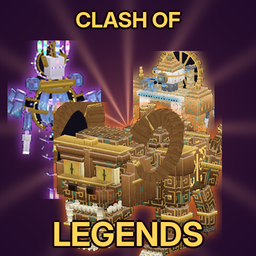
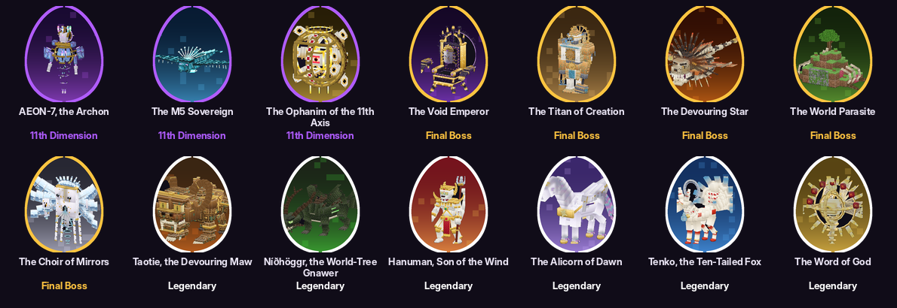

# Clash of Legends — บอส 14 ตนในแพ็กเดียว ทุกตัวตีกันเอง

ไฟล์ติดตั้ง: [`dist/Clash_of_Legends.mcaddon`](dist/Clash_of_Legends.mcaddon) (Behavior Pack 1 อัน + Resource Pack 1 อัน, เวอร์ชัน 1.1.0)

แพ็กนี้รวมบอสจาก 3 แอดออนเข้าด้วยกัน:

| มาจาก | บอส |
|---|---|
| Intelligent Beings of the 11th Dimension | AEON-7 Archon, M5 Sovereign, Ophanim of the 11th Axis |
| Five Final Bosses | Void Emperor, Titan of Creation, Devouring Star, World Parasite, Choir of Mirrors |
| Legendary & Divine Beings 2.0.5 | Taotie, Níðhöggr, หนุมาน, Alicorn, Tenko, พระวัจนะ (พร้อม Seraph, Cherub, Ophan) |

## วิธีติดตั้ง
1. **ลบแอดออนเดิมออกจากโลกก่อน** ทั้ง 3 ตัว และ Legends United เวอร์ชันก่อนหน้า
2. นำเข้า `Clash_of_Legends.mcaddon` แล้วเปิด Behavior Pack **Clash of Legends**
3. ใช้ Minecraft Bedrock 1.26.60 ขึ้นไป และไม่ต้องเปิด Experimental

## บอสตีบอส ไม่มีพวก
- **บอสทุกตัวเป็นศัตรูกันหมด** ไม่ว่าจะมาจากแอดออนไหน
  - ตัวที่มาจากแอดออนเดียวกันก็ตีกัน
  - บอสชนิดเดียวกันสองตัวก็ตีกัน
- บอสโจมตีเฉพาะ **บอสด้วยกันและผู้เล่น** เท่านั้น สัตว์ สัตว์เลี้ยง ชาวบ้าน และม็อบทั่วไปจะไม่โดน
- ข้อยกเว้นเดียว: Seraph, Cherub และ Ophan เป็นผู้ติดตามของพระวัจนะ จึงอยู่ฝ่ายเดียวกับพระวัจนะ แต่ยังตีบอสตัวอื่นทุกตัว
- บอสไม่ตีตัวเอง
- **ดาเมจ:** ดาเมจที่บอสทำกับบอสด้วยกันจะคูณ 3 การปะทะจึงจบใน 1–3 นาที ดาเมจที่ทำกับผู้เล่นยังเท่าเดิม
- **ไม่มีผู้เล่นก็สู้กันได้** ผู้เล่นจะยืนดูหรือเข้าไปร่วมวงก็ได้

## ไข่เกิดที่จำง่าย

- ไข่ทั้ง 14 ฟองอยู่ในหมวด Spawn Eggs ของ Creative
  - **รูปบนไข่:** แต่ละฟองมีรูปบอสตัวนั้นอยู่ข้างใน
  - **สีไข่:** เป็นสีประจำตัวของบอส
  - **สีขอบไข่:** บอกว่ามาจากแอดออนไหน (ม่วง = มิติที่ 11, ทอง = Final Boss, ขาว = Legendary)
  - **ชื่อไข่:** เป็นชื่อเต็มของบอส ตามด้วยชื่อแอดออนต้นทาง
- พิมพ์ `/clash:eggs` เพื่อรับไข่ครบ 14 ฟอง (ต้องเปิด cheats)
- บอสที่ฟักจากไข่จะเริ่มต่อสู้เต็มรูปแบบ มีฉากเปิดตัว เฟส และอัลติเมตครบ

## ไม่มีตัวอักษรขึ้นบนจอ
- ปิดข้อความทุกแบบที่ขึ้นจอ ทั้ง 21 จุด ได้แก่
  - ข้อความในแชต
  - ตัวอักษรใหญ่กลางจอ
  - ข้อความบน action bar
- ถ้ายังเหลือจุดไหน การ build จะหยุดทันที
- ท่าโจมตียังเตือนด้วยวงบนพื้น เอฟเฟกต์ และเสียงเหมือนเดิม
- สิ่งที่ยังแสดง: หน้า Codex/Bestiary ที่เปิดเอง คำตอบของคำสั่งที่พิมพ์ และแถบเลือดบอสของเกม

## เล่นรวมกันได้
- ไม่มีไฟล์หรือไอดีชนกัน (ตรวจ 789 ไอดี)
- ไม่มีแพ็กไหนแก้ไฟล์ vanilla
- ค่าที่เซฟไว้และคำสั่งของแต่ละส่วนขึ้นต้นด้วย namespace ของตัวเอง และไม่มีส่วนไหนใช้ scoreboard
- ทุกส่วนใช้ Script API รุ่นเดียวกัน

## วิธีสร้างแพ็ก
- **ไม่ได้แก้ไฟล์ของแอดออนเดิม:** `tools/combine.py` อ่านไฟล์ .mcaddon ที่ปล่อยไปแล้วของทั้ง 3 ตัวแล้วประกอบใหม่
- **แพตช์สคริปต์ 42 จุด** อยู่ใน `tools/patches.py` ทุกจุดต้องตรงกับโค้ดเดิมพอดี ไม่อย่างนั้นการ build จะหยุด
- **ระบบศัตรูร่วม:** ใช้ `scripts/shared/rivals.js` ร่วมกันทั้ง 3 ส่วน
  - บอสทุกตัวเป็นศัตรูกัน ยกเว้นตัวเองกับผู้ติดตามของตัวเอง
  - เป้าที่โจมตีได้มีแค่บอสกับผู้เล่น
  - ปลดตัวกันไม่ให้ตีพวกเดียวกันของแต่ละแอดออน ให้เหลือแค่การกันตัวเองและผู้ติดตามของตัวเอง
- **ไข่และไอคอน:** `tools/eggs.py` ตัดรูปบอสจากภาพพรีวิวของแต่ละแอดออน แล้ววาดไข่และไอคอนแพ็ก

## การทดสอบ
`python3 tools/combine.py && node tools/smoke/smoke.mjs` รันสคริปต์ทั้งหมดพร้อมกันใน mock ของ Script API ที่ตรวจไอดีทุกตัวอย่างเข้มงวด ผ่าน **126/126** ข้อ:
- ไข่ 14 ฟองฟักเป็นบอสที่ระบบควบคุมได้ และทุกฟองมีรูปกับชื่อของตัวเอง
- **การปะทะข้ามแอดออน:** ทดสอบ 7 คู่ ทุกตัวเล็งและตีอีกฝ่าย และทุกคู่มีบอสตาย
- **บอสแอดออนเดียวกันก็สู้กัน:** Taotie กับ Tenko, Titan กับ Void Emperor, Archon กับ Sovereign และหนุมานกับหนุมาน
- พระวัจนะกับคณะเทวทูตไม่ตีกันเอง
- ไม่มีบอสตัวไหนตีตัวเอง และวัวที่อยู่กลางสนามรบไม่โดนเลย
- ตะลุมบอน 6 บอสพร้อมผู้เล่นตรงกลาง บอสทุกตัวยังตีผู้เล่นได้
- ผู้เล่นไม่ได้รับข้อความในแชต ตัวอักษรกลางจอ หรือข้อความบน action bar เลย
- ไม่มีคำเตือนจากสคริปต์

**ยังไม่ได้ทดสอบในเกมจริง** ถ้าเจอปัญหา ส่งข้อความจาก Settings → Creator → Content Log GUI มาได้
