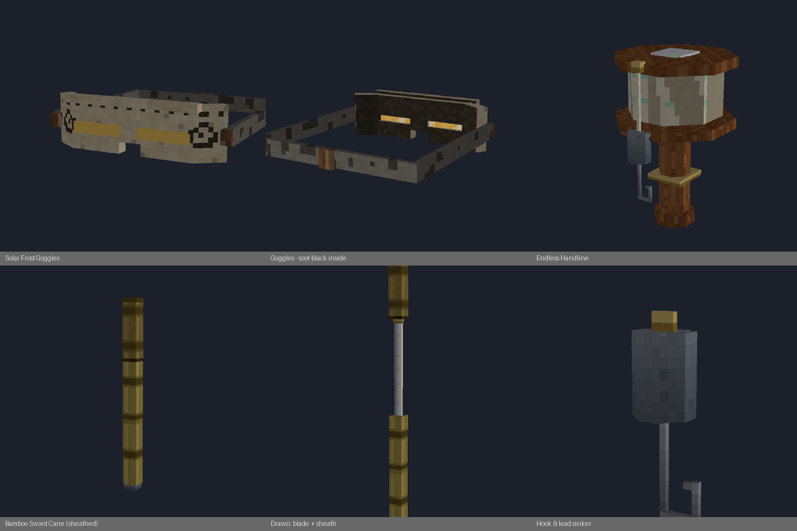
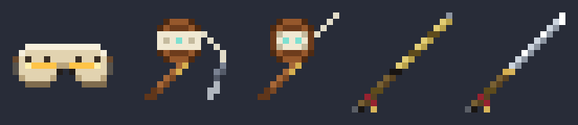
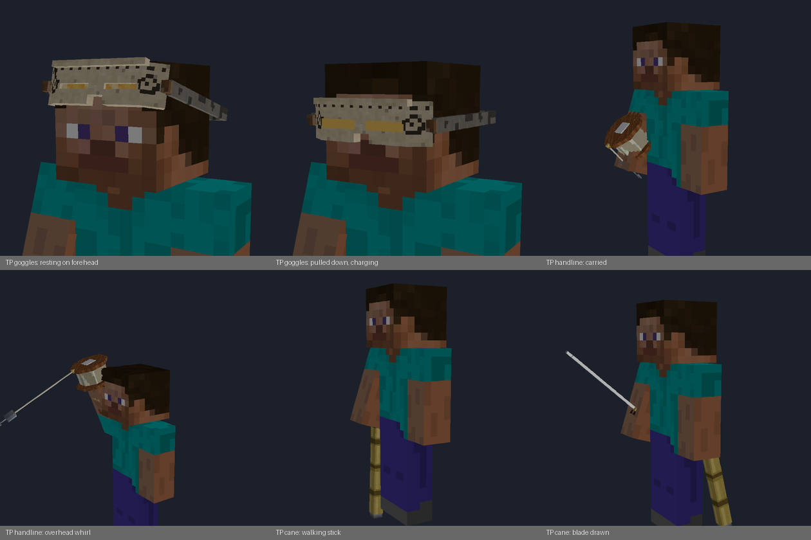
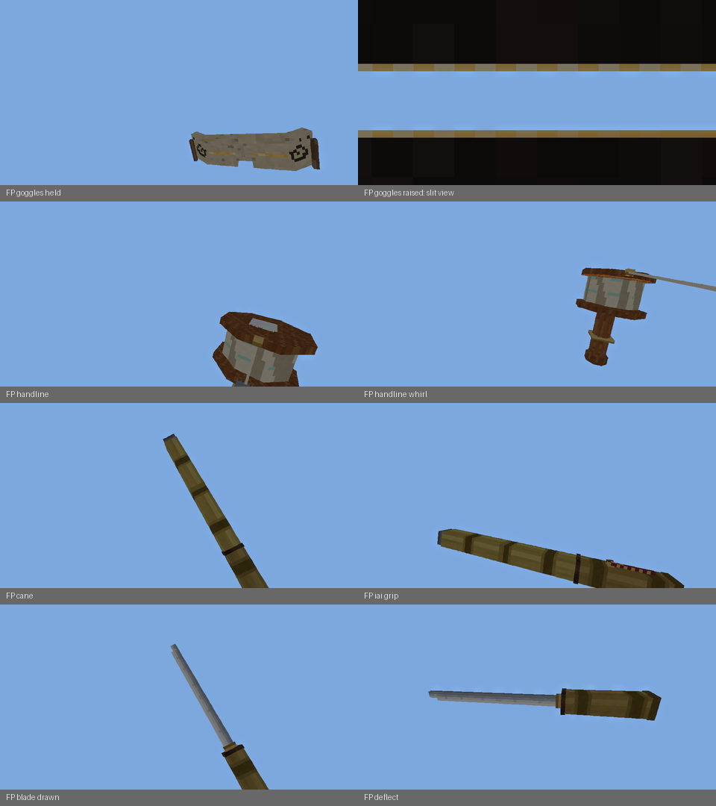

# ODDWORKS — Fantasy Equipment · Set 01 (Minecraft Bedrock Add-on)

ชุดอุปกรณ์แฟนตาซีชุดแรกของ ODDWORKS มี 3 ชิ้น ทุกชิ้นมาจากของจริง แล้วใส่กลไกแฟนตาซีเข้าไป
แต่ละชิ้นมี **3 สกิล** พร้อมข้อจุดแข็ง จุดอ่อน และการโต้ตอบกับสภาพแวดล้อมของตัวเอง

| | |
|---|---|
| ไฟล์ติดตั้ง | [`dist/ODDWORKS_Set01.mcaddon`](dist/ODDWORKS_Set01.mcaddon) (มี `.mcpack` แยก BP/RP ให้ด้วย) |
| เวอร์ชันเกม | Bedrock **1.26.60** ขึ้นไป |
| Script API | `@minecraft/server` **2.11.0** (stable) ไม่ต้องเปิด Experimental |
| ใช้ร่วมกับ Tribes of the Cosmos | ได้ เพราะ ODDWORKS **ไม่ override ตัวผู้เล่น** ท่าทางแขนใช้ `playAnimation` แทน |



## เริ่มเล่น
1. เปิดไฟล์ `.mcaddon` แล้วเปิด Behavior Pack **ODDWORKS** ในโลก (Resource Pack จะเปิดตามให้เอง)
2. คราฟต์ได้ที่โต๊ะคราฟต์ หรือหยิบจากเมนู Equipment ในโหมดครีเอทีฟ
3. พิมพ์ `/oddworks:guide` เพื่อดูวิธีกดในเกม ปุ่มของแต่ละชิ้นยังเขียนไว้ในคำอธิบายของไอเท็มด้วย (tooltip)
4. แถบ HUD ด้านล่างจอบอกสถานะ ระดับแสง แรงตึงสาย และคูลดาวน์ของชิ้นที่ถืออยู่

| ไอเท็ม | สูตร (โต๊ะคราฟต์) |
|---|---|
| Solar Frost Goggles | `กระดูก กระดูก กระดูก` / `น้ำแข็งอัด ผงกลาวสโตน น้ำแข็งอัด` / `เชือก _ เชือก` |
| Endless Handline | `ไม้กระดาน เชือก ไม้กระดาน` / `เชือก ไข่มุกเอนเดอร์ เชือก` / `_ ไม้ เหล็ก` |
| Bamboo Sword Cane | `ไผ่` / `ดาบเหล็ก` / `ไผ่` (แนวตั้งกลาง) |



---

## 001 — Solar Frost Goggles
แว่นกันหิมะแบบอินูอิตที่แกะจากเขากวางคาริบู มีช่องตาแคบเป็นแนวนอน ด้านในรมควันให้ดำเพื่อตัดแสงจ้า
และรัดด้วยเอ็นกับหนังแมวน้ำ ในเกมช่องตาฝัง "น้ำแข็งสุริยะ" ที่ดูดแสงแดดแล้วปล่อยออกมาเป็นความเย็นจัด
ตอนถือ แว่นจะดันอยู่บนหน้าผาก พอเริ่มชาร์จจะเลื่อนลงมาปิดตา
ในมุมบุคคลที่หนึ่งจะเห็นด้านในสีดำของแว่น เหลือเป็นช่องเรืองแสงแนวนอนช่องเดียว (สองช่องตาที่มองพร้อมกันจะรวมเป็นช่องเดียว)

**ระดับแสง** (แสดงบน HUD): แดดเที่ยงวันฟ้าโล่ง 100% · หิมะหรือน้ำแข็งรอบตัวสะท้อนแสงเพิ่มได้ถึง ×1.6 (160%) · ฝน ×0.55 · พายุ ×0.3 ·
แสงจันทร์ 6–20% · คบไฟ ≤12% · Nether และ End ไม่มีแดด

| สกิล | ปุ่ม | ผล |
|---|---|---|
| **Glacial Beam** | กด Use ค้าง (ดูดแสง) แล้วปล่อย | มีอนุภาคแสงไหลจากทิศดวงอาทิตย์และจากหิมะเข้าช่องตา ชาร์จเต็มใน 1.5 วินาทีที่แสง 100% แต่ชาร์จได้สูงสุดแค่ 25% + 75% × ระดับแสง ปล่อยแล้วยิงลำแสงเย็นจัด ระยะ 12–40 บล็อก ดาเมจ 2–14 (ประเภท freezing) ทะลุได้ 1/2/3 ตัว และสะสม frost จนเป้าหมาย **แข็งเป็นก้อนน้ำแข็ง** 2–5 วินาที ถ้าตีเป้าหมายที่แข็งอยู่ น้ำแข็งจะ **แตก** และได้ +3 ดาเมจ ลำแสงยังทำให้น้ำต้นทางเป็น frosted ice (ละลายกลับเองแบบ Frost Walker) ลาวาต้นทางเป็น obsidian (ต้องชาร์จ ≥50%) ลาวาไหลเป็นหินกรวด และดับไฟกับแคมป์ไฟ ใช้ทำสะพานน้ำแข็งข้ามน้ำได้ |
| **Snowblind** | ย่อตัว + กด Use (ไม่ได้มองฟ้า) | ปล่อยแสงจ้าเป็นกรวย 35° ไกล 6–12 บล็อก (บนหิมะ +30%) ต้องมีแสงอย่างน้อย 20% มอนสเตอร์จะตาพร่า 2–5 วินาที ได้ Slowness II และ Weakness II **พลาดการโจมตี 70%** และเดินเซ ผู้เล่นจะติด Blindness อันเดดที่ไหม้กลางแดดจะติดไฟ เวทล่องหนถูกลบ สัตว์บินร่วงลงมา ส่วนชาวบ้านกับสัตว์เลี้ยงจะไม่โดน คูลดาวน์ 7 วินาที |
| **Sun Dog** | ย่อตัว + กด Use ค้างขณะจ้องดวงอาทิตย์ | อิงจากปรากฏการณ์ parhelion ของอากาศหนาว ต้องมองห่างจากดวงอาทิตย์ไม่เกิน 22° ฟ้าโล่ง ไม่มีเมฆ และดวงอาทิตย์อยู่เหนือขอบฟ้า เมื่อจับได้จะเห็นวงแสง 22° รอบดวงอาทิตย์ แล้วได้ **ดวงอาทิตย์จำลอง** มาลอยรอบตัว 45 วินาที (บนหิมะ 60 วินาที) มันส่องแสงจริง (light 14) ทำให้แว่นได้แสงอย่างน้อย 100% ในรัศมี 12 บล็อก แม้กลางคืน ในถ้ำ หรือใน Nether และเผาอันเดดที่เข้าใกล้ ใช้ลำแสงหรือแสงจ้าแล้วพลังของมันจะลดลง คูลดาวน์ 50 วินาที |

**คุณสมบัติและจุดอ่อน:** ขณะถือแว่นจะกัน Blindness ได้ (Glare Ward) · ขณะชาร์จเดินช้าลงและมุมมองแคบลง ·
ถ้าถือชาร์จเต็มค้างไว้เกิน 2.5 วินาที แว่นจะ **เกิดเกล็ดน้ำแข็ง (rime-over)** ประจุหาย ตัวเองติด Slowness และใช้ไม่ได้ 4 วินาที ·
มอนที่เกิดจากความหนาว (stray, polar bear, snow golem, wither) แทบไม่โดนและไม่แข็ง · มอนธาตุไฟ (blaze, magma cube) โดน ×2 ·
ในทะเลทรายและ Nether ความเย็นสลายเร็ว · ความทนทาน 420 ซ่อมด้วยกระดูกหรือน้ำแข็งอัด · ร่ายมนตร์แบบคันธนูได้ (Power เพิ่มความแรง)

---

## 002 — Endless Handline
รอกมือแบบด้ามสั้นจากไม้กลึง มีสายพันรอบดรัม ตะกั่วถ่วงรูปไข่ และตะขอมีเงี่ยง
สายเป็น "ไหมจมน้ำ" ยาว **96 บล็อก** และเรืองแสงจาง ๆ วิธีเหวี่ยงเหมือนคนตกปลาด้วยสายมือจริง คือเหวี่ยงตะกั่วหมุนเหนือหัวแล้วโยนออกไป

| สกิล | ปุ่ม | ผล |
|---|---|---|
| **Overhead Cast** | กด Use ค้าง (หมุนเหนือหัว) แล้วปล่อย | หมุนครบหนึ่งรอบใช้ 0.45 วินาที หมุนได้สูงสุด 4 รอบ ระยะโยนประมาณ 16/32/48/64+ บล็อก ระหว่างหมุน ตะกั่วจะฟาดศัตรูที่เข้าใกล้ (2 ดาเมจต่อรอบ) ตะขอติดได้กับ **บล็อก** (เกาะเหมือนตะขอเกี่ยว) **มอน** **เรือ** **ไอเท็มหรือ XP ที่ตกพื้น** และ **น้ำ** (ตกน้ำแล้วกลายเป็นทุ่น) |
| **Reel & Haul** | สายอยู่ข้างนอก: กด Use ค้างเพื่อม้วน · ย่อตัวเพื่อผ่อนสาย | สายมีความยาวจริงและพันมุมได้สูงสุด 6 มุม ถ้าเกาะบล็อก: ม้วนแล้วดึงตัวเองขึ้นไป (พอถึงขอบจะกระโดดขึ้นให้) แกว่งเป็นลูกตุ้ม หรือผ่อนสายเพื่อโรยตัวลงหน้าผา ตกขณะเกาะสายรับดาเมจลดลง 70% ถ้าเกี่ยวมอน: เป็น **ชักเย่อตามน้ำหนัก** ไก่ 0.4 ซอมบี้ 2 วัว 2.6 ม้า 4.5 โกเลม 10 วอร์เดน 40 ตัวเราหนัก 2.5 (ย่อตัวยืนบนพื้น ×1.6 ลอยกลางอากาศ ×0.5) ตัวที่เบากว่าจะถูกลากมาหา ส่วนตัวที่หนักกว่าจะลากเราไป ถ้าเกี่ยวเรือ: ลากเรือเปล่ากลับมา หรือพ่วงเรือลำอื่น ถ้าเรานั่งเรืออยู่แล้วเกี่ยวฝั่ง ม้วนสายจะ **ลากเรือทั้งลำ (kedging)** ถ้าเกี่ยวคันโยก ประตู ประตูกล หรือรั้ว ม้วนครั้งแรกจะดึงให้เปิดหรือปิด ถ้าเกี่ยวระฆังจะสั่นระฆัง |
| **Snap** | สายอยู่ข้างนอก: ย่อตัว + กด Use | สะบัดสายส่งคลื่นวิ่งไปตามเส้น ถ้าเกี่ยวมอน: ดาเมจ 4–8 (ยิ่งสายยาวยิ่งแรง) กระชากตัวเบาให้ลอยมาหา ตัวหนักจะชะงัก และมีโอกาส **ปัดอาวุธหลุดมือ** (ครึ่งหนึ่งตกพื้นแบบสึกหนัก อีกครึ่งหัก ส่วนตรีศูลหลุดออกมาแค่ 25%) ถ้าเกี่ยวบล็อก: **ดีดตัวพุ่ง** ไปทางตะขอ คูลดาวน์ 6 วินาที (ดีดตัว 3 วินาที) |

**การตกปลา:** ทุ่นในน้ำลึก ≥5 บล็อกหรือไกล ≥24 บล็อก ได้ตารางของรางวัล "น้ำลึก" ที่มีปลาและสมบัติมากกว่า ·
Lure ทำให้ปลากินเร็วขึ้น · Luck of the Sea มีโอกาสได้ของสองชุด · ฝนตกปลากินเร็วขึ้น ใต้หลังคากินช้าลง ·
พอปลากินเหยื่อ ทุ่นจะจมและมีเสียงแจ้ง ต้องม้วนภายใน 1.3 วินาที

**จุดอ่อน:** มี **แรงตึงสาย** (สีของเส้นไล่จากขาวเป็นแดง) ถ้าดึงของหนักนาน ๆ สายจะขาด (เสียความทนทาน 6 และต้องผูกตะขอใหม่ 5 วินาที) ·
ไฟ ลาวา หรือแมกมาที่โดนสายจะ **เผาสายขาด** · ตะขอเกาะน้ำแข็งกับกระจกไม่ได้ · บล็อกสไลม์ทำให้ตะขอเด้งกลับ · น้ำผึ้งทำให้ตะขอติดแน่นจนดีดตัวไม่ได้ ·
หมุนใต้น้ำช้าลง 60% · สลับไปถืออย่างอื่นแล้วสายจะม้วนเก็บทันที · ระวังว่าการย่อตัวบนเรือคือการลงจากเรือ ·
ความทนทาน 384 ซ่อมด้วยเชือก · ร่ายมนตร์แบบเบ็ดตกปลาได้

---

## 003 — Bamboo Sword Cane
ดาบซ่อนในไม้เท้า (shikomizue) ฝักทำจากไผ่เก่าสีทองมีข้อปล้อง ด้ามเป็นไผ่รมควันที่ต่อกับฝักแนบสนิท ไม่มีกระบังดาบ
ในฝักซ่อนใบดาบตรงเรียวที่มีลายน้ำแข็ง (hamon) ตอนเก็บดาบจะเป็นไม้เท้าเดินธรรมดาที่ปลายแตะพื้น
ตอนชักดาบ มือขวาถือใบดาบ ส่วนฝักเปล่าอยู่ในมือซ้าย

| สกิล | ปุ่ม | ผล |
|---|---|---|
| **Iai — Drawing Cut** | (ตอนเก็บดาบ) กด Use ค้างเพื่อจับด้าม แล้วปล่อยตอน **มีประกายแสง** | ระหว่างจับด้าม สมาธิจะเพิ่มขึ้นและมุมมองแคบลง ช่วง 0.55–0.8 วินาทีจะมีเสียงกริ๊งและประกายที่คอดาบ ถ้าปล่อยตอนนั้นจะได้ **Clean Draw** ชักดาบพร้อมพุ่งไป 5 บล็อก ฟันทุกตัวในแนว ×1.5 ทะลุเกราะ 40% และแผลเลือด +2 ถ้าปล่อยตอนอื่นจะพุ่ง 2.5–5 บล็อก ดาเมจ 4–10 การพุ่งจะหยุดเองก่อนชนกำแพง ก่อนหน้าผาสูงเกิน 3 บล็อก ก่อนลาวา ไฟ กระบองเพชร หรือน้ำ ถ้าแตะแล้วปล่อยทันทีจะเป็นการชักดาบเฉย ๆ คูลดาวน์ 3 วินาที (Clean Draw 2 วินาที) |
| **Kaeshi — Deflect** | (ตอนชักดาบ) กด Use | ตั้งท่ารับ 0.4 วินาที ปัดการโจมตีระยะประชิดและกระสุนที่มาจากด้านหน้า (มุม 100°) ได้ทั้งหมด ลูกธนูจะถูก **ฟันขาดกลางอากาศ** แล้วสวนกลับทันที ดาเมจ 5 (+3 ถ้าปัดใน 0.2 วินาทีแรก) ทะลุเกราะ 60% และติดแผล 2–3 แผล ปัดสำเร็จคูลดาวน์แค่ 0.6 วินาที ถ้าพลาดคูลดาวน์ 1.8 วินาที |
| **Noto — Closing Click** | (ตอนชักดาบ) ย่อตัว + กด Use | สะบัดเลือดออกจากใบดาบ (chiburi) แล้วสอดเข้าฝักจน "แกร๊ก" (0.55 วินาที) ทุกตัวที่ **กำลังเลือดไหลจากแผลของเรา** ในรัศมี 24 บล็อก จะเสียเลือดที่เหลือทั้งหมด ×1.25 ทันทีและชะงัก ถ้ามีตัวตาย Iai จะพร้อมใช้อีกทันที คูลดาวน์ 4 วินาที |

**การฟันและเลือดไหล:** ตอนชักดาบ ฟันได้ 6 ดาเมจ ท่าฟันเร็ว และได้ Speed I · ฟันแต่ละครั้งเปิดแผล 1 แผล (สูงสุด 5)
แต่ละแผลเสีย 0.5 ดาเมจต่อวินาที × ความไวต่อการเสียเลือดของเป้าหมาย และไหลต่ออีก 6 วินาทีหลังโดนฟันครั้งสุดท้าย ·
**เล็งคอหรือหัว** จะเป็นแผลจุดตาย ดาเมจ +15% เกราะลดลงครึ่ง และได้แผลเพิ่ม · สีเลือดต่างกันตามชนิดมอน
(แดงสำหรับสัตว์และคน น้ำตาลคล้ำสำหรับอันเดด เขียวสำหรับแมงมุมและครีปเปอร์ ม่วงสำหรับเอนเดอร์ หมึกดำหรือหมึกเรืองแสงสำหรับหมึก)

| ประเภทเป้าหมาย | เลือดไหล | ความคมของดาบ |
|---|---|---|
| เนื้อหนังทั่วไป (คน สัตว์ ชาวบ้าน illager piglin เอนเดอร์แมน) | 100% | 100% |
| อันเดดเนื้อเน่า (ซอมบี้ husk drowned zoglin phantom) | 45% | 100% |
| ไคติน / ยางไม้ (แมงมุม ผึ้ง ครีปเปอร์) | 60–80% | 100% |
| เปลือกหรือหนังหนา (เต่า armadillo ravager guardian hoglin) | 50–90% | 50–80% |
| **ไม่มีเลือด** (โครงกระดูก โกเลม สไลม์ blaze breeze vex ghast shulker warden creaking) | 0% | 30–90% (ดาบกระทบดังแกร๊ง) |

**จุดอ่อน:** **เกราะต้านคมดาบ** คือคมดาบลดลง 3% ต่อแต้มเกราะ (สูงสุด −75%) และโอกาสเปิดแผล = 1 − เกราะ/24
ถ้าฟันโดนเหล็กจะมีประกายไฟ เสียงดาบกระทบ และดาบบิ่น · มอนตัวหนัก (iron golem, ravager, warden, hoglin, zoglin,
piglin brute, wither, ender dragon, elder guardian, creaking) **ปัดไม่ได้**: ดาเมจลดแค่ครึ่ง ดาบบิ่น 8 และโดนกระแทกถอย ·
**ไฟห้ามเลือด** เป้าหมายที่ติดไฟแผลจะปิด (Fire Aspect ของเราเองก็ด้วย) · Regeneration ทำให้เลือดไหลน้อยลงครึ่ง ·
ตอนเก็บดาบเป็นแค่ไม้เท้า (ดาเมจ 3) · ระหว่าง Noto จะปัดไม่ได้ · สลับไปถืออย่างอื่นแล้วดาบจะเก็บเข้าฝักเอง ·
ความทนทาน 520 ซ่อมด้วยเหล็ก (ไผ่ซ่อมได้นิดหน่อย) · ร่ายมนตร์แบบดาบได้




---

## โครงสร้างและวิธี build
```
oddworks-addon/
├─ dist/            ไฟล์ติดตั้ง (.mcaddon + .mcpack)
├─ src/             สคริปต์ TypeScript (Script API 2.11.0)
│  ├─ items/        goggles.ts · handline.ts · cane.ts  (สกิลทั้ง 9)
│  ├─ systems/      frost (แข็ง/แตก) · bleed (แผล/เลือด) · dazzle (ตาพร่า) · damage (ปัด, เกราะ, ระบบดาเมจ)
│  └─ core/         แสงแดด/หิมะ/สภาพอากาศ · เป้าหมาย/น้ำหนัก/สายพันธุ์ · เอฟเฟกต์ · HUD · ไอเท็ม
├─ tools/
│  ├─ models.py · materials.py · modelkit.py   โมเดล + texture แบบ procedural + renderer ที่จำลองการ bind กระดูกของ Bedrock
│  ├─ anims.py · rig.py      ท่าทางมุมหนึ่งและสาม (solver คำนวณตำแหน่งในมุมบุคคลที่หนึ่ง)
│  ├─ particles.py · icons.py · sfx.py          อนุภาค 34 แบบ · pixel art · เสียงสังเคราะห์ 29 เสียง (OGG)
│  ├─ build.py · validate.py · smoke/           build → ตรวจ → ทดสอบรันจริงบน mock API
│  └─ vanilla/reference.json                    id ของ vanilla 1.26.60 (จาก Mojang/bedrock-samples)
└─ docs/images/     ภาพที่เรนเดอร์จากโมเดลจริง
```
```bash
cd oddworks-addon
npm install     # typings @minecraft/server 2.11.0 + TypeScript
npm test        # typecheck → build → validate → smoke   (ต้องมี Python 3 + Pillow + numpy + ffmpeg)
```

## สิ่งที่ทดสอบแล้ว และข้อจำกัด
- **TypeScript strict** กับ typings ทางการ 2.11.0: ไม่มี error
- **ตรวจไฟล์แบบ static 1,972 รายการ ไม่มี error** ครอบคลุม manifest, ไอเท็ม ↔ attachable ↔ geometry ↔ texture ↔ animation ↔ controller,
  ชื่อกระดูกที่แอนิเมชันใช้, ขอบเขต UV, เสียงและอนุภาคทุกตัว, สูตรคราฟต์, loot table, ข้อความใน lang
  และทุก id ที่สคริปต์เรียก (อนุภาค เสียง เอฟเฟกต์ บล็อก entity ท่าทาง) เทียบกับแพ็กและข้อมูล vanilla
- **Minecraft Creator Tools (validator ของ Microsoft): 0 error, 0 warning**
- **Smoke test 78 รายการผ่านหมด** โดยรันสคริปต์ที่ compile แล้วบน mock API ที่เข้มงวด
  (จำลองบล็อก raycast กระสุน ดาเมจ และเอฟเฟกต์ ถ้าใช้ id ผิด แก้บล็อกใน before-event หรือเรียก entity ที่ตายแล้ว จะนับว่า fail)
  ครอบคลุมทั้ง 9 สกิล รวมถึงชาร์จตอนมืด, rime-over, แช่แข็งน้ำและลาวา, Sun Dog กับไฟ, เกาะผนัง, ลากเรือ, ตกปลา, สายขาด,
  ปัดอาวุธ, เกราะ netherite, ปัดการโจมตี, มอนตัวหนัก, Noto, ไฟห้ามเลือด, ศัตรูตาพร่าตีพลาด และการคืนไอเท็มเป็นสภาพเดิม และกรณีที่เกมส่งแค่ itemStopUse ตอนปล่อยปุ่ม
- **ยังไม่ได้ทดสอบในเกมจริง** เพราะในเครื่องนี้ไม่มี Minecraft และการรัน Bedrock Dedicated Server ผ่าน Creator Tools
  ต้องให้คุณยอมรับ Minecraft EULA เอง (`npx -y @minecraft/creator-tools@0.21.0 eula`) สิ่งที่ควรตรวจในเกม:
  - ตำแหน่งของในมือมุมบุคคลที่หนึ่ง โดยเฉพาะหน้ากากแว่นตอนชาร์จ ซึ่งคำนวณจากกล้องที่เทียบกับ trident และ spyglass ของ vanilla แล้ว
    แต่ส่วนหนึ่งของกล้องมุมหนึ่ง Bedrock ฝังอยู่ในเอนจิน จึงอาจต้องขยับเล็กน้อย
  - แอนิเมชันชัก ปัด และเก็บดาบในมุมหนึ่ง ส่งสัญญาณผ่าน cooldown category (`query.cooldown_time_remaining`) ซึ่งผู้เล่นคนอื่นจะไม่เห็น
    คนอื่นจะเห็นแค่ท่าแขนจาก `playAnimation` กับการเปลี่ยนไอเท็ม
  - แรงลากเรือตอนมีผู้เล่นขับอยู่ (kedging) ใช้ `applyImpulse` กับเรือ ความแรงจริงอาจต่างจากที่คำนวณ
  - สภาพอากาศตอนเพิ่งเปิดโลกจะถือว่าฟ้าโล่งไว้ก่อน จนกว่าจะเปลี่ยนสภาพอากาศครั้งแรก (API ไม่มีฟังก์ชันอ่านสภาพอากาศ)

## แหล่งอ้างอิงด้านรูปลักษณ์
- แว่นกันหิมะอินูอิต: [Canada's History](https://www.canadashistory.ca/explore/first-nations-inuit-metis/inuit-snow-goggles) ·
  [British Museum](https://www.britishmuseum.org/collection/object/E_Am1855-1126-458) · [The Met](https://www.metmuseum.org/art/collection/search/751542) ·
  [My Modern Met](https://mymodernmet.com/inuit-yupik-snow-goggles/) (เขากวาง งาช้างน้ำ ไม้ลอยน้ำ, ช่องตาแคบ, เขม่าด้านใน, สายเอ็นและหนังแมวน้ำ)
- การตกปลาด้วยสายมือ: [FAO handline fishing](https://www.fao.org/3/t0511e/T0511E01.htm) · [hand-reel casting](https://hunting-fishing-gear.com/article-display/225.html)
  (เหวี่ยงตะกั่วเหนือหัวแบบโบลา แล้วสายคลายออกจากรอกเหมือนรอกสปินนิ่ง)
- ดาบซ่อนในไม้เท้า: [Swordstick (Wikipedia)](https://www.wikipedia.org/wiki/Swordstick) · [shikomizue construction](https://www.truekatana.com/knowledge-base/5251/what-is-a-shikomizue-and-how-does-it-differ-from-a-standard-straight-sword)
  (ใบดาบตรง ไม่มีกระบัง ฝักทำให้ดูเหมือนไม้เท้าไผ่ ด้ามกับฝักต่อกันแนบสนิท)
