# Playable Races — v1.3.0 (Races 001–006)

A Minecraft **Bedrock Edition** add-on that lets every player become one of six nonhuman species — each with its own animated body, biology, abilities, passive traits and relationship with the world. **Expansion 01** (v1.1.0) adds races 004–006, including the first **Unique** lineage, to the foundation release without changing anything players already have. **v1.2.0** redraws races 004–006 from the ground up — new models, pixel-art textures, animations and effects — while keeping all of their gameplay and every saved choice ([what changed and why](docs/CREATIVE.md#visual-overhaul-v120-races-004006-redrawn)). **v1.3.0** redoes the ability effects of all six races — layered, glowing, animated ([details](docs/CREATIVE.md#ability-effects-overhaul-v130-every-race)).

| Code | Race | Thai name | Identity |
|---|---|---|---|
| **001** | **Aberrant Flora Salamander** | เผ่าสลาแมนเดอร์พืชประหลาด | amphibian-plant hybrid: hydration, photosynthesis, regeneration, prey control, aquatic speed |
| **002** | **Runic Titan Golem** | เผ่าไททันรูนโกเลม | living architecture: durability, rebuilding its body into hammer / wall / rune circle, rune stability |
| **003** | **Blood Moon Jackalope** | เผ่าแจ็คคาโลปดวงจันทร์สีเลือด | lunar hare: speed, deception, marks and leaps, awakening under a rare Blood Moon |
| **004** | **Xenentoma** | เซเนนโทมา | eyeless six-limbed arthropod: vibration sense (not a wallhack), moulting decoys, flattening glides, a twelve-segment telescoping strike |
| **005** | **Flying Spaghetti Monster** | สปาเกตตีมอนสเตอร์บินได้ | hovering living pasta: noodle grabs and rescues, al dente counters, ricocheting meatballs, a spiral sauce vortex |
| **006** | **Nurariten** ✦ UNIQUE ✦ | นูราริเทน | the Uninvited Sovereign: courts, judgment marks, safe arrivals, and **HYAKUTEN CHŪKŌ** 百天昼行 — the five-stage daytime procession of the Hundred Heavens. One holder per world |


**Install:** [`dist/PlayableRaces.mcaddon`](dist/PlayableRaces.mcaddon) — Bedrock **1.26.60+**, **no experimental toggles**. Step-by-step (incl. iPhone/iPad and updating from 1.0.x): [docs/INSTALL.md](docs/INSTALL.md).

## How to play
1. Join the world: you receive the **Lineage Codex** and the selection screen opens once.
2. Read a lineage, press **Embrace**, confirm. Your body transforms and you get your race's **Focus**.
3. Hold the Focus: **use** = cast the selected ability, **sneak + use** = select the next one. The action bar shows your abilities (four, five for the Unique lineage), cooldowns and your race resource (hydration / rune stability / lunar resonance / sensory clarity / sauce / the sun's mandate).

Full ability tables, passives, the Blood Moon schedule, Divine Jurisdiction, commands and operator settings: **[docs/ABILITIES.md](docs/ABILITIES.md)**.

| | | |
|---|---|---|
|  |  | 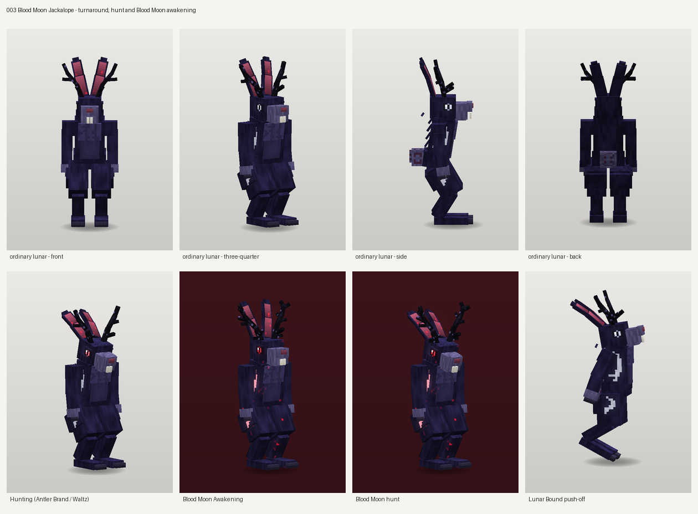 |
|  | 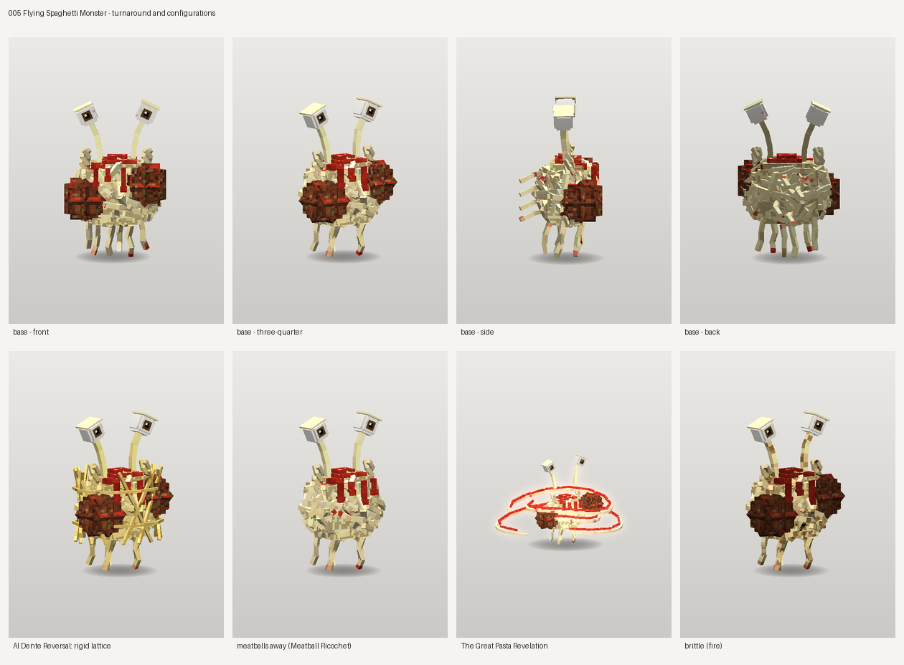 | 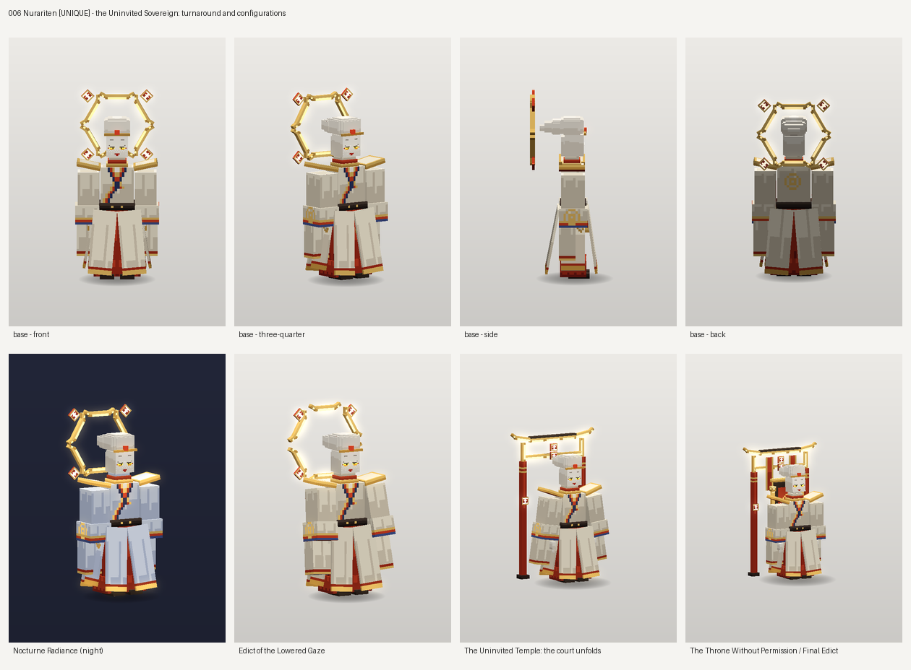 |

**HYAKUTEN CHŪKŌ** (Nurariten's unique ultimate) staged with the shipped models exactly where the script places them — a gate in the sky, two heralds, eight columns of attendants (96 figures; with the heralds, the gate and the Sovereign: one hundred) circling the throne, using ten script-owned entities instead of a hundred mobs:

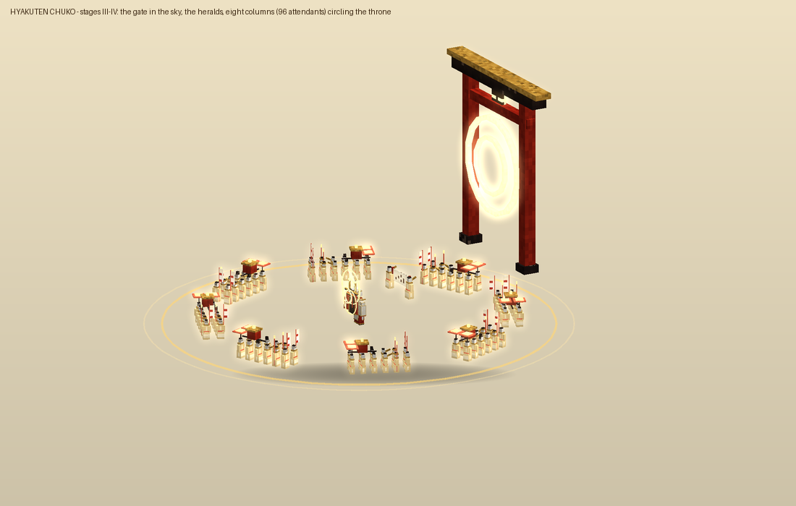

**Living motion** — rendered from the shipped animation files (races 004–006 as redrawn in v1.2.0): breathing, blinking, race-specific gaits with grounded feet, jumps and landings, and idle behaviours the creatures perform on their own ([details](docs/CREATIVE.md#living-motion-v102)).

| | | |
|---|---|---|
| 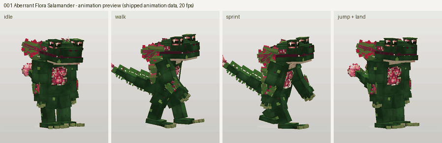 | 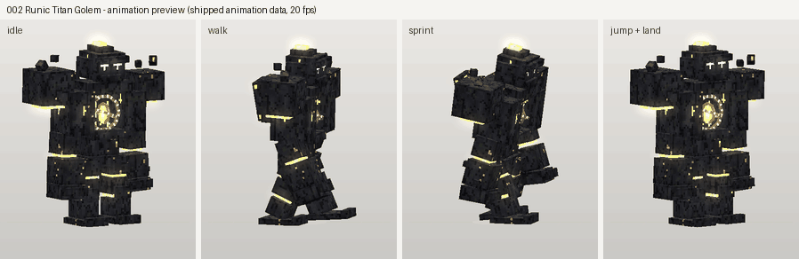 |  |
|  | 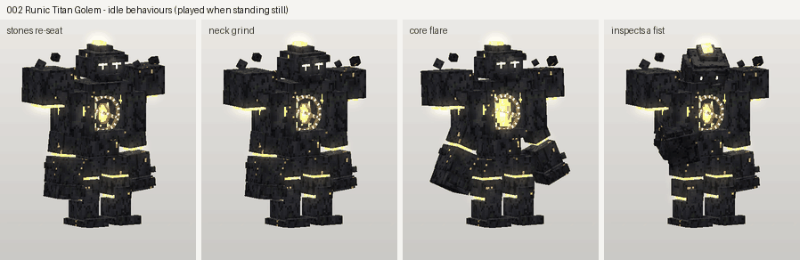 |  |
|  | 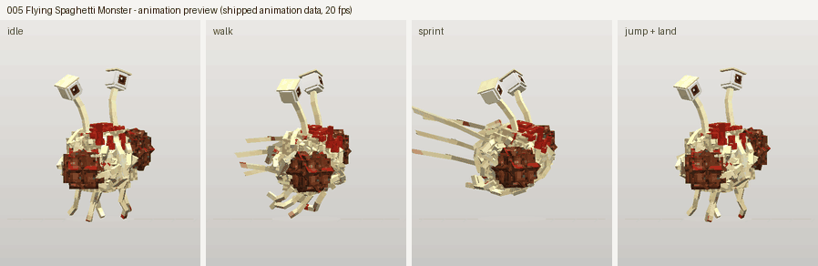 |  |
|  | 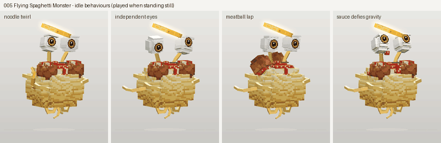 | 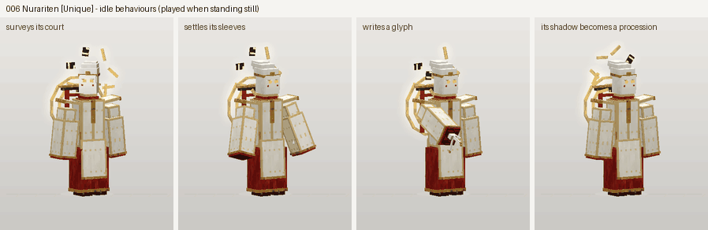 |

**Ability effects (v1.3.0)** — every effect re-enacted exactly as the scripts spawn it, rendered from the pack's particle files:

| | | |
|---|---|---|
| 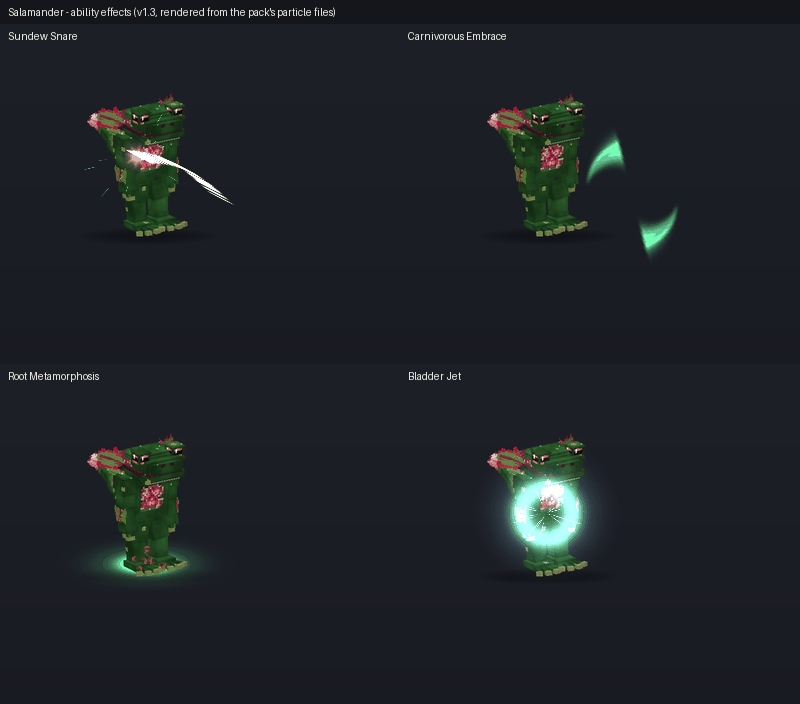 | 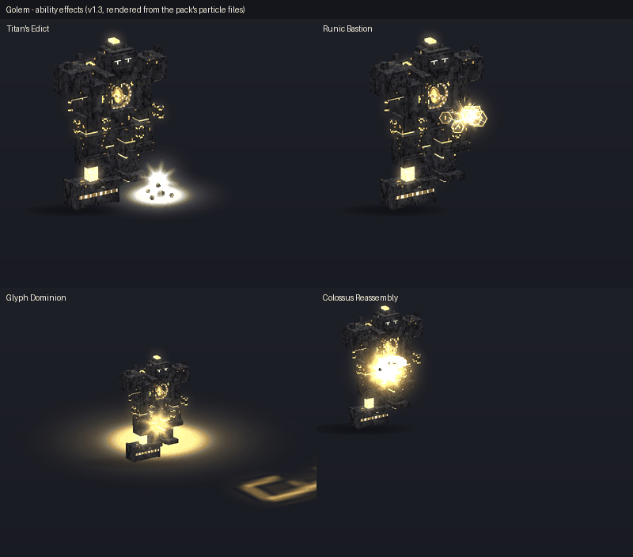 |  |
| 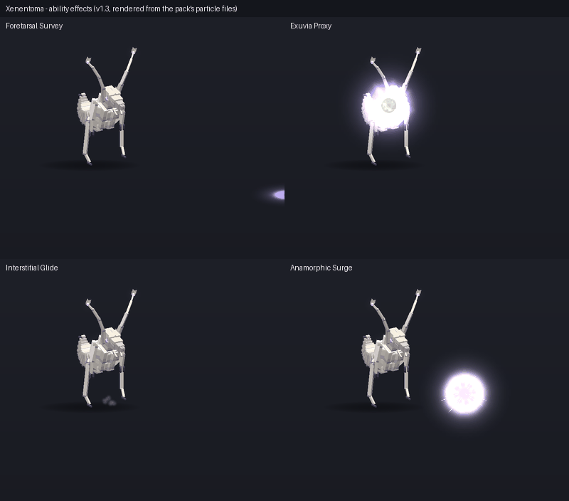 | 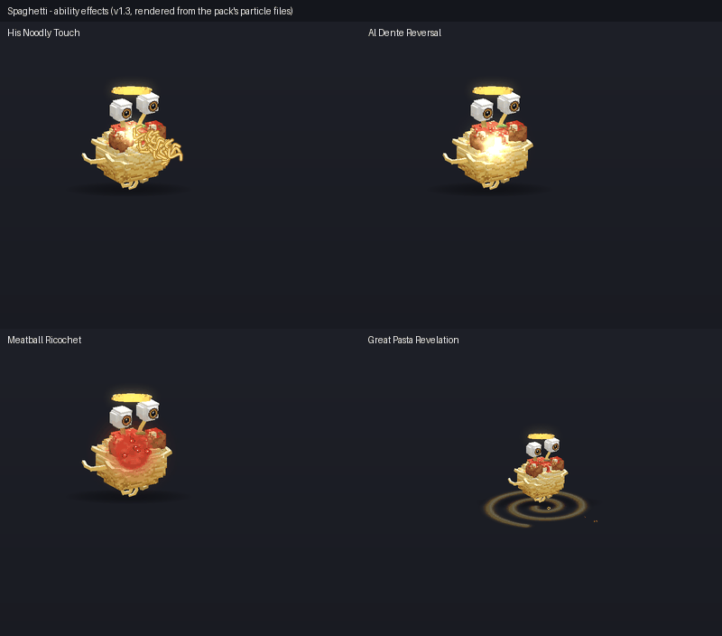 |  |

## Documents
* [Installation guide (iOS, Android, Windows, consoles, servers)](docs/INSTALL.md)
* [Ability & control reference](docs/ABILITIES.md)
* [Technical compatibility report](docs/COMPATIBILITY.md) — target version, APIs, how bodies are rendered without overriding the player, limitations
* [Testing report](docs/TESTING.md) — what was verified (typecheck, Creator Tools 0 errors, 60,577 static checks incl. every Molang expression, 277 runtime assertions, an offline run of every animation, and a proof that the 1.2.1 rewrite moves every body exactly as before) and what still needs an in-game check (proposed tests, clearly separated)
* [Creative development report](docs/CREATIVE.md) — brief → implementation mapping, research, additions and every significant change, for 001–003, Expansion 01 and the v1.2.0 redraw

## Project layout
```
playable-races/
├─ dist/                       PlayableRaces.mcaddon + the two .mcpack files
├─ packs/                      generated, editable packs (what ships)
│  ├─ PlayableRaces_BP/        items, helper entities (mirage, exuvia, meatball, gate, herald, procession), recipe, compiled scripts
│  └─ PlayableRaces_RP/        attachables, geometry, textures, animations, render controllers, particles, fog
├─ src/                        TypeScript gameplay (stable Script API 2.11.0)
│  ├─ main.ts                  events, loops, item components
│  ├─ lineage.ts, commands.ts  assign/remove/restore races, slash commands
│  ├─ core/                    ability engine, forms (crests), HUD, targeting, combat, env probes, persistence
│  ├─ races/                   registry + one module per race (salamander, golem, jackalope, xenentoma, spaghetti, nurariten)
│  ├─ systems/                 Blood Moon, lunar sigils, mirage decoys, helper entities (proxies),
│  │                           Unique claims, Divine Jurisdiction (courts + judgment marks)
│  └─ ui/menu.ts               the Lineage Codex
├─ tools/                      build pipeline (Python)
│  ├─ kit/                     geometry/atlas toolkit, procedural textures, software renderer,
│  │                           Molang interpreter + animation runtime (animrt.py), player simulation
│  ├─ models/                  one module per race (anatomy + materials + helper-entity models)
│  ├─ anims/                   layered attachable animations (life.py, races.py, xenentoma.py, spaghetti.py,
│  │                           nurariten.py), gait ground-fit (fit.py), cast poses
│  ├─ fx.py                    particle atlas, 67 particle effects, Blood Moon and heaven-light fogs
│  ├─ build.py / validate.py / previews.py / anim_gifs.py
│  └─ vanilla/                 1.26.60 reference data used by the validator
├─ tests/                      strict Script API mock + gameplay scenario tests
└─ docs/                       reports and preview images
```

## Build & test
Requirements: Python 3 with Pillow and NumPy, Node 18+.
```bash
cd playable-races
npm install       # official @minecraft/server typings + TypeScript
npm test          # typecheck -> tools/build.py -> tools/validate.py -> tests/run.mjs
python3 tools/previews.py
python3 tools/anim_gifs.py && python3 tools/anim_gifs.py --fidgets   # animated previews
```
Models, textures and animations are generated from code: edit `tools/models/*.py` or `tools/anims/races.py`, run the build, and the packs, previews and package are regenerated together (and cross-checked).

## Adding races 007+
1. `tools/models/<race>.py` — a `build()` using `humanoid()` (binds to the player skeleton), `VARIANTS`, `TEXTURES`, `materials()` (and `ENTITY_ONLY` for geometry used only by a helper entity).
2. `tools/anims/<race>.py` — the race's attachable animations, built from the layers in `tools/anims/life.py` (a `Rig`, `body()`, `grounded()` for the gait, `fidget_controller()` / `landing_controller()`); register it in `RACES` in `tools/build.py` with its permanent code. Check it with `python3 tools/anim_gifs.py --races <race>`.
3. `src/races/<race>.ts` — a `RaceDef` (passives, `variant()`, four `AbilityDef`s) and add it to `src/races/registry.ts`. Helper entities go through `spawnProxy()` (owner, lifetime and cleanup are handled); a **Unique** race sets `rarity: "unique"` and adds a fifth ability with `ultimate: true`.
4. Add the race's focus item entry in `tools/build.py` (and `proxy_entity()` calls for any helper entities). Crest items, attachables, render controllers, the skin-hiding condition, lang, icons and portraits are generated automatically.

Race codes, item ids and the `plrace` namespace are permanent; existing worlds keep working when new races are added.
