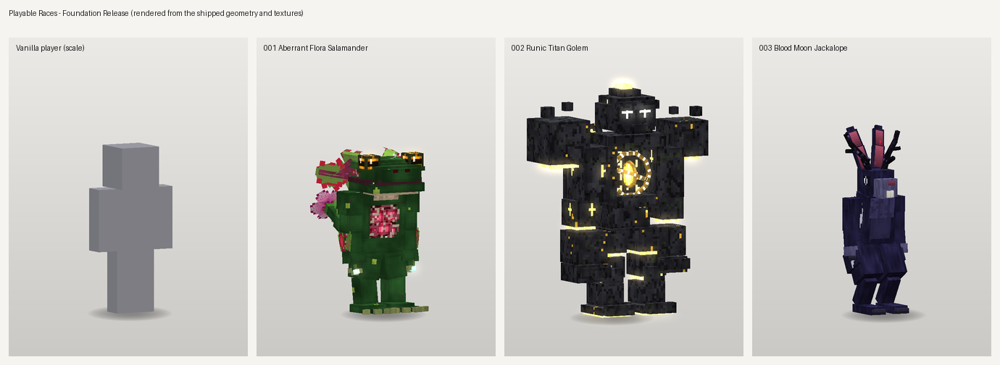
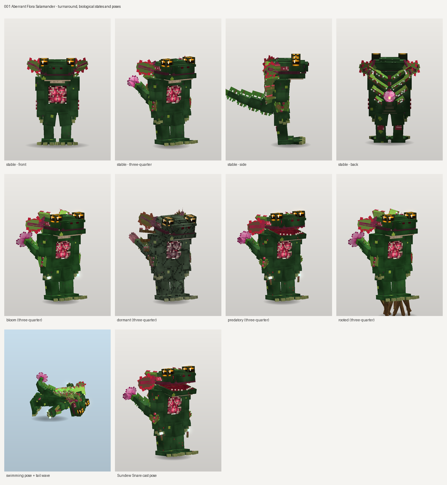
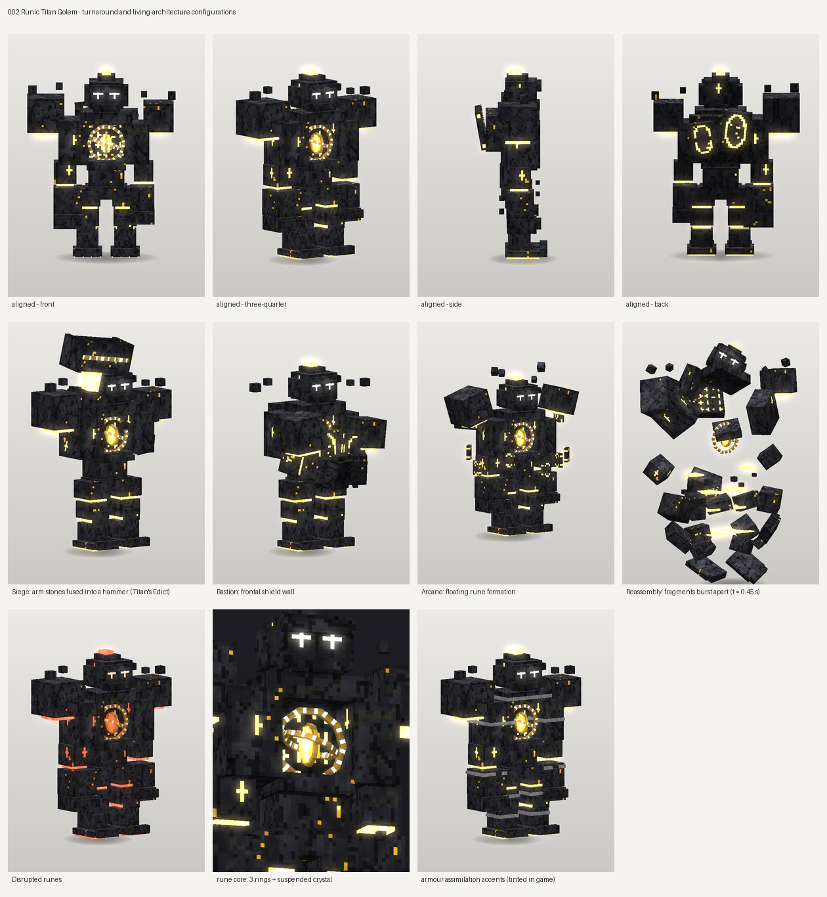

# Playable Races — Foundation Release (Races 001–003)

A Minecraft **Bedrock Edition** add-on that lets every player become one of three nonhuman species — each with its own animated body, biology, four abilities, passive traits and relationship with the world:

| Code | Race | Thai name | Identity |
|---|---|---|---|
| **001** | **Aberrant Flora Salamander** | เผ่าสลาแมนเดอร์พืชประหลาด | amphibian-plant hybrid: hydration, photosynthesis, regeneration, prey control, aquatic speed |
| **002** | **Runic Titan Golem** | เผ่าไททันรูนโกเลม | living architecture: durability, rebuilding its body into hammer / wall / rune circle, rune stability |
| **003** | **Blood Moon Jackalope** | เผ่าแจ็คคาโลปดวงจันทร์สีเลือด | lunar hare: speed, deception, marks and leaps, awakening under a rare Blood Moon |



**Install:** [`dist/PlayableRaces.mcaddon`](dist/PlayableRaces.mcaddon) — Bedrock **1.26.60+**, **no experimental toggles**. Step-by-step (incl. iPhone/iPad): [docs/INSTALL.md](docs/INSTALL.md).

## How to play
1. Join the world: you receive the **Lineage Codex** and the selection screen opens once.
2. Read a lineage, press **Embrace**, confirm. Your body transforms and you get your race's **Focus**.
3. Hold the Focus: **use** = cast the selected ability, **sneak + use** = select the next one. The action bar shows all four abilities, cooldowns and your race resource (hydration / rune stability / lunar resonance).

Full ability tables, passives, the Blood Moon schedule, commands and operator settings: **[docs/ABILITIES.md](docs/ABILITIES.md)**.

| | | |
|---|---|---|
|  |  |  |

## Documents
* [Installation guide (iOS, Android, Windows, consoles, servers)](docs/INSTALL.md)
* [Ability & control reference](docs/ABILITIES.md)
* [Technical compatibility report](docs/COMPATIBILITY.md) — target version, APIs, how bodies are rendered without overriding the player, limitations
* [Testing report](docs/TESTING.md) — what was verified (typecheck, Creator Tools, 16,935 static checks, 129 runtime assertions) and what still needs an in-game check
* [Creative development report](docs/CREATIVE.md) — brief → implementation mapping, additions and changes

## Project layout
```
playable-races/
├─ dist/                       PlayableRaces.mcaddon + the two .mcpack files
├─ packs/                      generated, editable packs (what ships)
│  ├─ PlayableRaces_BP/        items, mirage entity, recipe, compiled scripts
│  └─ PlayableRaces_RP/        attachables, geometry, textures, animations, render controllers, particles, fog
├─ src/                        TypeScript gameplay (stable Script API 2.11.0)
│  ├─ main.ts                  events, loops, item components
│  ├─ lineage.ts, commands.ts  assign/remove/restore races, slash commands
│  ├─ core/                    ability engine, forms (crests), HUD, targeting, combat, env probes, persistence
│  ├─ races/                   registry + one module per race
│  ├─ systems/                 Blood Moon, lunar sigils, mirage decoys
│  └─ ui/menu.ts               the Lineage Codex
├─ tools/                      build pipeline (Python)
│  ├─ kit/                     geometry/atlas toolkit, procedural textures, software renderer
│  ├─ models/                  salamander.py, golem.py, jackalope.py (anatomy + materials)
│  ├─ anims/                   attachable animations + player cast poses
│  ├─ fx.py                    particle atlas, 30 particle effects, Blood Moon fog
│  ├─ build.py / validate.py / previews.py
│  └─ vanilla/                 1.26.60 reference data used by the validator
├─ tests/                      strict Script API mock + gameplay scenario tests
└─ docs/                       reports and preview images
```

## Build & test
Requirements: Python 3 with Pillow and NumPy, Node 18+.
```bash
cd playable-races
npm install       # official @minecraft/server typings + TypeScript
npm test          # typecheck -> tools/build.py -> tools/validate.py -> tests/run.mjs
python3 tools/previews.py
```
Models, textures and animations are generated from code: edit `tools/models/*.py` or `tools/anims/races.py`, run the build, and the packs, previews and package are regenerated together (and cross-checked).

## Adding races 004–006
1. `tools/models/<race>.py` — a `build()` using `humanoid()` (binds to the player skeleton), `VARIANTS`, `TEXTURES`, `materials()`.
2. `tools/anims/races.py` — the race's attachable animations; register it in `RACES` in `tools/build.py` with its permanent code.
3. `src/races/<race>.ts` — a `RaceDef` (passives, `variant()`, four `AbilityDef`s) and add it to `src/races/registry.ts`.
4. Add the race's focus item entry in `tools/build.py`. Crest items, attachables, render controllers, the skin-hiding condition, lang, icons and portraits are generated automatically.

Race codes, item ids and the `plrace` namespace are permanent; existing worlds keep working when new races are added.
