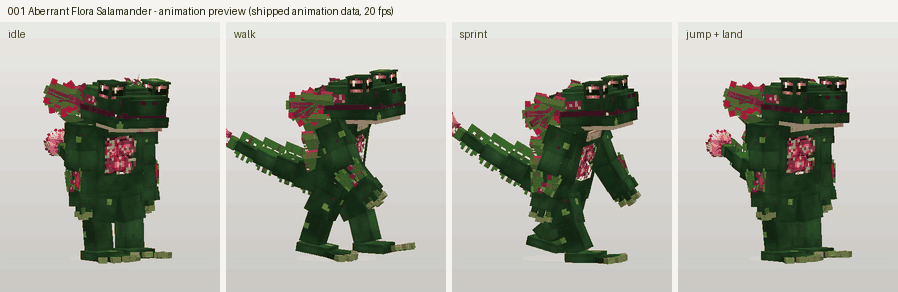
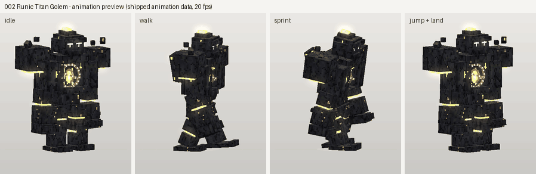
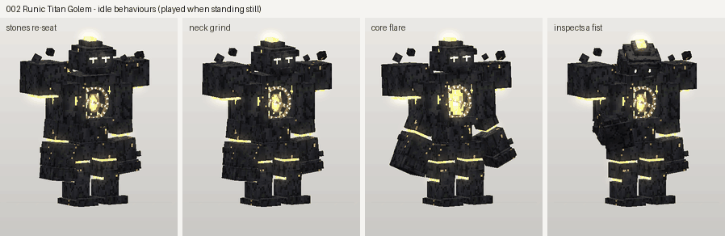
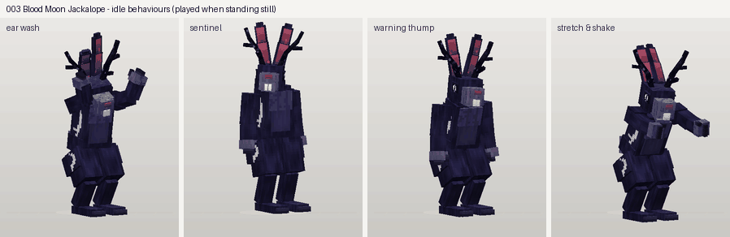

# Creative Development Report

This report maps every part of the original brief to what was built, and lists additions and every significant change with its reason. Nothing from the brief was silently dropped; where something could not be done literally, the replacement is named.

---

## The big decision: bodies without overriding the player

The brief asked for genuinely playable creatures *and* warned that Mojang's cooperative guidelines discourage overriding `minecraft:player` or player skins. The usual "morph" approach (replacing `player.json` and `player.entity.json`) conflicts with other add-ons and silently breaks whenever Mojang changes player animations.

**What was built instead:** each racial body is a **head-slot crest whose attachable copies the player's skeleton**. The creature rides on the player's real animated bones, so it automatically walks, swims, sneaks, rides, sleeps, glides and draws bows exactly as the player does — today and after future updates — while its own anatomy (tails, gills, plates, ears, antlers, rune rings) is animated on top. The player's skin is hidden by a one-condition override of a single vanilla render controller, only while a form is manifested. (Details and trade-offs: [COMPATIBILITY.md](COMPATIBILITY.md).)

Turning that constraint into design:
* **States are bodies.** Every biological state or configuration is a different crest item with its own geometry and transition animation (15 forms). Abilities physically rebuild the creature rather than just playing particles.
* **Veil / Manifest.** Because the form lives in the helmet slot, players can *veil* it — keep their powers and wear a turtle shell or a carved pumpkin — and manifest it again later. It turned a limitation into a disguise mechanic.
* **Crest Infusion.** The crest can absorb enchanted books (Protection, Respiration, Thorns …), so late-game players lose nothing by keeping their form manifested.
* **Armour Assimilation** *(addition)*. Vanilla armour does not fit a 2.4-block stone titan or a digitigrade hare, so it is hidden on manifested forms and the creature grows its own plates per worn slot, tinted by the armour's material (leather, chain, iron, gold, copper, diamond, netherite, turtle). The armour still protects normally.

---

## 001 · Aberrant Flora Salamander — เผ่าสลาแมนเดอร์พืชประหลาด

**Identity kept:** an organism that is simultaneously amphibian, photosynthesiser, predator and ecosystem; plant organs are working anatomy, not decoration.

| Brief element | Delivered |
|---|---|
| ~1.8 blocks | 30.7 model units → 1.8 blocks after the player scale |
| Broad flattened skull, large amber eyes, wide mouth to the cheeks | 11-wide flat cranium with an overhanging snout, dorsolateral bulging amber eyes (glowing irises, slit pupils), a dark lip line wrapping to the cheeks, hinged lower jaw with small teeth and a pale gular pouch |
| Moist, glossy, translucent skin; dark green-black; purple-red vascular patterns | Procedural 3-D skin: mottled green-black, wet specular glints on top surfaces, ridged-noise purple-red vein network running continuously across body parts, sparse yellow-green **algae spots** (spotted-salamander nod) |
| Branching gills like carnivorous leaves, responsive | Three feathery gill stalks per side with cross-plane fronds and red glandular filaments; they pulse with breathing, stream back when moving or swimming, flare when hurt, tuck when dormant |
| Thick photosynthetic back plates that move with meaning | Eight hinged plates (two rows) that **roll open by state** (dormant 8° → stable 34° → bloom 62° → rooted 70°), **track the sun's elevation through the day**, and open further when the creature stands still in sunlight (sunbathing) |
| Arms with adhesive glands, tendrils, prey organs | Glands along the forearm, two **Venus-trap lobes** with ciliated rims (snap open in the Predatory state), hanging sticky tendrils with dew drops that **extend** when hunting, broad digit pads |
| Translucent abdomen with fluid sacs and vascular channels | Real depth: a cut-out membrane over a recessed cavity containing glowing fluid sacs and vascular channels |
| Broad digits, adhesive pads, retractable roots | Splayed toes with pale pads that spread on ground contact; roots that grow out of the soles in the Rooted form |
| ~1-block tail with leaf fins and an opening flower | Four-segment tail (~1.1 blocks) with dorsal/ventral leaf fins and a five-petal flower that opens (bloom) and closes (dormant) |
| Blooming / Predatory / Dormant states | Implemented as visual forms **and** gameplay states (see ABILITIES.md). Predatory is a short combat state after Snare/Embrace; Bloom/Stable/Dormant follow a **hydration** meter with hysteresis so states do not flicker |
| Snare / Embrace / Root / Jet | All four, values close to the brief (cooldowns trimmed slightly for pace) |
| Animations: idle, walk, run, swim, sunbathing, hunting, rooting, dormancy | Idle breathing and gill pulse; tail sway and torso flex scaled by speed; toe spread on contact; travelling tail wave while swimming; sun tracking/sunbathing; snapping lobes/jaw and extending tendrils (predatory); root growth intro; 2.2 s wilting intro for dormancy; bloom unfurling intro; flinch; cast poses for every ability |

**Additions:** the **Ensnared** combo (Snare → Embrace bites 50% harder), photosynthesis that also restores hunger, Conduit Power gills, rain/wet-ground/humid-biome hydration, drinking water bottles, Rooted hydration from soil, a land version of Bladder Jet that costs hydration and douses fire, adhesive pads (fall damage -40%), fire weakness, "Dormant Resilience" (-15% damage so dormancy is a trade-off, not just a punishment), ambient spores, pollen and dew drips from the creature itself.

**Changed:** *Dolphin's Grace* does not exist in Bedrock — swimming speed uses the underwater-movement attribute instead (+70%, +100% Blooming). Root Metamorphosis' cooldown starts when you root (30 s) so its effective downtime matches the brief's 35 s.

## 002 · Runic Titan Golem — เผ่าไททันรูนโกเลม

**Identity kept:** living architecture whose mind is its runes; stones are organs; movement and combat are acts of rebuilding.

| Brief element | Delivered |
|---|---|
| ~2.4 blocks | 2.4–2.6 blocks to the crest stones; hitbox stays vanilla (engine limit) |
| Sculpted head, rune-shaped glowing eye openings, no human face | Monolith head with brow ridge, cheek plates and crest stones; eyes are glowing rune glyphs (slit + stem + tick), a faint mouth seam; it follows your look direction from its own neck pivot |
| Massive asymmetrical basalt torso with empty space around the chest | Separated pillars (the right side heavier), arch, lintel and back masses frame an open chest cavity |
| Core: three concentric rotating rune rings + suspended crystal | Three ring bones built from rotated segments spinning on X, Y and Z at different speeds around a bobbing double crystal; rune wall glyphs behind it |
| Oversized asymmetrical arms of disconnected floating stones | Shoulder boulders, floating upper-arm fragments, massive forearms and knuckled fists, separated by glowing rune seams, with pebbles orbiting each forearm; the fist encloses the vanilla grip so held items sit in it |
| Heavy stone-column legs | Stacked hip/thigh/knee/shin/plinth stones with glowing seams and foot runes |
| Dark basalt, aged gold fractures, glyphs, weathering | Columnar-jointed basalt, weathered edges, pits, moss in crevices, *kintsugi* gold fractures, procedurally generated rune glyphs (emissive) |
| Siege / Bastion / Arcane configurations | Real geometry configurations with transition animations: the right arm's stones (plus the absorbed left forearm) **become a hammer**; back slabs and shoulders **swing to the front and interlock**; slabs, satellites and eight glyph tablets **lift into an orbiting rune ring** |
| Edict / Bastion / Dominion / Reassembly | All four. The shockwave visibly travels; Bastion is directional; Dominion's circle is readable (ground decal + glyph pillars) and actually repels; Reassembly scatters the whole body |
| Animations: idle hover & rings, heavy walk, streamlined run, jump runes, attack reconstruction, damage flicker, reassembly | Rings/crystal/satellites/slabs hover; pelvis and hips settle with each step; sprinting tucks shoulders/satellites/slabs back; foot runes appear and fragments rise when airborne; the arms rebuild into the hammer; hits make fragments lose alignment; the 1-second burst-and-converge reassembly |

**Rune disruption (designed, as requested):** a **Rune Stability** meter that everyone can read on the HUD. Magic-type damage, lightning, thunderstorms under open sky, wither and the golem's own ability strain erode it; below 25% the runes are **Disrupted** (arcane abilities locked, slower cooldowns, misaligned body and red glyphs) until they recover to 50%. It makes witches, lightning and spamming abilities meaningful counterplay without ever disabling the physical kit.

**Additions:** Monolith Stance (stand still: tougher, faster rune recovery), heavy landing shockwave, cancelled knockback, sinking and seabed walking, water breathing underwater, glyph burn inside the circle and "Warded" allies, invulnerability while scattered, armour bands for assimilation, rune motes and sparks from the core.

**Changed:** the brief listed "strong resistance to physical attacks" and "high durability" — implemented as +4 hearts and -25% physical damage rather than permanent Resistance, so magic remains a real threat and the golem never trivialises survival.

## 003 · Blood Moon Jackalope — เผ่าแจ็คคาโลปดวงจันทร์สีเลือด

**Identity kept:** unmistakably a jackalope even with every effect off; agile, eerie, lunar; locomotion is identity.

| Brief element | Delivered |
|---|---|
| ~1.65 blocks | head top ≈ 1.6 blocks; ears and antlers rise above it |
| Elongated hare face, small nose, prominent front teeth | Long lavender-grey muzzle, twitching nose (its own bone), two incisors, cheek fur, whiskers |
| Two branching obsidian antlers with deep-red channels that can change | Three-segment beams with brow and outer tines and a glowing red channel; **four extra tines grow** during the Blood Moon |
| Long, independently animated ears with crimson inner veins | Two-segment ears with separate idle rhythms, random twitches, a listening pose, streaming back when running, pinned when hunting; inner surfaces with glowing crimson vein patterns |
| Silver eyes, red when empowered | Silver emissive irises; red while hunting and under the Blood Moon |
| Slender black-indigo body with curved silver markings | Directional fur strands; silver **crescent** markings on the haunches; chest ruff |
| Functional hands | Paws with digits at the vanilla grip point |
| Powerful hare hind legs | Digitigrade thigh/shin/long-foot chain (forward-kinematics solved so the feet plant) |
| Round fluffy tail with red markings | Scut with a ring marking that ignites when hunting/awakened |
| Ordinary vs Blood Moon Awakening | Four forms (base, hunt, awakened, awakened-hunt) and a world event with a defined rarity, duration and activation (ABILITIES.md) |
| Bound / Brand / Mirage / Waltz | All four, with mechanics that make each matter (see below) |
| Animations: idle ears/nose, cautious walk, bounding run, jump crouch & push-off, landing compression, listening, antler attack, Blood Moon transformation | Idle ears/nose/tail; walking reduces the human stride and leans the torso; **sprinting cancels the human leg swing and replaces it with a synchronised bound** (thighs, shins and feet flex together, body rises and pitches); push-off extension when rising, legs reach when falling; a landing controller compresses the legs; the Listening pose (sneak still); head-down antler charge pose; 1.8 s awakening: tines grow one after another, dorsal fur rises, head tilts back to the moon, crimson spiral |

**Mechanics that give each ability real function:**
* **Lunar Sigil** (Antler Brand): +3 melee damage, Waltz priority and +50%, **Moonhunt** cooldown refund on kill, Blood Moon detonation.
* **Velvet Mirage:** a real 1-HP decoy entity with the `player` family, so mobs that hunt players pursue it; nearby hostiles are provoked into attacking it; whoever strikes it is dazzled; the caster gets a guaranteed dodge.
* **Crimson Waltz:** blink-leaps that land on safe ground around the target, ending in a launching cross slash; damage reduction while dancing.
* **Lunar Resonance:** a 0–4 scale tied to the real moon phase, not just day/night.

**Additions:** Moonlit Hearing pings and the "something is behind you" ear warning, Thump & Listen reveal, new-moon "umbral" longer mirages, two Bound charges under the Blood Moon, life-stealing blood slashes, red camera fade and howl pose on awakening, a crimson fog during the event (vanilla fog stack, removed afterwards — never touches biome lighting).

**Blood Moon decision:** vanilla's full moon is not an eclipse, so the Blood Moon is an add-on event: only on full moons, 34% chance (configurable), guaranteed after three misses, moonrise to dawn, persisted across reloads, operator commands to test it.

---

## Living motion (v1.0.2)

Feedback on v1.0.1 was that the creatures looked *flat, stiff and not alive*: the bodies rode the player's
human walk cycle with only small ambient wiggles on gills, ears and rings. v1.0.2 rebuilds every animation
as a stack of layers that run together on each form (see `tools/anims/life.py` and `tools/anims/races.py`):

| Layer | What it adds |
|---|---|
| **life** | breathing (chest, shoulders, head), heartbeat, blinking with real eyelids, slow weight shifts, small head moves and curious tilts while standing |
| **locomotion** | a race-specific gait on top of the player's own stride: shorter strides, knees and ankles, hip bob, roll toward the stance leg, shoulder twist against the hips, forward lean, follow-through on tails, ears, gills and loose stones |
| **airborne / landing** | take-off stretch and fall reach driven by vertical speed; a soft or hard landing squash (with dust) chosen by how fast the fall was |
| **attack / hurt** | a reaction to every melee swing; a keyframed flinch on every hit (eyes squeezed shut, ears pinned, stones jolted) |
| **idle behaviours** | after a few seconds standing still the creature does something on its own, picked at random |
| **turning** | the body twists toward where the player looks and leans into turns; tails and ears drag behind |

**Per race**

* **Salamander (001):** slow amphibian breaths and a fluttering **throat pouch** with a deep gulp every few seconds; visible **heartbeat** of the fluid sacs behind the belly membrane; upper eyelids blink (heavy-lidded when Dormant, shut when asleep). Walks with bent knees, flat feet that roll off the toes, a sinuous body roll and a travelling wave down the tail; sprints with arms splayed and the tail lifted. Idle: **tastes the air with its sticky tongue**, **shakes its head** (gills slap, spores fly), **curls its tail round to admire its flower** (petals open, pollen drifts), **stretches and yawns** (empty hands only). States: Predatory lashes its tail and twitches its jaw, Bloom breathes its petals, Rooted sways like a plant in a breeze.
* **Titan Golem (002):** a six-second **stone breath** in which the blocks part and rejoin, a lub-dub **rune heartbeat** in the crystal, slow **stone eye shutters**. Walks stiff-legged and lumbering with a heavy roll; every footfall drops the trunk onto the hips, jolts the shoulder boulders and back slabs in sequence, flares the core and kicks up **dust from the soles**. Idle: **stones lift and re-seat** bottom to top, **grinds its crown** left and right (sparks), **spins up its core**, **raises a fist and turns it over to look at it** (empty hand only).
* **Jackalope (003):** fast shallow breaths, a **twitching nose with whiskers**, bouts of **chewing**, ears that swivel independently and point where it looks, quick bird-like head moves and blinks. Walks with springy steps and bouncing ears; sprints as a real **two-footed hare bound** with a flight phase, paws tucked and ears pinned. Idle: **washes its face and pulls an ear down to clean it**, **rears up as a sentinel** and scans the horizon, **thumps a hind foot** in warning (dust), **stretches, yawns and shakes**. Hunt and Blood Moon states add trembling, coiled stances and sharper twitches.

**Engineering decisions**

* **Stateless and identical everywhere.** Everything is Molang of the player's own queries (stride distance, speed, vertical speed, look direction, life time, hurt time); no persistent variables, so the motion is the same on every device and survives the form changing. Idle behaviours use a timer-animation state machine (`q.all_animations_finished`), not stored timestamps.
* **Feet stay on the ground.** The build plays each gait through a Molang/keyframe interpreter on top of the vanilla walk cycle, measures the lowest point of the legs at every stride phase and fits a short Fourier series for the body bob (`tools/anims/fit.py`). Feet stay within about 0.1 pixel of the ground through the whole walk and sprint of all three races; only the Jackalope's sprint deliberately leaves the ground.
* **Held items stay in the hands.** Arms only take the race's own arm motion when that hand is empty (`q.is_item_equipped`), so swords, shields and the Focus never drift away from the hand; arm-using idle behaviours only play with empty hands.
* **No fighting the vanilla poses.** Gaits switch off while riding or gliding, idle behaviours stop for any movement, sneaking, sleeping, swimming or a hit, and everything is third-person only.
* **Cheap on phones.** Values every layer needs (stride phase, swing, speed, the fitted bob) are computed once per frame in the attachable's `pre_animation` script.
* **Seen before shipped.** `tools/anim_gifs.py` renders GIFs from the shipped files (the previews below are not mock-ups), and the validator now parses every Molang expression and rejects unknown queries or unset variables.

| | | |
|---|---|---|
|  |  |  |
|  |  |  |

**New anatomy for it:** eyelids (all three), a throat pouch, a tongue and pulsing viscera (Salamander), a hinged chewing jaw and whiskers (Jackalope), stone eye shutters and footfall dust points (Golem); the Golem's trunk now pivots at the hips.

## Shared systems built for this release

* **Lineage Codex** — selection with race portraits, detail pages (lore, strengths, weaknesses, passives, abilities with the original brief values), a confirmation step, the Rite of Unbecoming (policy-controlled race change), Veil/Manifest, Crest Infusion, Recall Focus, an archive of all races and operator settings. Opens once automatically for new players and never nags.
* **Rite ceremony** on transformation (rune aura in the race colour, arms-raised pose, title).
* **Ability engine** — cooldowns, charges, channels with explicit interruption rules, failure reasons that never waste a cooldown, a green aim reticle for targeted abilities, an action-bar HUD.
* **Persistence & safety** — per-player data (race, selection, cooldowns as remaining time, resources, enchantments, input locks) and world data (settings, Blood Moon); clean-up on death, logout, dimension change and race change; villagers, golems, pets, armour stands and (unless PvP is enabled) players are never hit; no terrain is modified.
* **Expansion-ready** — permanent race codes 001–003; a new race is one model module, one animation set and one `RaceDef` registered in `src/races/registry.ts` (see the README).

## Lore summary

* **The Mirefold (001):** a cave salamander lineage that swallowed the seeds of a carnivorous bog-bloom; the two organisms now share one bloodstream. Wet, they bloom; dry, they wait for rain.
* **The Unsleeping Masonry (002):** an empire carved its laws into basalt so they could never be forgotten; the laws remembered themselves and stood up. Its thoughts are written and rewritten on three turning rings.
* **The Hollow-Moon Kin (003):** hare-folk whose antlers are organs of the moon. When the full moon rises red, they remember what they were.
