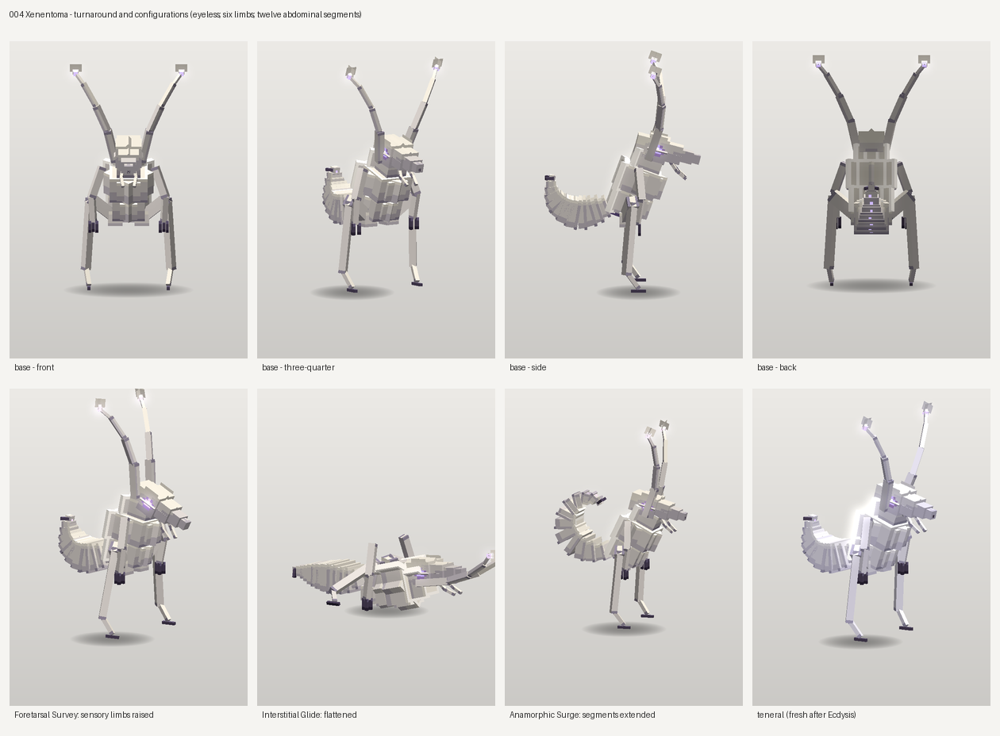
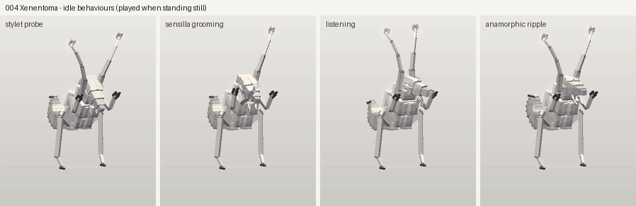
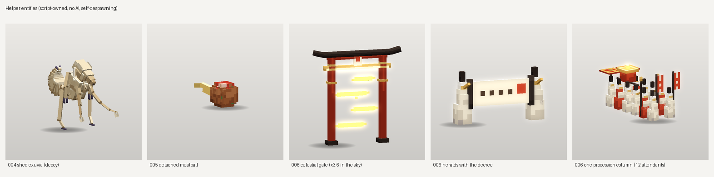

# Creative Development Report

This report maps every part of the original brief to what was built, and lists additions and every significant change with its reason. Nothing from the brief was silently dropped; where something could not be done literally, the replacement is named.

---

## The big decision: bodies without overriding the player

The brief asked for genuinely playable creatures *and* warned that Mojang's cooperative guidelines discourage overriding `minecraft:player` or player skins. The usual "morph" approach (replacing `player.json` and `player.entity.json`) conflicts with other add-ons and silently breaks whenever Mojang changes player animations.

**What was built instead:** each racial body is a **head-slot crest whose attachable copies the player's skeleton**. The creature rides on the player's real animated bones, so it automatically walks, swims, sneaks, rides, sleeps, glides and draws bows exactly as the player does — today and after future updates — while its own anatomy (tails, gills, plates, ears, antlers, rune rings) is animated on top. The player's skin is hidden by a one-condition override of a single vanilla render controller, only while a form is manifested. (Details and trade-offs: [COMPATIBILITY.md](COMPATIBILITY.md).)

Turning that constraint into design:
* **States are bodies.** Every biological state or configuration is a different crest item with its own geometry and transition animation (15 forms). Abilities physically rebuild the creature rather than just playing particles.
* **Veil / Manifest.** Because the form lives in the helmet slot, players can *veil* it — keep their powers and wear a turtle shell or a carved pumpkin — and manifest it again later. It turned a limitation into a disguise mechanic.
* **Crest Infusion.** The crest can absorb enchanted books (Protection, Respiration, Thorns …), so late-game players lose nothing by keeping their form manifested.
* **Armour Assimilation** *(addition)*. Vanilla armour does not fit a 2.4-block stone titan or a digitigrade hare, so it is hidden on manifested forms and the creature grows its own plates per worn slot, tinted by the armour's material (leather, chain, iron, gold, copper, diamond, netherite, turtle). The armour still protects normally.

---

## 001 · Aberrant Flora Salamander — เผ่าสลาแมนเดอร์พืชประหลาด

**Identity kept:** an organism that is simultaneously amphibian, photosynthesiser, predator and ecosystem; plant organs are working anatomy, not decoration.

| Brief element | Delivered |
|---|---|
| ~1.8 blocks | 30.7 model units → 1.8 blocks after the player scale |
| Broad flattened skull, large amber eyes, wide mouth to the cheeks | 11-wide flat cranium with an overhanging snout, dorsolateral bulging amber eyes (glowing irises, slit pupils), a dark lip line wrapping to the cheeks, hinged lower jaw with small teeth and a pale gular pouch |
| Moist, glossy, translucent skin; dark green-black; purple-red vascular patterns | Procedural 3-D skin: mottled green-black, wet specular glints on top surfaces, ridged-noise purple-red vein network running continuously across body parts, sparse yellow-green **algae spots** (spotted-salamander nod) |
| Branching gills like carnivorous leaves, responsive | Three feathery gill stalks per side with cross-plane fronds and red glandular filaments; they pulse with breathing, stream back when moving or swimming, flare when hurt, tuck when dormant |
| Thick photosynthetic back plates that move with meaning | Eight hinged plates (two rows) that **roll open by state** (dormant 8° → stable 34° → bloom 62° → rooted 70°), **track the sun's elevation through the day**, and open further when the creature stands still in sunlight (sunbathing) |
| Arms with adhesive glands, tendrils, prey organs | Glands along the forearm, two **Venus-trap lobes** with ciliated rims (snap open in the Predatory state), hanging sticky tendrils with dew drops that **extend** when hunting, broad digit pads |
| Translucent abdomen with fluid sacs and vascular channels | Real depth: a cut-out membrane over a recessed cavity containing glowing fluid sacs and vascular channels |
| Broad digits, adhesive pads, retractable roots | Splayed toes with pale pads that spread on ground contact; roots that grow out of the soles in the Rooted form |
| ~1-block tail with leaf fins and an opening flower | Four-segment tail (~1.1 blocks) with dorsal/ventral leaf fins and a five-petal flower that opens (bloom) and closes (dormant) |
| Blooming / Predatory / Dormant states | Implemented as visual forms **and** gameplay states (see ABILITIES.md). Predatory is a short combat state after Snare/Embrace; Bloom/Stable/Dormant follow a **hydration** meter with hysteresis so states do not flicker |
| Snare / Embrace / Root / Jet | All four, values close to the brief (cooldowns trimmed slightly for pace) |
| Animations: idle, walk, run, swim, sunbathing, hunting, rooting, dormancy | Idle breathing and gill pulse; tail sway and torso flex scaled by speed; toe spread on contact; travelling tail wave while swimming; sun tracking/sunbathing; snapping lobes/jaw and extending tendrils (predatory); root growth intro; 2.2 s wilting intro for dormancy; bloom unfurling intro; flinch; cast poses for every ability |

**Additions:** the **Ensnared** combo (Snare → Embrace bites 50% harder), photosynthesis that also restores hunger, Conduit Power gills, rain/wet-ground/humid-biome hydration, drinking water bottles, Rooted hydration from soil, a land version of Bladder Jet that costs hydration and douses fire, adhesive pads (fall damage -40%), fire weakness, "Dormant Resilience" (-15% damage so dormancy is a trade-off, not just a punishment), ambient spores, pollen and dew drips from the creature itself.

**Changed:** *Dolphin's Grace* does not exist in Bedrock — swimming speed uses the underwater-movement attribute instead (+70%, +100% Blooming). Root Metamorphosis' cooldown starts when you root (30 s) so its effective downtime matches the brief's 35 s.

## 002 · Runic Titan Golem — เผ่าไททันรูนโกเลม

**Identity kept:** living architecture whose mind is its runes; stones are organs; movement and combat are acts of rebuilding.

| Brief element | Delivered |
|---|---|
| ~2.4 blocks | 2.4–2.6 blocks to the crest stones; hitbox stays vanilla (engine limit) |
| Sculpted head, rune-shaped glowing eye openings, no human face | Monolith head with brow ridge, cheek plates and crest stones; eyes are glowing rune glyphs (slit + stem + tick), a faint mouth seam; it follows your look direction from its own neck pivot |
| Massive asymmetrical basalt torso with empty space around the chest | Separated pillars (the right side heavier), arch, lintel and back masses frame an open chest cavity |
| Core: three concentric rotating rune rings + suspended crystal | Three ring bones built from rotated segments spinning on X, Y and Z at different speeds around a bobbing double crystal; rune wall glyphs behind it |
| Oversized asymmetrical arms of disconnected floating stones | Shoulder boulders, floating upper-arm fragments, massive forearms and knuckled fists, separated by glowing rune seams, with pebbles orbiting each forearm; the fist encloses the vanilla grip so held items sit in it |
| Heavy stone-column legs | Stacked hip/thigh/knee/shin/plinth stones with glowing seams and foot runes |
| Dark basalt, aged gold fractures, glyphs, weathering | Columnar-jointed basalt, weathered edges, pits, moss in crevices, *kintsugi* gold fractures, procedurally generated rune glyphs (emissive) |
| Siege / Bastion / Arcane configurations | Real geometry configurations with transition animations: the right arm's stones (plus the absorbed left forearm) **become a hammer**; back slabs and shoulders **swing to the front and interlock**; slabs, satellites and eight glyph tablets **lift into an orbiting rune ring** |
| Edict / Bastion / Dominion / Reassembly | All four. The shockwave visibly travels; Bastion is directional; Dominion's circle is readable (ground decal + glyph pillars) and actually repels; Reassembly scatters the whole body |
| Animations: idle hover & rings, heavy walk, streamlined run, jump runes, attack reconstruction, damage flicker, reassembly | Rings/crystal/satellites/slabs hover; pelvis and hips settle with each step; sprinting tucks shoulders/satellites/slabs back; foot runes appear and fragments rise when airborne; the arms rebuild into the hammer; hits make fragments lose alignment; the 1-second burst-and-converge reassembly |

**Rune disruption (designed, as requested):** a **Rune Stability** meter that everyone can read on the HUD. Magic-type damage, lightning, thunderstorms under open sky, wither and the golem's own ability strain erode it; below 25% the runes are **Disrupted** (arcane abilities locked, slower cooldowns, misaligned body and red glyphs) until they recover to 50%. It makes witches, lightning and spamming abilities meaningful counterplay without ever disabling the physical kit.

**Additions:** Monolith Stance (stand still: tougher, faster rune recovery), heavy landing shockwave, cancelled knockback, sinking and seabed walking, water breathing underwater, glyph burn inside the circle and "Warded" allies, invulnerability while scattered, armour bands for assimilation, rune motes and sparks from the core.

**Changed:** the brief listed "strong resistance to physical attacks" and "high durability" — implemented as +4 hearts and -25% physical damage rather than permanent Resistance, so magic remains a real threat and the golem never trivialises survival.

## 003 · Blood Moon Jackalope — เผ่าแจ็คคาโลปดวงจันทร์สีเลือด

**Identity kept:** unmistakably a jackalope even with every effect off; agile, eerie, lunar; locomotion is identity.

| Brief element | Delivered |
|---|---|
| ~1.65 blocks | head top ≈ 1.6 blocks; ears and antlers rise above it |
| Elongated hare face, small nose, prominent front teeth | Long lavender-grey muzzle, twitching nose (its own bone), two incisors, cheek fur, whiskers |
| Two branching obsidian antlers with deep-red channels that can change | Three-segment beams with brow and outer tines and a glowing red channel; **four extra tines grow** during the Blood Moon |
| Long, independently animated ears with crimson inner veins | Two-segment ears with separate idle rhythms, random twitches, a listening pose, streaming back when running, pinned when hunting; inner surfaces with glowing crimson vein patterns |
| Silver eyes, red when empowered | Silver emissive irises; red while hunting and under the Blood Moon |
| Slender black-indigo body with curved silver markings | Directional fur strands; silver **crescent** markings on the haunches; chest ruff |
| Functional hands | Paws with digits at the vanilla grip point |
| Powerful hare hind legs | Digitigrade thigh/shin/long-foot chain (forward-kinematics solved so the feet plant) |
| Round fluffy tail with red markings | Scut with a ring marking that ignites when hunting/awakened |
| Ordinary vs Blood Moon Awakening | Four forms (base, hunt, awakened, awakened-hunt) and a world event with a defined rarity, duration and activation (ABILITIES.md) |
| Bound / Brand / Mirage / Waltz | All four, with mechanics that make each matter (see below) |
| Animations: idle ears/nose, cautious walk, bounding run, jump crouch & push-off, landing compression, listening, antler attack, Blood Moon transformation | Idle ears/nose/tail; walking reduces the human stride and leans the torso; **sprinting cancels the human leg swing and replaces it with a synchronised bound** (thighs, shins and feet flex together, body rises and pitches); push-off extension when rising, legs reach when falling; a landing controller compresses the legs; the Listening pose (sneak still); head-down antler charge pose; 1.8 s awakening: tines grow one after another, dorsal fur rises, head tilts back to the moon, crimson spiral |

**Mechanics that give each ability real function:**
* **Lunar Sigil** (Antler Brand): +3 melee damage, Waltz priority and +50%, **Moonhunt** cooldown refund on kill, Blood Moon detonation.
* **Velvet Mirage:** a real 1-HP decoy entity with the `player` family, so mobs that hunt players pursue it; nearby hostiles are provoked into attacking it; whoever strikes it is dazzled; the caster gets a guaranteed dodge.
* **Crimson Waltz:** blink-leaps that land on safe ground around the target, ending in a launching cross slash; damage reduction while dancing.
* **Lunar Resonance:** a 0–4 scale tied to the real moon phase, not just day/night.

**Additions:** Moonlit Hearing pings and the "something is behind you" ear warning, Thump & Listen reveal, new-moon "umbral" longer mirages, two Bound charges under the Blood Moon, life-stealing blood slashes, red camera fade and howl pose on awakening, a crimson fog during the event (vanilla fog stack, removed afterwards — never touches biome lighting).

**Blood Moon decision:** vanilla's full moon is not an eclipse, so the Blood Moon is an add-on event: only on full moons, 34% chance (configurable), guaranteed after three misses, moonrise to dawn, persisted across reloads, operator commands to test it.

---

## Living motion (v1.0.2)

Feedback on v1.0.1 was that the creatures looked *flat, stiff and not alive*: the bodies rode the player's
human walk cycle with only small ambient wiggles on gills, ears and rings. v1.0.2 rebuilds every animation
as a stack of layers that run together on each form (see `tools/anims/life.py` and `tools/anims/races.py`):

| Layer | What it adds |
|---|---|
| **life** | breathing (chest, shoulders, head), heartbeat, blinking with real eyelids, slow weight shifts, small head moves and curious tilts while standing |
| **locomotion** | a race-specific gait on top of the player's own stride: shorter strides, knees and ankles, hip bob, roll toward the stance leg, shoulder twist against the hips, forward lean, follow-through on tails, ears, gills and loose stones |
| **airborne / landing** | take-off stretch and fall reach driven by vertical speed; a soft or hard landing squash (with dust) chosen by how fast the fall was |
| **attack / hurt** | a reaction to every melee swing; a keyframed flinch on every hit (eyes squeezed shut, ears pinned, stones jolted) |
| **idle behaviours** | after a few seconds standing still the creature does something on its own, picked at random |
| **turning** | the body twists toward where the player looks and leans into turns; tails and ears drag behind |

**Per race**

* **Salamander (001):** slow amphibian breaths and a fluttering **throat pouch** with a deep gulp every few seconds; visible **heartbeat** of the fluid sacs behind the belly membrane; upper eyelids blink (heavy-lidded when Dormant, shut when asleep). Walks with bent knees, flat feet that roll off the toes, a sinuous body roll and a travelling wave down the tail; sprints with arms splayed and the tail lifted. Idle: **tastes the air with its sticky tongue**, **shakes its head** (gills slap, spores fly), **curls its tail round to admire its flower** (petals open, pollen drifts), **stretches and yawns** (empty hands only). States: Predatory lashes its tail and twitches its jaw, Bloom breathes its petals, Rooted sways like a plant in a breeze.
* **Titan Golem (002):** a six-second **stone breath** in which the blocks part and rejoin, a lub-dub **rune heartbeat** in the crystal, slow **stone eye shutters**. Walks stiff-legged and lumbering with a heavy roll; every footfall drops the trunk onto the hips, jolts the shoulder boulders and back slabs in sequence, flares the core and kicks up **dust from the soles**. Idle: **stones lift and re-seat** bottom to top, **grinds its crown** left and right (sparks), **spins up its core**, **raises a fist and turns it over to look at it** (empty hand only).
* **Jackalope (003):** fast shallow breaths, a **twitching nose with whiskers**, bouts of **chewing**, ears that swivel independently and point where it looks, quick bird-like head moves and blinks. Walks with springy steps and bouncing ears; sprints as a real **two-footed hare bound** with a flight phase, paws tucked and ears pinned. Idle: **washes its face and pulls an ear down to clean it**, **rears up as a sentinel** and scans the horizon, **thumps a hind foot** in warning (dust), **stretches, yawns and shakes**. Hunt and Blood Moon states add trembling, coiled stances and sharper twitches.

**Engineering decisions**

* **Stateless and identical everywhere.** Everything is Molang of the player's own queries (stride distance, speed, vertical speed, look direction, life time, hurt time); no persistent variables, so the motion is the same on every device and survives the form changing. Idle behaviours use a timer-animation state machine (`q.all_animations_finished`), not stored timestamps.
* **Feet stay on the ground.** The build plays each gait through a Molang/keyframe interpreter on top of the vanilla walk cycle, measures the lowest point of the legs at every stride phase and fits a short Fourier series for the body bob (`tools/anims/fit.py`). Feet stay within about 0.1 pixel of the ground through the whole walk and sprint of all three races; only the Jackalope's sprint deliberately leaves the ground.
* **Held items stay in the hands.** Arms only take the race's own arm motion when that hand is empty (`q.is_item_equipped`), so swords, shields and the Focus never drift away from the hand; arm-using idle behaviours only play with empty hands.
* **No fighting the vanilla poses.** Gaits switch off while riding or gliding, idle behaviours stop for any movement, sneaking, sleeping, swimming or a hit, and everything is third-person only.
* **Cheap on phones.** Values every layer needs (stride phase, swing, speed, the fitted bob) are computed once per frame in the attachable's `pre_animation` script.
* **Seen before shipped.** `tools/anim_gifs.py` renders GIFs from the shipped files (the previews below are not mock-ups), and the validator now parses every Molang expression and rejects unknown queries or unset variables.

| | | |
|---|---|---|
|  |  |  |
|  |  |  |

**New anatomy for it:** eyelids (all three), a throat pouch, a tongue and pulsing viscera (Salamander), a hinged chewing jaw and whiskers (Jackalope), stone eye shutters and footfall dust points (Golem); the Golem's trunk now pivots at the hips.

## Expansion 01 (v1.1.0): races 004–006

The expansion was built into the existing add-on, not beside it: same packs and pack ids, the same race framework, and races 001–003 preserved: their generated models, textures, animations, attachables and items are byte-for-byte identical to v1.0.2 (checked file by file), their item ids, race codes and saved data are unchanged, their scripts only gained the fields the new Codex needs (focus names, control hints, reticle cones), and all 136 of their runtime assertions still pass. Permanent codes **004**, **005** and **006** were added.

*The tables below record the expansion as built in v1.1.0; the bodies, motion and effects of 004–006 were redrawn in v1.2.0 with the same gameplay — see [the v1.2.0 section](#visual-overhaul-v120-races-004006-redrawn).*

### Research behind the designs
* **Protura** (the real "coneheads"): tiny soil hexapods with **no eyes and no antennae**; they walk on four legs and hold the **front legs up as sensory organs**; the head carries a pair of **pseudoculi** of uncertain function; mouthparts are internal **stylets**; development is **anamorphic** — abdominal segments are added at moults until the adult has **twelve**. ([Wikipedia: Protura](https://en.wikipedia.org/wiki/Protura))
* **The Flying Spaghetti Monster**: the deity of Pastafarianism, introduced in Bobby Henderson's **2005 open letter to the Kansas State Board of Education**; usually drawn as a tangle of spaghetti with **two meatballs and two eyes on stalks**; believers are "touched by His Noodly Appendage". ([Wikipedia: Flying Spaghetti Monster](https://en.wikipedia.org/wiki/Flying_Spaghetti_Monster))
* **Nurarihyon**: a yokai pictured as an elderly gentleman with an **elongated, gourd-shaped head** in fine clothes who **walks into homes at the busy evening hour, sits down, drinks the tea and is taken for the master of the house**; later popular culture made him the **commander of the yokai** (and, in modern fiction, the leader of the Night Parade of One Hundred Demons, *hyakki yagyō* 百鬼夜行). ([Wikipedia: Nurarihyon](https://en.wikipedia.org/wiki/Nurarihyon), [yokai.com: Nurarihyon](https://yokai.com/nurarihyon/))

### 004 · Xenentoma — เซเนนโทมา

**Identity kept:** an alien arthropod that *does not see*: it reads the world through the ground, and its body changes by moulting and adding segments.

| Brief element | Delivered |
|---|---|
| ~1.75 blocks, eyeless, Protura-inspired, six limbs | 1.75-block hexapod built on the proturan blueprint; three limb pairs with three jobs (below) |
| Conical head, false eyes (pseudoculi), retractable needle feeding apparatus | Conical head with two glowing pseudoculi, palps, and a **stylet that extends** to probe (idle behaviour) and to inject (Anamorphic Surge) |
| Translucent ivory / pale grey / muted violet chitin; sensory hairs | Procedural chitin with translucent edges, a violet **nerve cord glowing through the body**, sensilla bristles on the forelimbs and head |
| Anterior sensory limbs, middle manipulative limbs (hold items), posterior segmented locomotor legs | Forelimbs held forward ending in glowing sensilla (raised in Survey); middle limbs bound to the player's arms so **items are held normally**; posterior legs with pretarsal claws that carry the gait |
| 12 abdominal segments; overlapping dorsal plates (not wings) | Twelve articulated segments with intersegmental membranes that show when the abdomen stretches; split dorsal **tergites** that open when it moults — never wings |
| Vibration Mapping (not a wallhack), Ecdysis (shell decoy), Anamorphic Expansion | **Vibration Sense** (private, approximate, ground-borne, close range) + **Sensory Clarity** resource; **Exuvia Proxy** with a real shed-shell entity; **Anamorphic Surge** extending the twelve segments one after another |
| Survey 15 s / Exuvia 28 s / Glide 18 s / Surge 40 s | All four at the brief's cooldowns and ranges (see ABILITIES.md) |
| Passives: darkness awareness without a dark screen, quieter movement, vibration detection | **Eyeless** (Blindness/Darkness removed, the screen is never darkened), **Stillness** (motionless → invisible), Vibration Sense, Six-Point Landing |
| Weaknesses: explosions/vibrations overwhelm senses; airborne reduces detection | Explosions within 14 blocks and lightning **overload** it (no senses, no Survey, slower cooldowns, +15% explosion damage); in the air the senses shrink and blur |
| Animations: idle, walk, run, jump, scanning, molting, gliding, surge, sleeping, combat, swim, damage, recovery | Restless sensing idle; a six-limbed walk and a scuttling run with posterior legs carrying the gait; jump tuck; **Survey** pose with forelimbs raised and sensilla flicking; **teneral** form after moulting (soft, pale) and the shell left behind; flattened **glide** with folded legs; segment-by-segment **surge**; asleep, the sensory limbs fold and the abdomen curls; a stylet stab on every attack, a curl-and-retract flinch when hurt, soft and hard landing recovery; swimming uses the player's own swim pose (the gait layer steps aside); idle behaviours: stylet probe, sensilla grooming, listening to the ground, an anamorphic ripple down the segments |

**Additions:** Sensory Clarity as a readable resource with hysteresis, "sensed" creatures that the Surge strikes harder, the exuvia provoking nearby hostiles, Speed II escape then Resistance as the cuticle hardens, tripping enemies during the glide.
**Changed:** "vibration mapping" is deliberately *not* an outline/X-ray effect: it is a few private, jittered rings at approximate positions, because a wallhack would break survival and PvP.

### 005 · Flying Spaghetti Monster — สปาเกตตีมอนสเตอร์บินได้

**Identity kept:** absurd on purpose, engineered seriously — every power is a property of its pasta anatomy.

| Brief element | Delivered |
|---|---|
| Floating spaghetti mass ~1.1 blocks wide, ~1.7 tall with eyestalks | Dense asymmetric mass of ~40 curved noodle strands in slowly circulating twist groups, dangling and trailing strands, hovering a hand's breadth above the ground |
| Exactly two meatballs | Two meatballs on orbit pivots — they leave (Ricochet), circle (Revelation) and come back |
| Two independent eyes on stalks | Two noodle eyestalks with their own lids; they look and blink independently (one watches your back: Dual-Eye Awareness) |
| Sauce that flows, even against gravity | Sauce on the strands, a sauce crown and drips that sometimes **run upward**; Sauce is also its resource |
| Temporary noodle appendages for items | Braided noodle arms that only form while a hand holds something or strikes, so tools sit in a "hand" of strands |
| Hovering visual without unrestricted flight | Visual hover + **Noodle Parachute** (sneak while falling) — no flight |
| Touch 15 s / Al Dente 22 s / Ricochet 28 s / Revelation 50 s | All four at the brief's cooldowns; the Revelation is three rotating spiral layers of the body itself with opposite-orbit meatballs and raised eyestalks, not a particle burst |
| Passives & weaknesses: Noodly Float, Flexible Appendages, Elastic Form, Dual-Eye Awareness; fire brittleness; meatballs detached | All, plus **SAUCY** empowerment; fire leaves a visibly singed **brittle** form |

**Additions:** blessing allies with the Touch, gathering dropped items, projectile-proof Al Dente with a counter, meatball tethers and target sharing, pasta-themed food bonuses.
**Changed:** none of the brief's numbers; the hover is purely visual (Bedrock cannot give a player a free-floating hitbox without flight).

### 006 · Nurariten — นูราริเทน (UNIQUE)

**Identity kept:** *The Uninvited Sovereign* — it does not ask, it arrives; it treats every place as its house and every crowd as its court.

| Brief element | Delivered |
|---|---|
| ~1.95 blocks; elongated cranium curving back; ivory mask face; narrow golden slit-pupil eyes | Gourd-like cranium sweeping back under a gold diadem; ivory mask face with vermilion court marks; narrow golden eyes with vertical pupils that shift while the face stays still; slow, heavy blinks |
| Fragmented floating golden halo | Eight halo fragments (arcs and glyph tablets) that each drift on their own around the head and flare when it attacks |
| Layered collars, long sleeves, slender fingers | Stacked ceremonial collars on an elongated neck; sleeves that **hide the hands** — slender long-fingered hands slide out only to hold an item, strike or issue a decree (two fingers for an edict, one finger for the Final Edict) |
| Ivory, aged gold, vermilion garments | Ivory silk with a faint gold cloud-scroll damask, aged gold trims, vermilion hakama and lacquered clogs |
| Architectural back halos / heavenly gates that unfold; procession-like shadow | A folded gate and rings on the back that **unfold into a court** (Temple) and rise into a **throne-palace** (ultimate); an idle behaviour where it stands perfectly still while its shadow becomes a procession |
| Divine Jurisdiction (Sovereign Presence, Celestial Edicts, The Hundred Heavens), shared judgment marks | Implemented as a system (`src/systems/jurisdiction.ts`): **courts** (temporary, block-free) and **judgment marks** (1–3, shared by all its abilities) |
| Arrival 18 s / Lowered Gaze 25 s / Temple 35 s / Expulsion 40 s | All four at the brief's cooldowns, with the requested safety rules (safe teleport, no forced camera, no flashing, no land seizure) |
| HYAKUTEN CHŪKŌ 百天昼行 (ขบวนร้อยสวรรค์ยาตรายามทิวา), 180 s, five stages, real consequences, full restoration, no 100 AI mobs, iPhone-friendly | All five stages (below), each with combat consequences; ten script-owned entities in total; everything dissolves and every temporary state (fog, movement lock, forms, courts, marks) is restored — also on interruption, death, logout and reload |
| Day / midday / dusk / night relationship without changing world time or sky | **Solar Mandate** (day/midday bonuses), **dusk = the hour of visiting** (Nurarihyon's hour: 2 Arrival charges, longer Temple), **Nocturne Radiance** at night; at night the ultimate brings a *private* daylight haze to its witnesses; world time/sky never touched |
| Passives: Celestial Bearing, Royal Presence (subtle, not permanent CC), Uninvited Authority; weaknesses: Judicial Weakness, Arrogant Posture, Broken Mandate | All six, with numbers in ABILITIES.md; Royal Presence never affects players and never stacks |
| Unique classification must be meaningful and extensible | One holder per world (operator-configurable, `/plrace:unique`), world announcement, a fifth ability, its own world system and presentation; `rarity: "unique"` + `ultimate: true` is all a future Unique needs |

**HYAKUTEN CHŪKŌ — the five stages as built**
1. **The Sky Must Open** — a gate (the Temple's gate at ×3.6) opens 9 blocks ahead in the sky with fractures of light, a ground shadow, a bell and one soft golden fade; the Sovereign stands still. *Interruptible* (Judicial Weakness): a heavy hit returns half the cooldown and breaks the mandate.
2. **The Proclamation** — two heralds descend from the gate carrying the decree; every enemy within 16 blocks is judged and bows.
3. **The Hundred Heavens March** — eight columns (standard bearers, guards, heralds with horns, judges with scrolls, palanquin bearers, parasol bearers; an empty palanquin reserved for the Sovereign in each) emerge in a ring and march around it, spiralling inward, trampling and herding enemies toward the centre. 96 attendants + 2 heralds + the gate + the Sovereign = **one hundred**.
4. **The Throne Without Permission** — the court rises into a throne-palace behind it; the columns halt and face inward; the Sovereign is protected and everything within 12 blocks is weakened and judged.
5. **The Final Edict** — one finger rises; golden seals converge on every judged creature and the judgment lands (4 +4 per mark, +25% at midday). Then the procession dissolves into light, the gate closes and the haze lifts.

**Additions:** Master of the House (Hero of the Village indoors among villagers — the yokai who is taken for the master), the exile rule that turns expelled creatures back at the court's edge, accessibility toggle for the ultimate's screen effects, cancel-in-preparation with a partial refund.
**Changed (and why):** the brief's "Hundred Heavens March" is not a hundred separate mobs — that would cost pathfinding, collision and network traffic on every phone in range; columns of shared geometry marching on a script path keep the image (one hundred figures) at the cost of ten entities. The brief's "sky must open" uses a giant gate and a private fog instead of changing the sky, which Bedrock cannot do per player. When cast under a roof, the gate enters "through the door" (ground level, normal size) instead of the sky — a deliberate nod to a yokai who walks into houses.

### Motion for 004–006
The three new bodies use the same layered, stateless animation system as v1.0.2 (life, locomotion, airborne/landing, attack, hurt, idle behaviours, form transitions), with gaits fitted to the measured foot floor (Xenentoma within 0.02 px, Nurariten within 0.16 px; the Spaghetti Monster hovers):

| | | |
|---|---|---|
|  |  |  |
|  |  |  |

* **Xenentoma:** constant small sensing (sensilla flicking, forelimbs tasting the air), a six-legged gait, the stylet that slides out to probe, grooming of the sensilla, freezing to listen to the ground, a ripple running down the twelve segments.
* **Flying Spaghetti Monster:** strands circulating in twist groups, meatballs bobbing, eyes looking and blinking separately, trailing strands streaming back when it moves, sauce running uphill; idle behaviours: it doodles shapes with a noodle, its eyes look in two directions, a meatball does a lap around the body, sauce defies gravity.
* **Nurariten:** serene and minimal — the face barely moves while the halo fragments and the architecture do; slow ceremonial steps with almost still arms; a brief pause and a slow turn toward whoever struck it; idle behaviours: it surveys its "court", settles its sleeves with a flick, two fingers emerge to write a glyph in the air, and (by day) it stands utterly still while its shadow becomes a procession.

## Visual overhaul (v1.2.0): races 004–006 redrawn

**Why:** after v1.1.0 the three new lineages were judged to look funny and cheap — models, textures, motion and effects alike. v1.2.0 redraws all of it. Direction chosen with the player: **elegant, Marketplace-style** (clear silhouettes, clean pixel art with a limited lit palette that sits next to Minecraft and races 001–003); the Spaghetti Monster as an **appetising pasta deity**; the Xenentoma **standing and walking upright with elegance, dropping onto all six limbs to sprint**.

**Scope:** visuals only. Models, textures, animations, particles and the helper entities (exuvia, meatball, celestial gate, heralds, procession) were rebuilt; every item id, form/variant name, pose name, particle, entity and geometry id, locator the scripts use and all gameplay are unchanged, so worlds and saved players carry over. Races 001–003 are byte-for-byte identical to v1.1.0 (checked file by file).

**What looked wrong (read off renders of v1.1.0) → what changed**

| | v1.1.0 | v1.2.0 |
|---|---|---|
| **004 Xenentoma** | a "robot with a tail": boxy chest, human limbs, forelimbs held out like a zombie, a screen-like box head, twelve equal segments dragging like a lizard tail, grey stone-like texture with purple stripes, a human walk | an upright S-curve: digitigrade hind legs, a wasp waist, a thorax leaning forward under three overlapping tergites, a conical head with glossy pseudoculi and the stylet sheath; sensory forelimbs raised in a tall V ending in glowing sensilla fans; mantis-like middle limbs at the hands (they fold against the chest when empty); a short teardrop **gaster curled under the body** (twelve overlapping segments with glowing membranes) instead of a tail. Smooth translucent ivory chitin with pearl edges and a violet nerve cord. 90 cubes (125 before) |
| **005 Flying Spaghetti Monster** | a haystack of 588 thick strands, dirt-block meatballs, box eyes, a red brick of sauce, hanging strands that read as spider legs and turned into sticks at speed | a round **nest of glossy golden spaghetti** — twelve staggered slices (no shared face planes, no z-fighting) painted with strands wound continuously across every face, four loose loops lifting off the surface; two **seared, glazed meatballs** on its shoulders; a ladle of marinara poured over the top and running down the sides (one bead creeps upward); big round eyes with **sliding pupils** and their own lids on noodle stalks; His Noodly Appendages curling out and streaming back; drooping U-loops underneath (they can only swing, never read as legs); the **Holy Colander's rim as a perforated golden halo**. 131 cubes |
| **006 Nurariten** | a white box head under a stacked "chef's hat", a flat face, box sleeves, paper-card hems with random dots, a scattered halo of sticks, a toy-like gate, a stiff walk | a Heian court sovereign: closed A-line robe with a vermilion hakama and six weighted hem panels, wide sleeves, a long gourd cranium sweeping back in one continuous curve, an ivory mask with golden slit-pupil eyes, high court brows (*hikimayu*) and a vermilion mouth; a complete **halo of six arcs and four glyph seals**; slender pillars that unfold into a torii court and rise into a throne; ivory, aged gold, vermilion and lacquer black with gold cloud scrolls and kasane edges. 90 cubes (107 before) |
| **all three** | per-pixel random noise ("dirty"), no palette discipline, no edge light, 16 px particle sprites, pure sine motion with no timing or holds | quantised palette ramps lit from each face's real rest-pose normal, 1-texel rims, pixel-exact decals (faces, pupils, seals); a second full-colour **particle atlas** (256×256) for races 004–006; motion built on timing — anticipation, follow-through, holds, eased moves, per-race rhythm |

**Shared tools added** (all offline, in `tools/`): `kit/pixel.py` (palettes, lighting, rims, decals — no random noise); shape builders in `models/common.py` (`chain`, `ellipsoid`, `drape`, `arc`, `segment`); animation helpers in `anims/life.py` (`chain_wave` travelling waves, `saccade` move-and-hold, `smooth_pulse`); `review.py` sheets (turnaround, black silhouettes, in-game distance next to the vanilla player and races 001–003); `fx_ex.py` (the new particle atlas and effects). The validator now also rejects numbers in scientific notation inside Molang (Bedrock cannot parse them).

**Motion language per race**
* **Xenentoma — stillness, then precise jerks.** Sensory limbs sweep and freeze (0.08–0.15 s snaps, 0.5–1.5 s holds) with a fine tremble at the tips; the head ticks between directions; the gaster breathes as a wave running segment by segment. It stalks upright on its hind legs with high careful steps; **sprinting with empty hands it drops onto all six limbs and scuttles in a tripod gait** (holding an item it sprints upright, so the item stays in its hand). Idle: stylet probe, sensilla grooming, listening to the ground, an anamorphic ripple.
* **Flying Spaghetti Monster — soft and buoyant.** The nest floats on a slow 2.5 s swell and breathes with it; everything that hangs follows a beat late; loops slide around the nest; the pupils dart and hold independently and each lid blinks on its own clock; it leans and banks into its path while the appendages stream back in travelling waves; it squashes on landing and the meatballs bounce a beat later; attacks are a whip-like lash. Idle: a noodle twirls itself like pasta on a fork, the eyes study sky and ground and then each other, the meatballs take a lap around the nest, a bead of sauce climbs into the air while both eyes watch.
* **Nurariten — slow and ceremonial.** *Suriashi* steps (short, no bounce, hem panels swinging behind the legs), almost still arms with heavy sleeves, a head that turns slowly, a halo that turns and breathes. Idle: surveys its court, settles its sleeves, writes a glyph with two fingers, stands still while its shadow becomes a procession.

**Effects (new atlas, same particle ids):** Xenentoma — violet sensilla motes, flat double ripples on the ground, pale moult fluid, translucent spinning chitin flakes, a violet star burst for the surge. Spaghetti Monster — glossy marinara drops and splats, soft steam wisps, golden al dente splinters, a golden noodle spiral for the Revelation, a sauce ring on the ground. Nurariten — soft gold motes, a gold decree glyph (令) in a ring, a vermilion hanko seal (王), a court ring with ticks and cardinal marks, a glowing torii, branching light fractures, petals rising as the procession dissolves, and a shadow-play procession strip.

**Helper entities:** the meatball is now a round seared, glazed meatball; the celestial gate's light became staggered bands of golden mist (*suyari-gasumi*) instead of rungs; the shed exuvia comes straight from the new body (hollow, split along the back, its sensory limbs drooping); heralds and processions use the new Heian palette.

## Shared systems built for this release

* **Lineage Codex** — selection with race portraits, detail pages (lore, strengths, weaknesses, passives, abilities with the original brief values), a confirmation step, the Rite of Unbecoming (policy-controlled race change), Veil/Manifest, Crest Infusion, Recall Focus, an archive of all races and operator settings. Opens once automatically for new players and never nags.
* **Rite ceremony** on transformation (rune aura in the race colour, arms-raised pose, title).
* **Ability engine** — cooldowns, charges, channels with explicit interruption rules, failure reasons that never waste a cooldown, a green aim reticle for targeted abilities, an action-bar HUD.
* **Persistence & safety** — per-player data (race, selection, cooldowns as remaining time, resources, enchantments, input locks) and world data (settings, Blood Moon); clean-up on death, logout, dimension change and race change; villagers, golems, pets, armour stands and (unless PvP is enabled) players are never hit; no terrain is modified.
* **Expansion-ready** — permanent race codes 001–006; a new race is one model module, one animation set and one `RaceDef` registered in `src/races/registry.ts` (see the README).
* **Added for Expansion 01:** helper entities with owners, lifetimes and guaranteed cleanup (`src/systems/proxies.ts`); Unique lineages with world-level claims (`src/systems/unique.ts`); Divine Jurisdiction (`src/systems/jurisdiction.ts`); explosion and item-use hooks for races; a race-wide 4-tick world hook; five-ability support in the engine, HUD and Codex; the Codex shows six lineages with the Unique badge and who holds it.

## Lore summary

* **The Mirefold (001):** a cave salamander lineage that swallowed the seeds of a carnivorous bog-bloom; the two organisms now share one bloodstream. Wet, they bloom; dry, they wait for rain.
* **The Unsleeping Masonry (002):** an empire carved its laws into basalt so they could never be forgotten; the laws remembered themselves and stood up. Its thoughts are written and rewritten on three turning rings.
* **The Hollow-Moon Kin (003):** hare-folk whose antlers are organs of the moon. When the full moon rises red, they remember what they were.
* **The Eyeless Choir (004):** a lineage of soil-dwellers that never needed eyes; they sing to each other through the ground, and they hear everything that walks on it.
* **The Noodly Existence (005):** in 2005 a letter described a deity of spaghetti and meatballs, invisible to science because it touches every measurement. Somewhere, it seems, the joke was taken literally.
* **The Uninvited Sovereign (006):** what the old yokai who walks into houses becomes in heaven — a sovereign of the celestial courts. It was never invited. It was always expected.
