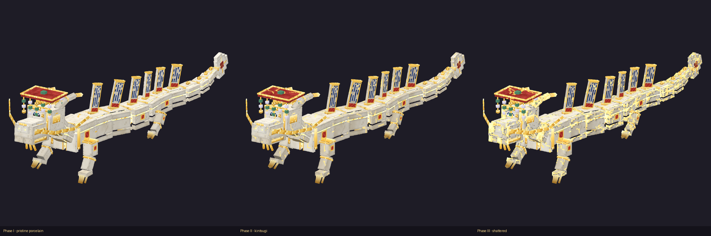
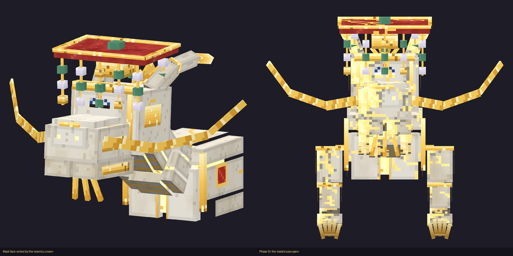
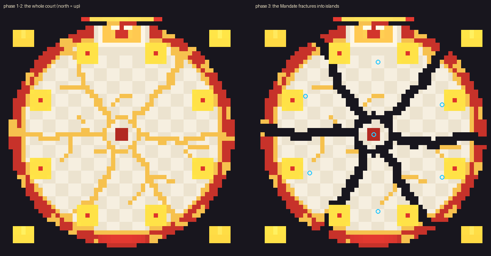
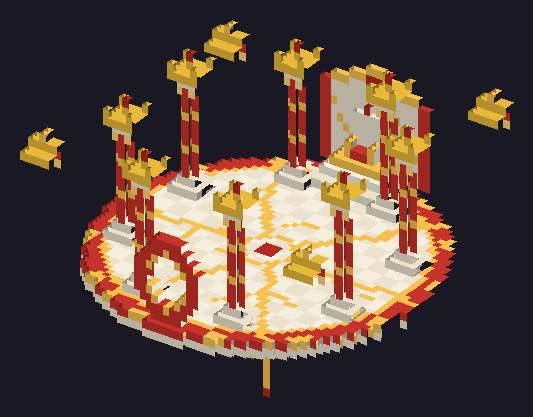
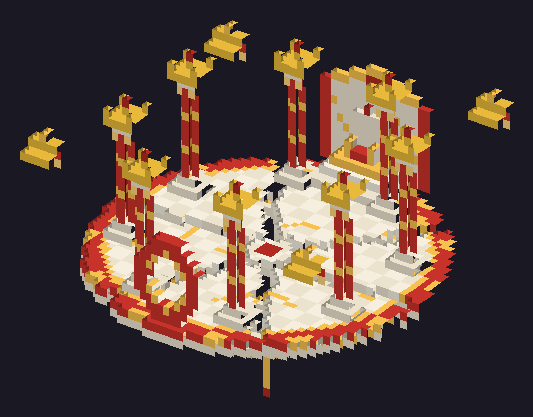
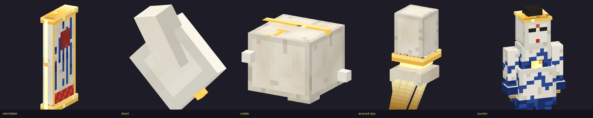

# Dragon Boss 001 — The Porcelain Emperor

แอดออน Minecraft Bedrock ที่เพิ่มบอสมังกร **The Porcelain Emperor (จักรพรรดิกระเบื้องเคลือบ)** พร้อมมิติเฉพาะของมันชื่อ
**The Fractured Mandate (อาณัติที่แตกร้าว)** ซึ่งเป็น **custom dimension จริง** ที่ลงทะเบียนผ่าน Script API ไม่ใช่สนามที่สร้างแยกไว้ในโลกปกติ

**ไฟล์สำหรับติดตั้ง:** [`dist/The_Porcelain_Emperor.mcaddon`](dist/The_Porcelain_Emperor.mcaddon)
(มี `.mcpack` แยก BP/RP ให้ด้วยในโฟลเดอร์เดียวกัน)

| | |
|---|---|
| เวอร์ชันเกมที่รองรับ | Bedrock **26.60** ขึ้นไป (`min_engine_version` 1.26.60) |
| Script API | `@minecraft/server` **2.11.0** และ `@minecraft/server-ui` **2.3.0** (เวอร์ชัน stable ล่าสุดของ 26.60) |
| Experimental toggles | **ไม่ต้องเปิด** ใช้เฉพาะ API แบบ stable รวมถึง Custom Dimension API |
| แพลตฟอร์มเป้าหมาย | iPhone (ใช้เฉพาะฟีเจอร์ของ Bedrock ไม่มีอะไรที่เป็นของ Java Edition) |



---

## 1. แนวคิดการออกแบบ

> จักรพรรดิมังกรองค์หนึ่งสั่งให้ช่างหลวงสร้างร่างของตนใหม่ด้วยหินอ่อนและกระเบื้องเคลือบเพื่อจะครองแผ่นดินไปชั่วนิรันดร์
> เมื่ออาณัติแห่งสวรรค์ (Mandate of Heaven) ของมันแตกร้าว ราชสำนักก็เติมทองคำลงในทุกรอยแตกแบบ **Kintsugi**
> และทุกครั้งที่ร่างแตก มันกลับแข็งแกร่งขึ้น — **"แม้สิ่งที่แตกแล้ว ก็ยังต้องรับใช้องค์จักรพรรดิ"**

ภาษาการออกแบบมี 5 ข้อ ซึ่งทั้งหมดถูกนำไปใช้ในการต่อสู้จริง ไม่ใช่แค่ของตกแต่ง

1. **ร่างที่แตกอยู่แล้วตั้งแต่ต้น** ลำตัวคดเคี้ยวแบบมังกรจีนประกอบจากวงแหวนกระเบื้องกลวงที่ลอยล้อมแกนแสงสีทอง
   ช่องว่างระหว่างวงแหวนเป็นส่วนหนึ่งของเงาร่าง เมื่อบาดเจ็บ วงแหวนจะลอยห่างจากกันมากขึ้นจริงในแอนิเมชัน
2. **ใบหน้าซ้อนใบหน้า (ความผิดธรรมชาติที่ซ่อนอยู่)** บนหน้าผากของมังกรมี *หน้ากากกระเบื้องรูปหน้ามนุษย์* ที่หลับตานิ่งสงบ
   และถูกบังด้วยม่านลูกปัดของ **มงกุฎเหมี่ยนกวน (mianliu)** ที่ลอยอยู่เหนือหัวโดยไม่แตะร่าง ใต้หน้ากากเป็นปากที่
   **ขากรรไกรล่างแยกเป็นสองซีก** และอ้าออกด้านข้างจนเห็นลำคอที่เรืองทอง ในเฟสสุดท้าย หน้ากากแตกร้าวและ *ลืมตาเป็นแสงทอง*
3. **แผ่นราชโองการ (Edict Tablets)** แทนครีบหลัง เป็นแผ่นกระเบื้องขอบทอง มีอักษรสีน้ำเงินโคบอลต์และตราชาดสีแดง
   แผ่นเหล่านี้คือเศษที่มันขว้างออกไปจริง โมเดลจะ **ซ่อนแผ่นที่ถูกขว้างไปแล้ว** และงอกคืนเมื่อซ่อมร่าง
4. **ขาทั้งสี่ลอยแยกจากลำตัว** โดยมีเส้นด้ายสีทองยึดไว้ ขาหน้าข้างขวาสามารถ **หลุดออกไปไล่ล่าผู้เล่นเอง** (Severed Claw)
5. **หางปลายเป็นหัวคทารูอี้ (ruyi)** และ **หัวใจเป็นโถหลวงที่มีทองหลอมอยู่ข้างใน** แผ่นอกจะเปิดออกในจังหวะที่มันอ่อนแอ
   ให้เห็นหัวใจทองชัดเจน เป็นสัญญาณให้ผู้เล่นรู้ว่าควรโจมตีตอนนี้



สีหลักคืองาช้างและทอง ใช้แดงชาด หยก และน้ำเงินโคบอลต์เป็นสีรอง Texture มี 3 ชุด (pristine / kintsugi / shattered)
ซึ่ง render controller สลับตามเฟส ส่วนรอยแตกของแต่ละชุดสร้างจากเครือข่ายรอยร้าวชุดเดียวกันที่ค่อย ๆ ขยายตัว
รอยแตกจึงลุกลามต่อเนื่องจริงจากเฟสหนึ่งไปอีกเฟส และเส้นทองเป็นพิกเซลเรืองแสง (emissive)

---

## 2. The Fractured Mandate — มิติของจักรพรรดิ



* เป็น **custom dimension จริง** (`porcelain:fractured_mandate`) ที่ลงทะเบียนตอนเริ่มโลกด้วย `dimensionRegistry.registerCustomDimension()`
  API นี้อยู่ในเวอร์ชัน stable ของ `@minecraft/server` ตั้งแต่ 2.8.0 และมีใน 2.11.0 ที่แอดออนนี้ใช้ (ตรวจจาก typings ทางการ
  และตัวอย่าง *Custom Dimensions* ของ Microsoft ที่มากับ Minecraft Creator Tools)
* **ข้อจำกัดที่ต้องบอกตรง ๆ:** Bedrock สร้าง custom dimension ได้เฉพาะแบบ **void (ว่างเปล่า)** เท่านั้น
  พระราชวังทั้งหมด (ประมาณ 7,900 บล็อก) จึง **สร้างด้วยสคริปต์** ทุกครั้งที่เรียกบอส ท้องฟ้าและไบโอมของมิติยังเป็นค่าเริ่มต้นของเกม
  ซึ่ง API ไม่เปิดให้กำหนด แอดออนจึงใช้ **fog ของตัวเอง** (สีงาช้าง → ทองเข้มในเฟส 3 → ทองอ่อนเมื่อชนะ) ผ่าน `player.fogSettings`
  เพื่อเปลี่ยนบรรยากาศ ส่วนการเข้าออกมิติทำได้ผ่านสคริปต์เท่านั้น (ตราประทับและคำสั่งของแอดออน) Bedrock ยังไม่รองรับประตูมิติหรือ `/tp` ไปยัง custom dimension
* พระราชวังลอยอยู่กลางความว่างเปล่าเหมือนจานกระเบื้องคว่ำ ลานกลมรัศมี 26 บล็อกปูด้วยกระเบื้องหินอ่อน
  มี **รอยต่อทอง Kintsugi** เป็นแนวรอยเลื่อน 6 เส้นที่มีลวดลายเดียวกับร่างของมังกร มีเสาแลคเกอร์ชาด 8 ต้น
  บัลลังก์กับฉากกั้นจักรพรรดิอยู่ทิศเหนือ **ประตูพระจันทร์ (Moon Gate)** อยู่ทิศใต้ และมีซากหลังคาพระราชวังลอยอยู่รอบนอก
  ใช้บล็อกที่ทำขึ้นเฉพาะ 8 ชนิด เช่น Ivory Marble, Kintsugi Seam (เรืองแสง), Vermilion Lacquer, Imperial Roof และ Gilded Floor
* **สนามเปลี่ยนตามร่างของมังกร:**
  * **เฟส 2:** รอยแตกลามบนพื้นจากใจกลางออกไปตามแนวรอยเลื่อน ยอดเสา 2 ต้นแตกออกกลายเป็นก้อนหินลอยอยู่บนฟ้า
    และมังกรสามารถดึงกระเบื้องพื้นขึ้นมาขว้างใส่ผู้เล่นได้
  * **เฟส 3:** แนวรอยต่อทองเรืองแสงเตือนประมาณ 3.5 วินาที จากนั้น **แยกออกเป็นเหวกว้าง 2 บล็อก**
    ลานจึงแตกเป็น **เกาะลอย 7 เกาะ** (ตามภาพทางขวา) เสาทุกต้นพังเหลือแต่ตอและกลายเป็นเศษลอย ฉากกั้นบัลลังก์แยกเป็นสองซีก
  * **เมื่อชนะ:** เหวทุกเส้นถูก **เติมด้วยทองแบบ Kintsugi** ไล่จากใจกลางออกไป เสากลับมาตั้งใหม่พร้อมแถบทองตรงจุดที่เคยหัก
    และ fog จะสว่างขึ้น สื่อว่าสิ่งที่แตกได้รับการซ่อมจนงามกว่าเดิม
* **ตาข่ายนิรภัย:** ถ้าตกลงเหว มิติจะเหวี่ยงผู้เล่นกลับขึ้นมาบนเกาะที่ใกล้ที่สุด (เสียเลือด 4 และช้าลงชั่วครู่) ไม่ตายทันที
* บล็อกในมิติ **ทุบหรือวางไม่ได้** ในโหมด survival และระเบิดก็ทำลายพระราชวังไม่ได้ ม็อบศัตรูทั่วไปจะไม่เกิดในมิตินี้

 

---

## 3. การต่อสู้

**HP 900** แถบเลือดบอสแสดงชื่อ "The Porcelain Emperor" การต่อสู้มี 3 เฟส ใช้เวลาโดยประมาณ 4–8 นาที
**สัญญาณเตือน:** ตราประทับสีแดงบนพื้นบอกจุดที่การโจมตีจะลง ตราสีทองแสดงกรวยลมหายใจ และเสียงฆ้องเตือนก่อนท่ารุนแรง
หลังจบแต่ละท่า มังกรจะหยุดพักสั้น ๆ ซึ่งสั้นลงในเฟสหลัง และมันจะไม่ใช้ท่าเดิมซ้ำติดกัน

### กลไกหลัก: "เศษทุกชิ้นมีชะตากรรม"
แผ่นราชโองการและเศษกระเบื้องที่ตกลงพื้นจะ **ปักอยู่ในลานและเรืองแสง** ผู้เล่นตีให้แตกได้ภายในไม่กี่ครั้ง
และจะได้ **Absorption** เป็นรางวัล (มีโอกาสได้ *Shard of the Mandate* ด้วย) ถ้าปล่อยไว้:
* **เฟส 1–2:** มังกรใช้ **Golden Repair** ดึงเศษกลับมาซ่อมร่าง ฟื้นเลือด 2.5% ต่อชิ้น และแผ่นราชโองการงอกคืน
* **เฟส 3:** เศษที่ปักอยู่เกิน 10 วินาทีจะลุกขึ้นเป็น **Porcelain Courtier** (ข้าราชบริพารกระเบื้องลายครามสีน้ำเงินขาว) ที่ไล่โจมตีผู้เล่น (พร้อมกันได้สูงสุด 4 ตัว)

### สกิล
| เฟส | สกิล | สัญญาณเตือน → การโจมตี | วิธีรับมือ |
|---|---|---|---|
| 1-3 | **Imperial Procession** | ตราแดงเรียงเป็นทางยาวและเสียงฆ้อง แล้วมังกรพุ่งเตี้ยไปตามทาง (7 ดาเมจ + กระเด็น) เฟส 2 พุ่ง 2 รอบ เฟส 3 พุ่ง 3 รอบ | ออกจากแนวตรา |
| 1-3 | **Edict Barrage** | ลอยขึ้น ยกแผ่นราชโองการ แล้วขว้าง 3/4/6 แผ่น โดยมีตราแดงที่จุดตก (6 ดาเมจ) แผ่นจะปักเป็นเสาหิน | หลบตรา แล้วทุบแผ่นที่ปักอยู่ |
| 1-3 | **Gilded Breath** | เงยหัวขึ้นและมีตราทองเป็นรูปกรวย แล้วพ่นทองหลอมกวาดเป็นมุม (ดาเมจต่อเนื่อง + Slowness) พื้นที่โดนจะเคลือบทอง 15 วินาที เหยียบแล้วช้าลง | หลบออกด้านข้าง |
| 1-2 | **Golden Repair** | (เมื่อมีเศษปักอยู่ ≥3) ขดตัวกลางลาน แผ่นอกเปิด มีเส้นด้ายทองโยงไปยังเศษแต่ละชิ้น | ทุบเศษให้หมด **หรือ** ทำดาเมจ 7% ของ HP ระหว่างร่าย เพื่อ **ขัดจังหวะ** (มังกรเซและรับดาเมจ ×1.8) |
| 2-3 | **Shatter Dive** | ลอยสูง ตราแดงตามตัวเป้าหมาย 1.5 วินาทีแล้วล็อก (มีเสียงตราประทับ) จากนั้นดิ่งลง (13 ที่ศูนย์กลาง / 6 ที่ขอบ) พื้นเป็นหลุม และเศษ 6-8 ชิ้นไถลออกไป | วิ่งออกจากตราหลังล็อก แล้วตีตอนมังกร **ติดพื้น** |
| 2-3 | **Rubble Ascension** | ฉีกกระเบื้องพื้น 4-6 ก้อนขึ้นมาหมุนรอบตัว แต่ละก้อนเรืองแดงพร้อมตราที่เป้าหมาย แล้วถูกขว้าง (7 ดาเมจ) | ยิงก้อนหินให้แตกกลางอากาศได้ (16 HP) หลุมบนพื้นจะซ่อมตัวเองภายในประมาณ 18 วินาที |
| 2-3 | **Severed Claw** | กรงเล็บขวาหลุดออกไปไล่ล่าผู้เล่น ฟัน 3-4 ครั้ง (6 ดาเมจ) โดยมีตราแดงก่อนฟันทุกครั้ง | ดาเมจที่ทำกับกรงเล็บสะท้อนไปที่มังกร 50% ถ้า **ทำลายกรงเล็บได้** (60 HP) มังกรเสีย 6% ของ HP เซ และเสียแขนข้างนั้นไปถาวร |
| 3 | **Thousand Shard Storm** | ขดเป็นวงแหวนหมุนกลางลาน วงแหวนเศษ 18 ชิ้นและแถบแสงแดงขยายจากกลางออกไปขอบลานแล้วหดกลับ (6 ดาเมจ) | หา **ช่องว่างที่มีลำแสงทอง** แล้วยืนอยู่ในช่องนั้นขณะวงแหวนผ่าน |
| 3 | **The Kowtow** | ลอยเหนือบัลลังก์ ม่านลูกปัดแหวกออกเผยใบหน้า มีข้อความ **"KNEEL"** และฆ้องดัง 3 ครั้ง | **กดย่อตัว (Sneak) ตอนฆ้องครั้งที่ 3** ใครไม่ย่อตัวโดน 15 ดาเมจ จากนั้นมังกรก้มหัวลงพื้น 5 วินาที (รับดาเมจ ×1.8) |
| 3 | **Fragment Rush** | สลายร่างเป็นเศษ แล้วเส้นด้ายทองพุ่งรวมกันด้านหลังเป้าหมายพร้อมตราแดง มังกรประกอบร่างใหม่และพุ่งงับ (9 ดาเมจ) ×3 | หันกลับไปมองตรา แล้วกระโดดหลบ |

### ความยากและความสมดุล
* เฟส 1 รับดาเมจ 85% (กระเบื้องยังไม่แตก) เฟส 2 รับ 100% และเฟส 3 รับ 115% แต่ท่าอันตรายและถี่ขึ้น
* ช่วงที่มังกร **เผยหัวใจ** (เซ หรือก้มหัว Kowtow) รับดาเมจ ×1.8 และระหว่าง Golden Repair รับดาเมจ ×1.5
* ดาเมจที่ผู้เล่นได้รับปรับตามความยากของโลก: Easy 65%, Normal 100%, Hard 135%
* เล่นหลายคน: มังกรรับดาเมจลดลงตามจำนวนผู้เล่น (2 คน ×0.8, 3 คน ×0.67, 4 คน ×0.58)
* ตัวเลขทั้งหมดปรับได้ใน [`src/config.ts`](src/config.ts) (ค่า `BOSS` และ `DMG`)
* ถ้าไม่มีใครอยู่ในสนาม มังกรจะค่อย ๆ ฟื้นเลือด

### เงื่อนไขชัยชนะและการจบการต่อสู้
* **ชนะ:** เมื่อ HP หมด มังกรจะไม่หายไปเฉย ๆ แต่ลอยขึ้นกลางลาน สั่นและร้าว แล้วแตกกระจายในฉากยาว 6 วินาที
  ตามด้วยการซ่อมพระราชวังด้วยทอง ทุกคนที่ร่วมสู้ได้รับ **Kintsugi Heart**, Shards of the Mandate 3-5 ชิ้น,
  ทองคำ 12 แท่ง, เพชร 3 เม็ด และ 750 XP จากนั้นเดินผ่าน **Moon Gate** เพื่อกลับไปยังจุดที่เข้ามา
  (ถ้าไม่เดิน ระบบจะส่งกลับเองใน 2 นาที)
* **แพ้:** ถ้าไม่มีผู้เล่นที่ยังมีชีวิตอยู่ในมิติเกิน 30 วินาที จักรพรรดิจะซ่อมร่างแล้วมิติปิดตัว
* **ตายในมิติ:** ไอเท็มที่ดรอปจะ **ถูกส่งกลับไปที่จุดที่เข้ามา** (ในมิติ void จะไม่มีทางกลับไปเก็บเองได้)
  เมื่อเกิดใหม่จะมีหน้าต่างถามว่า "กลับไปสู้ต่อไหม" และถ้ากลับไป จุดที่จะถูกส่งกลับยังคงเป็นจุดเดิมที่เข้ามาครั้งแรก

### รางวัล: Kintsugi Heart
ถือไว้ที่ **มือรอง (off-hand)** เมื่อเลือดต่ำกว่า 30% จะได้ Regeneration II 6 วินาที และ Absorption 30 วินาที คูลดาวน์ 90 วินาที



---

## 4. การติดตั้งบน iPhone และวิธีเรียกบอส

1. ดาวน์โหลด `The_Porcelain_Emperor.mcaddon` ลง iPhone แล้วเปิดไฟล์จากแอป **Files** → เลือก **Minecraft**
   เกมจะนำเข้าทั้ง Behavior Pack และ Resource Pack ให้เอง
2. สร้างโลกใหม่ (หรือแก้ไขโลกเดิม) → **Behavior Packs** → เปิด **The Porcelain Emperor** (Resource Pack จะเปิดตามมาเอง)
   **ไม่ต้องเปิด Experiments และไม่จำเป็นต้องเปิดโกง** สำหรับการเล่นปกติ
3. ได้มาซึ่ง **Cracked Imperial Seal (ตราประทับจักรพรรดิที่ร้าว)**:
   * คราฟต์: บล็อกทอง 4 (มุม) + บล็อกควอตซ์ 4 (ขอบ) + เพชร 1 (กลาง) หรือ Shard of the Mandate 4 + แท่งทอง 1
   * หรือหยิบจากหมวด Items ใน Creative หรือพิมพ์ `/porcelain:seal` (ต้องเปิดโกง)
4. ถือตราประทับแล้ว **แตะค้าง / ใช้ไอเท็ม** (หรือแตะบล็อกบนพื้นขณะถือ) → อ่านคำอธิบาย → กด **Break the seal**
   ผู้เล่นที่อยู่ภายใน 12 บล็อกจะถูกพาเข้าไปด้วย ระบบจะใช้เวลาไม่กี่วินาทีในการสร้างพระราชวัง แล้วเข้าสู่ฉากเปิดตัว
5. ออกกลางคัน: ใช้ตราประทับในมิติแล้วเลือก **Leave** หรือพิมพ์ `/porcelain:leave`
   คนอื่นที่อยากเข้าร่วมระหว่างการต่อสู้ใช้ตราประทับ (ไม่ถูกใช้หมด) หรือพิมพ์ `/porcelain:join`

**คำสั่งสำหรับผู้ดูแล/ทดสอบ (ต้องเปิดโกงและเป็น operator):**
`/porcelain:summon` (เปิดการต่อสู้โดยไม่ใช้ตรา), `/porcelain:seal`, `/porcelain:phase 2|3`,
`/porcelain:skill <procession|edict|breath|repair|dive|rubble|claw|storm|kowtow|rush>`, `/porcelain:reset`

> ข้อความในเกมเป็นภาษาอังกฤษ เพราะ Bedrock ไม่มีภาษาไทยในเมนูภาษาของเกม ส่วนเอกสารนี้เป็นภาษาไทย

---

## 5. โครงสร้างและเทคนิค

```
porcelain-emperor-addon/
├─ dist/                 ← .mcaddon + .mcpack สำหรับติดตั้ง
├─ src/                  ← สคริปต์เกม TypeScript (Script API 2.11.0)
│  ├─ main.ts            ← ลงทะเบียน custom dimension + คำสั่ง, ผูก event ทั้งหมด
│  ├─ config.ts          ← id ทุกตัว, ค่าความสมดุล (HP, ดาเมจ, เกณฑ์เฟส)
│  ├─ arena/blueprint.ts ← แบบพระราชวังแบบ procedural (pure data, ทดสอบได้)
│  ├─ arena/arena.ts     ← สร้าง/ทำให้แตก/แยกเกาะ/ซ่อมด้วยทอง, ticking area, ตาข่ายนิรภัย
│  ├─ boss/emperor.ts    ← AI ของบอส: การบิน, เฟส, กฎดาเมจ, 10 สกิลแบบ generator ทีละ tick
│  ├─ boss/fragments.ts  ← แผ่นราชโองการ/เศษ/ก้อนพื้นที่เป็น entity จริงและเคลื่อนด้วยสคริปต์
│  ├─ fight/session.ts   ← วงจรการต่อสู้: เข้า-ออกมิติ, ฉากเปิด, ตาย/เกิดใหม่, แพ้/ชนะ, รางวัล, กู้คืนหลังปิดโลก
│  ├─ fight/ui.ts        ← หน้าต่างฟอร์ม (server-ui)
│  └─ charm.ts           ← Kintsugi Heart
├─ tools/
│  ├─ modelkit.py        ← ตัวสร้างโมเดล+texture แบบ procedural และ software renderer
│  ├─ models.py          ← โมเดลมังกร (71 bones, 315 cubes) + เศษ 5 แบบ
│  ├─ assets_rp.py       ← แอนิเมชันมังกร 20 ชุด + ของเศษ 6 ชุด, animation controller 18 state, render controller, particle 12 ชนิด, fog 3 ชุด, เสียง 9 รายการ
│  ├─ assets_bp.py       ← entity 6 ตัว, ไอเท็ม 3 ชิ้น, บล็อก 8 ชนิด, สูตรคราฟต์, loot table
│  ├─ audio.py           ← สังเคราะห์เสียงทั้งหมดจากศูนย์ (เสียงระฆังกระเบื้อง, เสียงร้าว, เสียงแตก, ฆ้อง, เสียงคำราม, เพลงต่อสู้ 63 วินาที)
│  ├─ pixels.py          ← texture บล็อก, ไอคอน, particle atlas, pack icon
│  ├─ build.py           ← สร้าง BP/RP ทั้งหมด → compile TS → แพ็ก .mcaddon
│  ├─ validate.py        ← ตรวจไฟล์แบบ static (4,079 checks)
│  ├─ smoke/             ← mock ของ @minecraft/server แบบเข้มงวด + สคริปต์จำลองการต่อสู้
│  └─ preview.py         ← เรนเดอร์ภาพใน docs/images จากข้อมูลจริง
└─ docs/images/
```

* **บอสไม่มี AI แบบ data-driven** สคริปต์ควบคุมตำแหน่ง การหัน และสกิลทุก tick แล้วส่งสถานะไปยัง client ผ่าน
  entity properties ได้แก่ `phase` (เลือก texture), `action` (เลือกแอนิเมชัน), `plates`/`claw` (ซ่อนชิ้นส่วนที่หลุดไป) และ `bend`/`tilt`
  (ให้ลำตัวโค้งตามการเลี้ยวและเชิดหัวตามการบิน)
* แอนิเมชันมีท่าว่ายในอากาศแบบคลื่นเดินทางตลอดลำตัว ท่าโค้งตามการเลี้ยว ระยะห่างของวงแหวนตามเฟส และท่าเฉพาะอีก 17 ท่า
  เช่น ขากรรไกรแยกอ้า ขดตัวเป็นวงแหวนหมุน ม่านลูกปัดแหวกออก และร่างแตกตอนตาย ทั้งหมดสลับด้วย animation controller ที่ blend 0.3 วินาที
* ไม่ override `minecraft:player` จึงไม่ชนกับแอดออนอื่นที่แก้ตัวผู้เล่น
* คำนึงถึงประสิทธิภาพบน iPhone: เศษที่เคลื่อนพร้อมกันมีไม่เกินประมาณ 25 ชิ้น ใช้ particle ชิ้นเดียวขนาดใหญ่เป็นตราบนพื้นแทนการวาดด้วย particle จำนวนมาก
  การสร้างพระราชวังทำผ่าน `system.runJob` (ประมาณ 2,200 คำสั่ง fill แบ่งทำทีละช่วง) และ ticking area 36 chunk เปิดเฉพาะตอนสู้
* glow ใช้ material `entity_emissive_alpha` โดยตั้ง alpha ของพิกเซลเรืองแสงไม่ต่ำกว่า 150/255
  เพื่อไม่ให้พิกเซลหายถ้า material ตัด alpha ที่ 0.5

### Build เอง
```bash
cd porcelain-emperor-addon
npm install          # typings @minecraft/server 2.11.0 / server-ui 2.3.0 / vanilla-data 1.26.60 + TypeScript
npm test             # typecheck → build → validate → smoke test
python3 tools/preview.py   # (ไม่บังคับ) เรนเดอร์ภาพ docs/images ใหม่
```
ต้องมี Python 3 + Pillow + numpy และ ffmpeg (ใช้ encode เสียงเป็น OGG Vorbis)

---

## 6. สิ่งที่ทดสอบแล้ว (อัตโนมัติ) และข้อจำกัด

**ทดสอบผ่านแล้ว:**
1. **TypeScript strict typecheck** กับ typings ทางการ `@minecraft/server` 2.11.0 และ `@minecraft/server-ui` 2.3.0 ไม่มี error
2. **Minecraft Creator Tools 0.21.0 validation**: **0 error, 0 warning** มีเพียงคำแนะนำให้อัปเดต format_version
   ซึ่งไม่บังคับ และรายการที่เครื่องมือเองระบุว่าเป็น noise
3. **Static validation 4,079 checks** ได้แก่ manifest/UUID/dependency, geometry ↔ client entity ↔ render controller ↔ texture,
   bone ทุกตัวที่ถูกแอนิเมตมีอยู่จริง, ทุก `query.property(...)` ใน Molang อ้างถึง property ที่มีอยู่และ `client_sync`,
   transition ของ animation controller, UV ไม่เกินขอบ, ไฟล์เสียง/particle/fog มีครบ, สูตรคราฟต์และ loot ชี้ไปยังไอเท็มที่มีจริง,
   และทุก id ที่สคริปต์เรียก (`porcelain:*`, `minecraft:*`, effect) มีอยู่จริง
4. **Runtime smoke test** รันสคริปต์ที่ compile แล้วจริงบน mock แบบเข้มงวด (ใช้ id ผิด, ตั้ง property เกินช่วง, เขียนบล็อกใน chunk
   ที่ยังไม่โหลด หรือเรียก entity ที่ถูกลบแล้ว จะนับว่า fail) ผ่าน **114-116 assertions ต่อรอบ (บาง assertion ขึ้นกับเหตุการณ์สุ่ม) และผ่านทั้ง 30 random seed**
   ครอบคลุม: ลงทะเบียน custom dimension ตอน startup, ใช้ตราประทับ → สร้างพระราชวังครบ → พาผู้เล่นใกล้ ๆ เข้าไป (คนไกลไม่ถูกพาไป),
   ฉากเปิดคืนกล้องและการเดิน, ต่อสู้จนครบ 3 เฟส, เศษปักพื้น, เกาะแตก, ตาข่ายนิรภัยตอนตกเหว, Kowtow (คนย่อตัวรอด คนยืนโดน),
   Golden Repair ทั้งกรณีถูกขัดจังหวะและสำเร็จ, ทำลายกรงเล็บ, บังคับใช้ทุกสกิล, ชนะ → รางวัล → เหวถูกเติมทองครบทุกช่อง → ออกทาง Moon Gate
   → ปิดมิติ, แพ้เมื่อทุกคนตาย → ไอเท็มถูกส่งกลับไปยังจุดที่เข้ามาของ *เจ้าของที่ถูกต้อง*, ออกกลางคัน, เข้าร่วมกลางคัน,
   ปิดโลกระหว่างการต่อสู้แล้วเปิดใหม่, และกันการทุบบล็อกในพระราชวัง
   (การทดสอบนี้เจอและแก้บั๊กจริง 4 จุด: ฉากตายถูกขัดด้วยคำสั่ง `/porcelain:skill`, จุดกลับบ้านถูกเขียนทับเมื่อกลับเข้าสู้หลังตาย,
   ไอเท็มของผู้เล่นสองคนที่ตายใกล้กันถูกส่งไปผิดคน และการตั้ง property ผิดชนิดให้เศษชิ้นเล็ก)
5. **ภาพพรีวิว** ในเอกสารนี้เรนเดอร์จาก geometry, texture และแบบพระราชวังจริงที่อยู่ในแพ็ก

**ข้อจำกัด — ยังไม่ได้ทดสอบในเกมจริง:** สภาพแวดล้อมนี้ไม่มี Minecraft และไม่มี iPhone
ส่วน Bedrock Dedicated Server ที่มากับ Creator Tools ต้องให้ผู้ใช้ยอมรับ Minecraft EULA ด้วยตัวเองก่อน จึงยังไม่ได้รัน
ผลการทดสอบข้างต้นเป็นการจำลอง ไม่ใช่การเล่นจริง และมีจุดที่ต้องยืนยันในเกม:
* **ทิศการหมุนของ bone** (ขากรรไกรอ้าออกด้านข้าง แขนกางออก หนวดพลิ้วออกนอก ม่านลูกปัดแหวก) ได้มาจากการอนุมานจากข้อมูล vanilla
  (ท่าแขนซอมบี้, ท่า idle ของ humanoid, กฎการ export ของ Blockbench) ยังไม่ได้เห็นในเกม
* **ความเรืองแสง** ของ `entity_emissive_alpha` ขึ้นอยู่กับ renderer ของเกม ออกแบบไว้แบบปลอดภัย แต่ความสว่างจริงอาจต่างจากภาพพรีวิว
* **ความรู้สึกของการต่อสู้** เช่น ความเร็วการบิน ระยะกระเด็น และความยาก อาจต้องปรับตัวเลขใน `config.ts`
* hitbox ของบอสเป็นกล่องเดียวขนาด 6×4.5 บล็อกรอบอกและคอ (Bedrock ไม่มี hitbox หลายชิ้นที่หมุนตามตัว)
  การตีปลายหางจึงไม่นับ ให้ตีหัว อก หรือยิงธนู/ตรีศูล
* ท้องฟ้าของมิติ void ยังเป็นค่าเริ่มต้นของเกม เพราะ API ไม่เปิดให้เปลี่ยน แอดออนใช้ fog ช่วยเปลี่ยนบรรยากาศแทน

### Checklist สำหรับทดสอบบน iPhone
1. นำเข้า `.mcaddon` แล้วเปิดแพ็กในโลกใหม่ (ไม่เปิด experiments) → เข้าโลกได้ และไม่มี Content Log error
   (ตั้งค่า → Creator → เปิด Content Log เพื่อดู)
2. ได้ตราประทับ (คราฟต์ หรือหยิบจาก Creative) → ใช้แล้วมีหน้าต่างขึ้น → กด *Break the seal*
3. รอสร้างพระราชวังไม่เกินไม่กี่วินาที → ถูกส่งไปยืนหน้าประตูพระจันทร์ เห็น fog สีงาช้างและได้ยินเพลง
4. ฉากเปิด: กล้องเคลื่อนหามังกรที่ขดอยู่บนบัลลังก์ → มังกรตื่นและคำราม → ได้กล้องกับการเดินคืน
5. ดูโมเดล: สีงาช้างกับทอง, ทองเรืองในที่มืด, แผ่นราชโองการหายไปทีละแผ่นเมื่อถูกขว้าง, แขนขวาหายเมื่อกรงเล็บหลุดออกไป
6. ดูทิศของแอนิเมชัน: ขากรรไกรต้อง **อ้าออกด้านข้าง** ไม่ไขว้กัน, หนวดและแขนไม่ทะลุเข้าลำตัว, ม่านลูกปัดแหวกออกตอน Kowtow
7. เปลี่ยนเฟส: texture ร้าวขึ้น, พื้นร้าว, เฟส 3 มีเหวแยกเป็นเกาะ, หน้ากากลืมตา
8. วัดความลื่น (FPS) ตอน Thousand Shard Storm และตอนพระราชวังแตก
9. ทดสอบตกเหว (ต้องถูกส่งกลับขึ้นเกาะ), ตายในมิติ (ไอเท็มต้องกลับไปที่จุดเข้า), กด Sneak ตอน Kowtow
10. ชนะ: เหวถูกเติมทอง, ได้ Kintsugi Heart และของรางวัล, เดินผ่าน Moon Gate แล้วกลับถึงจุดเดิม
11. ปิดโลกระหว่างสู้แล้วเปิดใหม่ → ต้องถูกส่งกลับโลกปกติ ไม่ติดอยู่ในมิติว่าง

ถ้าพบปัญหา ให้ส่งข้อความจาก Content Log หรือบอกว่าเห็นอะไรไม่ตรงกับ checklist แล้วจะปรับให้
