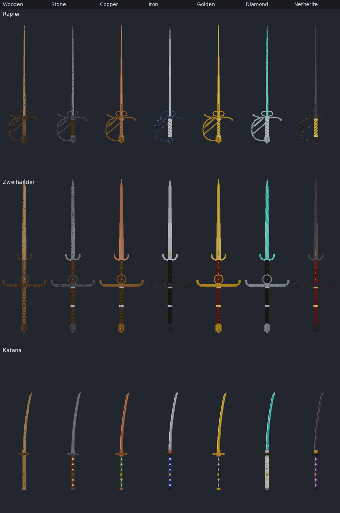
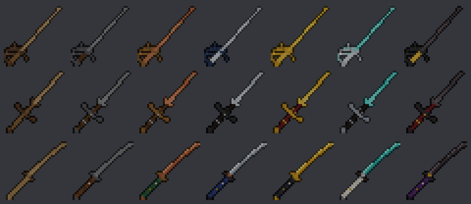
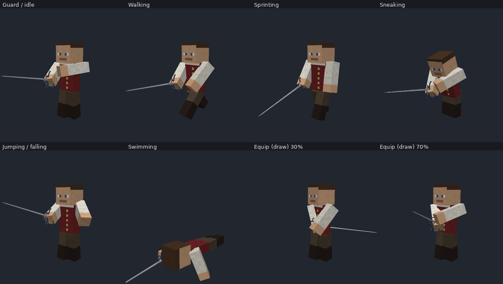
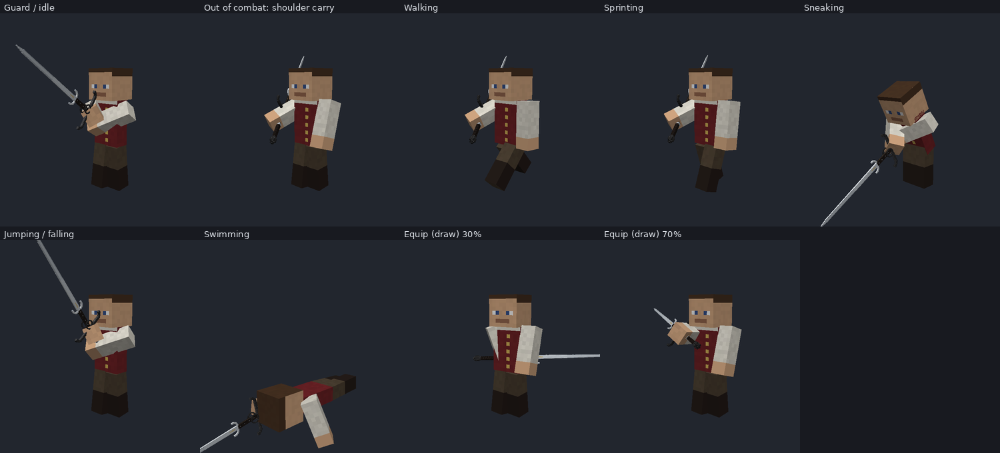
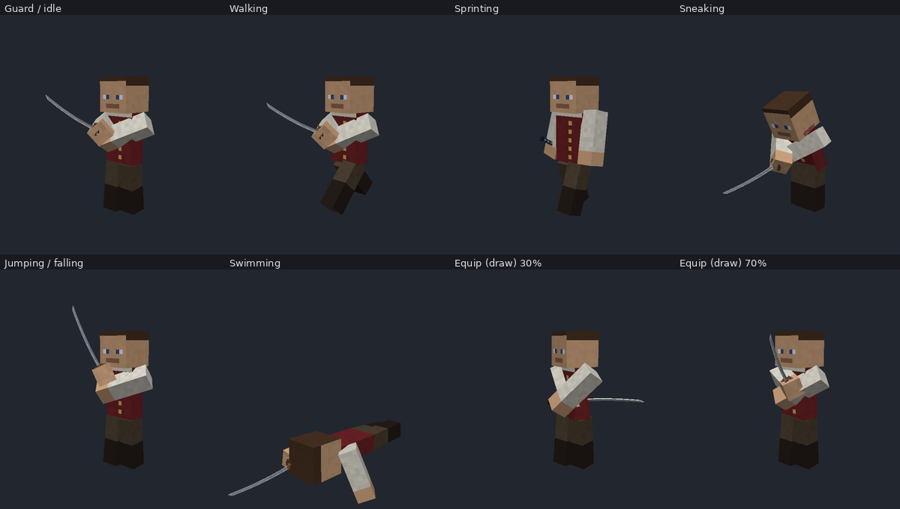
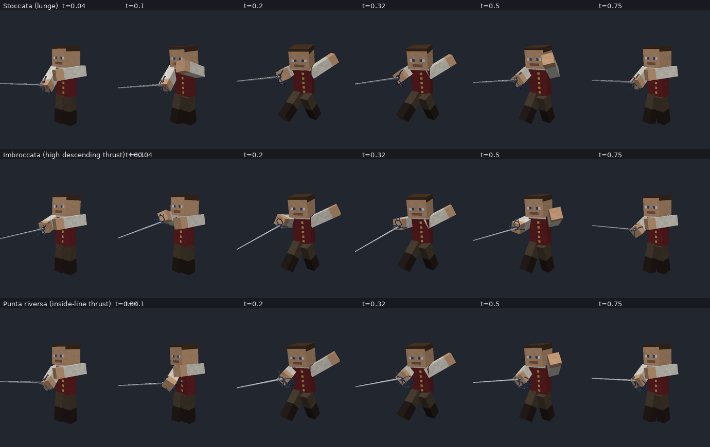
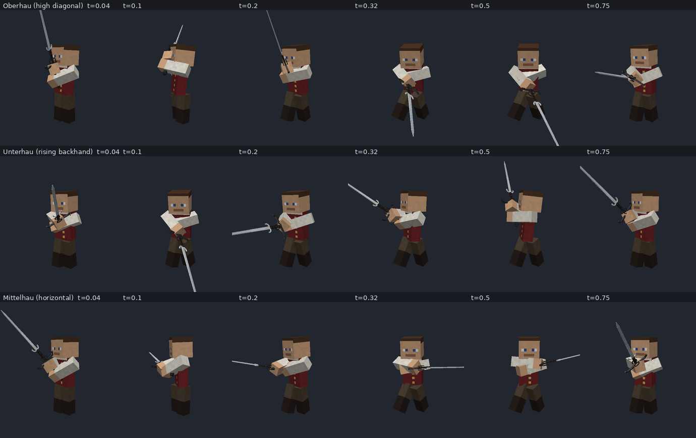
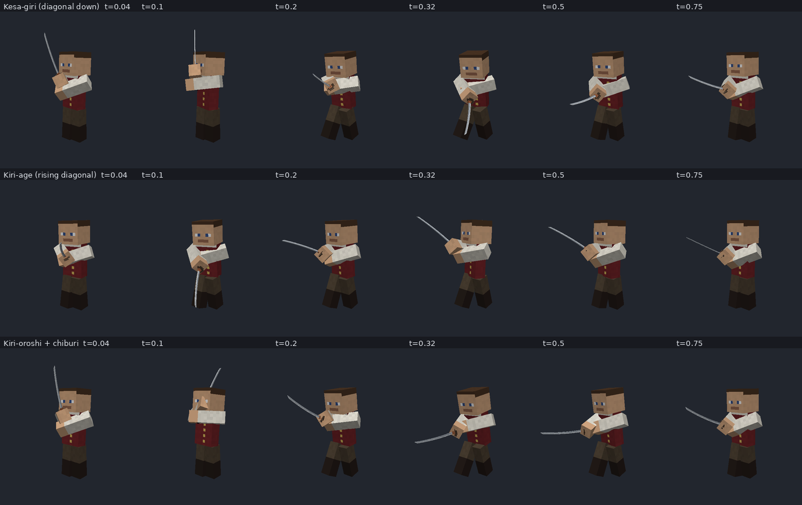

# Real-World Weapons — Base Release 01

A Minecraft **Bedrock Edition** add-on with three historically researched swords, each made in the
seven Minecraft materials. That gives 21 items:

| # | Weapon | Historical model | How it fights |
|---|---|---|---|
| 001 | **Rapier** | European swept-hilt rapier, c. 1580–1640 (Wallace Collection, V&A, Met, Cleveland specimens; Capoferro and Fabris) | Fast, precise, thrust-oriented. Longer reach, bonus at long measure |
| 002 | **Zweihänder** | German / Swiss two-handed sword, c. 1500–1600 (Cleveland 1919.70, Wallace A472, Royal Armouries IX.991) | Slow, long-reaching, powerful two-handed cuts that sweep several enemies |
| 003 | **Katana** | Edo-period katana in koshirae, 1603–1868 (Met, Fitzwilliam, Tokyo National Museum blades) | Balanced, fluid two-handed cuts. Draw-cut (iai) bonus |

Every model, texture, icon and animation is made for its own weapon; nothing reuses the vanilla sword.



## Install

1. Get [`dist/Real_World_Weapons.mcaddon`](dist/Real_World_Weapons.mcaddon).
   * **Windows:** double-click it.
   * **iOS / iPadOS:** save it to Files, then open it with *Share → Minecraft*.
   * **Android:** open it with Minecraft from a file manager.
2. Create or edit a world. Under **Behavior Packs**, activate **Real-World Weapons**. Its resource pack
   is added automatically as a dependency.
3. **No experiments are needed.** The add-on uses only stable item components and the stable
   `@minecraft/server` 2.11.0 script module.

**Requirements:** Minecraft Bedrock **26.60** or newer (`min_engine_version` 1.26.60) on any platform.

**Getting the items:**
* **Survival:** craft them (see [Crafting](#crafting)).
* **Creative:** *Equipment* tab, in three groups: Rapiers, Zweihänder, Katanas.
* **Commands** (cheats on): e.g. `/give @s rww:iron_katana`.

## Weapons and stats

* **Damage per hit** is the total damage, including the player's base 1.
* **Attack cooldown** is functional (`minecraft:cooldown`, `type: "attack"`): attacks are blocked
  until it ends, and it is shown on the hotbar. The visual swing (`minecraft:swing_duration`) and all
  attack animations last exactly as long.
* **DPS** compares single-target damage per second with the vanilla Bedrock sword of the same tier.
  The vanilla sword is limited to two hits per second by the 0.5 s hurt immunity. The special rules
  below are not included.

**Rapier**

| Item | Identifier | Damage per hit | Durability | Enchantability | Attack cooldown | Reach (survival / creative) | DPS vs sword |
|---|---|---:|---:|---:|---:|---|---:|
| Wooden Rapier | `rww:wooden_rapier` | 5 | 54 | 15 | 0.55 s | 3.6 / 6.0 blocks | 0.91× |
| Stone Rapier | `rww:stone_rapier` | 6 | 119 | 5 | 0.55 s | 3.6 / 6.0 blocks | 0.91× |
| Copper Rapier | `rww:copper_rapier` | 6 | 172 | 13 | 0.55 s | 3.6 / 6.0 blocks | 0.91× |
| Iron Rapier | `rww:iron_rapier` | 7 | 226 | 14 | 0.55 s | 3.6 / 6.0 blocks | 0.91× |
| Golden Rapier | `rww:golden_rapier` | 5 | 30 | 22 | 0.55 s | 3.6 / 6.0 blocks | 0.91× |
| Diamond Rapier | `rww:diamond_rapier` | 8 | 1406 | 10 | 0.55 s | 3.6 / 6.0 blocks | 0.91× |
| Netherite Rapier | `rww:netherite_rapier` | 9 | 1829 | 15 | 0.55 s | 3.6 / 6.0 blocks | 0.91× |

**Zweihänder**

| Item | Identifier | Damage per hit | Durability | Enchantability | Attack cooldown | Reach (survival / creative) | DPS vs sword |
|---|---|---:|---:|---:|---:|---|---:|
| Wooden Zweihänder | `rww:wooden_zweihander` | 10 | 75 | 15 | 1.00 s | 4.0 / 6.5 blocks | 1.00× |
| Stone Zweihänder | `rww:stone_zweihander` | 12 | 165 | 5 | 1.00 s | 4.0 / 6.5 blocks | 1.00× |
| Copper Zweihänder | `rww:copper_zweihander` | 12 | 239 | 13 | 1.00 s | 4.0 / 6.5 blocks | 1.00× |
| Iron Zweihänder | `rww:iron_zweihander` | 14 | 314 | 14 | 1.00 s | 4.0 / 6.5 blocks | 1.00× |
| Golden Zweihänder | `rww:golden_zweihander` | 10 | 41 | 22 | 1.00 s | 4.0 / 6.5 blocks | 1.00× |
| Diamond Zweihänder | `rww:diamond_zweihander` | 16 | 1952 | 10 | 1.00 s | 4.0 / 6.5 blocks | 1.00× |
| Netherite Zweihänder | `rww:netherite_zweihander` | 18 | 2540 | 15 | 1.00 s | 4.0 / 6.5 blocks | 1.00× |

**Katana**

| Item | Identifier | Damage per hit | Durability | Enchantability | Attack cooldown | Reach | DPS vs sword |
|---|---|---:|---:|---:|---:|---|---:|
| Wooden Katana | `rww:wooden_katana` | 7 | 60 | 15 | 0.70 s | vanilla | 1.00× |
| Stone Katana | `rww:stone_katana` | 8 | 132 | 5 | 0.70 s | vanilla | 0.95× |
| Copper Katana | `rww:copper_katana` | 8 | 191 | 13 | 0.70 s | vanilla | 0.95× |
| Iron Katana | `rww:iron_katana` | 10 | 251 | 14 | 0.70 s | vanilla | 1.02× |
| Golden Katana | `rww:golden_katana` | 7 | 33 | 22 | 0.70 s | vanilla | 1.00× |
| Diamond Katana | `rww:diamond_katana` | 11 | 1562 | 10 | 0.70 s | vanilla | 0.98× |
| Netherite Katana | `rww:netherite_katana` | 13 | 2032 | 15 | 0.70 s | vanilla | 1.03× |

All the numbers come from one table, [`tools/rww/stats.py`](tools/rww/stats.py):

* **Damage:** the vanilla sword's damage × 1 (rapier), × 2 (Zweihänder) or × 1.4 (katana).
* **Durability:** × 0.9, × 1.25 or × 1.
* **Enchantability:** the vanilla value of the tier.

Netherite items do not burn in lava or fire. Wooden items work as furnace fuel. All of them take
sword enchantments at the enchanting table and anvil.



### Special rules (script)

| Weapon | Rule |
|---|---|
| Rapier | **Stoccata at long measure:** +25 % damage when the target stands ≥ 2.5 blocks away. Critical particles show it |
| Katana | **Iai draw-cut:** the first hit within 1 s of drawing the katana does +50 %. It recharges 4 s after use. Blue particles show it |
| Zweihänder | **Sweep:** a hit also deals 50 % damage and knock-back to other mobs within 3.6 blocks and ±60° of the view. The sweep spares villagers, wandering traders, golems, allays, armor stands, tamed animals, and players unless the `pvp` game rule is on |
| Zweihänder | **Weight:** extra knock-back on the main target. Drawing it starts the 1 s cooldown (hefting) |
| All | A thrust or cut through several mobs costs 1 durability point, not one per mob |

The rapier and Zweihänder use Mojang's `minecraft:piercing_weapon` (the spear component) for their
reach. It hits every entity on the line of sight, so these two weapons **cannot mine blocks**. The
katana uses normal targeting and can still break blocks.

## Crafting

`M` is the tier material and `S` a stick.

| Tier | Material (`M`) |
|---|---|
| Wooden | any planks |
| Stone | the stones of the vanilla stone sword: cobblestone, blackstone or cobbled deepslate (`minecraft:stone_tool_materials`) |
| Copper / Iron / Golden / Diamond | copper ingot / iron ingot / gold ingot / diamond |
| Netherite | smithing table: Netherite Upgrade template + the **diamond** weapon + netherite ingot |

```
Rapier          Zweihänder      Katana
. . M           . M .           . M
. M .           . M .           . M
S . .           M S M           S .
```

* **Recycling:** smelt copper, iron or golden weapons in a furnace or blast furnace for one nugget.
* **Repair:** use the tier material in an anvil (+25 %), or combine two weapons of the same kind.
* **Recipe unlocks:** recipes unlock in the recipe book when you pick up the material.

## Animations

The player's own arms, torso and legs are animated for each weapon. Each weapon has:

* its own guard, walk, sprint, sneak, jump / fall, landing dip and swim poses;
* an equip draw;
* **three attacks** that cycle on consecutive swings, each with a recovery;
* a first-person version.

Every pose blends smoothly into the next.

| | Rapier | Zweihänder | Katana |
|---|---|---|---|
| Guard | *Terza*, point forward, left hand raised before the chest (Capoferro) | Two-handed guard; shoulder carry when out of combat (4 s) or sprinting | *Chūdan-no-kamae* |
| Sneak | Crouched terza | Low guard (*Alber*) | *Gedan* |
| Draw | From the left hip | Lifted from point-down at the right side | From the left hip, edge up, into chūdan |
| Attack 1 | *Stoccata*, lunging thrust with a forward step | *Oberhau*, high diagonal cut | *Kesa-giri*, diagonal down |
| Attack 2 | *Imbroccata*, descending thrust from a high hand | *Unterhau*, rising backhand cut | *Kiri-age*, rising diagonal |
| Attack 3 | *Punta riversa*, inside-line thrust | *Mittelhau*, horizontal cut | *Kiri-oroshi*, vertical cut + *chiburi* |

* **Two-handed grips.** Minecraft arms have no elbows, so both hands are placed on the grip with
  inverse kinematics. In every sampled stance and attack frame, the left hand stays within 0.41 units
  of the grip; a Minecraft fist is 4 units wide.
* **Timing.** Attacks follow the engine's own attack timer, so animation and cooldown cannot drift
  apart.
* **First person.** The vanilla swing is replaced by weapon-specific thrusts and cuts, with the hilt
  in the lower right.

| Stances (iron tier) | |
|---|---|
|  |  |
|  |  |
|  |  |

First person: [rapier](docs/images/first_person_rapier.png) ·
[Zweihänder](docs/images/first_person_zweihander.png) · [katana](docs/images/first_person_katana.png) ·
[hilt close-ups](docs/images/hilts.png).

*These images come from the offline renderer, which emulates Bedrock's transforms; they are not
in-game screenshots (see [Limitations](#limitations)).*

## Controls

There is nothing new to learn, and the default touch controls work as is.

* **Draw:** select the weapon in the hotbar.
* **Attack:** left click, controller trigger, or tap / attack button on touch screens.
* **Cooldown:** the hotbar shows when the next attack is ready.

## Compatibility

* **No vanilla file is overridden.** That includes `player.entity.json`, player animations and render
  controllers. The poses run as runtime animations started by the script, so the pack works next to
  other add-ons that edit the player, such as [Tribes of the Cosmos](../tribes-addon) in this
  repository.
* **Unique namespace:** all identifiers use the `rww:` namespace and fresh pack UUIDs.
* **Multiplayer:** poses are sent to every player within 48 blocks, including players who join or
  come back into range later.
* **Mobs** holding these weapons render them with the same model.

## Limitations

Full list: [technical design §4](docs/technical_design.md#4-limitations).

* **Not tested in game.** This build environment has no Minecraft client. Running the Bedrock Dedicated
  Server requires accepting the Minecraft EULA, which is the owner's decision. Please run the
  checklist in the [testing report](docs/testing_report.md#not-tested-here-please-verify-in-game).
* **Touch taps.** How a *classic* touch tap on an off-centre mob resolves for piercing weapons is
  unverified (checklist M3). The crosshair touch layout aims exactly like a mouse.
* **Stiff arms.** Two-handed grips keep the hands at chest height.
* **Off-hand items.** A shield or torch stays visible in the off hand while a two-hander is held.
* **Pose start.** The pose begins about 2 ticks, plus network latency, after drawing.
* **Hilt scale.** Grips and guards are enlarged to fit the 4 × 4 Minecraft fist (documented per weapon).

## Historical basis

* [`docs/historical_references.md`](docs/historical_references.md) gives, for each weapon, the museum
  specimens and their measurements, and how each part of the model maps to the evidence. It marks
  what is **evidence** and what is a **Minecraft adaptation**.
* [`docs/research/historical_dossier.md`](docs/research/historical_dossier.md) holds the full research
  notes, with about 190 cited sources.

The scale is 1 model unit = 5 cm, from Capoferro's rapier "twice the length of the arm". Only the
**iron** tier reproduces a historical finish. **Wooden** follows training practice (bokken, wasters).
**Diamond and netherite are gameplay adaptations.**

## Project structure

```
real-world-weapons/
├── dist/                  Real_World_Weapons.mcaddon (+ the two .mcpack files)
├── src/                   gameplay script (TypeScript → BP/scripts/main.js)
│   ├── main.ts            event wiring, custom component rww:weapon
│   ├── combat.ts          rapier / katana / Zweihänder rules
│   ├── animation.ts       starts, re-sends and stops the player poses
│   └── weapons.ts         item parameters and rule constants
├── tools/
│   ├── build.py           generates both packs and the .mcaddon (deterministic)
│   ├── validate.py        static validation (2,762 checks)
│   ├── previews.py        renders docs/images
│   ├── smoke/             runtime test of the compiled script against a strict API mock
│   ├── vanilla_refs.json  vanilla identifiers the packs rely on (names only)
│   └── rww/               models, materials, icons, IK + animation authoring, Molang evaluator, renderer
└── docs/                  historical references, technical design, testing report, images
```

The packs are generated: edit the sources in `tools/rww` and `src`, never the files in `build/`.

## Build and test

Requirements: Python 3.10+ with NumPy and Pillow; Node.js 18+.

```
npm install                 # TypeScript + official @minecraft/server 2.11.0 typings
npm test                    # typecheck → build → validate → smoke test
python3 tools/previews.py   # optional: re-render docs/images
```

`npm test` writes `build/RWW_BP`, `build/RWW_RP` and `dist/*.mcpack` / `.mcaddon`. Results of this
build are in the [testing report](docs/testing_report.md).

## Sources for the platform facts

* Mojang [bedrock-samples](https://github.com/Mojang/bedrock-samples) `v1.26.60.5`: vanilla items,
  spears, player entity, render controllers, JSON schemas and script-module metadata.
* Microsoft Learn: [Minecraft Bedrock creator documentation](https://learn.microsoft.com/minecraft/creator/)
  (item components, `@minecraft/server` API).
* npm: [`@minecraft/server`](https://www.npmjs.com/package/@minecraft/server) dist-tags (2.11.0 stable).
* [Bedrock Wiki](https://wiki.bedrock.dev/) (item format history, `playanimation`).
* [Blockbench](https://github.com/JannisX11/blockbench) Bedrock codec (geometry and animation conventions).
* [Minecraft Creator Tools](https://github.com/Mojang/minecraft-creator-tools) (validation).
* Minecraft Wiki: Bedrock sword values, hurt immunity, release changelogs.

The historical sources are listed in the two historical documents above.
