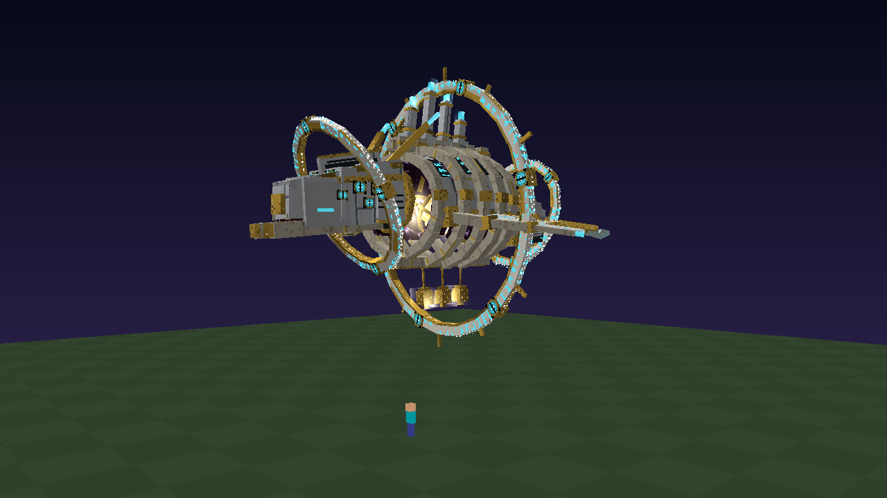
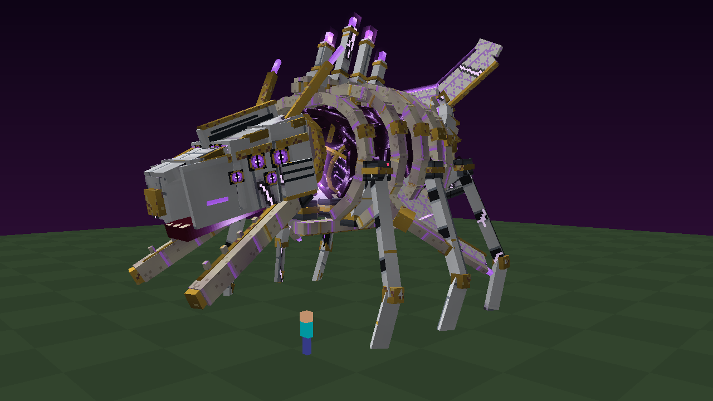
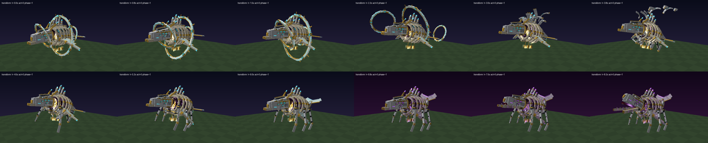
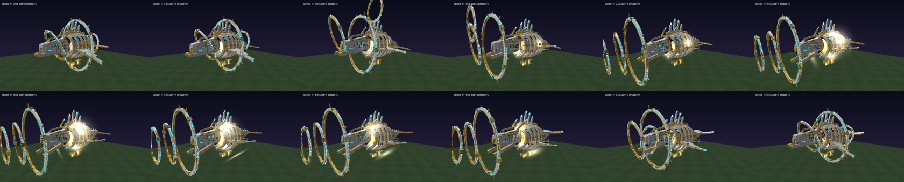
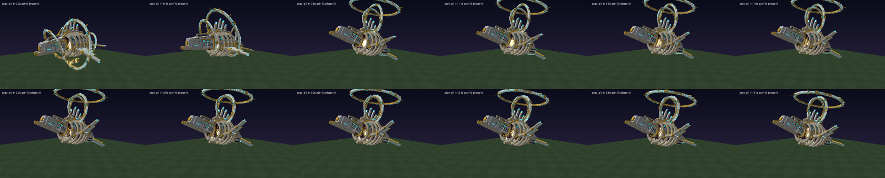
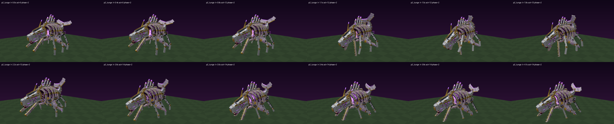
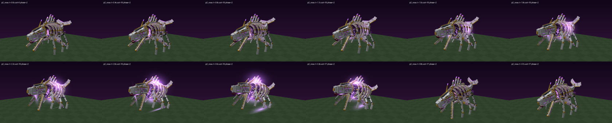
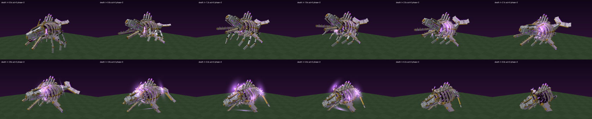
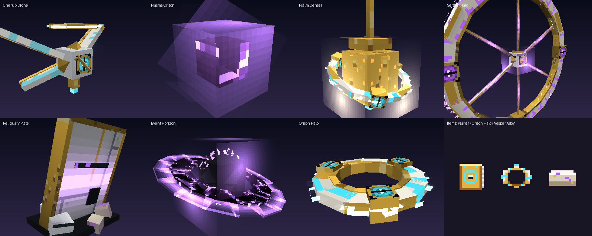

# SCI-FI ANIME BOSSES — Boss 001: **VESPER-0, The Ship That Learned to Pray**

A flagship boss encounter for **Minecraft Bedrock Edition 1.26.60+** (current stable, 1.26.65).
Script API **`@minecraft/server` 2.11.0** (latest stable) — **no experimental toggles required**.

**Install:** open [`dist/SciFi_Anime_Bosses_VESPER-0.mcaddon`](dist/SciFi_Anime_Bosses_VESPER-0.mcaddon)
(separate `_BP.mcpack` / `_RP.mcpack` are next to it), enable the behavior pack on a world.
**Updating from 1.0.0:** import the new file (version 1.0.1 replaces the old one); if an existing world still behaves
the old way, remove both packs from that world and add them again.



> An abandoned survey ark listened to dying stars for eleven thousand years until it heard hymns in the
> static. It grew a body from its specimen archives, wrapped its reactor into a private sun and became a
> pilgrim. Play the **Astral Psalter** and it answers.

---

## Playing the encounter

1. **Craft the Astral Psalter** — amethyst shards, copper ingots and an end crystal (`ACA / CEC / ACA`),
   or 3 Vesper Alloy + ender eye + amethyst shard after your first victory.
2. **Use it** (tap on a touch screen, right-click with a mouse, left trigger on a controller) in the Overworld under
   open sky. While you hold the Psalter, the bar above the hotbar says whether the hymn can be played where you stand
   (and if not, why). An 8-second hymn ritual (pillar of light,
   rising glyphs) ends with VESPER-0 descending from the sky. The Psalter is consumed only when VESPER-0 actually
   arrives: a hymn that fizzles (the summoner leaves, the site unloads) costs nothing. Refused (item kept) in other
   dimensions, under a roof, in Peaceful, or when a VESPER-0 is already nearby.
3. Fight it in **Survival or Adventure**: VESPER-0 ignores players in Creative or Spectator mode (it says so in chat).
   If nobody can be fought for 30 s, VESPER-0 departs and the Psalter is returned.

| Phase | Ability | Telegraph | Counterplay |
|---|---|---|---|
| **I — The Sacred Vessel** | **Litany Lance** — the three rings swing into a cannon barrel before the prow; a sweeping reactor beam, burning, leaves scorched ground | red sweep line on the ground for 1.6 s, rising whine | strafe out of the line, or break line of sight — blocks stop the beam |
| | **Halo Rite** — rings drop beneath the hull and fall as expanding shockwaves | deep bell = **low** ring (jump it), high chime = **high** ring (stay grounded); colour-coded | jump-rope timing |
| | **Event Horizon** — singularity at your predicted position: pulls players, mobs and items, crushes the centre, implodes | violet ring + inward spiral for 2.5 s, sub-bass | run outward early |
| | **Choir of Satellites** — cherub drones fire slow homing plasma | drone glows + whine before each shot | kill drones (16 HP), dodge, or **parry** an orb with a melee hit/arrow — it turns gold and flies back into the heart (30 damage) |
| | **Genuflection** — kneels and vents: **heart exposed ×1.75** | plates open; vents flare orange 1.5 s before a vent burst | punish, then back off |
| 75 % | **Vespers** — shielded prayer; censers drift into the arena (20 s) | title + countdown bar + chant, hymn pulses | shatter every censer → it **crashes, stunned, heart ×2.0**. Fail → **Benediction** (armour-piercing radiant blast; cover blocks it) and it heals per surviving censer |
| 50 % | **The False Ascension** — 9 s cinematic: rings tumble away and become **Seraph Halos**, armour plates blow off and crash into the arena as **cover**, six limbs unfold, the sun collapses into a black sun, the jaw splits | camera shots (optional), titles, debris impact rings | stay out of the red impact circles |
| **II — The False Ascension** | **Predator Lunge** — coils, locks a path, dashes; then **anchored** with heart exposed | magenta path line, turns red when locked; roar | sidestep, then punish |
| | **Reaping Talons** — limbs strike your predicted positions in sequence | crack circles 0.9 s before each strike | keep moving |
| | **Black Sun Nova** — strikes everyone with line of sight to the core | 3 s swelling, title *"break line of sight"*, screen shake | hide behind the fallen plates (each survives 3 novas) or any blocks; Blast Protection helps |
| | **Seraph Halos** — three autonomous rings: a rolling judgement wheel, a shin-height saw (jump it), a hunting chakram | glow + whine + path line | break a ring (40 HP) → dormant 20 s; break **all three** → VESPER-0 is **Unhaloed** (stagger, heart exposed) |
| | **Twin Event Horizons**, **Roar** shockwave | as above | |
| 25 % | **Requiem** — harder prayer (16 s, 4 censers, orbited by the Seraphs) | | same as Vespers |
| < 12 % | **Enrage** — faster cooldowns and rings | | |
| 0 % | **Death** — 8 s collapse, reactor implosion, white-out | | |

**Rewards** (each participant, up to the top 8 damage dealers, delivered straight into your inventory): the
**Orison Halo** (guaranteed on your first victory, 25 % after), 8–12 **Vesper Alloy**, plus 1500 XP at the crash site
and the **Dying Star** — 30 s of Regeneration II near the wreck.
The **Orison Halo** is a sword-class chakram (9 damage, enchantable, repairable with Vesper Alloy):
*use* throws a piercing halo that flies 16 blocks and returns (8 damage each way, 2.5 s cooldown, 2 durability).

Damage taken by VESPER-0: hull ×0.35 (Phase I ceramic armour) / ×0.7 (Phase II flesh), heart ×1.75–2.0 when exposed,
explosions ×0.5, 60 per hit max, scaled for group size `1/(1+0.5·(n−1))`. 1200 HP. Each weak-point window has a
**stagger cap** (Genuflection 8 %, prayer stun 12 %, Anchored 5 %, Unhaloed 8 % of max health): once the heart has
absorbed it, it seals early, so a strong group can't burn a whole segment in one window, while a small group still
gets the full window. Easy ×0.7 / Hard ×1.3 boss damage.
Every player's hits count (per-attacker invulnerability frames, pooled application) — groups are not penalised.

Commands (operators): `/sab:vesper summon|despawn|status` (cheats), `/sab:vesper_cinematics on|off`.



## What was built

| | |
|---|---|
| **Boss model** | ~25.5 × 16.5 blocks, **90 bones / 668 cubes** + 78 additive-glow cubes + energy-shield pass, three render passes sharing one skeleton |
| **Helpers** | Cherub drone, plasma orb, censer, Seraph halo (3 variants), reliquary plate, singularity, Litany Lance beam, thrown Orison Halo, invisible proxy hitboxes |
| **Textures** | trim-sheet atlas 512×256 in a Phase I and a cracked/corrupted Phase II variant (alpha = emissive mask for `entity_emissive`), 128² glow atlases, hex shield, 128² particle atlas — **1.28 MB total**; helpers reuse the boss atlas |
| **Animation** | **31 boss animations** (base layer, idles, P2 pose, 20 actions, 9 s transformation, 8 s death, ambient FX) + 9 helper animations; **2 controllers / 24 states** driven by synced entity properties; client-side smoothing of heading/pitch/bank and head tracking |
| **VFX** | **55 particle effects**; telegraphs are single emitters parameterised from script (`MolangVariableMap`: radius, length, life, colour) |
| **Audio** | **36 original sound effects + 2 looping music tracks** (Phase I hymn 64 s, Phase II 40 s), all synthesised from scratch (formant choir, inharmonic bells, FM metal, filtered noise, convolution reverb) |
| **Gameplay** | ~3,900 lines of TypeScript: AI scheduler with weighted, context-aware choices, velocity steering, terrain following, threat targeting, phase thresholds, prayer/transform/death sequences, persistence across reloads, rewards, weapon, ritual, commands |

| Animation sequences (rendered from the shipped animation data through a client simulator) | |
|---|---|
|  |  |
|  |  |
|  |  |

Animated: [transformation](docs/images/transform.gif) · [Litany Lance](docs/images/lance.gif) · [Predator Lunge](docs/images/p2_lunge.gif)



## Technical notes

* **Research basis:** typings of `@minecraft/server` 2.11.0, Microsoft Learn docs (MicrosoftDocs/minecraft-creator),
  Mojang/bedrock-samples 1.26.60.5 (vanilla entities, render controllers, animations, particles, sound definitions,
  fogs), Bedrock JSON schemas bundled with Microsoft's Minecraft Creator Tools 0.21.0.
* **Rotation conventions** were derived from vanilla data (the Ender Dragon's neck chain formulas): bone rotation is
  `Rz(−rz)·Ry(ry)·Rx(−rx)`, `+ry` turns toward the entity's right. The preview renderer implements the same maths.
* **Heading** is sent as a synced property and applied to the root bone as `heading − body_y_rotation`, smoothed
  per frame — correct whether or not the engine also rotates the body. Pitch/bank and head-look follow the same pattern.
* **Weak points / long body:** proxy hitbox entities (prow, stern, heart; plus the limbs in Phase II, which step aside
  while the heart is exposed) follow the body every tick and forward hits.
  While the heart is exposed the hull's collision group shrinks so the heart becomes the target.
* **Damage** is intercepted in `world.beforeEvents.entityHurt`, scaled, clamped at phase thresholds (no skipping a
  prayer or the transformation) and pooled; the scripted death replaces vanilla death (no 90° death flip).
* **Mobile budget:** one boss draws ~750 cubes in three passes; textures 1.28 MB; particle spawns are budgeted
  (48 emitters/tick globally), helper count is bounded, property updates are change-only and quantised.
* **Format versions** match what vanilla 1.26.60 itself ships (entities 1.26.50, client entities 1.10.0,
  recipes 1.20.10, items 1.21.90 for custom components V2).

## Testing

| Check | Result |
|---|---|
| TypeScript `strict` typecheck against the official 2.11.0 typings | **pass** |
| JSON-schema validation of every pack file (Creator Tools' Bedrock schemas) | **110 files, 0 errors** |
| Cross-reference validation (`tools/validate.py`): bones/locators used by animations, part visibility, materials, textures, Molang syntax + allowed queries + synced properties, particles, sounds, lang keys, item icons, manifests, every `sab:*` id and sound in the compiled JS | **12,612 checks, 0 errors** |
| Microsoft **Minecraft Creator Tools 0.21.0** validation | **0 errors, 0 warnings** (3 known false positives about `item_texture.json`; format-version recommendations intentionally left at vanilla's values) |
| Runtime simulation (`tools/smoke`): compiled scripts on a strict mock of `@minecraft/server` that rejects unknown ids, out-of-range/unsynced properties, unknown entity events, particle variables the effect never reads, bad camera/fog/music ids | **77/77 checks in 5 scenarios** |

The simulation runs a complete fight with two bot players (melee + archer): ritual → arrival → Phase I → Vespers
(broken) → transformation → Phase II → Requiem (completed → False Benediction) → death → rewards, then verifies every
ability, title, helper, reward, XP amount, music/fog/camera use and that no helper entity leaks. Further scenarios
cover a 3-minute Phase I rotation (every ability incl. the vent burst), world reload mid-fight (including a save taken
mid-transformation, orphan cleanup, cover plates re-adopted and stray halos removed, and an unattended boss
departing with a Psalter refund), a threshold-integrity
stress test (eight players landing simultaneous capped hits every tick: the 75 % prayer, transformation and Requiem
must start at exactly 900 / 600 / 300 HP, in order; the pre-fix code failed it), and summon rules (including a ritual
that fizzles without costing the Psalter), the Orison Halo (damage, cooldown, durability, return) and the commands. With never-dodging, never-missing bots the fight
lasts ~3.5 min (≈1.6 min per phase, every ability seen in each phase); real players should expect roughly 5–8 minutes.

### Not tested in-game — please verify

No Minecraft client was available here. Running a Bedrock Dedicated Server through Creator Tools requires accepting the
Minecraft EULA, which I did not do on your behalf (and this environment's network policy blocks direct server
downloads). These items depend on engine behaviour I could only derive from documentation and vanilla data:

* rendering of `entity_emissive` (alpha-as-glow), `entity_beam_additive` glow passes and the `charged_creeper` shield;
* sign of the root-bone heading compensation (derived from vanilla; if VESPER-0 ever faces away from its target, flip it in `tools/vesper_anims.py`);
* feel of velocity steering on a no-gravity mob (an automatic teleport fallback engages if impulses don't move it),
  the gravity-well pull strength, knockback values and the camera cinematic easing;
* the large proxy hitboxes and the boss bar range; performance on low-end phones (budgets are conservative);
* using the Psalter and the Orison Halo with touch controls (both are plain "use" actions, which the Script API
  documents as firing for any use by a player).

## Build from source

```bash
cd scifi-anime-bosses
npm install            # @minecraft/server 2.11.0 typings + TypeScript
npm test               # typecheck -> build -> validate -> runtime simulation
python3 tools/docs_images.py --gifs   # documentation renders
```
Requires Python 3 (numpy, Pillow, jsonschema), Node 18+, and ffmpeg with libvorbis (audio is synthesised once and cached).
`tools/` contains the procedural modelling kit (`geo.py`), textures (`tex.py`), renderer (`render.py`), Molang
parser (`molang.py`), animation authoring + client simulator (`anim.py`, `client_sim.py`), the boss and helper
models/animations, VFX, audio synthesis, pack content, build, validator and the simulation in `tools/smoke/`.
