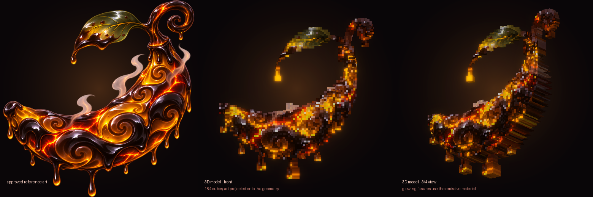
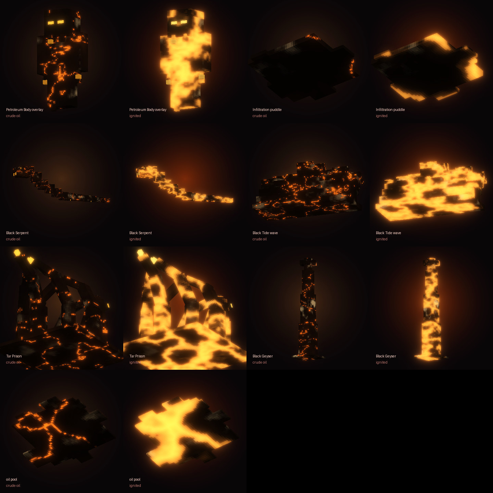

# Sekiyu Sekiyu no Mi — Petroleum (Minecraft Bedrock add-on)

An original, fan-made **Logia** Devil Fruit: *Sekiyu Sekiyu no Mi* (石油石油の実), the Petroleum-Petroleum Fruit.
Eat it and your body becomes crude oil. You generate petroleum without limit (there is **no oil gauge**),
shape it into waves, geysers, prisons and a giant serpent, flow through attacks, seep through gaps — and set it all on fire.

**Install file:** [`dist/Sekiyu_Sekiyu_no_Mi_Petroleum.mcaddon`](dist/Sekiyu_Sekiyu_no_Mi_Petroleum.mcaddon)
(separate `_BP.mcpack` / `_RP.mcpack` next to it)

| | |
|---|---|
| Game version | Bedrock **1.26.60** or newer (iPhone / iPad / Android / Windows) |
| Script API | `@minecraft/server` **2.11.0**, `@minecraft/server-ui` **2.3.0** (latest stable) |
| Experiments | **None** — stable APIs only |



---

## Install on iPhone / iPad

1. Download `Sekiyu_Sekiyu_no_Mi_Petroleum.mcaddon` (GitHub: open the file → **Download raw file**) and save it to **Files**.
2. In **Files**, tap it (or **Share → Minecraft**). Minecraft shows *Import started… / Successfully imported*.
3. Create or **Edit** a world → **Behavior Packs** → **Available** → activate **Sekiyu Sekiyu no Mi - Petroleum**
   (the resource pack follows automatically). No experimental toggles.
4. Get the fruit: **Creative inventory → Equipment** (search "Sekiyu"), or with cheats: `/give @s sekiyu:sekiyu_fruit`
5. Hold it and press & hold the screen to eat. You receive the **Crude Core**.

## Controls

Hold the **Crude Core** (`sekiyu:crude_core`). Everything works with touch; no commands needed.

| Input | Touch | Keyboard / controller | Action |
|---|---|---|---|
| **Use** | press & hold the screen (tapping a block also works) | right-click / LT | cast the selected ability |
| **Use again** while it is active | same | same | its follow-up: **IGNITE** (Tide, Geyser, Prison, Serpent), **AFTERBURN** (Oil Jet), **REFORM** (Body, Infiltration) |
| **Press Sneak** | tap the Sneak button | Shift | next ability (looking up = previous). Never casts. |
| **Sneak + Use** | while sneaking, Use | Shift + right-click | **Oil Console**: pick abilities (never casts), Logia transform / reform, HUD, guide, new core, PvP (ops) |

The HUD (action bar) shows your form, the Flow reflex, the selected ability, a live **`USE: IGNITE 2.4s`** prompt while a follow-up
is available, and all eight cooldowns (`TID BDY GEY TAR JET SRP SEP INF`). Commands: `/sekiyu:core`, `/sekiyu:console`
(anyone); `/sekiyu:grant`, `/sekiyu:revoke`, `/sekiyu:reset` (operators, cheats on).

## The eight abilities

Heavy Crude, Light Crude and Ignited Oil are **not** modes — each ability uses them naturally, and the second **Use** is
almost always "ignite it".

| # | Ability | CD | Heavy crude | Light crude | Ignited oil |
|---|---|---|---|---|---|
| 1 | **Black Tide** | 12 s | 3D wave, 6 wide, rolls 18 blocks: 6 dmg, knockback, Slowness II, slicks behind it | the wave flows over terrain, breaks on walls | Use again (or roll it over burning oil): burning wave, +4 dmg, sets ablaze, ignites its slicks |
| 2 | **Petroleum Body** | 4 s | standing still: Resistance I | moving: Speed II, drips slicks | your melee blows flare (+3 dmg, fire). Use again = reform |
| 3 | **Black Geyser** | 10 s | 3 geysers (3D columns) where you aim (22 blocks): 8 dmg, big launch, Slowness, thick slick | the ground bubbles first (0.6 s warning) | Use again during or ≤3 s after: fire columns, 5 dmg + fire, burning field |
| 4 | **Tar Prison** | 14 s | 3D tar tendrils hold the target 4 s (pulled back if it slips), Slowness IV, suffocating damage | oil floods out into a slick | Use again: 7 dmg fire burst, the prison collapses in flames |
| 5 | **Oil Jet** | 2.5 s | — | one high-pressure impulse ≈ 8 blocks (ground or air, walls stop you, no fall damage), slick + trail | Use again ≤1.2 s: **afterburner** in your new direction — steering, scorching (4 dmg + fire) whatever you pass, ignites the slick |
| 6 | **Black Serpent** | 18 s | every 3rd bite it **coils** and holds its prey; tail-sweeps groups (5 dmg) | a 9-block 3D serpent races after your target for 10 s, bites 7 dmg + Slowness III | Use again: a burning serpent (+3 dmg & fire per bite, fiery collapse) |
| 7 | **Petroleum Infiltration** | 8 s | — | dissolve into a puddle (3D) for 3 s: Speed IV, invisible, physical hits pass through, **seep through 1-block-high gaps** | — (Use again = reform early) |
| 8 | **Black Inferno** (ultimate) | 75 s | 1.2 s eruption: ring of geysers, oil floods 12 blocks, pools everywhere | | then everything ignites: 14 dmg (falls to half at the edge), fire 6 s, burning pools 6 s, smoke-dark fog for nearby players 12 s |

**Oil everywhere:** every ability leaves temporary pools (3D slicks). Enemies in them are slowed; fire, lava, a burning
creature or a burning pool ignites them, and fire spreads along connected oil. Your own fire never burns you. Pools
evaporate after 12 s or burn away after 6 s; there are at most 24 in the world, and every construct is removed when it
ends, when you die or leave, and on world load. **Blocks are never changed.**

## Logia defence and weaknesses

| Damage | Petroleum Body / Infiltration | Human form |
|---|---|---|
| melee, projectiles, contact, falling blocks, anvils, ram, thorns, mace, stalactites, pistons | **passes through** (attacker gets oil-slowed) | **Flow**: one such hit passes through every 4 s |
| explosions | half damage | normal |
| fire, burning, lava, magma, campfires, lightning | **+60 %** (oil burns) | normal |
| falling | none | halved |
| magic, wither, poison, drowning, suffocation, void, freezing, sonic boom, starvation | **normal — not avoided** | normal |

* **Seawater-like weakness:** while submerged in water your powers are sealed (no abilities, no Logia defence,
  forced back to flesh, Weakness + Slowness).
* **Sea-forged weapons (seastone stand-in):** tridents (held or thrown), drowned and guardians hit you for real and
  break the oil form.
* **Death:** the power stays; your form, follow-ups and constructs end; the core is returned on respawn.
  Ownership and your selected ability persist across world reloads. A second fruit is refused and not consumed.



## How it is built

```
sekiyu-addon/
├─ dist/                       ← .mcaddon + .mcpack
├─ src/                        ← TypeScript (compiled into the BP)
│  ├─ config.ts                ← every balance number
│  ├─ main.ts casting.ts logia.ts pools.ts constructs.ts power.ts hud.ts ui.ts state.ts
│  ├─ abilities/               ← one file per ability
│  └─ core/                    ← vectors, task runner, FX ids, combat targeting
├─ tools/
│  ├─ build.py                 ← generates both packs, compiles, packages
│  ├─ fruit_model.py           ← the 3D fruit (art projected onto a swept, rounded crescent)
│  ├─ models.py / oilkit.py    ← all other 3D models + procedural oil / fire textures
│  ├─ art.py fruit_icon.py sounds.py
│  ├─ validate.py              ← 5,786 static checks
│  ├─ hold_sim.py render_preview.py preview.py
│  └─ smoke/                   ← strict @minecraft/server mock + scenario test
└─ docs/preview/               ← rendered from the pack's own files
```

* **3D fruit:** 184 cubes swept along the banana's traced centerline with a rounded cross-section; every texel is painted
  by projecting it onto the approved art, glowing fissures use `entity_emissive`. It is a real held item (attachable,
  geometry 1.16.0 bound to the hand) with first-/third-person poses, an eating motion and rising vapour; the inventory
  icon is a 128×128 sprite of the art. When eaten, the same model rises from the player and melts into oil.
* **Logia transformation:** a petroleum shell model built on the vanilla humanoid skeleton (so every player animation
  drives it) with dripping strands, glowing eyes, a melt-in animation and a burning variant; the skin underneath gets an
  oily overlay tint. Infiltration hides the player model and renders an animated puddle instead. Both are driven by
  client-synced player properties and work for every viewer.
* **Constructs:** wave, geysers, prison, serpent and pools are entities with their own models, animations (the serpent's
  10 segments slither; the wave's crest rolls; tendrils grow and writhe; geysers rise and collapse) and particle states
  (drips / flames) — scripts only move them and decide hits.

### Build it yourself
```bash
cd sekiyu-addon
npm install
npm test      # typecheck → build → validate → smoke test   (Python 3 + Pillow + numpy, ffmpeg)
python3 tools/preview.py
```

---

## Test results

| Check | Result |
|---|---|
| TypeScript `strict` typecheck against the official 2.11.0 / 2.3.0 typings | ✅ |
| **Minecraft Creator Tools 0.21.0** validator | ✅ **0 errors** (warnings: intentional `minecraft:player` override, menu icons used only from script, format-version recommendations) |
| `tools/validate.py` — **5,786 checks** | ✅ 0 errors: manifests/UUIDs, player overrides identical to vanilla except the additions, overlay skeleton = vanilla humanoid, all 9 geometries (UVs, bones, animated bones exist), attachable binding and hold poses, 6 construct entities BP↔RP (properties used by render controllers/animations exist), 29 particles (atlas, Molang, mobile budgets), sounds, fog, items, lang, textures, every id the scripts use, exactly 8 abilities, no fuel/ammo system |
| `tools/smoke/smoke.mjs` — **143 assertions** on the compiled scripts with a strict API mock (vanilla physics, water, blocks) | ✅ all pass |

The smoke test plays every ability the way a player does (select → Use → Use again): fruit/ownership/refund; controls
(Sneak steps, console only selects, cast guard); Tide width/damage/slow/push/slicks/ignition/wall; Body defence,
oil-coated attacker, fire +60 %, explosions half, Speed/Resistance, flare, trident break, reform; human Flow reflex and
recharge, halved fall; water sealing; Geyser aim/launch/slick/ignition/water refusal; Prison target rule, hold,
suffocation, ignition; Oil Jet distance (**7.96 blocks**), afterburner; Serpent hunting/bites/limit/ignition/collapse;
Infiltration defence, seep through a 1-high gap and **not** through a wall, auto-reform without lingering invisibility;
Inferno damage/falloff/range/protected villagers/burning field/self-immunity/fog on and off; pool slowing, fire spread,
lava ignition, budget, expiry; PvP rule; second player; death, respawn, rejoin; all tasks and constructs cleaned up;
peak 40 particle calls in one tick.

**Not tested in game.** There is no Minecraft client here, and the Creator Tools dedicated-server session needs the
Minecraft EULA accepted by you first (`npx -y @minecraft/creator-tools@0.21.0 eula`). Nothing above is an in-game
observation. Please check in game:

1. The oil-body overlay and puddle on your skin type (classic and character-creator skins); armour is not covered.
2. The held fruit's position (from a simulator of vanilla hand transforms) and the first-person eating motion.
3. Movement feel: Oil Jet assumes `applyKnockback` drives player velocity in blocks/tick (as in the Jōki add-on).
4. Whether a cancelled (Logia-dodged) hit still knocks you back on your platform.
5. The procedurally synthesized sounds were format-checked, not auditioned.

## Engine limitations and the alternatives used

* **True intangibility** isn't available: the Logia is a damage filter (`entityHurt` before-event) with the table above,
  not immunity to everything.
* **Player skin can't be recoloured / reshaped:** the oil body is an extra model rendered over the player (vanilla
  skeleton) plus an overlay tint; the dissolved form swaps the player model for a puddle model.
* **Narrow openings:** Bedrock players can't shrink their collision box safely, so a dissolved player who pushes into a
  1-block-high gap is moved through it to the first spot with room to stand (max 4 blocks), checking every block on the
  way — never through solid blocks or out of the world.
* **Mob vision** isn't editable; Infiltration uses vanilla Invisibility. **Seastone** doesn't exist in vanilla; tridents,
  drowned and guardians stand in for sea-forged weapons.
* The add-on overrides `minecraft:player` (BP + RP) and can conflict with other add-ons that do the same; the HUD uses the
  action bar.

*Original fan creation; all models, textures and sounds are generated by the scripts in `tools/` (the fruit is built from
the provided art). No copyrighted models, animations or game assets are used.*
