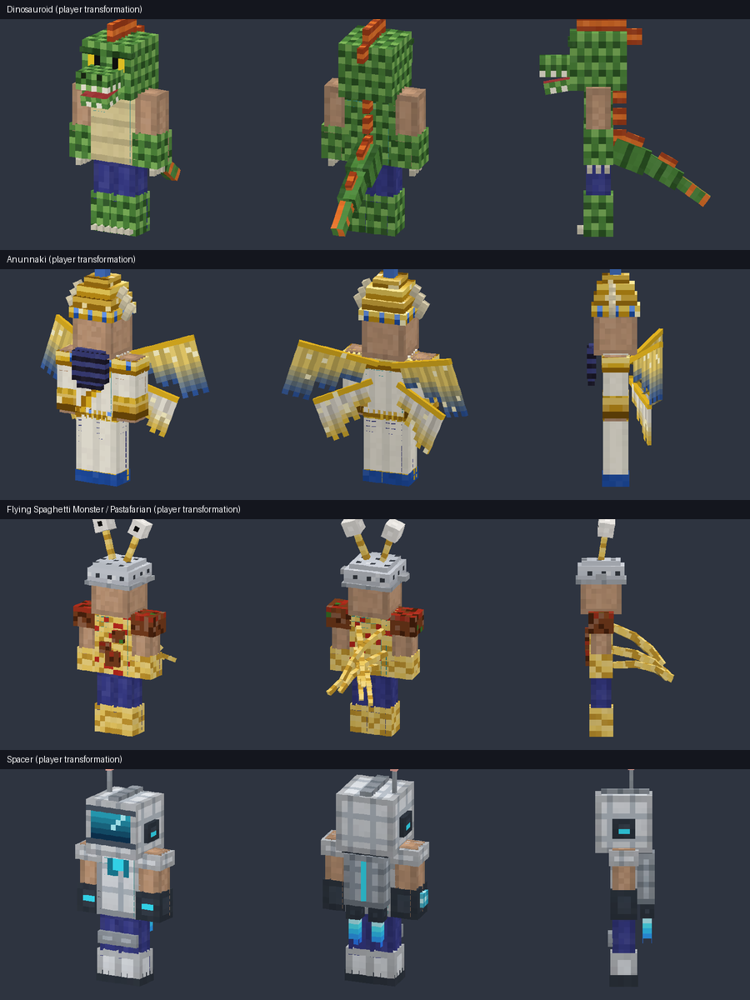
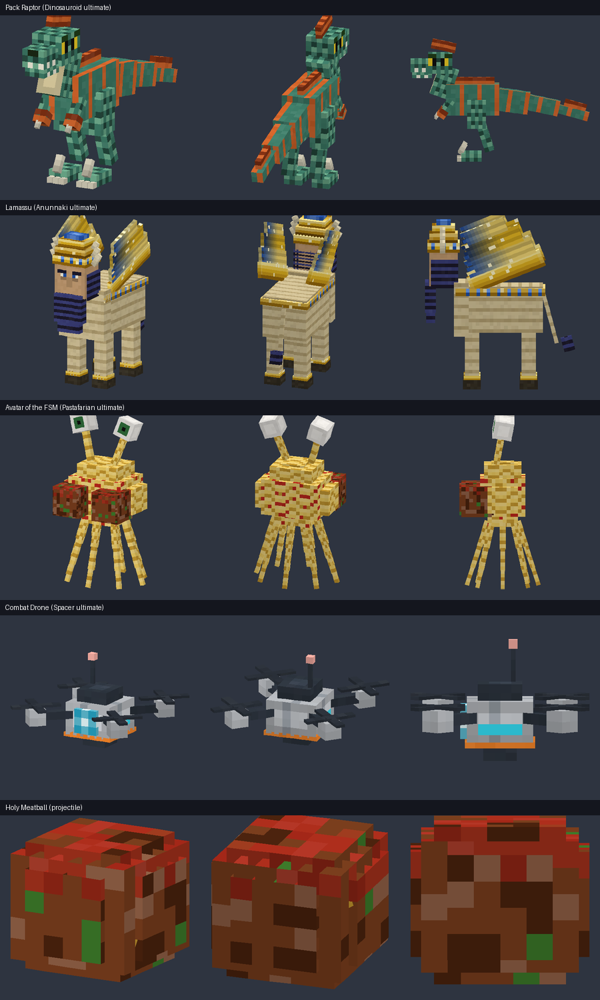

# Tribes of the Cosmos — Minecraft Bedrock Add-on

แอดออน Minecraft Bedrock ที่เพิ่ม **4 เผ่าที่ผู้เล่นเลือกเป็นได้** ได้แก่ Dinosauroid, Anunnaki,
Flying Spaghetti Monster และ Spacer เมื่อเลือกเผ่าแล้ว ร่างของผู้เล่นจะเปลี่ยนเป็นของเผ่านั้น
แต่ละเผ่ามีพลังติดตัว (passive) พลังงานของตัวเอง สกิล 3 อย่าง และท่าไม้ตาย (ultimate) ที่เรียกผู้พิทักษ์ซึ่งมีโมเดล 3D ของตัวเองออกมา

**ไฟล์สำหรับติดตั้ง:** [`dist/Tribes_of_the_Cosmos.mcaddon`](dist/Tribes_of_the_Cosmos.mcaddon)
(มีไฟล์ `.mcpack` แยก BP/RP ให้ด้วยในโฟลเดอร์เดียวกัน)

| | |
|---|---|
| เวอร์ชันเกมที่รองรับ | Bedrock **1.26.60** ขึ้นไป (`min_engine_version` 1.26.60) |
| Script API | `@minecraft/server` **2.11.0**, `@minecraft/server-ui` **2.3.0** (เวอร์ชัน stable ล่าสุดของ 1.26.60) |
| Experimental toggles | **ไม่ต้องเปิด** ใช้เฉพาะ API ที่เป็น stable |



---

## วิธีติดตั้งและเริ่มเล่น

1. เปิดไฟล์ `Tribes_of_the_Cosmos.mcaddon` บนเครื่องที่ติดตั้ง Minecraft ไว้ เกมจะนำเข้าแพ็กทั้งสอง (BP + RP) ให้เอง
2. สร้างโลกใหม่หรือแก้ไขโลกเดิม แล้วเปิด Behavior Pack **Tribes of the Cosmos** (Resource Pack จะถูกเปิดตามมาเอง)
3. เมื่อเข้าโลกครั้งแรก ผู้เล่นจะได้ **Tribal Codex** ถ้าทำหายให้พิมพ์ `/tribes:codex` หรือคราฟต์ใหม่จาก *หนังสือ + ไข่มุกเอนเดอร์*
4. ใช้ Codex เพื่ออ่านรายละเอียดของแต่ละเผ่าแล้วกด **Join** เพื่อเข้าร่วม จะได้รับ **วัตถุศักดิ์สิทธิ์ (Relic)** ของเผ่านั้น
5. ถือ Relic ไว้ในมือ
   * **ใช้ (คลิกขวา / แตะค้าง)** = ร่ายสกิลที่เลือกอยู่
   * **ย่อตัว + ใช้** = เปลี่ยนไปสกิลถัดไป
   * แถบ HUD ด้านล่างจอแสดงพลังงาน สกิลที่เลือก และเวลาคูลดาวน์

คำสั่งเพิ่มเติม: `/tribes:codex` (ทุกคนใช้ได้), `/tribes:settribe <เผ่า>` และ `/tribes:energy` (สองคำสั่งหลังต้องเปิดโกงและเป็นผู้ดูแล ใช้สำหรับทดสอบ)
ผู้ดูแลเปิดหรือปิดการให้สกิลทำร้ายผู้เล่นคนอื่น (PvP) ได้จากใน Codex

---

## การออกแบบทั้ง 4 เผ่า

ทุกเผ่ามี **โมเดลร่างแปลงของผู้เล่น** ซึ่งเรนเดอร์ทับสกินเดิมและขยับตามท่าทางทั้งหมดของผู้เล่น (เดิน ก้ม ตี ว่ายน้ำ)
เพราะโครงกระดูกของโมเดลจำลองโครงกระดูกของผู้เล่นใน vanilla ทุกจุด นอกจากนี้แต่ละเผ่ายังมีแอนิเมชันเฉพาะ
มี **พลังงาน** คนละแบบ และมี **ผู้พิทักษ์** ที่มีโมเดลกับแอนิเมชันของตัวเอง

### 🦖 Dinosauroid — "Heirs of the Cretaceous" (สีเขียว)
แนวคิด: นักล่าสายพันธุ์ troodont ที่รอดจากอุกกาบาตและวิวัฒน์เป็นมนุษย์กิ้งก่า (อิงทฤษฎี Dinosauroid ของ Dale Russell)
**รูปลักษณ์:** หัวเกล็ดที่มีตาสีเหลืองรูม่านตาเป็นขีดตั้ง ปากยื่นมีฟัน หงอนสีส้มบนหัวและแผ่นหลัง หางสามท่อนที่แกว่งตามจังหวะเดิน
เกล็ดบนแขนขา กรงเล็บที่มือ และเล็บเท้า
**พลังงาน: Primal Fury** ฟื้น 1.5/วินาที ได้เพิ่ม +4 เมื่อตีโดน และ +12 เมื่อสังหาร (ยิ่งสู้ยิ่งแรง)

| | ความสามารถ |
|---|---|
| Passive | Speed I + Jump Boost I ถาวร, Resistance I ถาวร, Strength I เมื่อยืนกลางแดด (เลือดเย็น), กินเนื้อดิบแล้วได้ Regen II โดยไม่ติด Hunger, **Predator Senses** เห็นกลิ่นสีเขียวเหนือมอนสเตอร์ในระยะ 24 บล็อก (เห็นเฉพาะตัวเอง) |
| Raptor Pounce (20) | กระโจนไปข้างหน้าแบบไม่รับดาเมจตก ลงพื้นแล้วเกิดคลื่นกระแทก 7 ดาเมจพร้อมแรงผลักในรัศมี 3.5 บล็อก |
| Primal Roar (30) | คำรามผลักศัตรูในรัศมี 10 บล็อกและติด Weakness + Slowness II ส่วนพันธมิตรได้ Strength I + Speed II |
| Tail Sweep (15) | ฟาดหาง 360° ทำ 6 ดาเมจพร้อมแรงผลักแรง |
| **ULT: Call of the Pack** (100) | เรียก **Pack Raptor** 3 ตัวมาเป็นเวลา 40 วินาที ถูกทำให้เชื่องกับผู้เรียกจริง จึงเดินตาม ล่ามอนสเตอร์ และโจมตีเป้าหมายเดียวกับเจ้าของ |

### 𒀭 Anunnaki — "Sky-Lords of Nibiru" (สีทอง)
แนวคิด: เทพจากดาว Nibiru ตามตำนานเมโสโปเตเมีย
**รูปลักษณ์:** มงกุฎเขาซ้อน 4 ชั้นแบบสุเมเรียน ประดับลาพิสและลูกแก้วเรืองแสง เขาเทพ 3 คู่ เคราลอนสีน้ำเงินดำ
**ปีก 4 ข้าง** แบบ Apkallu ที่กระพือช้า ๆ และกางออกเมื่ออยู่กลางอากาศ เสื้อคลุมขาวคาดทอง ปลอกคอทองฝังอัญมณี และปลอกแขนทอง
**พลังงาน: Divine Me** (ตาม "Me" กฎสวรรค์ของสุเมเรียน) ฟื้น 1/วินาที และเร็วขึ้น ×2.5 เมื่ออยู่กลางแดด

| | ความสามารถ |
|---|---|
| Passive | +8 HP สูงสุด (Health Boost II), ฟื้นเลือด 1 หัวใจทุก 2 วินาทีกลางแดด, **กดกระโดดค้างตอนตกเพื่อร่อน**, ออร่าศักดิ์สิทธิ์แผดเผา undead รอบตัว, ไม่โดนสายฟ้าของตัวเอง |
| Solar Lance (20) | ลำแสงอาทิตย์ระยะ 28 บล็อก ทำ 9 ดาเมจและติดไฟ ถ้าเป็น undead ดาเมจเพิ่ม 50% |
| Edict of Ascension (35) | "ยกเลิกแรงโน้มถ่วง" ทำให้ศัตรูในรัศมี 10 บล็อกลอยขึ้น 2 วินาที แล้วถูกฟาดลงพื้นรับ 5 ดาเมจบวกดาเมจตก |
| Aegis of Anu (30) | Absorption II + Resistance II ให้ตัวเองและพันธมิตร พร้อมล้างดีบัฟทั้งหมด |
| **ULT: Descent of Nibiru** (100) | **Lamassu** (กระทิงมีปีก หัวมนุษย์สวมมงกุฎ) ลงมาช่วยรบ 45 วินาที และฟ้าผ่าศัตรูสูงสุด 5 ตัว |

### 🍝 Flying Spaghetti Monster — "Children of His Noodly Appendage" (สีเหลือง)
แนวคิด: ศาสนาล้อเลียน Pastafarian แบบตลกแต่ใช้งานได้จริง
**รูปลักษณ์:** สวม **กระชอนศักดิ์สิทธิ์ (Holy Colander)** เป็นหมวก มีก้านตา 2 ก้านที่โยกไปมา ลำตัวพันด้วยเส้นสปาเกตตีราดซอส
มีมีทบอลบนไหล่และหน้าอก และมี **หนวดเส้นก๋วยเตี๋ยว 6 เส้น (3 ท่อนต่อเส้น)** งอกจากแผ่นหลังและดิ้นเป็นคลื่นตลอดเวลา
**พลังงาน: Holy Sauce** ฟื้น 1.2/วินาที กินอาหารอะไรก็ได้ +20

| | ความสามารถ |
|---|---|
| Passive | **บินได้จริง**: กดกระโดดค้างกลางอากาศเพื่อบินขึ้น (ใช้ Sauce), ไม่รับดาเมจตกเลย, หายใจใต้น้ำถาวร (พรของโจรสลัด), กินอาหารแล้วได้ Absorption |
| Noodly Lash (15) | ส่งเส้นก๋วยเตี๋ยวไปคว้าศัตรูไกลสุด 18 บล็อก ทำ 4 ดาเมจ ทำให้ช้าลง และดึงเข้าหาตัว |
| Meatball Barrage (25) | ยิง **มีทบอลศักดิ์สิทธิ์** 3 ลูก (เป็น projectile ที่มีโมเดลจริง) แต่ละลูกระเบิดเป็นซอส ทำ 4+4 ดาเมจและติด Slowness |
| Marinara Flood (30) | ราดซอสมารินาราเป็นวงรัศมี 5 บล็อก นาน 7 วินาที ศัตรูในวงติด Slowness III และโดนลวก ส่วนพันธมิตรได้ฟื้นเลือด |
| **ULT: Touched by His Noodly Appendage** (100) | **ตัว Flying Spaghetti Monster เอง** ลอยตามหลังผู้เล่น 30 วินาที ทุก 1.5 วินาทีจะคว้าศัตรู 2 ตัว (6 ดาเมจและยกลอย) และฟื้นเลือดให้เจ้าของ R'Amen! |

### 🚀 Spacer — "Wardens of the Outer Colonies" (สีฟ้า)
แนวคิด: ลูกหลานผู้อพยพข้ามดวงดาวที่เติบโตในสภาวะไร้น้ำหนัก ไม่พึ่งเทพหรือสัญชาตญาณ แต่พึ่งวิศวกรรม
**รูปลักษณ์:** หมวกนักบินอวกาศที่มีวิเซอร์เรืองแสงสะท้อนแสง เสาอากาศมีไฟแดง ชุดเกราะขาวพร้อมแกนพลังงานกลางอก
**เจ็ตแพ็ก** ที่มีเปลวไฟพลาสมาสีฟ้า ซึ่งไหววูบและพุ่งยาวขึ้นเมื่อลอยจากพื้น มีเกราะไหล่ ถุงมือมีไฟ และจอข้อมือ
**พลังงาน: Power Cells** ฟื้นคงที่ 2/วินาที และเร็วขึ้น 50% กลางแดด (โซลาร์เซลล์)

| | ความสามารถ |
|---|---|
| Passive | Night Vision + Water Breathing ถาวร (ชุดปิดผนึก), Haste I (แขนกล), ดาเมจตกลดลงครึ่งหนึ่ง |
| Plasma Bolt (10) | ลำแสงพลาสมายิงรัวระยะ 32 บล็อก 6 ดาเมจ ใช้พลังงานน้อยและคูลดาวน์สั้น |
| Jetpack Burst (20) | พุ่งไปทิศที่มองด้วยเจ็ตแพ็ก แล้วค่อย ๆ ร่อนลงโดยไม่รับดาเมจตก |
| Singularity Grenade (35) | สร้างหลุมดำจิ๋วตรงจุดที่เล็ง ดูดศัตรูในรัศมี 7 บล็อกนาน 4 วินาที แล้วยุบตัวระเบิด 10 ดาเมจ (ไม่ทำลายบล็อก) |
| **ULT: Orbital Drone Wing** (100) | ปล่อย **Combat Drone** 2 ลำ บินวนรอบตัว 40 วินาที ใบพัดหมุนจริง และยิงพลาสมาใส่ศัตรูที่ใกล้ที่สุดทุกวินาที |




---

## โครงสร้างและเทคนิคที่ใช้

```
tribes-addon/
├─ dist/                      ← ไฟล์ส่งงาน (.mcaddon + .mcpack)
├─ src/                       ← สคริปต์เกม TypeScript (Script API 2.11.0)
│  ├─ main.ts                 ← events, custom commands, loop หลัก
│  ├─ casting.ts / hud.ts / ui.ts / membership.ts / summons.ts
│  ├─ core/                   ← combat targeting, particles FX, task scheduler, state
│  └─ tribes/                 ← นิยามเผ่าละไฟล์ (passives + abilities)
├─ tools/
│  ├─ modelkit.py             ← ตัวสร้างโมเดล + texture แบบ procedural + software renderer
│  ├─ models.py               ← โมเดลทั้ง 9 ตัว (overlay 4 เผ่า + guardian/projectile 5 ตัว)
│  ├─ icons.py                ← pixel art ไอเท็ม 16×16, particle sprite, pack icon
│  ├─ build.py                ← สร้าง BP/RP ทั้งหมด → compile TS → แพ็ก .mcaddon
│  ├─ validate.py             ← ตรวจสอบไฟล์แบบ static (3,800+ checks)
│  ├─ smoke/                  ← จำลอง @minecraft/server แบบเข้มงวดเพื่อรันสคริปต์จริง
│  └─ vanilla/                ← player.json / player.entity.json จาก Mojang/bedrock-samples + reference index
└─ docs/images/               ← ภาพพรีวิวที่เรนเดอร์จากโมเดลจริง
```

* **การแปลงร่างผู้เล่น:** BP override `minecraft:player` (คัดลอกจาก vanilla 1.26.60 ทุกบรรทัด และเพิ่มเพียง property `tribes:race` ที่ sync ไปยัง client)
  ส่วน RP override `player.entity.json` (vanilla ทั้งหมด และเพิ่ม render controller กับแอนิเมชันที่ทำงานตาม `query.property('tribes:race')`)
* **โมเดลทั้งหมด** สร้างด้วยโค้ด (`tools/models.py`) มี 9 โมเดล 127 bones 272 cubes ใช้ per-face UV และ texture ที่วาดแบบ procedural
  เช่น เกล็ด ขนนก ทอง โลหะ เส้นสปาเกตตี มีทบอล และกระชอน แล้วเรนเดอร์ภาพพรีวิวเพื่อตรวจความสวยงาม
* **สคริปต์:** ระบบพลังงาน คูลดาวน์ HUD ฟอร์ม UI (เปิดใหม่อัตโนมัติถ้าผู้เล่นยังไม่ว่าง) custom commands, การเล็งด้วย raycast,
  ระบบ task ต่อ tick สำหรับสกิลที่ทำงานหลายจังหวะ และผู้พิทักษ์แบบลอยที่สคริปต์ควบคุมทุก tick
* **ความปลอดภัยของสกิล:** ไม่ทำร้ายชาวบ้าน พ่อค้าเร่ โกเลม สัตว์เลี้ยงที่เชื่องแล้ว ผู้พิทักษ์ของตัวเอง และผู้เล่นคนอื่น (เว้นแต่ผู้ดูแลเปิด PvP)

### Build เอง
```bash
cd tribes-addon
npm install          # ติดตั้ง typings @minecraft/server 2.11.0 / server-ui 2.3.0 + TypeScript
npm test             # typecheck → build → validate → smoke test
```
ต้องมี Python 3 และ Pillow

---

## สิ่งที่ทดสอบแล้ว และข้อจำกัด

**ทดสอบผ่านแล้ว (อัตโนมัติ):**
1. **TypeScript typecheck** แบบ `strict` กับ typings ทางการ `@minecraft/server` 2.11.0 และ `@minecraft/server-ui` 2.3.0 ไม่มี error
2. **Static validation 3,826 checks ไม่มี error** ได้แก่ JSON ทุกไฟล์, manifest/UUID/dependency, geometry ↔ client entity ↔ render controller ↔ texture ↔ animation,
   ชื่อ bone ที่ถูกแอนิเมตมีอยู่จริง, UV ไม่เกินขอบ texture, ลำดับชั้น bone ของ overlay ตรงกับ humanoid ของ vanilla,
   component ของ entity/item ทุกตัวต้องมีอยู่ใน vanilla, lang key ครบ, texture เป็น power-of-two,
   รวมถึงทุก sound / particle / effect / entity id ที่สคริปต์เรียกต้องมีอยู่จริงในแพ็กหรือใน vanilla (อ้างอิง Mojang/bedrock-samples 1.26.60)
   และ player override ต้องเหมือน vanilla ทุกจุด ยกเว้นส่วนที่เพิ่มเข้าไป
3. **Runtime smoke test ผ่าน 161 assertions** โดยรันสคริปต์ที่ compile แล้วจริงบน mock API ที่เข้มงวด (ใช้ id ผิด, effect ผิด, ระยะเวลาผิด หรือเรียก entity ที่ตายแล้ว จะถือว่า fail)
   ครอบคลุมการเลือกเผ่าผ่าน UI, passive ของแต่ละเผ่า, การร่ายสกิลครบทั้ง **16 สกิล**, การเปลี่ยนสกิล, คูลดาวน์, การเรียกและการหมดเวลาของผู้พิทักษ์,
   การระเบิดของมีทบอล, กฎดาเมจตก, การบินและการร่อน, การกินอาหาร, ชาวบ้านต้องไม่โดนสกิล, การออกจากเผ่า และ PvP toggle
4. **ภาพพรีวิวโมเดล** เรนเดอร์จาก geometry และ texture จริงด้วย software renderer (ภาพใน `docs/images`)

**ข้อจำกัด:** ผมไม่มี Minecraft Bedrock ในสภาพแวดล้อมนี้ จึง **ยังไม่ได้ทดสอบในเกมจริง** สิ่งที่ต้องยืนยันในเกม ได้แก่
* ทิศทางการหมุนของบางชิ้นส่วน เช่น มุมปีก หาง และหนวด ซึ่งคำนวณตามแบบแผนของ Bedrock/Blockbench แต่ยังไม่ได้เห็นในเกม
* ความรู้สึกของแรงผลัก (knockback) และระยะกระโดด ซึ่งอาจต้องปรับตัวเลข
* แอดออนนี้ override `minecraft:player` ทั้งฝั่ง BP และ RP จึงอาจชนกับแอดออนอื่นที่ override ผู้เล่นเหมือนกัน
* ต้องใช้เกม 1.26.60 ขึ้นไป ถ้าเกมเก่ากว่านี้สคริปต์จะไม่โหลด
