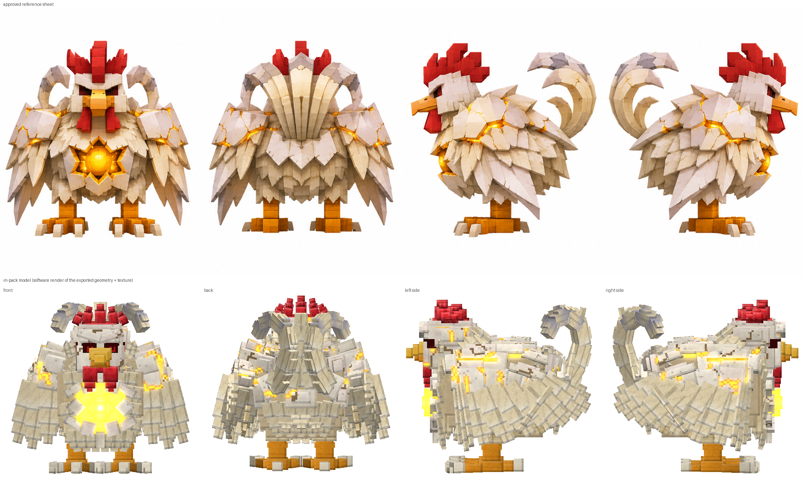
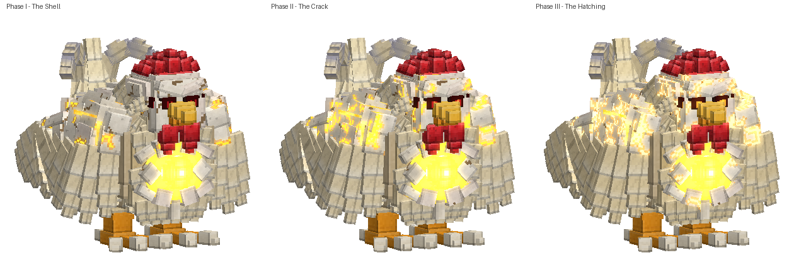
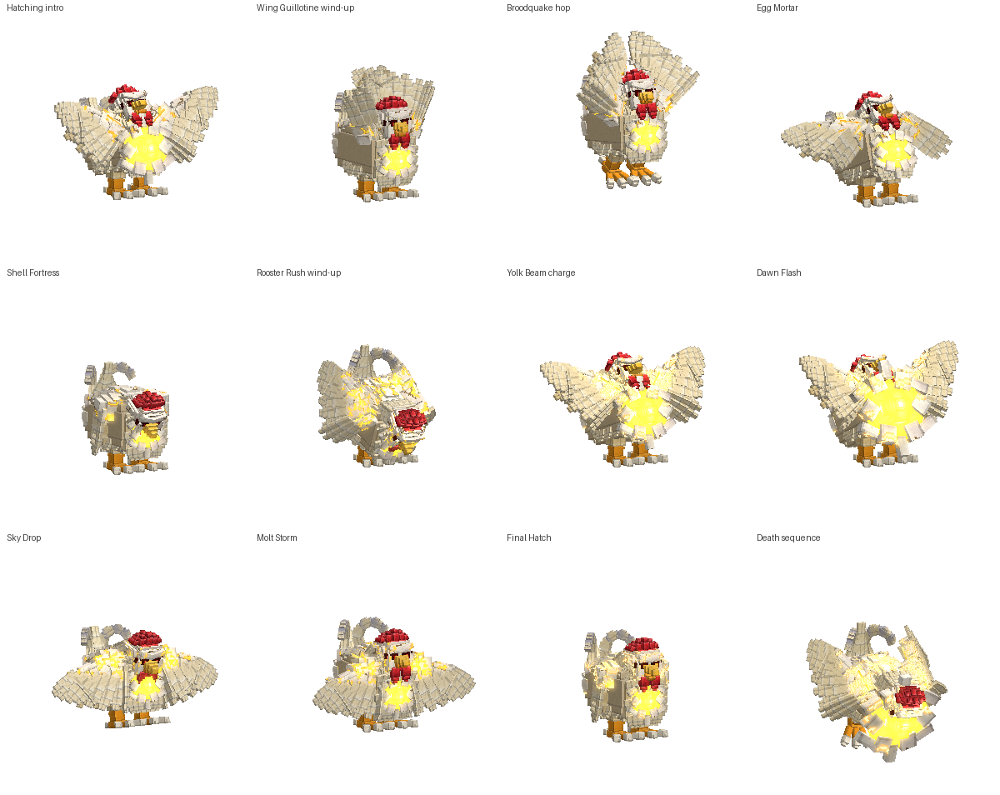
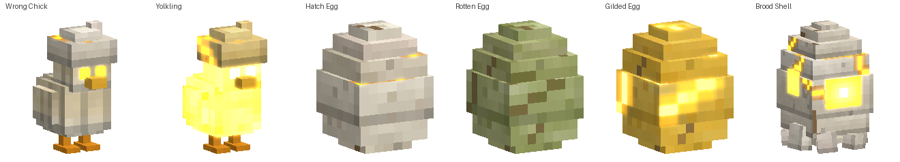

# BOSS 001: The Wrong Hatch, a Minecraft Bedrock boss add-on

A monstrous chicken grown inside a **living eggshell**, with a mysterious golden core and hatching
abilities you can't fully predict. It's a three-phase encounter with 17 regular abilities, scripted set
pieces, a hidden-outcome egg system, minions, multiplayer scaling and boss rewards.

**Install:** [`dist/The_Wrong_Hatch.mcaddon`](dist/The_Wrong_Hatch.mcaddon) (separate BP/RP `.mcpack`
files are in the same folder).

| | |
|---|---|
| Game version | Bedrock **1.21.100 or newer** (`min_engine_version` 1.21.100), so every current phone, console and PC client works |
| Script API | `@minecraft/server` **2.1.0** (stable). **No experimental toggles needed.** |
| Boss stats | 600 HP solo, scaled to 900 / 1200 / 1500 HP for 2 / 3 / 4+ players at spawn |
| Size | 5.20 blocks tall, 5.68 blocks long (6.0 including the tail curl), **9.66-block wingspan** when spread |



---

## วิธีติดตั้ง (ภาษาไทย)

1. เปิดไฟล์ `The_Wrong_Hatch.mcaddon` เกมจะนำเข้าแพ็ก 2 อัน (Behavior + Resource)
2. ตั้งค่าโลก → **Behavior Packs** → เปิด **BOSS 001: The Wrong Hatch** (ต้องเปิดอันนี้ ไม่ใช่แค่ Resource Pack)
3. เข้าโลกแล้วจะมีข้อความสีเหลืองในแชทว่า **"BOSS 001: The Wrong Hatch loaded."** ถ้าไม่มีข้อความนี้ แปลว่าแพ็กยังไม่ถูกเปิดในโลกนั้น
4. เรียกบอส (ต้องอยู่โหมด **Survival** หรือ **Adventure** บอสไม่โจมตีคนโหมดสร้างสรรค์):
   * ไข่ **Spawn The Wrong Hatch** ในเมนูโหมดสร้างสรรค์ หรือ
   * พิมพ์ `/wh:summon` (ต้องเปิดโกง) หรือ
   * คราฟต์ **Suspicious Egg** (ไข่ + บล็อกทอง + ตาแมงมุมหมัก) แล้วใช้บนพื้น
5. ต้องใช้เกม Bedrock **1.21.100 ขึ้นไป**

## Quick start

1. Open `The_Wrong_Hatch.mcaddon`. Both packs are imported.
2. Turn on the behaviour pack **BOSS 001: The Wrong Hatch** in a world. The resource pack follows automatically.
3. On joining, chat shows **"BOSS 001: The Wrong Hatch loaded."** If it doesn't, the behaviour pack isn't active in that world.
4. Spawn the boss **in Survival or Adventure mode**. Like vanilla mobs, it ignores Creative players.
   * **Spawn egg:** *Spawn The Wrong Hatch* (creative inventory) for testing.
   * **Survival:** craft a **Suspicious Egg** (egg + gold block + fermented spider eye, shapeless) and use it on the
     ground. A 5-second hatching ritual follows, then the boss bursts out.
   * **Command:** `/wh:summon`. Other test helpers: `/wh:phase <2|3>` (jumps the nearest boss to a phase)
     and `/wh:clear` (removes every boss and its brood). All three need cheats.

---

## Encounter overview

The fight has three phases. Each has its own texture set, and the glowing cracks spread as the shell fails.



| Phase | HP | What changes |
|---|---|---|
| **Intro: "The Hatching"** | invulnerable, 3 s | The boss rises out of its crouch, cracks open and crows. Title card "BOSS 001 / The Wrong Hatch". |
| **I: The Shell** | 100 % → 65 % | Grounded bruiser. Pecks, Wing Guillotine, Back Scratch, Broodquake, Egg Mortar, Feather Volley, Wing Hop, Shell Fortress, Molt Burst. |
| **First Crack** (transition) | invulnerable | Rears up and crows. The shell cracks (texture change), a shockwave knocks players back (6 dmg, 10-block radius) and the first two chicks burst out. |
| **II: The Crack** | 65 % → 30 % | Adds Rooster Rush, Yolk Beam, Dawn Flash, Rotten Hatch, Brood Call and Sickle Sweep. Pecks become 3-hit combos and the Guillotine gains a backswing. 15 % shorter cooldowns, more combos. |
| **Final Hatch I** (transition) | sealed | See [Final Hatch](#final-hatch-signature-mechanic). |
| **III: The Hatching** | 30 % → 0 % | The core is exposed: faster movement, +15 % damage, 30 % shorter cooldowns. Adds Sky Drop and Molt Storm. Broodquake slams twice, Rush chains two charges, Feather Volley adds a 16-way burst and the Guillotine leaves exploding feather blades. |
| **Final Hatch II** | at 10 % | The mechanic again, with a shorter (10 s) countdown. |
| **Death sequence** | 5 s | Staggers, drops to its knees, cracks spread and the core flares, then the shell bursts in a golden nova. Then loot and experience. |

Damage can't skip a phase: transitions are gated, and the boss's health is held at the threshold. The only exception is a single hit bigger than its entire remaining health (e.g. `/kill`). In that case the death sequence still plays, on a stand-in body, and the loot still drops once.

### Abilities

Every ability has a readable telegraph (animation, ground markers, particles, sound) and a counter.
Damage values are for Normal difficulty (Easy ×0.7, Hard ×1.3).



| Ability | Phases | Telegraph | Effect | Counter |
|---|---|---|---|---|
| **Peck / Peck Combo** | I / II+ | Head pulls back | 10 dmg peck; from phase II, a 3-hit combo (8/8/12) that alternates sides | Back off or strafe out of the 80° frontal cone |
| **Wing Guillotine** | I+ | Wings rise over the back; red arc on the ground | 16 dmg, 200° frontal arc, 7 blocks. Phase II+ adds a full-spin backswing (14). Phase III plants 6 feather blades that burst 0.7 s later | Leave the arc. In phase II+ don't stay behind it either |
| **Back Scratch** | I+ | Leans forward and scrapes | Gravel spray from the rear cone: 8 dmg, Blindness, Slowness II | Don't camp behind the boss |
| **Sickle Sweep** | II+ | Tail sickles bristle; red ring | 360° tail spin: 12 dmg and strong knockback | Get out of the 6.5-block ring |
| **Broodquake** | I+ | Crouch, wings up, pulsing red ring | Hop and slam: 20 dmg inside 4.5 blocks, then **3 expanding shockwave rings** (10 dmg and a launch) | **Jump** over each ring as it passes. Phase III slams twice |
| **Egg Mortar** | I+ | Squats, core flashes, eggs lobbed in arcs; a red marker shows each landing spot | 5 dmg on impact. Each egg hatches 2.5 s later with a **hidden outcome** (see below) | Dodge the markers, then read and react to each egg |
| **Feather Volley** | I+ | Fluffs up, aim line | Fan of 5 feather darts (6 dmg each). Phase II fires two fans; phase III adds a 16-way radial burst | Strafe sideways or break line of sight |
| **Shell Fortress** | I+ | Wings wrap, head tucks; ring on the ground | Reacts to burst damage. Takes only 15 % damage for 7 s while showing shell integrity | Deal enough damage to **break the shell**: a 4 s stun and ×1.5 damage taken. Fail and it bursts (12 dmg, 7 blocks) and heals 3 % |
| **Molt Burst** | I+ | Feathers shed | Reacts to crowding or hugging: 5 dmg and a big knockback | Don't hug the boss for long |
| **Wing Hop** | I+ | Wing beat | Gap closer leap onto distant targets; 8 dmg landing | Keep moving |
| **Rooster Rush** | II+ | Foot scrapes, a red line shows the charge path | Locked-direction charge (~20 blocks): 14 dmg and a sideways fling. Also hunts players kiting at mid range. Phase III chains 2 charges | Side-step the line. **Bait it into a wall** and it is dazed for 3 s, taking ×1.35 damage |
| **Yolk Beam** | II+ | Core swells for 1.4 s, aim line | Golden beam that sweeps toward its target at a limited turn rate: 4 dmg every ¼ s and sets you on fire. Blocked by terrain | Outrun the sweep or hide behind blocks |
| **Dawn Flash** | II+ | Core pulses 3 times with rising chimes; "LOOK AWAY!" warning | Players **looking at the core** with line of sight take 4 dmg, Blindness, Slowness II and Weakness | Turn your camera away before the 3rd pulse |
| **Rotten Hatch** | II+ | Squats and shakes its rump | Lays a ring of 4–5 green rotten eggs. They poison anyone nearby, then burst after 8 s into a lingering gas cloud plus a chick | Break them early (breaking one only gives you brief Nausea) |
| **Brood Call** | II+ | Crows, belly heaves | Hatches 3+ Wrong Chicks (a Yolkling bomber in phase III) | Kill the brood quickly |
| **Sky Drop** | III | Flaps upward; a red marker tracks the victim for 1.5 s, then locks | Dives onto the locked spot: 22 dmg inside 4.5 blocks plus a shockwave ring | Move out once the marker locks (inner ring appears), then jump the ring |
| **Molt Storm** | III | Spins up a feather tornado | Pulls players in for 5 s (3 dmg per ½ s inside 3.5 blocks), then blasts outward (8 dmg) | Sprint away against the pull |

#### Hidden-outcome eggs (Egg Mortar)
Every mortar egg looks the same until it **reveals itself ~0.9 s before hatching**:

| Reveal | If it hatches | If you smash it first |
|---|---|---|
| White feathers | Wrong Chick, or a golden Yolkling bomber in phase II+ | Nothing hatches |
| Red-orange embers + red ring | Yolk blast: 8 dmg, 3.2 blocks | Smaller blast (still hurts up close) |
| Turns green, stink | Rotten gas cloud | Brief Nausea |
| **Turns gold** | **Heals the boss 2 %** | **You get Regeneration II and Absorption II** |

#### Final Hatch (signature mechanic)
At 30 % (and again at 10 %), the boss seals itself in its shell and starts to hatch. **Brood Shells**
appear around it (3, plus 1 for each extra player), tethered to the core by golden light. A countdown
runs on the boss bar and action bar.

* **Break every shell in time:** a *Botched Hatch*. The boss is stunned for 6 s and takes ×1.5 damage.
* **Shells still standing:** a *Hatch Nova* for 6 + 7 dmg per surviving shell within 48 blocks, and each surviving
  shell hatches two chicks.

#### Combos and AI
* Each ability scores itself from the situation: range, angle, players behind, crowding, players far away,
  recent burst damage. The AI makes a weighted choice. It never repeats itself eagerly, and an anti-starvation
  rule makes unused moves steadily more likely.
* Combo chains: Rush → Guillotine/Volley, Wing Hop → Broodquake/Peck, Sky Drop → Molt Burst/Mortar,
  Broodquake → Mortar/Guillotine, Dawn Flash → Rush/Peck, Fortress → Broodquake. Chance of a combo: 15 % in
  phase I, 40 % in phase II, 70 % in phase III.
* Targeting is threat-weighted: whoever deals damage draws aggro, with distance as a tie-breaker, and the target is re-picked every 8 s.
* Anti-cheese: Back Scratch and Sickle Sweep punish players behind it, Molt Burst punishes hugging, Rush,
  Volley, Mortar and Dawn Flash punish kiting, and the Yolk Beam and Dawn Flash respect cover.

### Minions


* **Wrong Chick**: 8 HP, fast, 3 dmg pecks, wears a piece of its shell. Despawns after 90 s or when the boss dies.
* **Yolkling**: golden glowing chick. It runs at you, fuses for 1.2 s (swells and flashes) and explodes (9 dmg).
* The brood cap scales with phase and player count (6–10 chicks).

---

## Boss systems

* **Boss bar:** `minecraft:boss` with a live title for the phase name, *Shell Fortress*, *EXPOSED!* and the
  *FINAL HATCH* countdown.
* **Multiplayer:** health scales with the players present at spawn. The Brood Shell count and Fortress break
  threshold scale with it too. Every hit, effect and title goes to all players in range.
* **Hitboxes:** 2.8 × 4.8 collision box, plus a 4.4 × 5.0 `custom_hit_test` so wings and tail can be hit.
  Knockback immune.
* **Leash and reset:** with no target for 30 s, the boss returns to its spawn point and regenerates 2 %/s. The
  phase is kept, since a cracked shell can't un-crack. It is pulled back if dragged more than 56 blocks away or into the void.
* **Despawn:** if no player is within 96 blocks for 3 minutes, the boss and its brood are removed.
* **Persistence:** phase, health scaling, home point and Final Hatch progress are stored in dynamic properties.
  After a chunk or world reload, the controller re-attaches without replaying the intro.
* **Performance:** projectiles and eggs are script-driven with raycast collision and capped particle counts.
  There is one controller per boss, ticked from a single interval.

### Rewards
The boss drops from the loot table `loot_tables/entities/wrong_hatch.json`, and every participant gets
160 XP × the player scale.

| Item | |
|---|---|
| **Guillotine Pinion** | Feather-blade sword: 9 dmg, 1200 durability, sword enchantments. Hits have a 25 % chance of *feather bleed* (+3). **Sneak + use** fires a fan of 5 feather darts (6 s cooldown) |
| **Hatch Core** | Use it to hatch a loyal golden companion chick (30 HP, fights monsters, follows you; max 2) |
| **Golden Yolk** ×3–5 | Food: Regeneration II, Absorption II, Fire Resistance |
| **Living Eggshell Plate** ×6–10 | Crafts a cheaper Suspicious Egg (egg + plate + gold ingot) for a rematch |
| Gold ingots ×8–16, eggs ×8–16 | |

---

## How it's built

```
wrong-hatch-addon/
├─ dist/                    ← The_Wrong_Hatch.mcaddon (+ BP/RP .mcpack)
├─ src/                     ← TypeScript gameplay (Script API 2.1.0)
│  ├─ main.ts               ← events, commands, main loop
│  ├─ config.ts             ← every balancing number
│  ├─ boss/controller.ts    ← state machine, damage filter, targeting, leash/despawn, boss bar
│  ├─ boss/abilities.ts     ← the 17 abilities as timelines (generator functions)
│  ├─ boss/ai.ts            ← weighted selection, combos, anti-starvation
│  ├─ boss/phases.ts        ← intro, First Crack, Final Hatch, death and rewards
│  ├─ boss/brood.ts         ← hidden-outcome eggs, chicks, Yolklings
│  ├─ boss/hazards.ts       ← shockwave rings, gas clouds, feather darts, lobbed eggs
│  ├─ rewards.ts            ← ritual + reward items
│  └─ generated/spec.ts     ← action ids and key frames (generated)
├─ tools/
│  ├─ voxkit.py             ← voxel model kit: per-face UV packing, multi-variant textures, Bedrock export,
│  │                          numpy z-buffer renderer using the game's rotation conventions
│  ├─ boss_model.py         ← the boss model (51 bones, 580 cubes, 512×512 texture × 3 phases)
│  ├─ materials.py          ← procedural eggshell / feather / glow / comb materials
│  ├─ minion_models.py      ← chick, eggs, brood shell, feather dart
│  ├─ spec.py               ← single source of truth for action ids and timings (RP + scripts)
│  ├─ anims.py              ← 43 animations (37 boss + 6 minion) + controllers
│  ├─ sounds.py             ← 11 synthesised .ogg effects + sound definitions
│  ├─ build.py / validate.py / preview.py
│  └─ smoke/                ← strict @minecraft/server mock + full-fight simulation
└─ docs/images/
```

* **Damage scaling without new APIs:** invulnerable windows, Shell Fortress (×0.15) and the exposed stuns
  (×1.5 / ×1.35) are handled by the entity's `damage_sensor`, switched by the server-side int property
  `wh:dmode`. Phase gates and the scripted death run from the regular `entityHurt` after-event. This keeps the
  add-on on Script API 2.1.0.
* **Model:** built in code at half scale and exported ×2. The textures use 1 texel per 1/16 block (vanilla
  density). The material is `entity_emissive_alpha`: alpha-0 texels glow, which is how the cracks and core
  light up. A second render pass, the vanilla Warden's glow-layer technique, pulses the glow during the
  charge-up, Final Hatch and death.
* **Animation ↔ gameplay sync:** the server sets the synced int property `wh:anim`, and one animation
  controller state per action plays the matching clip. Script key frames (hits, egg launches, the slam) are read
  from the same `spec.py` that sets the animation lengths, and the validator checks that they agree.
* **Sounds:** 11 effects are synthesised (shell cracks, core hum, yolk beam, hatch nova, pulses, slashes …).
  Re-pitched vanilla sounds supply the crow (chicken pitched down), steps and wing flaps. Body sounds are in the
  client animations, and impact sounds come from the scripts.

### Build it yourself
```bash
cd wrong-hatch-addon
npm install       # @minecraft/server 2.1.0 typings + TypeScript
npm test          # typecheck → build → static validation → full-fight smoke test
```
You also need Python 3 with Pillow and numpy, and `ffmpeg` with libvorbis for the sounds.

---

## Verification

### Verified automatically
1. **TypeScript `strict` typecheck** against the official `@minecraft/server` 2.1.0 typings: 0 errors.
2. **Static validation, 6,880 checks, 0 errors.** It covers:
   * JSON syntax, manifests and UUIDs, and the script-module version matching the typings.
   * Geometry: hierarchy, cycles, UV bounds.
   * Cross references: client entity ↔ geometry ↔ textures ↔ render controllers ↔ materials ↔ animations ↔ controllers.
   * Every animated bone exists, and every animation sound effect is declared.
   * BP components and groups, checked against the vanilla component list (Mojang/bedrock-samples 1.26.60).
   * Event → group references, and client-used properties exist and are `client_sync`.
   * Item components, icons, recipes, loot and lang keys.
   * Particle textures and UVs.
   * Every vanilla sound *file path* exists in the vanilla `sound_definitions.json`, and the custom `.ogg` files exist.
   * Every particle and sound the scripts use exists.
   * Every action has an animation whose length matches the script timeline.
   * **The model's measured size** stays in the brief's range.

   The validator was mutation-tested: deliberately breaking a sound path or adding an unknown bone makes it fail.
3. **Full-fight smoke test**, run deterministically and passing for 12 different seeds. The compiled scripts run
   against a strict mock of `@minecraft/server` that rejects unknown particles, sounds, effects, entities,
   events, properties, out-of-range values and malformed commands. The test plays a two-player fight
   (~18,500 ticks) and checks:
   * Health scales to 900. The boss is invulnerable during the intro.
   * **Every one of the 31 action animations is used** across the three phases.
   * The phase gate holds at exactly 65 %. The First Crack happens.
   * The Final Hatch spawns 4 shells for 2 players. Breaking them gives a botched hatch with ×1.5 damage; leaving them gives the Hatch Nova.
   * Lethal damage starts the death sequence. The loot table spawns once and both players get XP.
   * The brood and eggs are cleaned up.
   * The ritual summons the boss and refuses a second ritual nearby. `/wh:clear` works.
   * A reloaded boss restores its phase without replaying the intro.
   * Golden Yolk, the Pinion dart fan (darts hit mobs) and the Hatch Core companion (tamed) all work.

   The test caught and fixed real bugs during development: a self-stopping death timeline, the
   botched-hatch window being blocked by the phase gate, a re-init on chunk reload, and an AI starvation
   counter bug.
4. **Visual check of the model** against the approved four-view sheet (image above). The render uses the exported geometry and textures with the game's rotation conventions.

### Still needs in-game testing
I don't have a Minecraft client in this environment, so these points are *unverified in the real engine*:
* **Rendering:** the `entity_emissive_alpha` glow and the Warden-style pulse layer (`warden_bioluminescent_layer`),
  per-face UV orientation on the up/down faces, and the visible bounds (culling box) for such a large model.
* **Chase behaviour:** pathfinding for a 2.8-block-wide mob, and how `melee_box_attack` with 0 damage behaves
  (used only for chasing; the scripts also cancel any sub-1 damage from the boss).
* **Smoothness** of the teleport-driven moves (Rooster Rush, Wing Hop, Sky Drop) as clients interpolate them,
  and the wall/step checks on real terrain.
* **Tuning:** turn rates, timings, and damage and health balance across difficulties and player counts.
  Every value is in `src/config.ts`.
* **Engine events:** custom-item `itemUse` firing for the Pinion and Hatch Core, the `/loot spawn` command
  (falls back to `spawnItem` if it fails), `camerashake`, and boss bar title updates from `nameTag`.
* Sound mix and volume levels, and particle readability at a distance.
